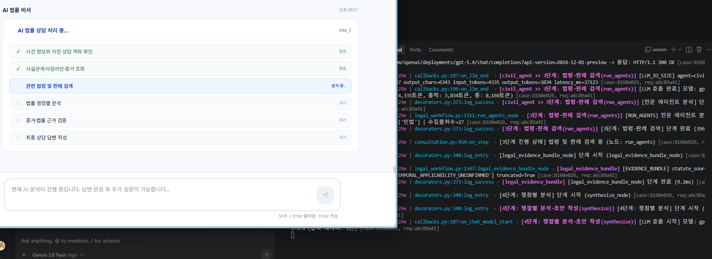

요약 및 향후 방향
issue_planner.py 개선 
현재 역할: 임대차 관련 질문에서 가공 조문 날조 및 무리한 형사고소 환각을 100% 막아주는 안전핀(가드레일) 역할을 하고 있습니다.
향후 확장 시: 하드코딩된 법령 목록을 직접 박아넣는 대신, 질문 의도(Intent)가 '형사처벌/가공조문 문의'로 분류되면 도메인 법령 검색기(RAG) + 민형사 구분 판례 가이드라인 프롬프트를 통해 동적으로 법령을 주입받는 구조로 일반화하는 것이 이상적입니다.

화면과 로그의 실행단계가 안맞다

출력 md 억제 제거

이전 상담턴 제거
이전 상담턴 가져오는 거 제거하면 어떨까?
데이터가 너무 많다. 3턴이나 되고 각 턴마다 출력량도 많아. 
이걸 써먹는지도 모르겠고.

intent_analysis_node  --- 이걸 왜 만들었지 ? 

당신은 대한민국 법률 AI의 대화 의도 분석가(Legal Intent Analyzer)입니다.
사용자의 현재 질문과 이전 대화 맥락, 사건 정보를 분석하여 사용자가 원하는 목적을 정확히 분류하고,
후속 질문인 경우 생략된 주어와 핵심 법률 쟁점을 복원한 'resolved_query'를 생성하세요.

1순위 (즉시 실행 추천):
plan_node 제거: 아무도 읽지 않는 더미 노드이므로 즉시 에지 연결을 route ➡️ statute_search_plan으로 변경하고 노드 제거.
legal_evidence_bundle_node 인라인화: synthesize_node 첫 머리에서 함수 직접 호출로 바꾸고 노드 제거.
2순위:
pre_synthesis_coverage.py 미사용 파일 정리.
3순위:
re_analyze_node의 초안 작성 로직을 synthesize_node와 통합 검토.

이 방향으로 1순위(plan_node 제거 및 legal_evidence_bundle 인라인 통합)부터 진행할까요?

두 개가 똑같잖아
상담 핵심 답변 
1. 핵심 결론 및 직접 답변