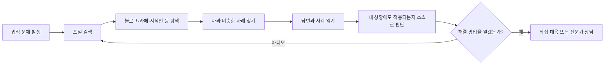
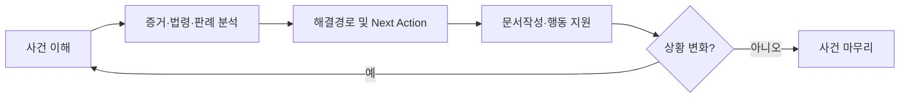
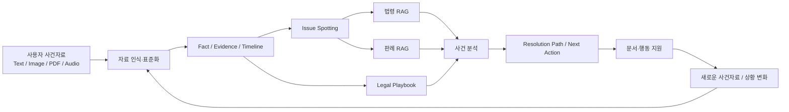
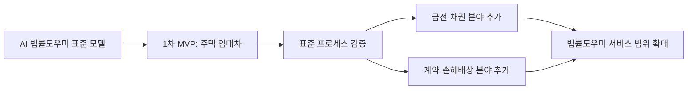
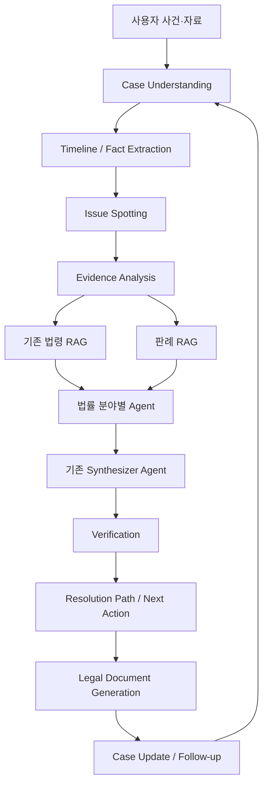
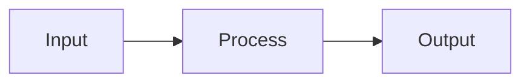

# AI 법률도우미 - 문제정의 및 서비스 기획

> **서비스 한 줄 정의**  
> 법을 모르는 일반인이 자신의 상황과 사건자료를 입력하면, AI가 사건을 이해하고 증거·법령·판례를 분석하여 사건 발생부터 마무리까지 단계별로 다음 행동을 안내하는 서비스.

> **핵심 가치 제안**  
> **남의 사례를 검색하지 말고, 내 사건을 AI에게 물어보세요.**

---

## 0. 문서 목적

본 문서는 AI Master 과정 평가 과제로 추진하는 **AI 법률도우미**의 문제정의, 목표 사용자, 프로젝트 목표, 핵심 기능, 기대효과, MVP 범위 및 제약사항을 정의한다.

본 문서를 프로젝트의 서비스 기획 기준 문서(Baseline)로 사용하며, 이후 요구사항·아키텍처·데이터·Agent·RAG·평가·테스트 문서는 본 문서의 정의와 일관성을 유지한다.

### 0.1 문서화 원칙

- Markdown을 프로젝트 문서의 원본(Source of Truth)으로 사용한다.
- 제목은 번호 기반 계층 구조를 유지한다.
- 표는 비교·요구사항·KPI 등 구조화 정보에 사용한다.
- 프로세스/아키텍처는 Mermaid를 우선 사용한다.
- 구현 예제는 언어가 명시된 코드 블록을 사용한다.
- 그림은 `assets/` 상대경로로 관리한다.
- 사실, 목표, 가정, 향후 계획을 구분한다.
- 임의의 성과 수치를 실제 측정 결과처럼 기록하지 않는다.
- 문서는 사람뿐 아니라 LLM이 문맥을 쉽게 이해할 수 있도록 약어와 모호한 표현을 최소화한다.

---

# 1. 배경 및 문제정의

## 1.1 현재 상황

법적 문제가 발생한 일반인은 법률전문가에게 바로 의뢰하기보다 먼저 포털 검색을 이용해 정보를 찾는 경우가 많다.

대표적인 사용 흐름은 다음과 같다.



이 방식에서는 사용자가 자신의 사건과 정확히 일치하지 않는 타인의 사례를 찾아 읽고, 그 내용이 자신의 상황에도 적용되는지를 스스로 판단해야 한다.

생성형 AI와 Legal RAG의 발전으로 법률정보 접근성은 높아졌지만, 기존 서비스 역시 대부분 **사용자가 질문하면 답변을 제공하는 방식**에 머무른다.

실제 법률 문제는 한 번의 질문과 답변으로 종료되지 않는다.

**사건 발생 → 사실관계 정리 → 자료·증거 확보 → 법적 쟁점 확인 → 법령·판례 검토 → 대응 → 상대방 반응 → 후속 절차 → 사건 종료**의 연속적인 과정이 필요하다.

## 1.2 Pain Point

| ID | Pain Point | 사용자 관점의 문제 |
|---|---|---|
| P-01 | 정확한 검색 자체가 어려움 | 법률용어를 모르기 때문에 무엇을 검색하고 질문해야 하는지 모른다. |
| P-02 | 내 사건과 타인의 사례가 다름 | 비슷한 사례를 찾아도 사실관계 차이가 법적으로 어떤 의미인지 판단하기 어렵다. |
| P-03 | 정보의 신뢰성을 판단하기 어려움 | 검색 결과가 최신 법령·판례에 부합하는지 일반인이 확인하기 어렵다. |
| P-04 | 증거의 중요도를 판단하기 어려움 | 계약서·문자·녹취 등 보유 자료 중 무엇이 어떤 쟁점을 입증하는지 알기 어렵다. |
| P-05 | 다음 행동을 결정하기 어려움 | 정보를 얻어도 지금 무엇을 해야 하고 언제 다음 단계로 넘어가야 하는지 모른다. |
| P-06 | 상황 변화에 따라 다시 검색해야 함 | 상대방의 새로운 답변이나 사건 변화가 생길 때마다 처음부터 다시 정보를 찾아야 한다. |

### 핵심 문제정의

> **법적 문제가 발생한 일반인은 포털 검색과 온라인 Q&A에서 자신과 비슷한 사례를 찾아 해결방법을 추측한다. 그러나 다른 사람의 사례가 자신의 상황에도 적용되는지 판단하기 어렵고, 여러 정보를 찾아도 실제로 ‘지금 무엇을 해야 하는지’를 결정하기 어렵다.**

## 1.3 기회요인

기존에 구축한 **법령문서 RAG + 법률 분야별 AI Agent + Synthesizer Agent**를 기반으로, 사용자의 실제 사건을 이해하는 Case Intelligence 기능과 판례·증거 분석 및 사건 진행 기능을 결합할 수 있다.

이를 통해 법률 AI의 역할을 다음과 같이 확장한다.

```text
기존 Legal AI
질문 → 법령 RAG → 분야별 Agent → Synthesizer → 법률 답변

AI 법률도우미
사건/자료 입력
  → 사건 이해
  → 사실관계·Timeline 구조화
  → 핵심 쟁점 및 증거 분석
  → 법령 + 판례 검색
  → 분야별 Agent 분석
  → Synthesizer 종합
  → 해결경로/Next Action 안내
  → 문서 작성
  → 상황 변화 반영
  → 사건 마무리 지원
```

### 서비스 전환 방향

> **법을 검색하는 AI에서, 사건을 이해하고 해결을 지원하는 AI로.**

---

# 2. 목표 사용자

## 2.1 Primary Target

**법적 문제가 발생했지만 법률 지식과 경험이 부족하여 무엇부터 어떻게 해야 할지 모르는 일반인**을 핵심 사용자로 정의한다.

### 주요 특성

| 항목 | 특성 |
|---|---|
| 법률 지식 | 법률용어와 절차에 익숙하지 않음 |
| 정보 탐색 | 포털 검색, 블로그, 카페, 지식인 등의 유사 사례에 의존 |
| 사건 정리 | 어떤 사실이 법적으로 중요한지 판단하기 어려움 |
| 증거 | 자료는 보유하고 있으나 법적 의미를 판단하기 어려움 |
| 법령·판례 | 직접 검색·해석하기 어려움 |
| 핵심 요구 | “그래서 지금 나는 무엇을 해야 하는가?” |

## 2.2 대표 사용자 요구

사용자가 원하는 것은 법률지식 자체보다 자신의 사건에 대한 **행동 가능한 안내(Actionable Guidance)**이다.

- 내 상황에서 법적으로 중요한 것은 무엇인가?
- 내가 가진 자료 중 어떤 것이 증거가 되는가?
- 비슷한 판례가 있는가? 내 사건과 무엇이 다른가?
- 지금 무엇을 해야 하는가?
- 다음 단계는 무엇인가?
- 필요한 문서는 어떻게 작성하는가?
- 상대방이 새롭게 대응하면 나는 어떻게 해야 하는가?

### 핵심 사용자 가치

> **법을 몰라도, 내 상황만 설명하면 지금 무엇을 해야 하는지 알 수 있다.**

---

# 3. 프로젝트 목표

## 3.1 프로젝트 목표 정의

법률 지식이 부족한 일반인이 자신의 사건과 관련 자료를 입력하면 AI가 사건의 사실관계·증거·법적 쟁점을 구조화하고, 관련 법령과 유사 판례를 근거로 대응방안을 도출하여 **사건 발생부터 마무리까지 단계별로 안내하는 AI 법률도우미**를 구축한다.

이번 MVP에서는 **주택 임대차 분야를 우선 적용하여 AI 법률도우미의 표준 사건처리 모델을 구축하고 검증**한다.

## 3.2 정성적 목표

1. **질문 중심에서 사건 중심으로 전환**  
   사용자가 정확한 법률 질문을 만들지 않아도 사건 설명과 자료를 통해 AI가 핵심 사실과 쟁점을 파악한다.

2. **답변 제공에서 해결과정 안내로 확장**  
   현재 상황, 필요한 증거, 대응방법, 다음 행동과 후속 절차를 사건 진행에 따라 지속적으로 안내한다.

3. **법령 중심에서 증거·법령·판례 기반 분석으로 확장**  
   사용자 사건의 증거와 관련 법령 및 유사 판례를 연결하여 근거 기반 분석을 제공한다.

4. **설명 가능하고 검증 가능한 Legal AI 구현**  
   AI의 판단이 어떤 사건 사실, 증거, 법령 및 판례에 기반하는지 확인할 수 있도록 한다.

## 3.3 정량적 목표

> 아래 수치는 프로젝트 **목표치**이며 실제 성과가 아니다. 개발 전 Baseline과 개발 후 결과를 동일 Benchmark로 측정한다.

| 성과지표 | 현재수준 | 목표수치 | 측정방법 |
|---|---|---:|---|
| 사건 핵심정보·쟁점 분석 정확도 | 신규 기능 / Baseline 측정 예정 | 90% 이상 | 테스트 사건의 기준 사실관계·핵심쟁점과 AI 분석 결과 비교 |
| 법령·판례 근거 정확도 | 법령 RAG 구축 / 판례 기능 신규 | 95% 이상 | 제시된 법령·판례의 존재 여부, 인용 정확성 및 사건 관련성 평가 |
| 사건 해결절차 안내 완성도 | 기존 단일 질의응답 중심 / Baseline 측정 예정 | 90% 이상 | 사건별 표준 해결절차 및 Next Action과 AI 안내 결과 비교 |

---

# 4. 핵심 기능

| ID | 핵심 기능 | 설명 | 주요 AI 기술 |
|---|---|---|---|
| F-01 | AI 사건 이해·정리 | 사용자 설명과 사건자료에서 당사자, 날짜, 금액, 사건 경위 등을 추출하고 Timeline 및 핵심 쟁점을 생성한다. | LLM, Document AI, Information Extraction |
| F-02 | 증거·법령·판례 연결 분석 | 사건 쟁점과 보유 증거를 연결하고 관련 법령과 유사 판례를 검색하여 현재 사건과 비교 분석한다. | Legal RAG, Precedent RAG, Knowledge Graph |
| F-03 | 맞춤형 사건 해결경로 안내 | 현재 사건 단계를 판단하고 지금 해야 할 일, 예상 절차, 단계별 Next Action을 제시한다. 상황 변화 시 경로를 재분석한다. | Multi-Agent, Reasoning, Case State Management |
| F-04 | 법률 행동·문서 지원 | 현재 단계에 필요한 내용증명 등 법률문서 초안을 사건정보와 법적 근거를 바탕으로 생성하고 후속 진행을 지원한다. | Document Generation, Legal Agent |

### 핵심 기능 흐름



---

# 5. 기대효과

## 5.1 정성적 기대효과

### 업무효율화
사건자료 정리, 유사 사례 탐색, 법령·판례 조사, 대응절차 확인을 통합하여 사용자의 법률 문제 해결 준비 시간을 줄인다.

### 품질향상
타인의 유사 사례에 대한 추측이 아니라 **내 사건의 증거 + 법령 + 판례**에 기반한 분석으로 대응의 일관성과 신뢰성을 높인다.

### 비용절감
초기 사건정리, 정보 탐색, 법률자료 조사, 문서 초안 작성을 AI가 지원하여 전문가 상담 전 준비에 필요한 시간과 비용을 줄인다.

## 5.2 정량적 기대효과 목표

> 아래 수치는 검증 전 **목표 기대효과**이며, MVP 사용자 테스트 결과로 최종 확정한다.

| 구분 | 목표 기대효과 | 측정방법 |
|---|---:|---|
| 업무효율화 | 법률정보 탐색·사건정리 시간 **70% 이상 단축** | 동일 사건 과제에 대해 기존 포털 검색 방식과 법률도우미 사용 방식의 수행시간 비교 |
| 품질향상 | 필수 대응절차 식별률 **90% 이상** | 전문가/기준셋의 표준 대응절차와 AI 안내 결과 비교 |
| 비용절감 | 초기 법률 대응 준비비용 **50% 이상 절감 목표** | 동일 범위의 사건정리·조사·문서준비에 필요한 기존 방식 비용과 비교 |

---

# 6. 범위 및 제약사항

## 6.1 포함범위

이번 MVP에서는 **주택 임대차 분야를 우선 적용하여 AI 법률도우미의 표준 사건처리 프로세스를 구축·검증**한다.

포함 기능은 다음과 같다.

- 사용자 자연어 사건 설명 입력
- 텍스트·이미지·PDF·음성 등 다양한 형태의 사건자료 입력 및 분석
- 입력자료를 사건 단위의 표준 Evidence로 구조화하고 원본과 AI 분석 결과의 연결관계 유지
- 당사자·날짜·금액·주요 사건 등 사실관계 구조화
- 사건 Timeline 생성
- 핵심 법적 쟁점 도출
- 사건 쟁점과 증거 연결
- 부족하거나 추가 확인이 필요한 증거(Evidence Gap) 식별
- 기존 Legal RAG를 이용한 관련 법령 검색·분석
- 판례 RAG를 이용한 유사 판례 검색 및 현재 사건과 비교
- 사건 유형별 Legal Playbook(법률 사건처리 표준)을 기반으로 사건 진행 단계 판단
- 단계별 해결절차 및 Next Action 안내
- 내용증명 등 필요한 법률문서 초안 생성
- 신규 자료·상황 입력 시 사건 상태 재분석 및 후속 대응 안내

## 6.1.1 MVP 서비스 수준의 핵심 처리 원칙

### 다양한 사건자료의 통합 처리

사용자가 법률 전문용어나 자료 형식을 알지 못해도 텍스트, 이미지, PDF, 음성 등 보유한 사건자료를 등록할 수 있도록 한다. 시스템은 자료 형식에 맞는 인식 과정을 거쳐 사건의 사실관계와 증거정보를 표준화한다.

### 판례 기반 사건 비교

관련 법령뿐 아니라 사건의 핵심 쟁점과 사실관계에 유사한 판례를 검색하고, 현재 사건과 판례의 공통점·차이점 및 판단 근거를 비교하여 제공한다.

### Legal Playbook 기반 사건 진행

사건 유형별 **Legal Playbook(법률 사건처리 표준)**을 활용하여 사건 해결에 필요한 사실, 증거, 법적 쟁점, 법적 근거, 대응절차를 체계적으로 확인하고 현재 사건 상태에 적합한 Next Action을 안내한다.

Legal Playbook은 단순한 고정 순서가 아니라 사건의 사실관계와 증거, 법령 및 판례에 따라 다음 단계를 판단하는 사건처리 기준으로 사용한다.

### Evidence Traceability

AI가 추출하거나 판단한 사건 사실은 가능한 한 원본 사건자료와 연결하여 관리한다. 사용자는 주요 판단이 어떤 계약서, 메시지, 녹취, 문서 등의 어느 근거에서 도출되었는지 확인할 수 있어야 한다.



## 6.2 제외범위

- 금전·채권, 일반 계약·손해배상 등 타 법률 분야의 **이번 MVP 실제 구현**
- 변호사를 대체하는 최종 법률판단 또는 법률대리
- 승소 여부 및 승소확률의 확정적 예측
- 법원·기관에 대한 소송·등기·신청 등의 직접 수행
- 실제 사건 결과의 보장
- 변호사 중개·선임·결제 Marketplace 기능

> 타 법률 분야는 목표 서비스에서 제외되는 것이 아니라, **임대차 분야에서 표준 모델을 검증한 후 단계적으로 추가하는 확장 대상**이다.

## 6.3 제약사항

- 법령·판례 데이터의 확보 범위와 최신성이 분석 품질에 영향을 미칠 수 있다.
- LLM의 잘못된 추론 또는 허위 인용 가능성에 대비한 Verification 체계가 필요하다.
- 사용자가 제공하는 사건 설명과 증거가 불완전하면 분석 정확도가 낮아질 수 있다.
- 계약서·녹취·개인정보 등 민감한 사건자료에 대한 보안과 개인정보 보호가 필요하다.
- AI Master 과제 기간 내에는 임대차 분야를 중심으로 End-to-End 서비스 완성도와 표준 프로세스 검증에 집중한다.

---

# 7. MVP와 확장 전략

## 7.1 MVP 원칙

**목표 서비스를 임대차 서비스로 제한하지 않는다.**

이번 MVP에서는 임대차 사건을 우선 적용하여 다음의 범용 사건처리 표준을 검증한다.

```text
Case
  → Evidence
  → Issue
  → Law
  → Precedent
  → Strategy
  → Action
  → Document
  → Follow-up
  → Resolution
```

이 표준은 임대차에 종속되지 않도록 설계한다.

## 7.2 확장 방향



### 확장 원칙

> **임대차 분야에서 표준을 만들되, 표준을 임대차에 종속시키지 않는다.**

향후 법률 분야 추가 시 공통 사건처리 구조를 유지하면서 해당 분야의 Domain Knowledge, Domain Agent, Legal Playbook 및 평가 데이터셋을 추가하는 방식으로 확장한다.

임대차 MVP에서 우선 검증할 범용 표준은 다음과 같다.

- Case: 사건 단위 관리
- Evidence: 다양한 사건자료의 표준화 및 근거 추적
- Issue: 법적으로 판단해야 할 쟁점 구조
- Law: 적용 법령과 근거 연결
- Precedent: 유사 판례 검색 및 사건 비교
- Legal Playbook: 사건 유형별 표준 처리기준 및 상태 전이
- Action: 현재 단계의 대응방법 및 Next Action
- Document: 사건정보 기반 문서 생성
- Follow-up: 새로운 사건자료와 상황 변화에 따른 재분석

이 표준 구조는 특정 임대차 규칙을 공통 엔진에 하드코딩하지 않고, 향후 다른 법률 분야의 지식과 Playbook을 추가할 수 있도록 설계한다.

---

# 8. 기존 시스템과의 연계

## 8.1 기존 보유 기능

- 법령문서 RAG
- 법률 분야별 AI Agent
- Synthesizer Agent를 통한 종합 답변

## 8.2 이번 프로젝트의 확장



기존 시스템은 **법률 지식과 전문 분석 엔진**으로 활용하고, 이번 프로젝트에서는 그 전후에 사건 이해·증거·판례·해결경로·진행관리 기능을 추가한다.

---

# 9. 서비스 핵심 메시지

### Vision

> **법을 검색하는 AI에서, 사건을 이해하고 해결을 지원하는 AI로.**

### User Value Proposition

> **남의 사례를 검색하지 말고, 내 사건을 AI에게 물어보세요.**

### User Promise

> **법을 몰라도, 내 상황만 설명하면 지금 무엇을 해야 하는지 알 수 있다.**

### MVP Strategy

> **주택 임대차 분야를 우선 적용하여 AI 법률도우미의 표준 사건처리 모델을 구축·검증하고, 이후 다른 생활법률 분야로 확장한다.**

---

# 10. 후속 문서 계획

본 문서 이후 프로젝트 문서는 동일한 Markdown 표준을 사용한다.

| 문서 ID 예시 | 문서명 | 목적 |
|---|---|---|
| ALH-REQ-001 | 요구사항 정의서 | 기능/비기능 요구사항, Acceptance Criteria 정의 |
| ALH-UX-001 | 사용자 시나리오 및 UX Flow | 사용자 Journey, 화면 흐름, 상태 전이 정의 |
| ALH-ARCH-001 | 시스템 아키텍처 | Component, Agent, RAG, 데이터 흐름 정의 |
| ALH-EVID-001 | 사건자료 및 Evidence 설계 | 멀티모달 자료 수집·인식·표준화·Traceability 정의 |
| ALH-KNOW-001 | Legal Knowledge 설계 | 법령 RAG·판례 RAG·Taxonomy 및 검색 구조 정의 |
| ALH-PLAY-001 | Legal Playbook 설계 | 사건처리 표준, 판단 노드, 상태 전이, 생성·검증·버전관리 정의 |
| ALH-AGENT-001 | AI Agent 설계 | Agent 역할, Input/Output, Prompt, Tool, Routing 정의 |
| ALH-EVAL-001 | AI 평가 설계 | Benchmark, KPI, 평가 데이터셋 및 측정 방법 정의 |
| ALH-TEST-001 | 테스트 계획 | 기능·통합·E2E·안전성 테스트 정의 |

---

# Appendix A. 문서 작성 템플릿

향후 신규 문서는 아래 구조를 기본으로 사용한다.

```markdown
---
document_id: ALH-XXX-001
title: 문서 제목
project: AI 법률도우미
version: 1.0
status: draft
created: YYYY-MM-DD
---

# 문서 제목

## 0. 문서 목적
## 1. 개요
## 2. 핵심 정의
## 3. 상세 내용
## 4. 요구사항/설계
## 5. 평가 또는 검증 기준
## 6. 제약사항
## 7. 후속 작업

### Diagram


### Code
```python
# executable or illustrative code
```

### Image

```

---

# Appendix B. 용어

| 용어 | 정의 |
|---|---|
| Case | 사용자가 해결하고자 하는 하나의 법률 사건 |
| Evidence | 사건의 사실 또는 주장을 입증하기 위해 사용되는 자료 |
| Issue | 사건에서 법적으로 판단해야 하는 핵심 쟁점 |
| Legal RAG | 법령 등 법률 지식을 검색하여 LLM 응답의 근거로 제공하는 구조 |
| Precedent RAG | 관련 판례를 검색하여 현재 사건과 사실관계·쟁점·판단근거를 비교하는 구조 |
| Legal Playbook | 특정 법률 사건 유형에 필요한 사실·증거·쟁점·법적 근거·판단조건·대응절차·Next Action을 구조화한 법률 사건처리 표준 |
| Evidence Gap | 사건 판단 또는 다음 행동 결정을 위해 필요하지만 현재 사건자료에서 확인되지 않은 사실 또는 증거 |
| Evidence Traceability | AI가 추출·판단한 사실과 결론을 이를 뒷받침하는 원본 사건자료까지 추적할 수 있도록 유지하는 특성 |
| Next Action | 현재 사건 상태에서 사용자가 다음으로 수행해야 할 행동 |
| Case Timeline | 사건에서 발생한 주요 사실을 시간순으로 구조화한 정보 |
| Synthesizer Agent | 여러 법률 분야 Agent의 분석 결과를 종합하는 Agent |
| Verification | 법령·판례·사건 사실과 AI 결과의 일치 여부를 검증하는 과정 |

---

# Appendix C. 변경이력

| Version | Date | 변경내용 |
|---|---|---|
| 1.0 | 2026-10-07 | 최초 Baseline 작성 |
| 1.1 | 2026-10-07 | 멀티모달 사건자료 처리, 판례 비교, Legal Playbook, Evidence Gap/Traceability, 확장 표준 개념 반영 |

---

**End of Document**
