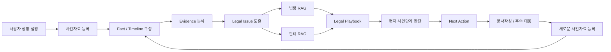
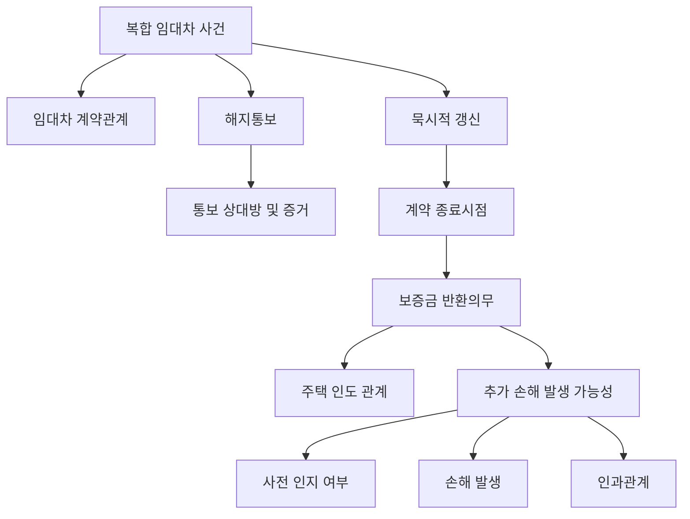
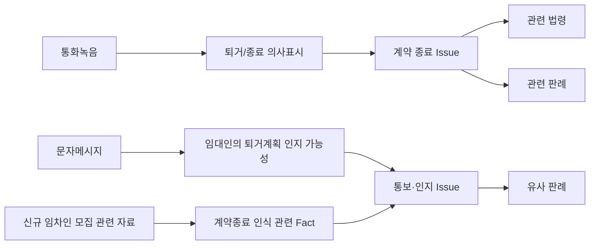
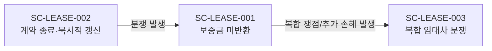

# AI 법률도우미 - 핵심 사용자 시나리오

## 1. 문서 목적

본 문서는 AI 법률도우미 MVP의 핵심 사용자 시나리오를 정의한다.

MVP는 **주택 임대차 분야를 우선 적용하여 법률도우미의 표준 사건처리 모델을 구축·검증**하는 것을 목적으로 한다.  
사용자는 법률 전문용어나 정확한 법적 쟁점을 알지 못해도 자신의 상황을 설명하고 보유 자료를 등록할 수 있으며, AI는 사건을 구조화하고 관련 근거를 분석하여 현재 단계와 다음 행동을 안내한다.

### 공통 사건처리 모델



---

# 2. Scenario 01 — 전세보증금 미반환 대응

## 2.1 시나리오 개요

**시나리오 ID:** SC-LEASE-001  
**유형:** 핵심 시나리오  
**목적:** 이미 발생한 보증금 반환 분쟁에 대한 End-to-End 대응 지원

### 사용자 상황

전세계약 종료를 앞둔 임차인이 임대인으로부터 다음과 같은 말을 듣는다.

> “새로운 세입자가 들어와야 보증금을 반환할 수 있습니다.”

사용자는 계약 종료와 보증금 반환에 관한 법률지식이 없으며, 어떤 자료를 준비하고 어떤 순서로 대응해야 하는지 알지 못한다.

## 2.2 사용자 보유자료

- 임대차계약서
- 임대인과 주고받은 문자 또는 카카오톡
- 통화녹음
- 보증금 관련 금융자료
- 기타 사건 관련 자료

## 2.3 서비스 처리 흐름

| 단계 | 사용자 행동 | AI 법률도우미 처리 |
|---|---|---|
| 1. 사건 등록 | “계약이 끝나는데 집주인이 보증금을 못 준다고 합니다.” | 자연어에서 사건 유형과 기본 Fact 추출 |
| 2. 자료 등록 | 계약서, 문자, 통화녹음 등을 등록 | OCR/STT/Parser 등을 이용해 Evidence로 변환 |
| 3. 사건 구조화 | 별도의 법률용어 입력 없음 | 당사자, 계약기간, 보증금, 통보일 등의 Fact와 Timeline 생성 |
| 4. 쟁점 분석 | AI의 추가 질문에 답변 | 계약 종료, 갱신, 해지통보, 보증금 반환 등 Legal Issue 도출 |
| 5. 증거 분석 | 추가 자료 등록 | Fact ↔ Evidence 연결 및 Evidence Gap 탐지 |
| 6. 법률 분석 | 사건 분석 요청 | 법령 RAG 및 판례 RAG를 이용한 근거 분석 |
| 7. 사건단계 판단 | 현재 상황 확인 | Legal Playbook을 이용해 현재 사건 상태 판단 |
| 8. Next Action | “지금 무엇을 해야 하나요?” | 현재 단계에서 필요한 행동과 근거 제시 |
| 9. 문서 지원 | 내용증명 등 작성 요청 | 사건 Fact와 Evidence에 근거한 문서 초안 생성 |
| 10. 후속 대응 | 임대인의 새로운 답변 등록 | Case State와 Timeline을 업데이트하고 Next Action 재계산 |

## 2.4 기대 결과

사용자는 포털에서 자신과 비슷한 사례를 반복적으로 검색하지 않고, **자신의 사건과 증거를 기준으로 현재 무엇을 해야 하는지 지속적으로 안내받는다.**

## 2.5 주요 검증 포인트

- 자연어 사건 설명에서 임대차/보증금 반환 사건을 올바르게 식별하는가
- 계약서·문자·녹취 등 서로 다른 자료를 하나의 사건으로 통합하는가
- 핵심 Fact와 Timeline을 정확하게 구성하는가
- 필요한 Legal Issue를 누락 없이 도출하는가
- 법령·판례의 실제 근거를 제시하는가
- 부족한 Evidence를 탐지하는가
- Legal Playbook에 따라 적절한 Next Action을 제시하는가

---

# 3. Scenario 02 — 계약 종료 및 묵시적 갱신 사전 대응

## 3.1 시나리오 개요

**시나리오 ID:** SC-LEASE-002  
**유형:** 핵심 시나리오  
**목적:** 분쟁 발생 전 법률관계 확인 및 적절한 사전 행동 지원

### 사용자 상황

임차인은 기존 임대차계약 기간이 지났지만 별도의 재계약서를 작성하지 않고 계속 거주하고 있다.

이사를 결정했으나 다음 사항을 알지 못한다.

- 현재 계약 상태가 무엇인지
- 언제 계약이 종료되는지
- 임대인에게 언제, 어떻게 알려야 하는지
- 보증금 반환은 언제 요구할 수 있는지

사용자는 자신의 상태가 ‘묵시적 갱신’에 해당하는지도 알지 못한다.

## 3.2 사용자 보유자료

- 기존 임대차계약서
- 임대인과의 문자 또는 카카오톡
- 통화녹음
- 계약 갱신 또는 조건 변경 관련 자료

## 3.3 서비스 처리 흐름

| 단계 | 사용자 행동 | AI 법률도우미 처리 |
|---|---|---|
| 1. 상황 설명 | “계약기간은 지났는데 재계약 없이 계속 살고 있습니다. 이사하려면 어떻게 해야 하나요?” | 임대차 계약 종료/갱신 관련 사건으로 분류 |
| 2. 계약서 등록 | 계약서 사진 또는 PDF 등록 | 계약일, 계약기간, 보증금, 당사자 등 추출 |
| 3. 추가 Fact 확인 | AI 질문에 답변 | 재계약 여부, 조건 변경, 임대인과의 협의내용 확인 |
| 4. Legal Issue 도출 | 별도 법률검색 없음 | 묵시적 갱신 가능성, 계약 종료 및 통보 관련 쟁점 도출 |
| 5. 법적 근거 분석 | AI 분석 확인 | 관련 법령·판례와 Legal Playbook 조회 |
| 6. 행동 안내 | 희망 퇴거시점 등 입력 | 필요한 통보와 향후 대응 절차 안내 |
| 7. 증거 확보 | 문자·통화 등 추가 등록 | 해지통보 관련 Evidence 등록 및 적정성 확인 |
| 8. 진행 관리 | 임대인의 답변 등록 | Timeline 및 Case State 업데이트 |
| 9. 분쟁 전환 | 임대인이 보증금 반환 곤란 등을 통보 | 보증금 미반환 관련 Playbook으로 연계 |
| 10. 후속 대응 | 계속 사건 관리 | 변경된 상황에 맞춰 새로운 Next Action 제공 |

## 3.4 기대 결과

법률문제가 발생한 후에만 대응하는 것이 아니라, 사용자가 **법적 상태를 미리 이해하고 필요한 행동과 증거를 준비하여 분쟁을 예방하거나 피해를 줄일 수 있도록 지원**한다.

## 3.5 주요 검증 포인트

- 사용자가 법률용어를 몰라도 묵시적 갱신 관련 쟁점을 발견하는가
- 부족한 Fact를 AI가 추가 질문으로 확보하는가
- 희망 행동과 법적 효력 발생시점을 구분하여 안내하는가
- 사용자의 행동을 Evidence로 남길 필요성을 안내하는가
- 사건 상황 변화에 따라 다른 Playbook으로 자연스럽게 전환하는가

---

# 4. Scenario 03 — 복합 임대차 분쟁 및 연쇄 손해 대응

## 4.1 시나리오 개요

**시나리오 ID:** SC-LEASE-003  
**유형:** Challenge Scenario  
**목적:** 복수 쟁점·다중 증거·상황 변화·추가 손해가 결합된 실제 사건 수준의 End-to-End 처리능력 검증

### 사용자 상황

임차인은 전세계약이 묵시적으로 갱신된 상태에서 새로운 주거계획을 위해 임대인에게 계약 종료 의사를 전화로 전달했다.

이후 문자와 통화를 통해 퇴거일과 보증금 반환을 여러 차례 협의했고, 임대인은 새로운 임차인을 구하기 위한 행동도 했다.

그러나 퇴거 예정일이 가까워진 시점에 임대인은 자금 또는 대출 문제로 보증금 반환이 어렵다고 통보한다.

임차인은 반환받을 보증금을 이용하여 제3자와 관련된 별도의 금전의무를 이행할 계획이었으며, 보증금을 받지 못하면 추가적인 재산상 손해가 발생할 가능성이 있다.

## 4.2 사용자 보유자료

- 임대차계약서
- 여러 차례의 통화녹음
- 문자/메신저 기록
- 임대인의 주택 방문 또는 신규 임차인 모집 관련 자료
- 보증금 반환 요구 내용증명
- 제3자와 관련된 계약자료
- 계좌이체 등 금융자료
- 사건 진행 중 새롭게 발생하는 자료

## 4.3 복합 Legal Issue 예시



## 4.4 서비스 처리 흐름

| 단계 | AI 법률도우미가 해결해야 할 과제 |
|---|---|
| 1. Multimodal Evidence 분석 | 계약서·문자·녹취·내용증명·금융자료 등 서로 다른 자료를 통합 |
| 2. Timeline 재구성 | 수개월에 걸친 통보·협의·행동·반환곤란 통보 등의 시간순 사건 구성 |
| 3. Fact 충돌 탐지 | 사용자 진술과 계약서·녹취·문자 등 자료 사이의 불일치 확인 |
| 4. 법률관계 분석 | 계약 상태, 묵시적 갱신, 해지통보, 계약 종료시점 등을 분석 |
| 5. Evidence 연결 | 각각의 자료가 어떤 Fact와 Legal Issue를 뒷받침하는지 연결 |
| 6. 판례 비교 | 쟁점별 유사 판례 검색 및 현재 사건과 사실관계 비교 |
| 7. 복합 쟁점 도출 | 보증금 반환 외에 추가손해·사전인지·인과관계 등 추가 쟁점 발견 |
| 8. Evidence Gap 탐지 | 추가손해 주장 등에 필요한 부족 자료를 식별하고 사용자에게 요청 |
| 9. 해결경로 결정 | Legal Playbook을 기반으로 현재 단계에서 가능한 대응수단과 순서 결정 |
| 10. 문서 생성 | 사건 전체 Fact/Evidence에 근거한 대응 문서 초안 생성 |
| 11. 상황 변화 대응 | 새로운 답변·변제·추가 피해 발생 시 Case State 재평가 |
| 12. 사건 종료/전환 | 해결 여부를 확인하고 종료 또는 후속 법적 절차로 전환 |

## 4.5 Evidence Traceability 예시



## 4.6 추가 손해 분석 원칙

추가 손해 가능성을 발견했다고 해서 AI가 곧바로 배상책임을 확정해서는 안 된다.

```text
보증금 미반환
    ↓
제3자에 대한 금전의무 이행 문제
    ↓
실제 손해 발생 여부
    ↓
상대방의 사전 인지 여부
    ↓
인과관계 검토
    ↓
관련 법령·판례 검색
    ↓
추가 Evidence 필요 여부 판단
```

AI는 판단에 필요한 Fact와 Evidence가 부족하면 결론을 생성하기보다 **Evidence Gap을 생성하고 추가 확인을 요청**한다.

## 4.7 Challenge Scenario 검증 목적

이 시나리오는 단순 Legal RAG 질의응답으로 해결하기 어렵다.

다음 기술요소가 End-to-End로 연결되어야 한다.

- Multimodal Input
- Document AI / OCR / STT
- Case Understanding
- Fact Extraction
- Timeline
- Evidence Model
- Evidence Traceability
- Issue Spotting
- Legal RAG
- Precedent RAG
- Legal Playbook
- Case State Management
- Multi-Agent Reasoning
- Verification
- Document Generation

따라서 본 시나리오는 다음 질문을 검증하는 **최종 통합 Challenge Scenario**로 사용한다.

> **“단순 법률 질의응답을 넘어, 장기간에 걸쳐 변화하는 복합 법률사건을 AI가 근거 기반으로 지속적으로 이해하고 다음 행동을 안내할 수 있는가?”**

---

# 5. 시나리오 간 관계



세 시나리오는 별개의 기능 데모가 아니라 사건의 복잡도가 증가하는 구조로 설계한다.

- **SC-LEASE-002:** 사전 예방 및 법률관계 확인
- **SC-LEASE-001:** 대표적인 실제 분쟁 해결
- **SC-LEASE-003:** 복합 사건에 대한 기술적 한계와 통합능력 검증

---

# 6. 시나리오 우선순위 매트릭스

평가기준:

- **비즈니스 가치:** 실제 사용자 빈도, 문제 해결 효과, 서비스 핵심가치 표현 정도
- **구현 난이도:** 데이터 종류, 법률 추론 복잡도, Agent/RAG/Playbook 연계 수준
- **PoC 포함여부:** AI Master 과정에서 실제 구현·검증 대상으로 포함할지 여부

| 시나리오 | 비즈니스 가치 | 구현 난이도 | PoC 포함여부 |
|---|---|---|---|
| **SC-LEASE-001 전세보증금 미반환 대응** | **매우 높음** — 법률도우미의 대표 문제와 End-to-End 가치를 직접 검증 | **중~상** | **포함 — 핵심 PoC** |
| **SC-LEASE-002 계약 종료·묵시적 갱신 사전 대응** | **높음** — 분쟁 예방 및 사전 대응이라는 서비스 확장가치 검증 | **중** | **포함 — 기본 PoC** |
| **SC-LEASE-003 복합 임대차 분쟁 및 연쇄 손해 대응** | **매우 높음** — 실제 복합사건 처리와 서비스 차별성을 가장 강하게 검증 | **매우 높음** | **포함 — Challenge PoC / 최종 통합 검증** |

## 6.1 권장 구현 우선순위

```text
1순위  SC-LEASE-001  대표 사건 End-to-End 완성
          ↓
2순위  SC-LEASE-002  사전 대응 및 Playbook 전환 검증
          ↓
3순위  SC-LEASE-003  복합 사건 Challenge 통합 검증
```

**SC-LEASE-003은 처음부터 모든 기능을 동시에 개발하는 시나리오가 아니라, SC-LEASE-001/002에서 검증된 기능을 통합하여 프로젝트 후반에 도전하는 최종 시나리오로 사용한다.**

---

# 7. 문서 관리

| 항목 | 값 |
|---|---|
| 문서 ID | ALH-02 |
| 버전 | v1.0 |
| 상태 | Baseline |
| 선행 문서 | ALH-01 문제정의 및 서비스기획 |
| 후속 문서 | 서비스 요구사항 / 시스템 아키텍처 / Evidence / Legal Knowledge / Legal Playbook 설계 |
| MVP 적용 분야 | 주택 임대차 |
