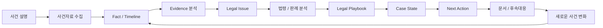
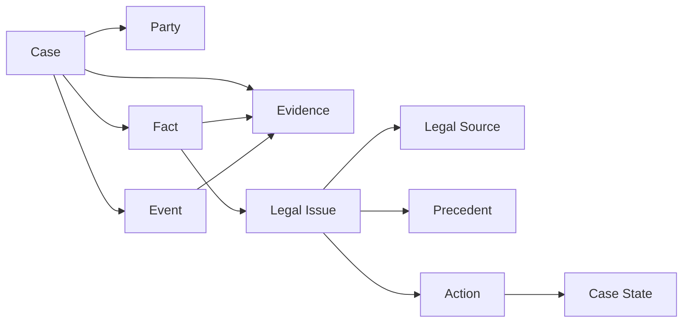
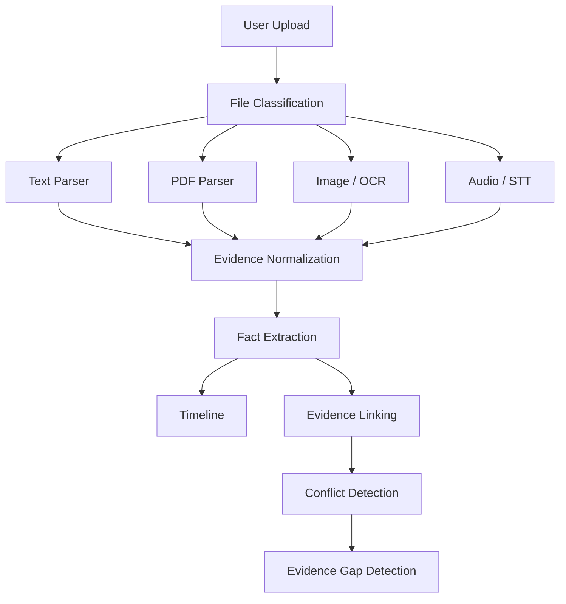
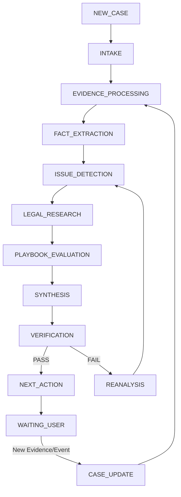
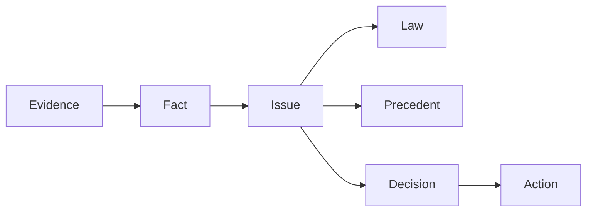
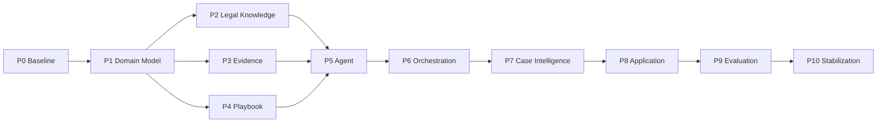

# AI 법률도우미 Master Development Plan

## 1. 문서 목적

본 문서는 **AI 법률도우미의 전체 개발 기준서(Master Development Plan)** 이다.

AI Master 과정의 문서 항목을 순서대로 따라 개발하는 방식이 아니라, 제품 완성을 위한 실제 개발계획을 먼저 수립하고 각 개발 단계에서 생성되는 설계·코드·평가 산출물을 AI Master 과정의 요구사항에 매핑한다.

실제 구현은 **Gemini Antigravity** 환경에서 수행하는 것을 전제로 한다. 따라서 본 문서와 후속 상세설계 문서는 사람에게 설명하기 위한 기획문서에 그치지 않고, AI 개발 에이전트가 읽고 구현 작업을 수행할 수 있는 **개발 명세 및 인수인계 문서** 역할을 동시에 수행한다.

### 1.1 기본 원칙

> 제품 개발계획 → 상세설계 → 구현 → 검증 → AI Master 과정 산출물 매핑

다음 원칙을 적용한다.

1. Markdown 문서를 개발의 Source of Truth로 사용한다.
2. 요구사항과 구현을 추적할 수 있도록 ID를 사용한다.
3. 모호한 자연어 지시보다 Schema, 상태, 입력/출력, 완료조건을 명시한다.
4. 법률 도메인 규칙을 프로그램 코드에 과도하게 Hard Coding하지 않는다.
5. Agent 간 데이터 교환은 가능한 한 정형 JSON Schema를 사용한다.
6. AI가 생성한 사실·법령·판례를 무검증 상태로 사용자에게 제공하지 않는다.
7. 각 Phase는 명시된 Definition of Done을 만족한 후 다음 단계로 진행한다.
8. MVP는 주택 임대차로 검증하되 전체 구조는 다른 법률 분야로 확장 가능하게 설계한다.

---

# 2. 제품 개발 목표

## 2.1 목표 서비스

법률지식이 부족한 일반인이 자신의 상황과 사건자료를 입력하면 AI가 다음 과정을 지원하는 **AI 법률도우미**를 구축한다.



서비스의 핵심 전환은 다음과 같다.

> **법을 검색하는 AI → 사건을 이해하고 해결 과정을 지원하는 AI**

## 2.2 MVP

MVP 적용 분야는 **주택 임대차 분쟁**이다.

MVP를 통해 다음 표준 모델을 검증한다.

- 사건 이해
- Multimodal Evidence 처리
- Fact 및 Timeline 생성
- Evidence Traceability
- Legal Issue 도출
- 법령 RAG
- 판례 RAG
- 현재 사건과 판례 비교
- Legal Playbook 기반 사건상태 판단
- Evidence Gap 탐지
- Next Action 생성
- 법률 대응문서 생성
- 새로운 사건자료 발생 시 재분석

---

# 3. 기존 자산과 신규 개발 영역

## 3.1 기존 자산

본 프로젝트 이전에 다음 기능이 구축되어 있다.

- 법령문서 RAG
- 법률 분야별 AI Agent
- 다수 Agent 결과를 종합하는 Synthesizer Agent

기존 기능은 신규 시스템에서 가능한 범위 내에서 재사용 또는 확장한다.

## 3.2 신규 핵심 개발 영역

```text
기존 Legal Q&A
 ├─ 법령 RAG
 ├─ 분야별 Legal Agent
 └─ Synthesizer
          │
          ▼
AI Legal Helper
 ├─ Case Model
 ├─ Evidence Intelligence
 ├─ Timeline
 ├─ Issue Spotting
 ├─ Precedent RAG
 ├─ Legal Playbook
 ├─ Case State
 ├─ Workflow / Orchestration
 ├─ Verification
 ├─ Next Action
 └─ Case Management
```

---

# 4. 전체 개발 Phase

| Phase | 개발 단계 | 핵심 목적 | 주요 산출물 |
|---|---|---|---|
| P0 | Baseline | 문제·범위·시나리오 확정 | 기획서, 사용자 시나리오 |
| P1 | Core Domain Model | 시스템 공통 데이터 언어 확정 | Domain Model, JSON Schema |
| P2 | Legal Knowledge | 법령 및 판례 Knowledge Layer 구축 | Legal/Precedent RAG |
| P3 | Evidence Intelligence | 사건자료를 검증 가능한 Evidence/Fact로 변환 | Evidence Pipeline |
| P4 | Legal Playbook | 사건처리 지식과 판단 흐름 구축 | Lease Playbook |
| P5 | Agent System | Agent 역할·Prompt·I/O·Tool 확정 | Agent Specification |
| P6 | Workflow & Orchestration | Agent 실행·상태·복구 로직 구현 | Orchestration Engine |
| P7 | Case Intelligence | 사건 요소 간 관계 및 추론 구조 구축 | Case Graph / Reasoning |
| P8 | Application | 사용 가능한 법률도우미 PoC 구현 | Web/Application PoC |
| P9 | Evaluation | 정확도·완성도·Challenge 검증 | Evaluation Report |
| P10 | Stabilization & Demo | 안정화 및 최종 시연 준비 | Release Candidate / Demo |

---

# 5. P0 — Baseline

## 5.1 세부 Task

- P0.1 문제 정의
- P0.2 목표 사용자 정의
- P0.3 서비스 가치 정의
- P0.4 MVP 범위 정의
- P0.5 핵심 사용자 시나리오 정의
- P0.6 Challenge Scenario 정의
- P0.7 KPI 정의

## 5.2 현재 상태

**완료**

관련 문서:

- ALH-01 문제정의 및 서비스기획
- ALH-02 핵심 사용자 시나리오

## 5.3 Definition of Done

- 목표 서비스와 MVP 범위가 명확하다.
- 최소 2개의 핵심 시나리오가 존재한다.
- Challenge Scenario가 정의되어 있다.
- 측정 가능한 KPI가 정의되어 있다.

---

# 6. P1 — Core Domain Model

## 6.1 목적

모든 Agent, RAG, Playbook, Workflow가 동일한 사건 데이터 구조를 사용하도록 시스템의 공통 Domain Model을 확정한다.

## 6.2 세부 Task

| Task ID | Task | 핵심 내용 |
|---|---|---|
| P1.1 | Case Model | 사건 식별자, 유형, 상태, 생성/변경 정보 |
| P1.2 | Party Model | 임차인, 임대인, 대리인, 제3자 |
| P1.3 | Fact Model | 사건에서 확인된 사실과 상태 |
| P1.4 | Evidence Model | 원본자료, 추출정보, 출처, 신뢰도 |
| P1.5 | Event/Timeline Model | 사건 발생일과 사건 흐름 |
| P1.6 | Legal Issue Model | 법적 쟁점과 관련 Fact |
| P1.7 | Legal Source Model | 법령·조문·공식자료 |
| P1.8 | Precedent Model | 판례 Metadata 및 분석구조 |
| P1.9 | Action Model | 가능한 법률 행동 |
| P1.10 | Case State Model | 사건 진행상태 |
| P1.11 | Agent Message Model | Agent 간 전달 구조 |
| P1.12 | JSON Schema | 전체 모델의 기계 판독 가능한 Schema |

## 6.3 핵심 관계



## 6.4 Definition of Done

- 모든 핵심 Entity에 ID와 Schema가 존재한다.
- Fact와 Evidence를 추적할 수 있다.
- UNKNOWN/CONFLICTED 상태를 표현할 수 있다.
- Agent 간 메시지가 JSON Schema로 검증 가능하다.
- SC-LEASE-001 데이터를 모델에 표현할 수 있다.

---

# 7. P2 — Legal Knowledge

## 7.1 목적

기존 법령 RAG를 재사용하고 판례 기반 사건 비교 기능을 추가한다.

## 7.2 세부 Task

### 기존 시스템 분석

- P2.1 기존 법령 RAG 구조 분석
- P2.2 기존 분야별 Legal Agent 분석
- P2.3 기존 Synthesizer 분석
- P2.4 재사용 API/Module 식별

### 판례 RAG

- P2.5 판례 데이터 Source 확정
- P2.6 판례 데이터 확보
- P2.7 임대차 판례 Filter
- P2.8 Precedent Schema 변환
- P2.9 Chunking
- P2.10 Embedding
- P2.11 Vector DB
- P2.12 Metadata Search
- P2.13 Semantic Search
- P2.14 Reranking
- P2.15 Current Case ↔ Precedent Comparison
- P2.16 판례 RAG 평가

## 7.3 검색 전략

```text
Legal Issue
    ↓
Metadata Filter
    ↓
Semantic Retrieval
    ↓
Reranking
    ↓
Relevant Precedents
    ↓
Fact Comparison
    ↓
Similarity / Difference / Court Reasoning
```

## 7.4 Definition of Done

- 임대차 관련 판례 검색이 가능하다.
- 사건번호 등 판례 Metadata를 검증할 수 있다.
- 단순 Vector 유사도가 아닌 Issue/Fact 기반 비교가 가능하다.
- 존재하지 않는 판례를 결과로 생성하지 않는다.
- 테스트셋으로 Retrieval 성능을 측정할 수 있다.

---

# 8. P3 — Evidence Intelligence

## 8.1 목적

사용자가 보유한 다양한 사건자료를 구조화된 Evidence와 Fact로 변환한다.

## 8.2 Pipeline



## 8.3 세부 Task

- P3.1 Upload API
- P3.2 File Type Detection
- P3.3 Document Classification
- P3.4 Text Parser
- P3.5 PDF Parser
- P3.6 OCR Pipeline
- P3.7 Audio/STT Pipeline
- P3.8 Evidence Normalization
- P3.9 Fact Extraction
- P3.10 Timeline Extraction
- P3.11 Fact ↔ Evidence Linking
- P3.12 Conflict Detection
- P3.13 Evidence Gap Detection
- P3.14 Source Location Traceability

## 8.4 중요 원칙

원본자료와 AI 해석을 분리한다.

```text
Original Evidence
      ↓
Extracted Content
      ↓
Extracted Fact
      ↓
AI Interpretation
```

각 Fact는 가능한 경우 원본 Evidence의 위치까지 역추적할 수 있어야 한다.

## 8.5 Definition of Done

- Text/PDF/Image/Audio 입력을 처리할 수 있다.
- 원본 파일을 보존한다.
- Fact가 Evidence ID를 참조한다.
- Timeline이 자동 생성된다.
- 서로 충돌하는 Fact를 탐지한다.
- 필요한 자료가 없을 경우 Evidence Gap을 생성한다.

---

# 9. P4 — Legal Playbook

## 9.1 목적

법률사건 처리에 필요한 **Process Knowledge**를 데이터로 구조화한다.

> Legal Playbook = Workflow + Decision Rules + Legal Knowledge + Evidence Requirements + Exception Rules

## 9.2 세부 Task

- P4.1 임대차 Legal Taxonomy
- P4.2 Case Type 정의
- P4.3 Issue Taxonomy
- P4.4 Required Fact 정의
- P4.5 Required Evidence 정의
- P4.6 Legal Source 연결
- P4.7 Precedent Query Template
- P4.8 Decision Node
- P4.9 Action 정의
- P4.10 Next Action Rule
- P4.11 Playbook JSON/YAML Schema
- P4.12 보증금 반환 Playbook
- P4.13 계약 종료 Playbook
- P4.14 묵시적 갱신 Playbook
- P4.15 Playbook Validation
- P4.16 Playbook Version Management

## 9.3 저장 원칙

예:

```text
/playbooks
  /lease
    taxonomy.yaml
    issues.yaml
    evidence.yaml
    deposit_return.yaml
    contract_termination.yaml
    tacit_renewal.yaml
```

도메인 규칙은 가능한 한 프로그램 로직과 분리한다.

## 9.4 Definition of Done

- Playbook Schema가 확정되어 있다.
- 최소 3개 임대차 Playbook이 존재한다.
- 현재 Case State를 입력하면 다음 Node를 판단할 수 있다.
- 필요한 Fact/Evidence가 부족하면 UNKNOWN 또는 Evidence Gap을 반환한다.
- Playbook 변경이 Core Code 수정 없이 가능하다.

---

# 10. P5 — Agent System

## 10.1 목적

Agent 역할과 권한을 명확히 분리하고 기계적으로 검증 가능한 계약(Contract)을 정의한다.

## 10.2 논리 Agent

- Case Agent
- Evidence Agent
- Issue Agent
- Legal Agent
- Precedent Agent
- Playbook Agent
- Document Agent
- Synthesizer Agent
- Verification Agent

논리 Agent의 수와 실제 LLM Instance 수는 동일할 필요가 없다.

## 10.3 Agent별 필수 명세

각 Agent는 다음 항목을 가져야 한다.

```text
Agent ID
Agent Name
Purpose
Persona
System Prompt
Input Schema
Output Schema
Available Tools
Allowed Actions
Forbidden Actions
Retry Policy
Timeout Policy
Error Handling
Evaluation Cases
```

## 10.4 공통 제약

- Evidence 없는 Fact 생성 금지
- 검증되지 않은 법령/판례 생성 금지
- UNKNOWN 허용
- Agent 역할 범위 밖 판단 금지
- 사용자에게 승소 가능성을 확정적으로 표현하지 않음
- 모든 주요 판단의 Traceability 유지

## 10.5 Definition of Done

- 모든 Agent의 Persona/System Prompt가 존재한다.
- Input/Output Schema가 정의되어 있다.
- Tool 권한이 Agent별로 제한된다.
- Agent 단위 테스트가 가능하다.
- 잘못된 출력이 Schema Validation에서 차단된다.

---

# 11. P6 — Workflow & Orchestration

## 11.1 목적

Agent와 Tool의 실행 순서, Case State, Retry, Error Recovery를 관리한다.

## 11.2 기본 Workflow



## 11.3 초기 함수 목록

```text
create_case()
update_case()

ingest_evidence()
classify_document()
extract_content()
normalize_evidence()

extract_facts()
build_timeline()
detect_conflicts()
detect_evidence_gap()

detect_issues()

search_statutes()
search_precedents()
rerank_precedents()
compare_case_to_precedent()

select_playbook()
evaluate_case_state()
determine_next_action()

synthesize_case_analysis()
verify_analysis()

generate_document()
```

## 11.4 함수 상세명세 표준

각 함수는 다음 형식으로 상세설계한다.

```text
Function Name
Purpose
Called By
Input Schema
Output Schema
Preconditions
Processing Logic
Postconditions
Error Codes
Retry Policy
Logging
Trace ID
```

## 11.5 상태관리

최소 상태:

```text
NEW_CASE
INTAKE
EVIDENCE_PROCESSING
FACT_ANALYSIS
ISSUE_ANALYSIS
LEGAL_RESEARCH
PLAYBOOK_EVALUATION
SYNTHESIS
VERIFICATION
ACTION_READY
WAITING_USER
REANALYSIS
RESOLVED
CLOSED
ERROR
```

상태는 LLM의 자유 텍스트가 아니라 시스템이 관리하는 Enum으로 정의한다.

## 11.6 Definition of Done

- State Machine이 구현되어 있다.
- Agent Routing이 명시적이다.
- 각 Tool 호출이 추적 가능하다.
- Verification FAIL 시 재실행 대상이 식별된다.
- 새로운 Evidence 입력 시 전체가 아니라 필요한 단계부터 재실행할 수 있다.
- Case 처리 History를 재현할 수 있다.

---

# 12. P7 — Case Intelligence

## 12.1 목적

사건의 요소를 단순 문서 목록이 아니라 관계 기반 구조로 연결한다.



## 12.2 세부 Task

- P7.1 Case Graph Schema
- P7.2 Evidence → Fact Edge
- P7.3 Fact → Issue Edge
- P7.4 Issue → Law Edge
- P7.5 Issue → Precedent Edge
- P7.6 Issue → Decision Edge
- P7.7 Decision → Action Edge
- P7.8 Explainability Query
- P7.9 Graph Update
- P7.10 Traceability Validation

## 12.3 Definition of Done

다음 질문에 시스템이 근거와 함께 답할 수 있어야 한다.

- 왜 이 쟁점을 발견했는가?
- 어떤 증거가 이를 뒷받침하는가?
- 어떤 법령이 관련되는가?
- 어떤 판례와 비교했는가?
- 왜 이 행동을 추천했는가?

---

# 13. P8 — Application

## 13.1 목적

일반 사용자가 실제 사건을 등록하고 진행상태를 이해할 수 있는 PoC Application을 구현한다.

## 13.2 주요 화면/기능

```text
내 사건
 ├─ 사건 설명
 ├─ 사건자료 등록
 ├─ Timeline
 ├─ 핵심 Fact
 ├─ Legal Issue
 ├─ Evidence 현황
 ├─ 법령
 ├─ 유사판례
 ├─ 사건 진행상태
 ├─ Evidence Gap
 ├─ Next Action
 ├─ 문서작성
 └─ AI에게 질문
```

## 13.3 UX 원칙

- 법률용어를 몰라도 사용 가능해야 한다.
- 사용자가 사건자료를 직접 분류하도록 요구하지 않는다.
- 가장 중요한 Next Action을 우선 보여준다.
- AI 판단과 근거를 구분하여 표시한다.
- UNKNOWN 및 추가 확인 필요사항을 숨기지 않는다.

## 13.4 Definition of Done

SC-LEASE-001을 UI에서 처음부터 끝까지 실행할 수 있다.

---

# 14. P9 — Evaluation

## 14.1 평가 시나리오

- SC-LEASE-001: 전세보증금 미반환 대응
- SC-LEASE-002: 계약 종료·묵시적 갱신 사전 대응
- SC-LEASE-003: 복합 임대차 분쟁 및 연쇄 손해 Challenge

## 14.2 핵심 KPI

| KPI | 목표 |
|---|---:|
| 사건 핵심정보·쟁점 분석 정확도 | 90% 이상 |
| 법령·판례 근거 정확도 | 95% 이상 |
| 사건 해결절차 안내 완성도 | 90% 이상 |

## 14.3 세부 Task

- P9.1 Gold Dataset 작성
- P9.2 Fact Extraction 평가
- P9.3 Issue Detection 평가
- P9.4 Legal Retrieval 평가
- P9.5 Precedent Retrieval 평가
- P9.6 Next Action 평가
- P9.7 Hallucination 평가
- P9.8 End-to-End 평가
- P9.9 Challenge Scenario 평가
- P9.10 결과 분석 및 개선

## 14.4 Definition of Done

- KPI가 실제 측정값으로 기록된다.
- 실패 Case가 분류되어 있다.
- 주요 오류의 원인과 개선 결과가 기록되어 있다.
- SC-LEASE-003 End-to-End 실행 결과가 존재한다.

---

# 15. P10 — Stabilization & Demo

## 15.1 세부 Task

- P10.1 통합 오류 수정
- P10.2 Prompt 최적화
- P10.3 Retrieval 최적화
- P10.4 성능 및 응답시간 점검
- P10.5 개인정보/로그 점검
- P10.6 Demo Dataset 고정
- P10.7 Demo Scenario Script
- P10.8 최종 Release Candidate
- P10.9 기술문서 정리
- P10.10 AI Master 제출자료 매핑

---

# 16. 개발 우선순위 및 의존성



P2, P3, P4는 P1 완료 후 일부 병렬 개발할 수 있다.

---

# 17. Gemini Antigravity 개발 인수인계 규칙

## 17.1 문서 우선 개발

Antigravity에서 구현을 시작하기 전에 해당 Phase의 상세설계 문서를 읽고 구현한다.

개발 중 설계 변경이 필요한 경우:

```text
1. 변경 필요사항 식별
2. 영향받는 요구사항/Schema 확인
3. 설계 문서 수정
4. Version/Revision 기록
5. 코드 수정
6. Test 수행
```

코드만 변경하고 설계 문서를 방치하지 않는다.

## 17.2 Task 단위 실행

Antigravity에는 가능한 한 Phase 전체가 아니라 Task 단위로 개발을 지시한다.

예:

```text
Implement P1.4 Evidence Model according to ALH-DOMAIN-001.

Requirements:
- Follow the defined JSON Schema.
- Do not modify unrelated domain models.
- Add schema validation tests.
- Add unit tests for valid and invalid Evidence objects.
- Report changed files and test results.
```

## 17.3 구현 완료 보고 형식

각 Task 완료 시 최소 다음을 남긴다.

```text
Task ID:
Status:
Implemented:
Changed Files:
Tests Added:
Test Result:
Known Issues:
Design Changes:
Next Task:
```

## 17.4 금지사항

- 문서에 없는 법률 규칙 임의 Hard Coding
- Schema를 무시한 Agent 간 자유 텍스트 의존
- 테스트 없이 완료 처리
- 실제 존재 여부가 확인되지 않은 법령·판례를 Fixture로 사용
- 원본 Evidence를 AI 요약문으로 대체
- Verification 우회
- UNKNOWN 값을 추정값으로 자동 치환

---

# 18. AI Master 과정 매핑

개발 산출물을 AI Master 과정 문서로 재사용한다.

| AI Master 항목 | 실제 개발 산출물 |
|---|---|
| 문제정의 | P0 Baseline |
| 핵심 사용자 시나리오 | P0 Scenario |
| Agent Persona/System Prompt | P5 Agent Specification |
| Workflow/Orchestration | P6 Orchestration Specification |
| 처리 로직 | P3/P4/P6 |
| 상태관리 | P1 Case State + P6 State Machine |
| 도구 및 함수명세 | P5 Tool Contract + P6 Function Specification |
| RAG 설계 | P2 Legal Knowledge |
| 평가 설계 | P9 Evaluation |
| PoC 결과 | P8/P9/P10 |

따라서 AI Master 문서는 별도의 가상 설계를 작성하지 않고 **실제 구현된 제품 설계와 결과를 기반으로 작성**한다.

---

# 19. 문서 체계

향후 주요 문서는 다음 구조로 관리한다.

| Document ID | 문서 |
|---|---|
| ALH-PLAN-001 | 문제정의 및 서비스기획 |
| ALH-SCEN-001 | 핵심 사용자 시나리오 |
| ALH-DEV-001 | Master Development Plan |
| ALH-DOMAIN-001 | Core Domain Model |
| ALH-KNOW-001 | Legal Knowledge / Precedent RAG |
| ALH-EVID-001 | Evidence Intelligence |
| ALH-PLAY-001 | Legal Playbook |
| ALH-AGENT-001 | Agent Specification |
| ALH-ORCH-001 | Workflow & Orchestration |
| ALH-CASE-001 | Case Intelligence |
| ALH-APP-001 | Application / UX |
| ALH-EVAL-001 | Evaluation |
| ALH-TEST-001 | Test Specification |

---

# 20. 개발 진행 체크포인트

각 Phase 종료 시 다음 질문에 모두 YES여야 한다.

- 설계 문서가 최신인가?
- Schema/API Contract가 명확한가?
- 코드와 문서가 일치하는가?
- 자동 Test가 존재하는가?
- 오류 및 UNKNOWN 처리가 정의되어 있는가?
- Traceability가 유지되는가?
- 다음 Phase가 현재 산출물을 안정적으로 사용할 수 있는가?

---

# 21. 즉시 다음 작업

현재 개발 진행상태:

```text
P0 Baseline               [DONE]
P1 Core Domain Model      [NEXT]
P2 Legal Knowledge        [WAIT]
P3 Evidence Intelligence  [WAIT]
P4 Legal Playbook         [WAIT]
P5 Agent System           [DRAFT]
P6 Orchestration          [WAIT]
P7 Case Intelligence      [WAIT]
P8 Application            [WAIT]
P9 Evaluation             [WAIT]
P10 Stabilization         [WAIT]
```

다음 작업은 **P1 Core Domain Model 상세설계**이다.

첫 구현 단위는 다음 순서로 진행한다.

```text
P1.1 Case Model
   ↓
P1.2 Party Model
   ↓
P1.3 Fact Model
   ↓
P1.4 Evidence Model
   ↓
P1.5 Event / Timeline Model
   ↓
P1.6 Legal Issue Model
   ↓
나머지 Domain Model
   ↓
통합 JSON Schema
   ↓
Schema Validation Test
```

---

# 22. Revision History

| Version | 변경내용 |
|---|---|
| v1.0 | 최초 Master Development Plan 수립. Gemini Antigravity 기반 구현을 위한 Phase, Task, 산출물, Definition of Done 및 AI Master 과정 매핑 정의 |
