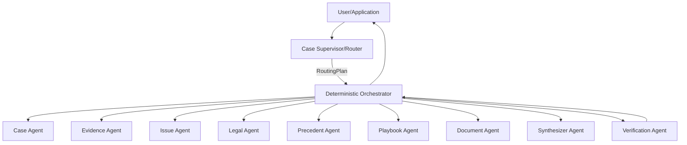

# AI 법률도우미 Development Baseline v1.1
Document ID: ALH-BASELINE-001
Status: FROZEN FOR IMPLEMENTATION
Supersedes: v1.0

## Control Architecture

## 10개 Logical Agent
1. Case Supervisor / Router Agent
2. Case Agent
3. Evidence Agent
4. Issue Agent
5. Legal Agent
6. Precedent Agent
7. Playbook Agent
8. Document Agent
9. Synthesizer Agent
10. Verification Agent

논리 역할 수와 물리 LLM 서비스 수는 동일할 필요가 없다.

## 제어 원칙
`Supervisor/Router = Intent + Routing`
`Orchestrator = State + Execution + Permission + Retry`
`Specialist Agent = bounded analysis`
`Synthesizer = integration`
`Verification = grounding/validation`

Router는 State를 직접 변경하지 않는다. Orchestrator는 RoutingPlan을 검증 없이 실행하지 않는다.

## Cross-Cutting Contracts
`RoutingPlan, VerificationResult, AnalysisArtifact, EvidenceGap, ClarificationQuestion, Provenance, WorkflowRun, AgentRun`

## 전역 필수규칙
Original Evidence 보존, Fact/Analysis 분리, UNKNOWN/CONFLICTED, verified legal sources, Traceability, Playbook versioning, deterministic workflow, structured messages/routing, independent Verification, privacy/security, provider abstraction, observability, automated tests.

## 현재 상태
DESIGN: FROZEN v1.1
IMPLEMENTATION: NOT STARTED
