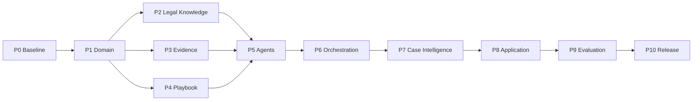

# AI 법률도우미 Master Index & Supervisor Guide

## 1. 이 문서의 역할

이 문서는 Gemini Antigravity가 AI 법률도우미 프로젝트를 인수할 때 **가장 먼저 읽어야 하는 최상위 실행 안내서**이다.

설계문서는 "무엇을 만들어야 하는가"를 정의하고, Execution Directive는 "어떻게 작업해야 하는가"를 정의하며, Acceptance Criteria는 "무엇을 만족해야 승인되는가"를 정의한다.

Gemini는 제품 요구사항을 재정의하는 PO가 아니다. 구현팀 역할을 수행한다.

---

# 2. 권한 구조

```text
Product Owner / User
        ↓
ChatGPT Supervisor
PO + Architecture + QA + Development Direction
        ↓
Gemini Antigravity
Implementation Team
```

설계 변경권은 Supervisor 승인 절차를 따른다.

---

# 3. Source of Truth 우선순위

충돌 시 다음 순서를 따른다.

1. 최신 Supervisor 승인/변경 지시
2. 본 Master Index
3. ALH-DEV-001 Master Development Plan
4. 해당 Phase 상세설계
5. 해당 Task 상세설계
6. 해당 Phase/Task Execution Directive
7. 기존 Repository Convention

단, 기존 Repository와 설계가 Material Conflict이면 낮은 우선순위를 무시하고 구현하는 것이 아니라 **중지 후 보고**한다.

---

# 4. 전체 개발 순서



P2/P3/P4는 P1 승인 후 병렬화 가능하지만 초기 실제 개발에서는 통합 리스크를 낮추기 위해 Supervisor가 실행 순서를 지정한다.

---

# 5. Phase별 목적

| Phase | 목적 | 핵심 결과 |
|---|---|---|
| P0 | 문제/범위/시나리오 | 제품 Baseline |
| P1 | 공통 데이터 계약 | Domain Schema |
| P2 | 법령/판례 지식 | Verified Legal Retrieval |
| P3 | 사건자료 이해 | Evidence/Fact/Timeline |
| P4 | 사건처리 지식 | Versioned Legal Playbook |
| P5 | AI 역할 분리 | Agent Contracts |
| P6 | 처리 제어 | State Machine/Orchestrator |
| P7 | 관계/설명가능성 | Case Graph/Trace |
| P8 | 사용자 제품 | PoC Application |
| P9 | 정량 검증 | Evaluation/KPI |
| P10 | 안정화/시연 | Release Candidate |

---

# 6. 구현 시작 전 필수 행동

Gemini는 코드 수정 전에:

1. 전체 Repository 구조 확인
2. 기존 법령 RAG/Agent/Synthesizer 식별
3. 사용 언어/Framework/DB/Test/Validation 확인
4. 현재 실행 가능 여부 확인
5. 설계와 기존 코드 Gap 분석
6. 불필요한 신규 Stack 도입 여부 검토

기존 프로젝트가 존재하는데 새 프로젝트를 옆에 만드는 방식은 금지한다. Supervisor가 명시적으로 승인한 경우만 예외이다.

---

# 7. Task 실행 Protocol

```text
READ
 ↓
REPOSITORY INSPECT
 ↓
GAP ANALYSIS
 ↓
IMPLEMENT
 ↓
UNIT/CONTRACT TEST
 ↓
REGRESSION TEST
 ↓
TASK COMPLETION REPORT
 ↓
SUPERVISOR REVIEW
 ↓
APPROVE / FIX / REJECT
```

Gemini의 COMPLETE 선언은 Supervisor 승인과 동일하지 않다.

---

# 8. 변경관리

Material 설계 변경이 필요하면:

```text
PROPOSED DESIGN CHANGE
Task:
Current Design:
Observed Constraint:
Proposed Change:
Reason:
Affected Documents:
Affected Code:
Migration:
Risk:
Alternative:
```

승인 전 Material Change 구현 금지.

Minor implementation detail은 문서 의미를 바꾸지 않는 범위에서 Repository Convention을 따를 수 있으며 완료보고에 기록한다.

---

# 9. Stop Conditions

다음이면 추측하지 말고 중지/보고:

- Source of Truth 간 의미 충돌
- 기존 핵심 Architecture와 설계 충돌
- 실제 데이터/법률 Source의 이용 가능성 불명확
- 법률 근거를 검증할 수 없음
- 보안상 위험한 구현이 필요함
- 테스트 불가능
- Dependency가 프로젝트 제약과 충돌
- Scope 밖 대규모 변경 필요

---

# 10. 프로젝트 전역 Non-Negotiable Rules

1. 존재하지 않는 법령/판례 생성 금지
2. Evidence 없는 사실을 CONFIRMED 처리 금지
3. 원본 Evidence를 AI 요약으로 대체 금지
4. 법률 판단과 Fact 분리
5. UNKNOWN 허용
6. 모든 중요 판단의 Traceability
7. Agent Tool 최소권한
8. Workflow 상태는 시스템 통제
9. Playbook은 Versioned Data
10. 사용자에게 승소/결과 보장 금지
11. 민감정보 로그 최소화
12. 테스트 없는 완료 금지
13. 평가수치 조작 금지
14. 실제 결과와 목표치를 구분
15. 기존 자산 재사용 우선

---

# 11. 문서/코드 동기화

설계 변경이 승인되면:

```text
Design update
→ version/revision
→ implementation
→ tests
→ acceptance
```

코드만 변경하고 문서를 방치하지 않는다.

---

# 12. Phase 승인

각 Phase 종료 시 해당 `Acceptance Criteria`를 사용한다.

판정:

- APPROVED
- APPROVED WITH MINOR FIX
- REJECTED
- BLOCKED

다음 Phase는 필요한 선행 Phase가 APPROVED인 경우에만 시작한다.

---

# 13. AI Master 과정 산출물 매핑

| 과정 요구 | 실제 프로젝트 산출물 |
|---|---|
| 문제정의 | P0 |
| 사용자 시나리오 | P0 |
| Agent Persona/System Prompt | P5 |
| Workflow/Orchestration | P6 |
| 처리로직/상태관리 | P3/P4/P6 |
| 도구/함수명세 | P2~P6 |
| RAG | P2 |
| PoC | P8 |
| 평가 | P9 |
| 최종 결과 | P10 |

AI Master 문서는 실제 구현 산출물에서 작성하며 구현되지 않은 성과를 기재하지 않는다.

---

# 14. Gemini 최초 인수 명령

실제 개발을 시작할 때 Supervisor가 별도 범위를 지정한다. 기본 인수 명령은 다음과 같다.

```text
You are the implementation team for the AI Legal Helper project.

First read:
1. AI_Legal_Helper_MASTER_INDEX_and_Supervisor_Guide_v1.0.md
2. ALH-DEV-001 Master Development Plan
3. The approved design, execution directive, and acceptance criteria for the assigned phase/task.

Before coding, inspect the existing repository and submit a Repository Assessment and Gap Analysis.

Do not redesign the product.
Do not proceed beyond the assigned task.
Do not silently resolve material design conflicts.
Do not claim completion without automated tests.

Implement only the task assigned by the Supervisor and return the required TASK COMPLETION REPORT.
```

---

# 15. 현재 상태

```text
P0 DESIGN   COMPLETE
P1 DESIGN   COMPLETE
P2 DESIGN   COMPLETE
P3 DESIGN   COMPLETE
P4 DESIGN   COMPLETE
P5 DESIGN   COMPLETE
P6 DESIGN   COMPLETE
P7 DESIGN   COMPLETE
P8 DESIGN   COMPLETE
P9 DESIGN   COMPLETE
P10 DESIGN  COMPLETE

IMPLEMENTATION: NOT STARTED
```

현재 목표는 전체 설계를 먼저 완성하는 것이며 Gemini 실행 결과 검토는 구현 단계에서 수행한다.

---

# 16. 실제 개발 시작점

전체 설계 검토 후 구현은 P1부터 시작한다.

첫 실행:
`P1 Repository Assessment → P1.1 Case Model`

P1 전체를 한 번에 자동 구현하도록 지시하지 않는다. Task 단위 구현/검수 방식이 기본이다.

---

# 17. 최종 성공조건

프로젝트 성공은 코드 양이 아니라 다음으로 판단한다.

> 사용자가 법률용어를 몰라도 자신의 사건자료를 입력하면, 시스템이 근거를 추적 가능한 방식으로 사건을 이해하고 관련 법령·판례를 검증하여 현재 상태와 다음 행동을 안내하며, 새로운 사건 변화가 발생하면 안전하게 재분석할 수 있는가?

SC-LEASE-003 Challenge Scenario가 이 질문의 최종 통합 검증 역할을 한다.


# 18. Phase 상세설계 파일 Index

- **P2**: `AI_Legal_Helper_P2_Legal_Knowledge_and_Precedent_RAG_Design_v1.0.md` / `AI_Legal_Helper_P2_Gemini_Execution_Directive_v1.0.md` / `AI_Legal_Helper_P2_Acceptance_Criteria_v1.0.md`
- **P3**: `AI_Legal_Helper_P3_Evidence_Intelligence_Design_v1.0.md` / `AI_Legal_Helper_P3_Gemini_Execution_Directive_v1.0.md` / `AI_Legal_Helper_P3_Acceptance_Criteria_v1.0.md`
- **P4**: `AI_Legal_Helper_P4_Legal_Playbook_Design_v1.0.md` / `AI_Legal_Helper_P4_Gemini_Execution_Directive_v1.0.md` / `AI_Legal_Helper_P4_Acceptance_Criteria_v1.0.md`
- **P5**: `AI_Legal_Helper_P5_Agent_System_Design_v1.0.md` / `AI_Legal_Helper_P5_Gemini_Execution_Directive_v1.0.md` / `AI_Legal_Helper_P5_Acceptance_Criteria_v1.0.md`
- **P6**: `AI_Legal_Helper_P6_Workflow_and_Orchestration_Design_v1.0.md` / `AI_Legal_Helper_P6_Gemini_Execution_Directive_v1.0.md` / `AI_Legal_Helper_P6_Acceptance_Criteria_v1.0.md`
- **P7**: `AI_Legal_Helper_P7_Case_Intelligence_and_Explainability_Design_v1.0.md` / `AI_Legal_Helper_P7_Gemini_Execution_Directive_v1.0.md` / `AI_Legal_Helper_P7_Acceptance_Criteria_v1.0.md`
- **P8**: `AI_Legal_Helper_P8_Application_and_UX_Design_v1.0.md` / `AI_Legal_Helper_P8_Gemini_Execution_Directive_v1.0.md` / `AI_Legal_Helper_P8_Acceptance_Criteria_v1.0.md`
- **P9**: `AI_Legal_Helper_P9_Evaluation_and_Test_Design_v1.0.md` / `AI_Legal_Helper_P9_Gemini_Execution_Directive_v1.0.md` / `AI_Legal_Helper_P9_Acceptance_Criteria_v1.0.md`
- **P10**: `AI_Legal_Helper_P10_Stabilization,_Security,_Release_and_Demo_Design_v1.0.md` / `AI_Legal_Helper_P10_Gemini_Execution_Directive_v1.0.md` / `AI_Legal_Helper_P10_Acceptance_Criteria_v1.0.md`

- **P1**: `AI_Legal_Helper_P1_Core_Domain_Model_v1.0.md` / `AI_Legal_Helper_P1_Gemini_Execution_Directive_v1.0.md` / `AI_Legal_Helper_P1_Acceptance_Criteria_v1.0.md`
- **P1.1 보조 상세문서**: `AI_Legal_Helper_P1.1_Case_Model_Design_v1.0.md`
