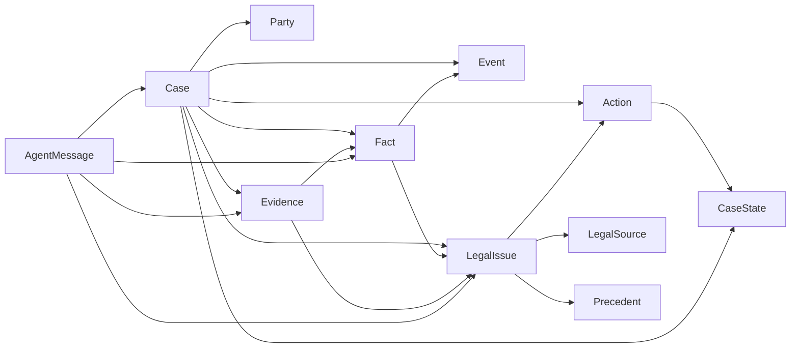

# P1 Core Domain Model

## 1. 목적

본 문서는 AI 법률도우미 전체 시스템이 공통으로 사용하는 사건 데이터 모델을 정의한다.

P2 Legal Knowledge, P3 Evidence Intelligence, P4 Legal Playbook, P5 Agent, P6 Orchestration, P7 Case Intelligence는 본 Domain Contract를 기준으로 구현한다.

핵심 원칙:

> **원본 Evidence → Fact → Event → Issue → Legal Source / Precedent → Decision → Action**

AI의 해석은 원본 사실과 분리하고 모든 주요 판단을 역추적 가능하게 한다.

---

# 2. 전체 Entity 관계



모든 하위 Entity는 `case_id`를 가진다.

---

# 3. 공통 설계 규칙

## 3.1 ID

권장 형식:

```text
CASE-{UUID}
PARTY-{UUID}
FACT-{UUID}
EV-{UUID}
EVENT-{UUID}
ISSUE-{UUID}
LAW-{UUID}
PREC-{UUID}
ACTION-{UUID}
MSG-{UUID}
```

ID에 개인정보나 법적 의미를 Encoding하지 않는다.

## 3.2 시간

모든 시스템 Timestamp는 timezone-aware ISO-8601을 사용한다.

## 3.3 상태

자유 텍스트 상태를 사용하지 않는다. Enum 또는 승인된 Taxonomy를 사용한다.

## 3.4 UNKNOWN

정보가 없으면 추측하지 않는다.

상태 구분:

```text
CONFIRMED
CLAIMED
INFERRED
UNKNOWN
CONFLICTED
```

## 3.5 Provenance

AI가 생성하거나 추출한 데이터는 가능한 경우 다음을 유지한다.

```text
source_type
source_ids
source_location
created_by
confidence
```

## 3.6 Version

Schema와 변경 이력을 추적할 수 있어야 한다.

---

# 4. P1.1 Case Model

Case는 Aggregate Root이다.

필수 핵심 필드:

```yaml
case_id: string
title: string
description: string
legal_domain: enum
case_type: string|null
status: CaseStatus
resolution_status: ResolutionStatus
primary_user_role: string|null

party_ids: []
evidence_ids: []
fact_ids: []
event_ids: []
issue_ids: []
action_ids: []
active_playbook_ids: []

created_at: datetime
updated_at: datetime
schema_version: string
revision: integer
metadata: object
```

### CaseStatus

```text
NEW_CASE
INTAKE
EVIDENCE_PROCESSING
FACT_ANALYSIS
ISSUE_ANALYSIS
LEGAL_RESEARCH
PLAYBOOK_EVALUATION
SYNTHESIS
VERIFICATION
ACTION_READY
WAITING_USER
REANALYSIS
RESOLVED
CLOSED
ERROR
```

### ResolutionStatus

```text
UNKNOWN
PRE_DISPUTE
ACTIVE
PARTIALLY_RESOLVED
RESOLVED
CLOSED
```

상세 P1.1 문서는 `ALH-DOMAIN-P1.1`을 따른다.

---

# 5. P1.2 Party Model

사건 관계자를 표현한다.

```yaml
party_id: string
case_id: string
party_type: enum
role: string
display_name: string|null
is_primary_user: boolean
attributes: object
source_ids: []
created_at: datetime
updated_at: datetime
```

### PartyType

```text
PERSON
ORGANIZATION
PUBLIC_AGENCY
UNKNOWN
```

`role`은 임대차 MVP에서 다음과 같은 값을 가질 수 있다.

```text
TENANT
LANDLORD
AGENT
FAMILY_MEMBER
THIRD_PARTY
UNKNOWN
```

Role은 향후 Taxonomy에서 확장 가능해야 한다.

### 개인정보 원칙

민감한 식별정보는 Party 기본 모델에 무분별하게 저장하지 않는다.

주민등록번호 등 고위험 식별정보는 MVP Core Model에서 제외한다.

---

# 6. P1.3 Fact Model

Fact는 사건 분석에서 사용하는 최소 사실 단위이다.

```yaml
fact_id: string
case_id: string
fact_type: string
statement: string
status: FactStatus
subject_party_ids: []
object_party_ids: []
event_date: datetime|null
evidence_refs: []
source_type: enum
confidence: number|null
created_by: enum
created_at: datetime
updated_at: datetime
```

### FactStatus

```text
CONFIRMED
CLAIMED
INFERRED
UNKNOWN
CONFLICTED
```

### CreatedBy

```text
USER
SYSTEM
AGENT
HUMAN_REVIEWER
```

### EvidenceRef

```yaml
evidence_id: string
source_location: string|null
support_type: enum
```

SupportType:

```text
SUPPORTS
CONTRADICTS
MENTIONS
```

### 핵심 규칙

`CONFIRMED`는 단순히 LLM confidence가 높다는 뜻이 아니다.

Evidence 또는 승인된 Human Review에 의해 확인된 경우에만 사용한다.

---

# 7. P1.4 Evidence Model

Evidence는 사건 원본자료와 추출정보를 연결한다.

```yaml
evidence_id: string
case_id: string
evidence_type: enum
document_type: string|null
original_uri: string
original_filename: string|null
mime_type: string|null
checksum: string|null

extraction_status: enum
extracted_content_ref: string|null
occurred_at: datetime|null
received_at: datetime|null

participant_ids: []
related_fact_ids: []
related_issue_ids: []

source_metadata: object
created_at: datetime
updated_at: datetime
```

### EvidenceType

```text
USER_TEXT
DOCUMENT
PDF
IMAGE
AUDIO
MESSAGE
EMAIL
FINANCIAL_RECORD
OFFICIAL_RECORD
OTHER
```

### ExtractionStatus

```text
PENDING
PROCESSING
COMPLETED
PARTIAL
FAILED
NOT_REQUIRED
```

### 핵심 규칙

```text
Original Evidence ≠ Extracted Text ≠ Fact ≠ AI Interpretation
```

원본 Evidence는 AI 분석 결과로 대체하지 않는다.

---

# 8. P1.5 Event / Timeline Model

Event는 사건에서 시간적으로 의미 있는 발생 사실을 표현한다.

```yaml
event_id: string
case_id: string
event_type: string
title: string
description: string
occurred_at: datetime|null
date_precision: enum
party_ids: []
fact_ids: []
evidence_ids: []
status: FactStatus
created_at: datetime
updated_at: datetime
```

### DatePrecision

```text
EXACT
DAY
MONTH
APPROXIMATE
UNKNOWN
```

Timeline은 Event 목록을 시간순으로 표현한 View이며 원본 Entity를 중복 생성하지 않는다.

---

# 9. P1.6 Legal Issue Model

LegalIssue는 사건에서 검토해야 할 법적 질문이다.

```yaml
issue_id: string
case_id: string
issue_code: string|null
title: string
question: string
status: IssueStatus
priority: enum

fact_ids: []
evidence_ids: []
legal_source_ids: []
precedent_ids: []
action_ids: []

missing_fact_requirements: []
missing_evidence_requirements: []

analysis_summary: string|null
confidence: number|null
created_at: datetime
updated_at: datetime
```

### IssueStatus

```text
DETECTED
UNDER_REVIEW
RESEARCH_REQUIRED
INSUFFICIENT_INFORMATION
ANALYZED
VERIFIED
CLOSED
```

### Priority

```text
LOW
MEDIUM
HIGH
CRITICAL
```

Issue는 법적 결론 자체가 아니다.

---

# 10. P1.7 Legal Source Model

법령 및 공식 법률자료의 검증 가능한 Metadata를 표현한다.

```yaml
legal_source_id: string
source_type: enum
jurisdiction: string
title: string
citation: string|null
article: string|null
effective_date: date|null
source_uri: string|null
retrieved_at: datetime|null
verification_status: enum
content_ref: string|null
metadata: object
```

### LegalSourceType

```text
STATUTE
REGULATION
RULE
OFFICIAL_GUIDANCE
ADMINISTRATIVE_INTERPRETATION
OTHER
```

### VerificationStatus

```text
VERIFIED
NOT_VERIFIED
STALE
FAILED
```

법령 전문을 Case Root에 복제하지 않는다.

---

# 11. P1.8 Precedent Model

판례 검색 및 사건 비교에 사용하는 구조이다.

```yaml
precedent_id: string
external_case_id: string|null
case_number: string|null
court: string|null
decision_date: date|null
case_name: string|null
domain: string|null
case_type: string|null

issues: []
facts_summary: string|null
claims_summary: string|null
court_reasoning: string|null
decision_summary: string|null
related_law_refs: []

source_uri: string|null
verification_status: enum
content_ref: string|null
metadata: object
```

Case별 비교 결과는 판례 원본 Entity와 분리한다.

### CasePrecedentComparison

```yaml
case_id: string
issue_id: string
precedent_id: string
similar_fact_ids: []
different_facts: []
favorable_factors: []
unfavorable_factors: []
relevance_score: number|null
analysis: string|null
```

`relevance_score`는 승소확률이 아니다.

---

# 12. P1.9 Action Model

Action은 사용자 또는 시스템이 수행할 수 있는 다음 행동이다.

```yaml
action_id: string
case_id: string
issue_ids: []
playbook_id: string|null
action_type: string
title: string
description: string
status: ActionStatus
priority: enum

required_fact_ids: []
required_evidence_ids: []
legal_basis_ids: []

due_at: datetime|null
completed_at: datetime|null
created_at: datetime
updated_at: datetime
```

### ActionStatus

```text
PROPOSED
AVAILABLE
BLOCKED
RECOMMENDED
IN_PROGRESS
COMPLETED
CANCELLED
```

Action은 법률 결과 보장을 의미하지 않는다.

---

# 13. P1.10 Case State Model

Case Root의 `status`보다 더 상세한 실행 Context를 표현한다.

```yaml
case_id: string
workflow_state: CaseStatus
resolution_status: ResolutionStatus
current_issue_ids: []
current_action_ids: []
active_playbook_ids: []
blocked_reason: string|null
waiting_for: enum|null
last_processed_at: datetime|null
state_revision: integer
```

### WaitingFor

```text
USER_INPUT
EVIDENCE
LEGAL_RESEARCH
HUMAN_REVIEW
EXTERNAL_EVENT
NONE
```

State 변경은 P6 Orchestration Engine이 최종 통제한다.

LLM이 임의로 상태를 확정하지 않는다.

---

# 14. P1.11 Agent Message Model

Agent 간 통신은 자유형 대화가 아닌 구조화 메시지를 기본으로 한다.

```yaml
message_id: string
case_id: string
trace_id: string
correlation_id: string|null

sender_agent: string
receiver_agent: string
message_type: enum

input_refs: []
payload: object
requested_operation: string|null

status: enum
created_at: datetime
completed_at: datetime|null

errors: []
```

### MessageType

```text
REQUEST
RESPONSE
EVENT
VALIDATION
ERROR
```

### MessageStatus

```text
CREATED
PROCESSING
COMPLETED
FAILED
REJECTED
```

### Error

```yaml
code: string
message: string
retryable: boolean
details: object
```

모든 Agent 호출은 가능한 경우 `trace_id`를 유지한다.

---

# 15. P1.12 통합 Schema

최종 구현에서는 다음 Schema가 기계적으로 검증 가능해야 한다.

```text
Case
Party
Fact
Evidence
Event
LegalIssue
LegalSource
Precedent
CasePrecedentComparison
Action
CaseState
AgentMessage
```

권장 저장 구조 예:

```text
/domain
  case
  party
  fact
  evidence
  event
  issue
  legal_source
  precedent
  action
  state
  messaging

/schemas
/tests
```

실제 폴더 구조는 기존 Repository 조사 후 기존 Convention을 우선한다.

---

# 16. Cross-Entity Integrity Rules

최소 규칙:

1. 하위 Entity의 `case_id`는 존재하는 Case를 참조해야 한다.
2. Fact의 EvidenceRef는 동일 Case의 Evidence여야 한다.
3. Event가 참조하는 Fact/Evidence도 동일 Case여야 한다.
4. Issue가 참조하는 Fact/Evidence는 동일 Case여야 한다.
5. Action이 참조하는 Issue는 동일 Case여야 한다.
6. CasePrecedentComparison의 Issue는 해당 Case에 속해야 한다.
7. 삭제/비활성화된 참조를 어떻게 처리할지는 Persistence 설계에서 확정한다.
8. 중복 ID 참조는 허용하지 않는 것을 기본으로 한다.

---

# 17. 데이터 Traceability 예시

```text
EV-001 통화녹음
  ↓ SUPPORTS
FACT-004 종료 의사표시
  ↓
EVENT-003 종료통보
  ↓
ISSUE-002 계약 종료시점
  ├─ LAW-001
  ├─ PREC-003
  └─ ACTION-005 추가 증거 확보
```

최종 사용자 답변의 주요 결론은 이 연결을 역추적할 수 있어야 한다.

---

# 18. 개인정보 및 보안 설계 경계

P1에서는 개인정보보호 전체 구현을 하지 않지만 Domain Model은 다음을 방해해서는 안 된다.

- 원본자료와 분석데이터 분리 저장
- 접근권한 분리
- Audit
- 삭제/보존 정책
- 민감정보 Masking

고위험 개인정보를 `metadata`에 무분별하게 저장하는 구현을 금지한다.

---

# 19. P1 구현 순서

```text
P1.1 Case
 ↓
P1.2 Party
 ↓
P1.3 Fact
 ↓
P1.4 Evidence
 ↓
P1.5 Event/Timeline
 ↓
P1.6 LegalIssue
 ↓
P1.7 LegalSource
 ↓
P1.8 Precedent
 ↓
P1.9 Action
 ↓
P1.10 CaseState
 ↓
P1.11 AgentMessage
 ↓
P1.12 Integrated Schema + Integrity Tests
```

각 Task 구현 후 테스트하지만, 현재 단계에서는 실행하지 않고 전체 설계를 먼저 완료한다.

---

# 20. P1 통합 테스트 요구사항

P1.12에서 최소 다음 Fixture를 구성한다.

### Fixture A — 정상 임대차 사건

Case → Parties → Evidence → Fact → Event → Issue → LegalSource → Precedent → Action

전체 참조가 유효해야 한다.

### Fixture B — Evidence 없는 주장

Fact.status = CLAIMED

Evidence 없이 CONFIRMED로 자동 승격되지 않아야 한다.

### Fixture C — 충돌 Fact

동일 사건에서 상충하는 자료가 존재하면 `CONFLICTED`를 표현할 수 있어야 한다.

### Fixture D — 잘못된 Cross Case Reference

다른 Case의 Evidence를 참조하면 Validation 실패.

### Fixture E — Agent Message

trace_id를 유지하면서 요청/응답을 Serialization 할 수 있어야 한다.

---

# 21. P1 Definition of Done

```text
[ ] 11개 핵심 Domain Entity 구현
[ ] Enum/Taxonomy 구현
[ ] Runtime Schema Validation
[ ] Cross-Entity Integrity Validation
[ ] Serialization Test
[ ] Invalid Data Test
[ ] Traceability Fixture Test
[ ] SC-LEASE-001 표현 가능
[ ] Domain이 임대차 전용으로 Hard Coding되지 않음
[ ] 기존 시스템 Regression 없음
[ ] P2/P3/P4가 공통 Contract로 사용할 수 있음
```

---

# 22. 다음 Phase Interface

P1 완료 후:

- P2는 `LegalSource`, `Precedent`, `LegalIssue` 사용
- P3는 `Evidence`, `Fact`, `Event` 사용
- P4는 `LegalIssue`, `Action`, `CaseState` 사용
- P5는 전체 Entity + `AgentMessage` 사용
- P6는 `CaseState`, `Action`, `AgentMessage` 사용
- P7은 Entity 관계를 Graph로 연결

P1은 이후 Phase의 계약(Contract)이므로 변경 시 영향분석과 Version 관리가 필수이다.
