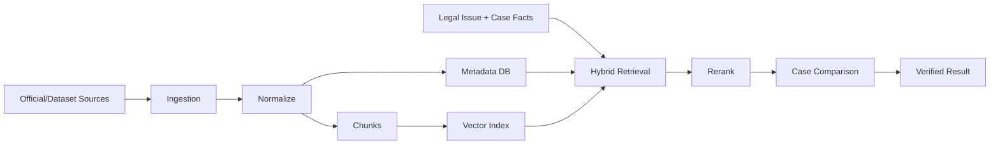

# P2 Legal Knowledge & Precedent RAG

## 목적
기존 법령 RAG/분야별 Legal Agent/Synthesizer를 재사용하고, 검증 가능한 판례 검색·비교 계층을 추가한다.

## 핵심 원칙
- 기존 시스템을 먼저 Audit하고 재사용한다.
- 법령/판례는 존재와 출처를 검증한 것만 사용자 판단 근거로 사용한다.
- Vector similarity만으로 법적 유사성을 판단하지 않는다.
- 판례 원문, 구조화 Metadata, Chunk, Embedding, 사건별 비교결과를 분리한다.
- Retrieval 실패 시 모델 기억으로 판례를 생성하지 않는다.

## Task
| ID | Task |
|---|---|
| P2.1 | 기존 법령 RAG Audit |
| P2.2 | 기존 Legal Agents Audit |
| P2.3 | 기존 Synthesizer Audit |
| P2.4 | 재사용 Adapter/API 설계 |
| P2.5 | 판례 Source Registry |
| P2.6 | 판례 Ingestion |
| P2.7 | 임대차 Filter/Classification |
| P2.8 | Precedent Normalization |
| P2.9 | Chunking |
| P2.10 | Embedding/Vector Index |
| P2.11 | Metadata Search |
| P2.12 | Hybrid Retrieval |
| P2.13 | Reranking |
| P2.14 | Case↔Precedent Comparison |
| P2.15 | Citation/Source Verification |
| P2.16 | Retrieval Evaluation |

## Pipeline

## Source Registry
각 Source:
`source_id, provider, dataset/version, acquisition_method, retrieved_at, license_or_usage_note, freshness, checksum/status`

실제 데이터 Source 선택은 구현 시 최신 공식/허용 Source를 조사하여 확정하고 기록한다.

## Retrieval Query
입력:
`case_id, issue_id, domain, case_type, relevant_fact_ids, legal_terms, date constraints`

처리:
1. Metadata filter
2. Semantic retrieval
3. lexical/keyword retrieval 가능
4. fusion
5. rerank
6. source verification
7. current-case comparison

## 판례 비교
반환:
`precedent_id, similar_fact_ids, different_facts, favorable_factors, unfavorable_factors, court_reasoning, relevance_score`

`relevance_score != win_probability`.

## Tool/Function Contract
- `audit_existing_legal_stack()`
- `register_legal_source()`
- `ingest_precedents()`
- `normalize_precedent()`
- `classify_precedent()`
- `index_precedent()`
- `search_statutes()`
- `search_precedents()`
- `rerank_precedents()`
- `verify_legal_source()`
- `compare_case_to_precedent()`

각 함수는 P6 표준 함수명세(`purpose/input/output/precondition/error/retry/logging/trace`)를 따른다.

## Error Policy
- Source unavailable → retryable source error
- unverifiable citation → NOT_VERIFIED, 사용자 근거에서 제외
- stale law → STALE
- zero precedent result → 빈 결과 + query refinement 가능, 생성 금지

## 평가
Gold queries에 대해 Recall@K, Precision@K/관련성 평가, citation validity, comparison correctness를 측정한다.

## DoD
- 기존 법령 RAG 재사용 경계 확정
- 판례 Source/Schema/Index 구축 가능
- Issue 기반 hybrid retrieval
- reranking
- source verification
- Case comparison
- hallucinated precedent 차단
- 자동 평가 Harness
