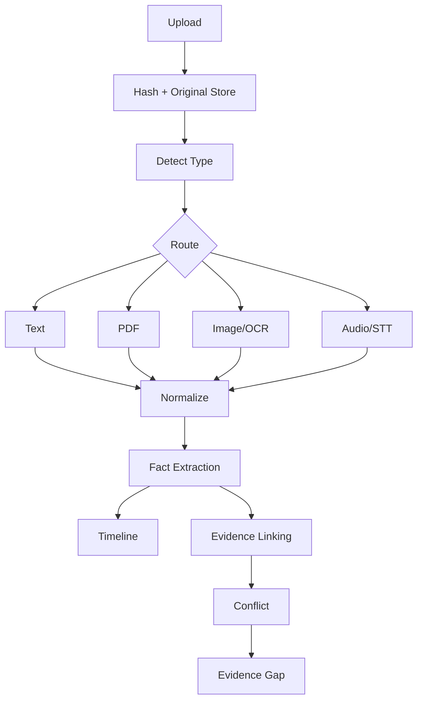

# P3 Evidence Intelligence

## 목적
사용자가 분류하지 않은 다양한 사건자료를 수집하여 원본 보존, 추출, Fact/Timeline 구성, Evidence Gap 탐지까지 수행한다.

## Task
P3.1 Upload/Ingestion API  
P3.2 File/MIME Detection  
P3.3 Document Classification  
P3.4 Text Parser  
P3.5 PDF Parser  
P3.6 Image/Vision-OCR  
P3.7 Audio/STT  
P3.8 Evidence Normalization  
P3.9 Fact Extraction  
P3.10 Timeline Extraction  
P3.11 Fact↔Evidence Linking  
P3.12 Conflict Detection  
P3.13 Evidence Gap Detection  
P3.14 Source-location Traceability  
P3.15 Pipeline Evaluation

## Pipeline

## 원본 보존
원본은 immutable reference/checksum을 유지한다. 추출문과 AI 해석은 별도 저장한다.

## Extraction Output
`evidence_id, extracted_text/content_ref, source_spans, extraction_method, confidence, warnings`

## Fact Extraction
각 Fact:
`statement, status, source evidence/location, parties, event_date, confidence`

LLM confidence만으로 CONFIRMED 승격 금지.

## Conflict Detection
동일 속성/사건에 대해 상충하는 Evidence가 있으면 자동 해결하지 말고 `CONFLICTED`와 양쪽 Source를 보존한다.

## Evidence Gap
LegalIssue/Playbook required facts/evidence와 현재 Case를 비교하여:
`gap_id, issue_id, requirement, reason, suggested_material, priority`

## Tool/Functions
- `ingest_evidence()`
- `detect_file_type()`
- `classify_document()`
- `extract_text()`
- `run_ocr_or_vision()`
- `transcribe_audio()`
- `normalize_evidence()`
- `extract_facts()`
- `extract_events()`
- `build_timeline()`
- `link_fact_evidence()`
- `detect_conflicts()`
- `detect_evidence_gap()`

## 보안 경계
파일 크기/형식 검증, 악성 파일 처리 경계, 민감정보 로그 최소화, 원본 접근제어를 고려한다.

## 평가
문서별 extraction correctness, Fact precision/recall, date extraction, traceability, conflict/gap detection을 Gold Set과 비교한다.

## DoD
Text/PDF/Image/Audio 처리, 원본 보존, Fact/Timeline, Traceability, Conflict, Gap, 실패/부분추출 상태가 구현 가능해야 한다.
