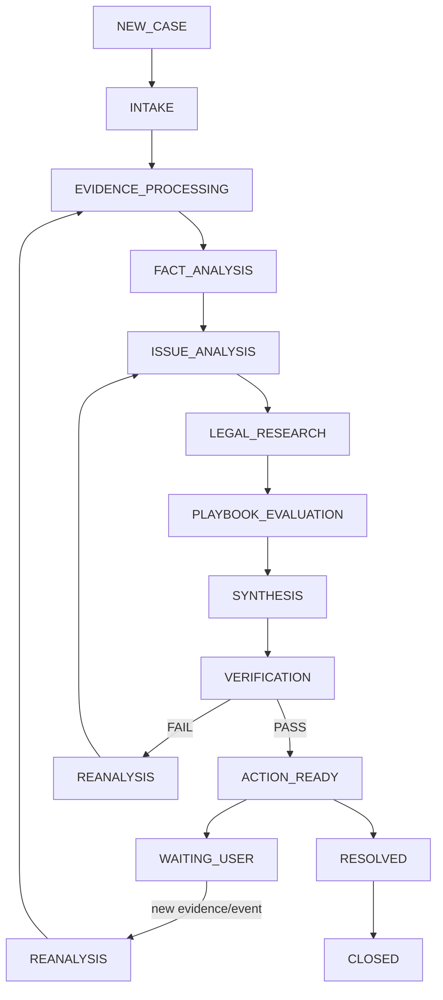

# P6 Workflow & Orchestration

## 목적
Case State, Agent/Tool 실행순서, 병렬처리, Retry, Reanalysis, Human/사용자 대기를 통제한다.

## State Machine

## Orchestration 원칙
- 상태는 시스템이 변경한다.
- Law/Precedent research는 가능한 경우 병렬 실행.
- Agent output schema validation 후 다음 단계.
- Verification FAIL은 실패 원인에 따라 최소 범위 재실행.
- 새로운 Evidence 입력 시 dependency impact를 계산하여 필요한 단계만 invalidate/re-run.
- 모든 run은 trace_id/correlation_id 기록.

## Processing Logic
`create_case → intake → evidence → facts/events → issues → parallel legal research → playbook → synthesis → verification → action`

## Function Specification
필수 함수:
`create_case, update_case, ingest_evidence, classify_document, extract_content, normalize_evidence, extract_facts, build_timeline, detect_conflicts, detect_evidence_gap, detect_issues, search_statutes, search_precedents, rerank_precedents, compare_case_to_precedent, select_playbook, evaluate_case_state, determine_next_action, synthesize_case_analysis, verify_analysis, generate_document`

각 함수는:
`name/purpose/called_by/input_schema/output_schema/preconditions/logic/postconditions/errors/retry/idempotency/logging/trace`

## Idempotency
업로드/추출/Index/Agent Run은 재시도 시 중복 객체 생성 방지키를 고려한다.

## Retry
- transient external error: bounded retry/backoff
- schema error: retry with correction once/limited
- logical verification fail: targeted reanalysis
- permanent validation fail: stop/report

무한 Agent loop 금지. 최대 재분석 횟수 후 Human/사용자 확인.

## State Persistence
workflow state, run history, input/output refs, model/prompt version, tool calls, verification result를 저장한다.

## DoD
deterministic state transitions, routing, parallel research, targeted reanalysis, retry limit, trace, resume, new evidence reprocessing, error state.
