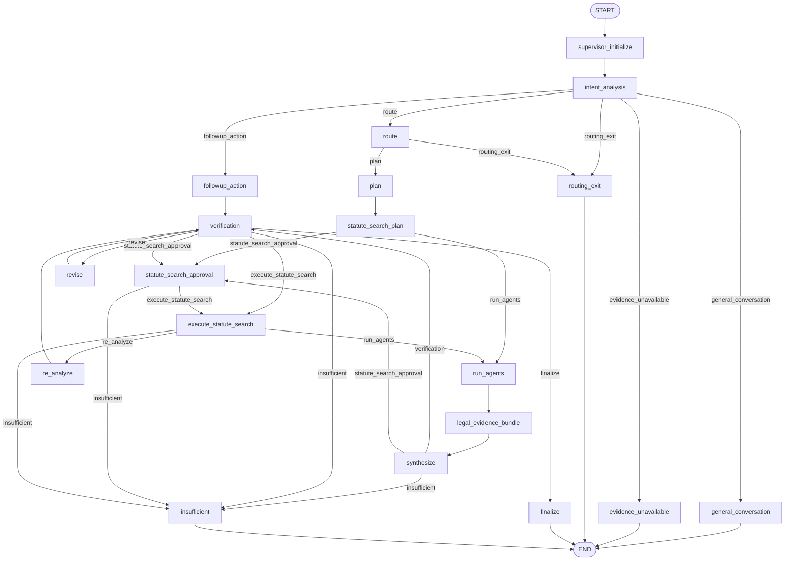
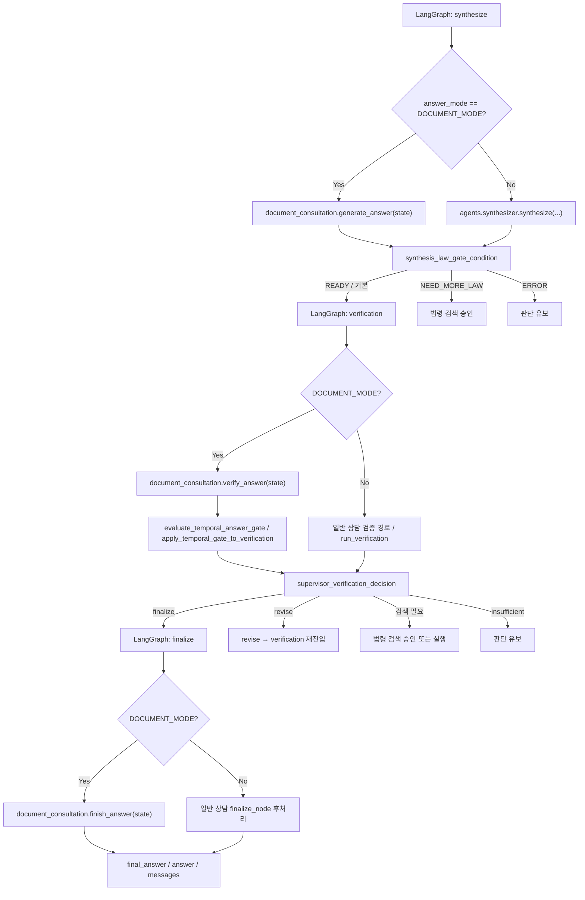
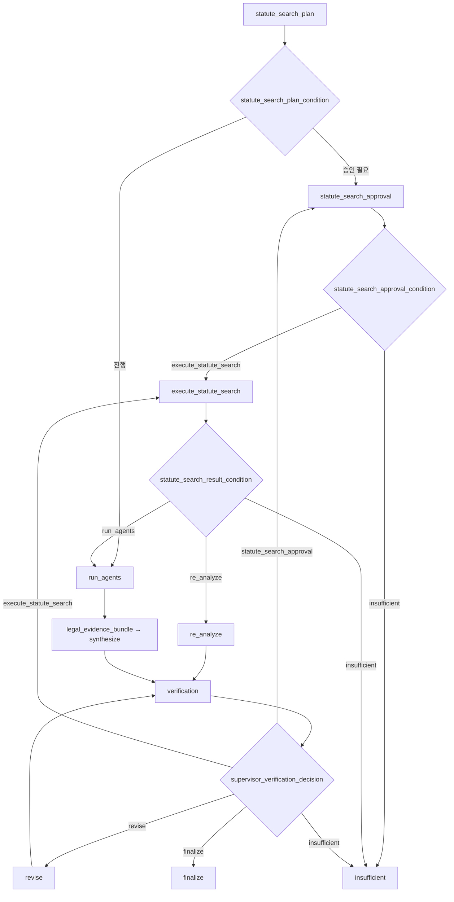

# AI Legal Helper 전체 상담 플로우차트 — 소스코드 대조본

- 검토일: 2026-11-11
- 기준: GitHub `main`의 `backend/src/ai_legal_helper/workflows/legal_workflow.py`
- 대조 대상: `docs/analysis/COMPREHENSIVE_CODE_LOGIC_PROMPT_AUDIT_REPORT.md` §3.1
- 범위: **실제 LangGraph 등록 노드/간선**과 **노드 내부의 문서·일반 상담 처리**를 분리하여 기술
- 주의: 아래는 정적 소스코드 리뷰 결과이며, 모든 분기의 E2E 실행 성공을 입증하지 않는다. 기존 실행 코드는 변경하지 않았다.

## 1. 감사 보고서 플로우차트 대조 결과

| 검토 항목 | 감사 보고서 | 소스코드 확인 결과 | 판정 |
|---|---|---|---|
| 그래프 노드 수 | 24개 주요 노드 | `build_legal_graph()`에 `graph.add_node()` **19개** | **수정 필요** |
| 조건부 분기 수 | 8개 | `graph.add_conditional_edges()` **7개** | **수정 필요** |
| 진입점 | START → supervisor_initialize → intent_analysis | 동일 | 일치 |
| 일반 대화·증거 없음·라우팅 종료 | 각각 종료 | 동일 | 일치 |
| 후속 행동 | followup_action → verification | 동일 | 일치 |
| 법률 상담 | route → plan → statute_search_plan | 동일. route에는 routing_exit 분기도 존재 | 부분 일치 |
| 전문 분석 | run_agents → legal_evidence_bundle → synthesize | 동일 | 일치 |
| 문서 답변 작성 | `synthesize / document_answer` 하나로 표시 | 실제 그래프 노드는 `synthesize` 하나. **내부**에서 `answer_mode == DOCUMENT_MODE`이면 `generate_answer(state)`, 아니면 `synthesize(...)` | 구분 필요 |
| 검증 | verification 공통 노드 | 그래프 노드는 공통. **내부**에서 문서 모드는 `verify_answer()` 및 시간성 게이트, 일반 모드는 별도 `run_verification()` 경로 | 구분 필요 |
| 최종화 | finalize 공통 노드 | 그래프 노드는 공통. 문서 모드는 `finish_answer(state)`로 위임, 일반 모드는 `finalize_node` 내부 처리 | 구분 필요 |
| 검색 결과 분기 | 문서→re_analyze, 일반→run_agents | 실제 분기는 **모드만이 아니라** `statute_search_phase`, 초안 유무, 검색 상태에 따라 결정 | **수정 필요** |
| 실패 및 유보 | insufficient → END | 동일 | 일치 |

> **노드와 함수 구별:** `generate_answer`, `verify_answer`, `finish_answer`, `assemble_grounded_answer`는 별도의 LangGraph 노드가 아니다. 실제 노드에 의해 호출되는 내부 함수다. 따라서 '3개의 답변 생성 파이프라인'을 3개의 병렬 그래프 경로로 해석하면 안 된다.

## 2. 전체 LangGraph 구조 — 실제 등록 간선 기준

다음 그림은 `build_legal_graph()`의 `add_node`, `add_edge`, `add_conditional_edges`를 기준으로 작성했다. 분기 라벨은 조건 함수의 **반환 키**를 사용했다.

### 그래프 등록 노드(19개)

`supervisor_initialize`, `intent_analysis`, `general_conversation`, `evidence_unavailable`, `followup_action`, `route`, `plan`, `statute_search_plan`, `run_agents`, `legal_evidence_bundle`, `synthesize`, `verification`, `revise`, `insufficient`, `finalize`, `statute_search_approval`, `execute_statute_search`, `re_analyze`, `routing_exit`.

조건부 분기 7개: `intent_analysis`, `route`, `statute_search_plan`, `synthesize`, `verification`, `statute_search_approval`, `execute_statute_search`.

## 3. 노드 내부 처리 — 상담 모드별 실제 차이

**주의:** 아래 다이어그램의 상자는 내부 함수·처리 단계이며, §2의 LangGraph 노드 개수에 포함되지 않는다.

### 문서 상담의 검증 및 최종화

- `synthesize_node`는 문서 모드에서 `document_consultation.generate_answer()`를 호출한다.
- `verification_node`는 문서 모드에서 `verify_answer()`와 시간성 검증 게이트를 사용한다.
- `finish_answer()`는 답변 SHA-256과 출처 스냅샷의 무결성을 확인한다. 검증된 답변은 원문을 보존하며, 조건에 따라 제한 답변 재생성·재검증 또는 WITHHELD 처리한다.
- `finalize_node`는 문서 모드에서 `finish_answer(state)`를 호출한다.

### 일반 상담의 검증 및 최종화

- `synthesize_node`는 일반 모드에서 `agents.synthesizer.synthesize(...)`를 사용한다.
- `synthesizer.py` 자체에서 `clean_markdown_formatting()`을 호출한다.
- `finalize_node`는 일반 모드에서 인용 검증/정제 후 `clean_markdown_formatting()`을 호출한다.
- 사건 브리핑과 쟁점 결과가 있으면 처분·사건 변경 정보를 반영한다. 코드 주석상 검증을 통과한 초안은 기본적으로 보존하고, **초안이 없는 경우** `assemble_grounded_answer()`를 사용한다.
- 따라서 `final_disposition.py`는 일반 상담과 병렬로 항상 실행되는 제3의 생성 그래프 경로가 아니라, **최종 처분·조립을 지원하는 함수 모듈**이다.

## 4. 검색·재검증 루프 상세

`statute_search_result_condition()`의 주요 조건:

1. `statute_search_status == API_ERROR`: `insufficient`.
2. `statute_search_phase == PRE_ANALYSIS`: `run_agents`.
3. `synthesis_law_gate == NEED_MORE_LAW`이고 초안이 없는 경우: 결과 상태에 따라 `run_agents` 또는 `insufficient`.
4. 그 외 검색 결과가 있거나 `NOT_FOUND`, `PARTIAL_SUCCESS`, `VERIFIED_LOCAL_FALLBACK`이면 `re_analyze`.
5. 나머지는 `insufficient`.

`supervisor_verification_decision()`은 단순한 `PASS→finalize / REVISE→revise` 매핑이 아니다. 쟁점별 처분, 문서 모드 전용 정책, 법령 추가 검색 필요성, 검색 이력, 수정 횟수, 시간성 재검토 등을 평가한다. §2의 다이어그램은 **가능한 간선**을 나타내며 모든 조건 조합의 상세 의사결정표는 아니다.

## 5. 보고서 그림에서 주의해야 할 점

1. **'24개 노드 / 8개 조건부 분기'는 실제 그래프 등록 코드와 불일치**한다.
2. **`synthesize / document_answer`는 하나의 노드 이름이 아니다.** 실제 노드 `synthesize` 안에서 모드에 따라 다른 함수가 실행된다.
3. **`final_disposition`은 LangGraph 노드가 아니다.** 최종 처분 계산과 답변 조립을 지원한다.
4. **법령 검색 이후의 분기는 단순 문서/일반 모드 분기가 아니다.** 검색 단계·초안 존재·검색 결과 상태에 좌우된다.
5. **문서 상담의 무결성 검증과 제한 답변 재검증**은 그래프 노드가 아닌 내부 처리다. 단일 상자 `finalize`만으로 이 안전장치를 설명할 수 없다.
6. `synthesis_law_gate_condition`은 실제로 `verification`, `statute_search_approval`, `insufficient` 키를 반환한다. 그림의 READY/NEED_MORE_LAW/FAIL은 **내부 상태**이지 그래프 분기 키가 아니다.
7. `intent_condition`의 `route` 반환은 법률 상담에만 한정된 문자열 조건이 아니라, 명시적으로 처리한 일반 대화·증거 불가·확인 요청·후속 행동 이외의 기본 분기다.

## 6. 소스 근거 인덱스

| 근거 | 파일 및 함수/구간 |
|---|---|
| 전체 그래프 등록 및 간선 | `workflows/legal_workflow.py` `build_legal_graph()`, 약 5095–5275행 |
| Intent 분기 | `workflows/legal_workflow.py` `intent_condition()`, 약 4729–4759행 |
| 모드별 초안 생성 | `workflows/legal_workflow.py` `synthesize_node()`, 약 1361행 이후 |
| 초안 후 분기 | `workflows/legal_workflow.py` `synthesis_law_gate_condition()`, 약 1471–1489행 |
| 모드별 검증 | `workflows/legal_workflow.py` `verification_node()`, 약 1497행 이후 |
| 검증 후 라우팅 | `workflows/legal_workflow.py` `supervisor_verification_decision()`, 약 2049행 이후 |
| 검색 결과 분기 | `workflows/legal_workflow.py` `statute_search_result_condition()`, 약 4162–4216행 |
| 최종화 및 초안 보존 | `workflows/legal_workflow.py` `finalize_node()`, 약 3236행 이후 |
| 문서 모드 검증·최종화 | `workflows/document_consultation.py` `verify_answer()`, `finish_answer()` |
| 일반 모드 종합 | `agents/synthesizer.py` `synthesize()` |
| 쟁점별 처분·조립 | `workflows/final_disposition.py` `determine_final_disposition()`, `assemble_grounded_answer()` |
| 서식 후처리 | `utils/text_formatter.py` `clean_markdown_formatting()` |

### 검증 한계

이번 리뷰는 GitHub `main`에 있는 **정적 소스 기준**이다. 특정 조건이 실제 운영 데이터에서 발생했는지, HITL 중단·재개 및 PostgreSQL 체크포인터가 정상 작동하는지는 별도의 실행 테스트가 필요하다. 본 문서는 코드 수정 제안서가 아니라 **현행 플로우의 사실 관계를 정리한 아키텍처 문서**다.
