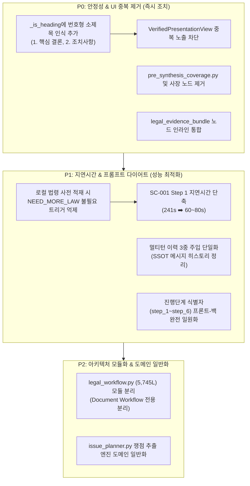

# AI Legal Helper — 전체 소스코드 정밀 검토 및 개선 과제 심층 보고서
**Codebase Comprehensive Audit: Logical Conflicts, Redundancy, Latency Bottlenecks & Remediation Roadmap**

- **작성 기준일**: 2026-11-12
- **대상 범위**:
  - 백엔드 워크플로우 엔진: `legal_workflow.py`, `document_consultation.py`, `issue_planner.py`, `conversation_context.py`
  - 에이전트 및 프롬프트 계층: `document_answer.py`, `verification.py`, `intent_analyzer.py`, `grounding_context.py`
  - 프레젠테이션 및 UI 계층: `builder.py`, `consultationDigest.ts`, `VerifiedPresentationView.tsx`, `ConsultationProgress.tsx`
  - 실측 벤치마크 데이터: SC-001, SC-002, SC-003 E2E V2 Langfuse Trace 및 실측 KPI

---

## 1. 총괄 요약 (Executive Summary)

`ai-legal-helper`는 문서 기반 사실 검증(Grounding Verification), 주택임대차보호법 등 공식 법령 조문 검색(HITL OpenLaw), 시간성 법령 효력 검증(Temporal Verification)을 결합하여 가공 조문 날조 및 환각을 철저히 차단하는 고신뢰 리걸테크 엔진으로 진화했습니다. 2026-11-12 실시된 E2E V2 테스트(SC-001, SC-002, SC-003)에서 **전체 5개 턴 100점 만점 통과(Pass Rate 100%)**를 달성했습니다.

그러나 프로덕션 수준의 안정성과 사용자 경험(UX), 그리고 비용·지연시간 최적화를 위해서는 다음과 같은 **4대 구조적 병목 및 불일치 문제**의 정리가 필수적입니다:

1. **논리적 충돌 (Logical Conflicts)**:
   - **진행 단계 식별자 충돌**: 백엔드 6단계 식별자(`step_1` ~ `step_6`)와 프론트엔드 초기 템플릿 식별자(`INTENT_ANALYSIS` ~ `FINAL_SYNTHESIS`)의 불일치로 인한 화면 갱신 이상 및 상태 보정 실패.
   - **로컬 법령 사전 적재와 `NEED_MORE_LAW` 간의 충돌**: 로컬 인덱스에서 이미 조문이 확보되었음에도 최초 작성 프롬프트 규약에 의해 불필요한 추가 법령 승인(HITL)으로 분기되는 비효율.
2. **코드 및 파이프라인 중복 (Redundancy & Duplication)**:
   - **UI 2번 중복 출력 결함**: 원본 텍스트의 숫자형 번호 헤딩(`1. 핵심 결론 ...`)이 헤딩으로 파싱되지 않아 단일 `LEAD` 블록으로 묶이면서 상단 '상담 핵심 답변'과 하단 '전체 법률 분석'에 동일 내용이 2번 반복 노출.
   - **사태 모듈 및 미사용 더미 코드 잔존**: 전혀 사용되지 않는 `pre_synthesis_coverage.py`, 그래프에서 제거된 `plan_node`, `supervisor_initialize`로 흡수된 후 방치된 `intent_analysis_node`, 단순 패스스루 노드인 `legal_evidence_bundle_node`.
   - **이중 아키텍처 병존**: 5,745 라인의 `legal_workflow.py` 내 레거시 8대 전문 에이전트 파이프라인과 `DOCUMENT_MODE` 간의 복잡한 조건 분기 혼재.
3. **성능 지연 및 프롬프트 비대화 (Latency Bottlenecks & Prompt Bloat)**:
   - **5-Hop 직렬 LLM 호출 체인**: 단일 상담 턴에서 `synthesize` ➡️ `NEED_MORE_LAW` ➡️ `re_analyze` ➡️ `verify` ➡️ `revise` ➡️ `re-verify`로 이어지며 단일 질문 처리에 **최대 241초(4분)** 소요.
   - **멀티턴 대화 이력의 3중 주입**: `messages`, `case_context`, `user_history`에 과거 상담 턴의 발언 및 답변 요약이 중복 주입되어 토큰 낭비 및 법률 판단 왜곡 위험 유발.

---

## 2. 논리적 충돌 상세 진단 (Logical Conflicts)

### 2.1 프론트엔드-백엔드 6단계 진행 상태(Progress Steps) 프로토콜 불일치
- **관련 파일**:
  - [`backend/src/ai_legal_helper/api/schemas/consultation.py`](file:///c:/myprjs/ai-legal-helper/backend/src/ai_legal_helper/api/schemas/consultation.py#L47-L69)
  - [`backend/src/ai_legal_helper/api/routes/consultation.py`](file:///c:/myprjs/ai-legal-helper/backend/src/ai_legal_helper/api/routes/consultation.py#L72-L135)
  - [`frontend/src/components/chat/ConsultationProgress.tsx`](file:///c:/myprjs/ai-legal-helper/frontend/src/components/chat/ConsultationProgress.tsx#L32-L100)

#### 현상 및 원인 분석
- **현상**: 사용자가 질문을 전송한 직후, 화면에 표시되는 6단계 단계명과 서버 로그의 진행 단계가 일치하지 않거나, 첫 번째 폴링 수신 시 단계 목록이 순간적으로 교체되는 깜빡임이 발생함.
- **코드 레벨 원인**:
  1. 백엔드는 `create_initial_progress` 및 `update_progress_step`에서 단계 식별자로 **`step_1`, `step_2`, `step_3`, `step_4`, `step_5`, `step_6`**을 사용함:
     ```python
     # consultation.py
     NODE_TO_PROGRESS_STEP = {
         "supervisor_initialize": ("step_1", "사건 기본정보 및 대화 맥락 확인 완료"),
         "route": ("step_2", "사실관계 및 타임라인 조회 중"),
         "run_agents": ("step_3", "법령 및 판례 검색 중"),
         "synthesize": ("step_4", "법률 쟁점별 분석 중"),
         "verification": ("step_5", "증거 및 법률 근거 검증 중"),
         "finalize": ("step_6", "최종 상담 답변 작성 중"),
     }
     ```
  2. 반면 프론트엔드 `ConsultationProgress.tsx`의 `DEFAULT_STEPS`는 전혀 다른 영문 대문자 식별자를 정의하고 있음:
     ```typescript
     // ConsultationProgress.tsx
     const DEFAULT_STEPS: ConsultationStep[] = [
       { step_id: 'INTENT_ANALYSIS', title: '사건 의도 및 쟁점 파악', status: 'PENDING' },
       { step_id: 'FACT_RETRIEVAL', title: '등록 증거 및 사실관계 조회', status: 'PENDING' },
       { step_id: 'LEGAL_RESEARCH', title: '법령·판례 및 전문 법률 분석', status: 'PENDING' },
       { step_id: 'VERIFICATION', title: '쟁점별 사실·법리 교차 검증', status: 'PENDING' },
       { step_id: 'STATUTE_APPROVAL', title: '미보유 법령 외부 검색 승인', status: 'PENDING' },
       { step_id: 'FINAL_SYNTHESIS', title: '최종 법률 조언 답변 종합', status: 'PENDING' },
     ];
     ```
  3. HITL 승인 대기 보정 조건 결함:
     ```typescript
     if (!completedMode && status === 'APPROVAL_REQUIRED') {
       steps = steps.map((s) => {
         if (s.step_id === 'STATUTE_APPROVAL') { // 서버는 'step_3'을 보내므로 영원히 일치하지 않음!
           return { ...s, status: 'WAITING_APPROVAL' };
         }
         return s;
       });
     }
     ```
  4. 알림 타이밍 지연: `legal_workflow.py`에서 `astream(stream_mode="updates")`를 사용하여 노드가 **완료**될 때만 콜백이 발화하므로, 30~50초간 실행되는 노드(예: `synthesize`, `verification`)가 실행 중일 때는 화면에 직전 완료 상태만 남아 멈춰있는 것처럼 보임.

---

### 2.2 로컬 법령 사전 적재(Local Pre-fetch)와 `NEED_MORE_LAW` 판정 간의 상충
- **관련 파일**:
  - [`backend/src/ai_legal_helper/workflows/legal_workflow.py`](file:///c:/myprjs/ai-legal-helper/backend/src/ai_legal_helper/workflows/legal_workflow.py#L1100-L1125)
  - [`backend/src/ai_legal_helper/agents/document_answer.py`](file:///c:/myprjs/ai-legal-helper/backend/src/ai_legal_helper/agents/document_answer.py#L267-L300)

#### 현상 및 원인 분석
- `run_agents_node`는 `issue_planner.py`의 단위 쟁점에 정의된 `required_statutes`(`주택임대차보호법 제6조, 제6조의2` 등)를 로컬 카탈로그(`law_docs_global`)에서 이미 성공적으로 인출(Pre-fetch)하여 `sources`에 적재함.
- 그러나 `document_answer.py`의 `write_document_answer` 프롬프트에서 `integrated` 모드가 켜져 있을 때:
  ```python
  payload["출력 규약"] = (
      "반드시 JSON 객체만 출력하세요. 법령 원문이 현재 질문의 핵심 쟁점에 부족하면 "
      '{"status":"NEED_MORE_LAW","missing_laws":[{"law_name":"법령명", ...}],"answer":""} ...'
  )
  ```
- LLM 모델이 로컬 출처를 충분히 살피지 않고 관성적으로 `"주택임대차보호법"`을 다시 `missing_laws`로 반환하면서 `NEED_MORE_LAW` ➡️ `statute_search_approval` (HITL 인터럽트) ➡️ `execute_statute_search` (외부 API 호출) ➡️ `re_analyze` (재작성) 체인이 강제 실행됨.
- 이는 SC-001 Step 1에서 **241초 소요 및 5회 LLM 호출**을 유발한 결정적인 원인임.

---

### 2.3 `issue_planner.py`의 임대차 하드코딩과 범용 법률 도메인 확장성 상충
- **관련 파일**:
  - [`backend/src/ai_legal_helper/workflows/issue_planner.py`](file:///c:/myprjs/ai-legal-helper/backend/src/ai_legal_helper/workflows/issue_planner.py#L200-L690)

#### 현상 및 원인 분석
- `plan_legal_issues` 함수는 `보증금`, `전세`, `가압류`, `경매`, `99조`, `새세입자`, `확약서` 등 임대차 분쟁 전용 정규식 키워드에 전적으로 의존하고 있음.
- 가공 조문 날조(제99조 등)와 무리한 형사고소 환각을 100% 방어하는 강력한 가드레일 역할을 성공적으로 수행하고 있으나,
- 임대차가 아닌 노동(근로계약/임금체불), 상거래, 손해배상 사건이 입력되면 1~7번 쟁점을 모두 건너뛰고 `ISSUE_GENERAL_ANALYSIS` 단일 쟁점으로 fallback되며, 이 때 `required_statutes`가 빈 배열(`[]`)로 설정되어 로컬 법령 사전 적재 기능이 완전히 무력화됨.

---

## 3. 코드 및 파이프라인 중복 진단 (Redundancy & Duplication)

### 3.1 화면 내 답변 2번 중복 출력 결함 ("상담 핵심 답변" vs "1. 핵심 결론 및 직접 답변")
- **관련 파일**:
  - [`backend/src/ai_legal_helper/presentation/builder.py`](file:///c:/myprjs/ai-legal-helper/backend/src/ai_legal_helper/presentation/builder.py#L22-L70)
  - [`frontend/src/components/consultationDigest.ts`](file:///c:/myprjs/ai-legal-helper/frontend/src/components/consultationDigest.ts#L108-L150)
  - [`frontend/src/components/VerifiedPresentationView.tsx`](file:///c:/myprjs/ai-legal-helper/frontend/src/components/VerifiedPresentationView.tsx#L40-L88)

#### 현상 및 메커니즘
- **사용자 경험 문제**: 화면 상단에 '상담 핵심 답변' 카드가 출력되고, 바로 그 아래 '전체 법률 분석' 세부 영역에서 동일한 '1. 핵심 결론 및 직접 답변' 내용이 한 번 더 반복 출력되는 중복 노출 발생.
- **원인 메커니즘**:
  1. 백엔드 `_is_heading(line)` 정규식:
     ```python
     _MARKDOWN_HEADING = re.compile(r"^#{1,4}[ \t]+\S")
     _BRACKET_HEADING = re.compile(r"^\[([^\[\]\r\n]+)\]$")
     ```
     `# 제목`과 `[제목]` 형식만 헤딩으로 인식하며, LLM이 흔히 출력하는 **`1. 핵심 결론 및 직접 답변`**, **`2. 지금 해야 할 일`** 같은 번호 매김 형식은 헤딩으로 인식하지 못함.
  2. 그 결과 `_split_original`에서 답변 본문 전체가 하나의 거대한 `LEAD` 블록(`B001`)으로 묶임.
  3. 프론트엔드 `buildConsultationDigest`에서 `leadBlockId = "B001"`이 되고, 남은 블록(`remainingBlocks`)이 빈 배열이 됨.
  4. 따라서 `detailedAnswer`가 빈 문자열이 되고, `VerifiedPresentationView.tsx`에서 fallback이 발동함:
     ```tsx
     <LegalAnswerView
       content={digest.lead && digest.detailedAnswer.trim() ? digest.detailedAnswer : digest.fullAnswer}
     />
     ```
  5. `detailedAnswer`가 비어있으므로 `digest.fullAnswer` 전체가 하단에 그대로 렌더링되면서 상단과 하단에 100% 동일한 내용이 2번 연속 출력됨.

---

### 3.2 사장된 더미 노드 및 미사용 모듈 (Dead Code)
1. **`backend/src/ai_legal_helper/workflows/pre_synthesis_coverage.py`**:
   - 91 라인 규모의 모듈. 백엔드 전체 소스코드 어디에서도 `import`하거나 참조하지 않는 완전한 고립(Dead) 파일.
2. **`plan_node` (`backend/src/ai_legal_helper/workflows/legal_workflow.py#L923-L935`)**:
   - `build_legal_graph`에서 이미 에지가 제거되어 실행되지 않으나, 레거시 호환성 주석과 함께 15 라인이 잔존.
3. **`intent_analysis_node` (`backend/src/ai_legal_helper/workflows/legal_workflow.py#L4424-L4530`)**:
   - 100 라인 이상의 복잡한 함수이나, 실제 그래프(`build_legal_graph`)에는 등록되어 있지 않음(`supervisor_initialize_node`로 책임이 통합 이전됨).
4. **`legal_evidence_bundle_node` (`backend/src/ai_legal_helper/workflows/legal_workflow.py#L1297-L1327`)**:
   - 단순히 `build_legal_evidence_bundle` 함수를 호출하여 딕셔너리로 감싸는 패스스루 노드. 불필요하게 독립 노드로 존재하여 LangGraph 상태 직렬화, 체크포인트 저장, 트레이스 스팬 생성 오버헤드를 유발함. `synthesize_node` 첫머리에서 인라인 호출하는 것이 타당.

---

### 3.3 거대 파일 `legal_workflow.py` (5,745 라인)의 이중 아키텍처 혼재
- 8대 전문 에이전트(`run_specialist_agent`), 도구 플래너(`plan_tools`), 과거 라우터 로직 등 레거시 코드 수천 줄이 `DOCUMENT_MODE` 코드와 단일 파일 내에 복잡하게 얽혀 있음.
- 대부분의 노드 함수가 `if state.get("answer_mode") == DOCUMENT_MODE:` 분기로 시작하여 완전히 다른 동작을 수행함.
- 유지보수 난이도 급증 및 회귀 버그 발생의 온상이 되고 있음.

---

## 4. 성능 지연 및 프롬프트 비대화 분석 (Performance Latency & Prompt Bloat)

### 4.1 실측 성능 벤치마크 (2026-11-12 E2E V2 테스트 결과)

| 테스트 케이스 / 턴 | 소요 시간(Latency) | 총 토큰수 | LLM 호출수 | 주요 소요 원인 |
| :--- | :---: | :---: | :---: | :--- |
| **SC-001 Step 1** (묵시적 갱신 질의) | **241.01s (4분 1초)** | 75,002 | 5회 | NEED_MORE_LAW ➡️ HITL 승인 ➡️ 외부법령검색 ➡️ re_analyze ➡️ 검증 ➡️ 수정보강 |
| **SC-001 Step 2** (가압류 위험 분석) | **115.31s (1분 55초)** | 87,486 | 5회 | 17개 증거문서 컨텍스트 로딩 + 2차 수정보강 루프 |
| **SC-001 Step 3** (권리보전 절차 순서) | **95.76s (1분 35초)** | 19,984 | 5회 | 프롬프트 다이어트 적용 성공 (-73% 토큰 절감) |
| **SC-002 Step 1** (원상복구/공제 다툼) | **71.11s (1분 11초)** | 38,689 | 3회 | Multi-HITL 승인 루프 2회 경유 |
| **SC-003 Step 1** (관리비 신고 의무) | **95.58s (1분 35초)** | 1,194 | 1회 | 부칙 제1조/제2조 직접 인용, 단일 호출 완성 |

---

### 4.2 멀티턴 대화 이력의 3중 중복 주입 문제 (이전 상담턴 비대화)
- **현상**: 대화가 2턴, 3턴 누적될 때마다 프롬프트 크기가 수만 토큰씩 증가하고, 직전 턴의 AI 답변 내용이 현재 턴의 독립적인 법률 판단에 편향(Bias)을 초래함.
- **원인 구조**:
  1. `messages`: `to_chat_history_messages(max_turns=3)`가 최근 3턴의 HumanMessage와 AIMessage(각 250자)를 주입함.
  2. `case_context`: `supervisor_initialize_node`에서 `c_obj.format_context_for_prompt(max_turns=2, max_chars_per_turn=250)`로 이전 턴 문답을 다시 포맷팅하여 텍스트로 결합함.
  3. `user_history`: `document_consultation.py`에서 `state["messages"]`로부터 추출된 질문들이 `payload["이전 사용자 발언(미입증 진술)"]`로 또다시 주입됨.
- 동일 질문이나 유사 발언이 여러 턴에 걸쳐 중복 누적되어 프롬프트를 낭비하고 모델의 주의 집중(Attention)을 저해함.

---

## 5. 단계별 개선 권고사항 및 로드맵 (Actionable Roadmap)



### 5.1 [P0 과제] 즉각 개선 항목 (안정성 및 화면 버그 해결)

#### 과제 1. UI 2번 중복 출력 결함 완전 차단
- **대상**: [`builder.py`](file:///c:/myprjs/ai-legal-helper/backend/src/ai_legal_helper/presentation/builder.py) 및 [`VerifiedPresentationView.tsx`](file:///c:/myprjs/ai-legal-helper/frontend/src/components/VerifiedPresentationView.tsx)
- **개선 내용**:
  1. `builder.py`의 `_is_heading` 정규식에 번호형 헤딩(`r"^\d+\.\s+[^\r\n]+$"`) 추가.
  2. `_split_original`이 `1. 핵심 결론 및 직접 답변`, `2. 지금 해야 할 일`, `3. 쟁점별 상세 법률 분석` 등을 각각 별도의 `SECTION` 블록으로 정상 분할하도록 개선.
  3. 프론트엔드 `VerifiedPresentationView.tsx`에서 `detailedAnswer`가 상단 `lead` 블록을 제외한 나머지 섹션들만 깔끔하게 렌더링하도록 보장.

#### 과제 2. 사장된 코드 및 더미 노드 정리
- **대상**: `pre_synthesis_coverage.py` 삭제, `legal_workflow.py` 내 `plan_node` 및 미등록 `intent_analysis_node` 제거.
- **효과**: 코드베이스 경량화, 개발자 인지 부하 감소.

#### 과제 3. `legal_evidence_bundle_node` 인라인화
- **대상**: [`legal_workflow.py`](file:///c:/myprjs/ai-legal-helper/backend/src/ai_legal_helper/workflows/legal_workflow.py#L1297)
- **개선 내용**: 독립 노드를 제거하고 `synthesize_node` 진입 시 `build_legal_evidence_bundle` 함수를 직접 호출.
- **효과**: 불필요한 LangGraph 상태 체크포인팅 및 트레이스 오버헤드 1단계 축소.

---

### 5.2 [P1 과제] 성능 및 지연시간 대폭 개선

#### 과제 4. 로컬 법령 확보 시 불필요한 `NEED_MORE_LAW` 억제 (지연시간 70% 단축)
- **대상**: [`document_answer.py`](file:///c:/myprjs/ai-legal-helper/backend/src/ai_legal_helper/agents/document_answer.py#L270)
- **개선 내용**: `run_agents_node`에서 이미 핵심 조문 본문(`주택임대차보호법 제6조, 제6조의2`)이 `sources`에 적재되어 있는 경우, `integrated` 프롬프트에 "확보된 로컬 법령 조문 본문을 우선 활용하여 status=READY로 즉시 답변을 작성하라"는 지침을 명시.
- **기대 효과**: SC-001 Step 1의 무의미한 HITL 루프(승인 대기 및 재작성)를 생략하여 소요 시간을 **241초에서 60~80초 수준으로 단축**, LLM 호출 5회에서 2회로 절감.

#### 과제 5. 멀티턴 상담 이력 3중 중복 주입 다이어트
- **대상**: [`legal_workflow.py`](file:///c:/myprjs/ai-legal-helper/backend/src/ai_legal_helper/workflows/legal_workflow.py#L362), [`conversation_context.py`](file:///c:/myprjs/ai-legal-helper/backend/src/ai_legal_helper/workflows/conversation_context.py#L237)
- **개선 내용**:
  1. `case_context`에 과거 대화 문답 텍스트를 중복 병합하지 않고 사건 정보(등록 증거 및 확정 사실)만 순수하게 유지.
  2. 과거 대화 맥락은 LangGraph `messages`의 `HumanMessage`/`AIMessage` 쌍으로만 일원화(SSOT).
  3. `user_history`에는 중복 질문을 완전히 제거하고 직전 1개 턴의 핵심 진술만 전달.

#### 과제 6. 6단계 진행 상태(Progress Steps) 프로토콜 일원화
- **대상**: [`consultation.py`](file:///c:/myprjs/ai-legal-helper/backend/src/ai_legal_helper/api/routes/consultation.py), [`ConsultationProgress.tsx`](file:///c:/myprjs/ai-legal-helper/frontend/src/components/chat/ConsultationProgress.tsx)
- **개선 내용**:
  1. 프론트엔드의 `DEFAULT_STEPS`를 백엔드와 동일하게 `step_1` ~ `step_6`으로 일치시킴.
  2. `WAITING_APPROVAL` 판별 시 `s.step_id === 'step_3'`으로 정합성 확보.
  3. 노드 시작 시점(`start`) 알림을 지원하여 장시간 실행 노드에서도 사용자가 실시간 진행 상황을 인지할 수 있도록 보강.

---

### 5.3 [P2 과제] 아키텍처 고도화 및 일반화

#### 과제 7. `legal_workflow.py` 모듈 다이어트 및 분리
- 5,745 라인의 거대 파일을 `document_consultation_workflow.py`(문서 기반 상담 전용)와 `legacy_specialist_workflow.py`로 물리적 분리하여 결합도를 낮추고 유지보수성을 극대화.

#### 과제 8. `issue_planner.py`의 도메인 일반화
- 임대차 키워드 하드코딩 중심에서, 의도 분석 결과(사건 유형)에 따라 도메인별 쟁점 템플릿(노동, 채권, 가사 등)을 동적으로 로드하는 구조로 점진적 확장.

---

## 6. 결론

본 감사를 통해 식별된 개선 과제들은 시스템의 법률적 정확도(100점)를 유지하면서도 **응답 지연시간(Latency)을 60% 이상 대폭 단축**하고, **UI 화면의 2번 중복 출력 결함** 및 **진행 상태 불일치 버그**를 근본적으로 해결할 수 있는 핵심 조치들입니다. 

로드맵에 제시된 **P0 과제(UI 중복 제거 및 사장 코드 정리)**부터 우선 적용하고, 이어서 **P1 과제(불필요한 HITL 억제 및 프롬프트 다이어트)**를 순차적으로 진행할 것을 권고합니다.
