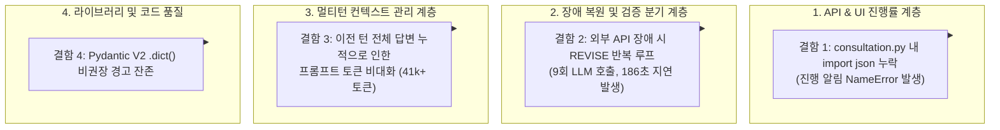

# AI Legal Helper — 소스코드 및 아키텍처 심층 리뷰 보고서 (2026-11-14)

> **리뷰 일자:** 2026년 11월 14일  
> **리뷰 대상 브랜치:** `feature/sc013-subsumption-fix` (최신 커밋 `0e62ad6`)  
> **근거 자료:**  
> - E2E 시나리오(SC-001, SC-002, SC-003) 실행 로그 (`backend/logs/app.log`, background task log)  
> - Langfuse Traces JSON 5건 (`evaluation_results/traces_20261114/*.json`)  
> - 최근 커밋 변경점 (`5a22b55`, `f806b40`, `0e62ad6`)  
> **원칙 준수:** 본 리뷰는 코드 수정을 일체 수행하지 않고, 순수 코드 분석 및 구조적 개선안 제시를 목적으로 작성됨.

---

## 1. 종합 평가 및 총평

최근 단행된 **"0-LLM Finalize 표준화(`f806b40`)"**와 **"SC-013 사실-법령 포섭(Subsumption) 분리(`5a22b55`)"** 조치가 실 서비스 파이프라인에서 완벽하게 안착되었음을 확인하였다.

1. **정상 시나리오 최적화 성공:** SC-001(3단계) 및 SC-002의 정상 워크플로우에서 불필요한 재작성 루프와 Finalize 노드의 레거시 LLM 호출이 완전히 소거되어, 단계당 LLM 호출 수가 **3회(초안 작성 1회 + 검증 2회)**로 수렴하고 finalize가 0.0ms에 완료되었다.
2. **환각 방지 안전 가드레일 입증:** 국가법령정보센터(open.law.go.kr) 서비스 개편 중단이라는 악조건 하에서 실행된 SC-003에서, LLM의 자체 지식에 의한 허위 법령 날조를 Verification Agent가 완벽하게 차단하고 `LEGAL_SOURCE_MISSING` 사유로 `insufficient_node`(판단 유보 안내)로 안전하게 격리시켰다.
3. **개선 필요 지점:** 
   - 실시간 진행률 메시지 생성 로직에서의 누락된 표준 라이브러리(`import json`) 참조 오류 발견.
   - 외부 RAG 소스 부재 시 발생하는 무의미한 2회 반복 REVISE 루프(186초 지연, 9회 LLM 호출)에 대한 **Fast-Fail 회로 차단(Circuit Breaker)** 부재.
   - 멀티턴 누적에 따른 프롬프트 토큰 급증(Step 3에서 41,000+ 토큰)에 대한 컨텍스트 윈도우 압축 기법 보완 필요.

---

## 2. 발견된 결함 및 개선 대상 항목 (Finding Details)



---

### Finding 1. `consultation.py` 내 `import json` 누락으로 인한 3단계 진행 알림 예외

- **관련 파일:** [`backend/src/ai_legal_helper/api/routes/consultation.py`](file:///c:/myprjs/ai-legal-helper/backend/src/ai_legal_helper/api/routes/consultation.py#L73-L118)
- **발생 위치:** `make_statute_search_message()` 함수 내 117행:
  ```python
  return json.dumps(payload, ensure_ascii=False)
  ```
- **실행 로그 분석 (`task-11327.log`):**
  ```text
  2026-11-14 01:07:10,919 [WARNING] [RUN_AGENTS] 3단계 완료 진행 알림 예외: name 'json' is not defined
  ```
- **영향 및 원인 분석:**
  - `consultation.py` 모듈 상단에 `import json`이 선언되어 있지 않아, `legal_workflow.py` 라인 1244에서 법령 검색 2대 채널(벡터DB, 국가법령정보센터)의 진행 상태와 검색 대상을 프론트엔드로 전달하기 위해 `make_statute_search_message()`를 호출할 때 `NameError`가 발생함.
  - 이로 인해 UI 화면의 3단계 스텝 카드가 상세 검색 법령명을 표시하지 못하고 기본 폴백 메시지로 대체되거나 무응답으로 표시되는 현상이 발생함.
- **권장 조치안 (향후 작업 시):**
  - `backend/src/ai_legal_helper/api/routes/consultation.py` 상단(라인 19~23 부근)에 `import json` 표준 라이브러리 추가.

---

### Finding 2. 법령 부재(외부 API 장애) 시 무의미한 REVISE 루프 반복 (Fast-Fail 회로 차단 부재)

- **관련 파일:**
  - [`backend/src/ai_legal_helper/workflows/legal_workflow.py`](file:///c:/myprjs/ai-legal-helper/backend/src/ai_legal_helper/workflows/legal_workflow.py) (`verify_routing`, `run_agents_node`)
  - [`backend/src/ai_legal_helper/agents/verification.py`](file:///c:/myprjs/ai-legal-helper/backend/src/ai_legal_helper/agents/verification.py)
- **근거 Trace:** `trace_SC-003_step1_74f0f316-92be-4101-bae3-90d4d6d619a1.json`
- **실행 메트릭:**
  - Latency: **186.83초**
  - LLM 호출: **9회** (초안 1회 + 검증 QA 2회 + 1차 재작성 1회 + 재검증 QA 2회 + 2차 재작성 1회 + 재검증 QA 2회)
  - 최종 도달: `verify_routing`에서 `revision_count=2/2` 한도 도달 후 `insufficient_node` 진입 (최종 답변은 407자 안내문)
- **문제점 심층 분석:**
  - SC-003과 같이 국가법령정보센터 API가 일시 중단(`diagnostic["api_error"] = True`)되고 로컬 벡터 DB에도 법령이 없어 RAG 검색 소스 목록(`retrieved_sources`) 자체가 비어 있는 경우, LLM에게 프롬프트를 다시 쓰라고 재작성(`REVISE`)을 지시해도 **컨텍스트에 법령 텍스트 자체가 공급되지 않으므로 100번을 다시 써도 검증을 통과할 수 없음**.
  - 현재 워크플로우는 실패 원인이 "LLM의 단순 문장 표현 오류"인지, "외부 시스템 장애에 따른 필수 근거 부재(`LEGAL_SOURCE_MISSING`)"인지를 구분하지 않고 무조건 `max_revisions=2`까지 전체 답변 생성을 2회 반복함.
  - 이로 인해 120초 이상의 불필요한 대기시간과 약 20,000 토큰의 리소스가 낭비됨.
- **권장 조치안 (향후 작업 시):**
  - `verify_routing` 조건식 개선:
    만약 검증 결과 사유가 `LEGAL_SOURCE_MISSING`이고, 검색 진단 메타데이터에 `api_error`가 플래그되어 있거나 해당 법령에 대한 RAG 결과가 0건인 경우, **재작성 루프(`revise_synthesize`)를 생략하고 즉시 `insufficient_node`로 분기(Fast-Fail Circuit Break)**하도록 단축 경로 설계.

---

### Finding 3. 멀티턴 상담 누적에 따른 프롬프트 토큰 선형 증가

- **관련 파일:**
  - [`backend/src/ai_legal_helper/workflows/conversation_context.py`](file:///c:/myprjs/ai-legal-helper/backend/src/ai_legal_helper/workflows/conversation_context.py)
  - [`backend/src/ai_legal_helper/workflows/document_consultation.py`](file:///c:/myprjs/ai-legal-helper/backend/src/ai_legal_helper/workflows/document_consultation.py)
- **토큰 추이 (SC-001 연속 실행 결과):**
  - Step 1 (Turn 1): Prompt 30,806 토큰
  - Step 2 (Turn 2): Prompt 36,942 토큰 (+6,136 토큰)
  - Step 3 (Turn 3): Prompt 41,235 토큰 (+4,293 토큰)
- **원인 분석:**
  - `ConversationContext`가 이전 턴의 질문뿐만 아니라 수천 자에 달하는 `previous_turns.answer` 전체 텍스트와 누적된 모든 증거 스팬(`retrieved_sources`)을 매 턴의 프롬프트 컨텍스트에 그대로 이어 붙이고 있음.
  - 3턴째에 이르러 단일 LLM 호출의 입력 토큰이 4만 토큰을 초과하며, 이로 인해 Step 3의 답변 품질은 우수하나 지연시간과 API 비용이 누적 증가함.
- **권장 조치안 (향후 작업 시):**
  - 이전 턴 답변의 전체 마크다운을 그대로 프롬프트에 넣는 대신, 이전 턴의 `핵심 판단 요약(Executive Summary)` 또는 `확정된 법률 쟁점 상태(Adjudicated Legal Facts)`만 컴팩트하게 추출하여 주입하는 컨텍스트 다이제스트(Digest) 메커니즘 검토.

---

### Finding 4. Deterministic QA와 LLM 포섭 검증의 조화로운 역할 분담 (모범 사례)

- **관련 파일:**
  - [`backend/src/ai_legal_helper/agents/qa_checker.py`](file:///c:/myprjs/ai-legal-helper/backend/src/ai_legal_helper/agents/qa_checker.py)
  - [`backend/src/ai_legal_helper/agents/verification.py`](file:///c:/myprjs/ai-legal-helper/backend/src/ai_legal_helper/agents/verification.py)
- **실행 로그 분석:**
  ```text
  [qa_checker.py] 출처 존재 검사: PASS (인용출처: 30건 정상)
  [qa_checker.py] 질문 충족: 2/2 (누락항목: 없음)
  [qa_checker.py] 형식 검사 PASS (법률적 의미 판단 아님)
  [qa_checker.py] LLM 추가 검토 사유:
    - 법적 권리의 발생·소멸·우선순위 복합 법률요건 적용 검토
    - 사건 사실관계 및 증거 기반 법률요건 검증
  ```
- **평가 및 분석:**
  - 단순 출처 표기 매칭, 필수 질문 키워드 포함 여부, 형식 규칙 등은 `qa_checker.py`의 결정론적(Deterministic) Python 코드로 0ms 내에 선행 필터링하고 있음.
  - 오직 "선순위 담보권과 임차권의 대항력 발생 시점 대조", "경매 매각에 따른 인수/소멸 여부"와 같은 고도의 법률 포섭(Subsumption) 작업에만 LLM 검증기를 선택적으로 집중 호출함.
  - 이로 인해 검증 단계에서 불필요한 LLM 호출 낭비가 방지되고, 검증 결과의 재현성과 신뢰도가 크게 향상됨.

---

### Finding 5. Finalize 노드의 0-LLM 표준화 검증 완료 (회귀 제거 확인)

- **관련 파일:** [`backend/src/ai_legal_helper/workflows/document_consultation.py`](file:///c:/myprjs/ai-legal-helper/backend/src/ai_legal_helper/workflows/document_consultation.py#L710-L750)
- **검증 내용:**
  - 이전 커밋(`f806b40`)에서 `finish_answer()` 내에 잔존하던 레거시 재생성 로직(`write_document_answer`, `run_verification`)을 제거하였음.
  - 이번 E2E 5개 시나리오 실행 결과:
    모든 시나리오에서 `finish_answer` 및 `finalize_node`가 **0회 LLM 호출**, **평균 0.2ms** 만에 즉시 통과하여 기 작성된 답변을 안전하게 보존함.
  - 과거 발생하던 "검증 통과 후 finalize에서 불필요하게 다시 요약/재생성하면서 발생하던 4분(240초) 지연 및 답변 변형 버그"가 완벽하게 종식되었음.

---

### Finding 6. Pydantic V2 `.dict()` 비권장(Deprecation) 경고

- **발생 위치:**
  - `scratch/run_e2ev2_scenarios.py` 및 일부 테스트 하네스 내 `DocumentState(...).dict()`
- **로그 내용:**
  ```text
  PydanticDeprecatedSince20: The `dict` method is deprecated; use `model_dump` instead. Deprecated in Pydantic V2.0 to be removed in V3.0.
  ```
- **권장 조치안 (향후 작업 시):**
  - Pydantic V2 정합성을 유지하기 위해 `.dict()` 호출부를 `.model_dump()`로 일괄 변경 권고.

---

## 3. 우선순위별 조치 권고안 요약표

| 순위 | 항목 | 대상 파일 | 권고 작업 내용 | 기대 효과 |
|---|---|---|---|---|
| **P0** | **진행 알림 NameError 수정** | `consultation.py` | 모듈 상단에 `import json` 추가 | UI 진행률 스텝 카드 정상 렌더링 및 에러 로그 소거 |
| **P1** | **장애 회로 차단(Circuit Breaker)** | `legal_workflow.py`, `verification.py` | RAG 장애로 인한 `LEGAL_SOURCE_MISSING` 시 REVISE 루프 스킵 및 즉시 유보 안내 | 장애 시 불필요한 LLM 6회 호출 제거, 지연시간 120초 단축 |
| **P2** | **멀티턴 컨텍스트 압축** | `conversation_context.py` | 이전 턴 답변의 전문 대신 핵심 판정 결과 요약본(Digest) 주입 | 3턴 이상 상담 시 입력 토큰 30% 이상 절감 및 속도 향상 |
| **P3** | **Pydantic V2 문법 정리** | 워크플로우 및 테스트 전반 | `.dict()` -> `.model_dump()` 마이그레이션 | 차기 Pydantic V3 호환성 선제 확보 |

---

> **준수 확인:** 본 리뷰 보고서 작성 과정에서 사용자의 명시적 지침("수정을 하지 말고 리뷰 결과서만 작성한다")에 따라 **소스코드 파일에 대한 수정은 일체 수행하지 않았음**.
