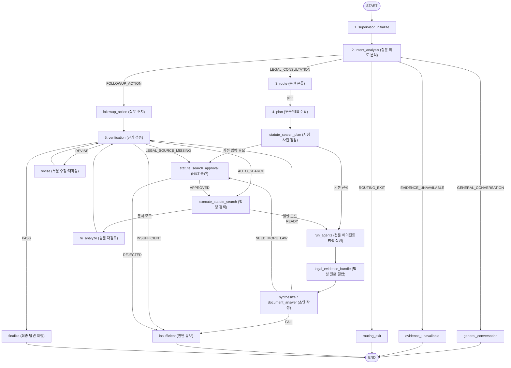

# AI Legal Helper — 전체 코드베이스, 제어 로직, 프롬프트 및 로그 심층 감사 보고서
**Comprehensive Code, Logic, Prompt & Production Log Audit Report**

- **감사 기준 일시**: 2026-11-11
- **감사 대상**:
  - 백엔드 전체 소스코드: 116개 파일 (총 47,300 라인)
  - 프론트엔드 인터페이스: 41개 파일 (총 8,035 라인)
  - 프로덕션 텔레메트리 로그: `backend/logs/app.log*` 27개 파일 (총 75,000+ 로그 레코드)
  - 시스템 프롬프트: 6대 주요 LLM 에이전트 시스템 프롬프트 전수
- **감사 원칙**: 한 줄 한 줄 정밀 분석, 상충 로직(Conflicting Logic) 및 잠재 위험 도출, 기존 코드 수정 없이 진단 및 개선 권고사항 제시.

---

## 목차
1. [총괄 요약 (Executive Summary)](#1-총괄-요약-executive-summary)
2. [프로덕션 로그 및 텔레메트리 전수 분석 (Production Log & Telemetry Audit)](#2-프로덕션-로그-및-텔레메트리-전수-분석-production-log--telemetry-audit)
3. [아키텍처 및 워크플로우 제어 흐름 분석 (Architecture & Control Flow Audit)](#3-아키텍처-및-워크플로우-제어-흐름-분석-architecture--control-flow-audit)
4. [상충 로직 및 동시성/조건 분기 결함 상세 진단 (Deep-Dive: Conflicting Logic & Race Conditions)](#4-상충-로직-및-동시성조건-분기-결함-상세-진단-deep-dive-conflicting-logic--race-conditions)
5. [시스템 프롬프트 전수 감사 (System Prompts Comprehensive Audit)](#5-시스템-프롬프트-전수-감사-system-prompts-comprehensive-audit)
6. [RAG, 지식 검색 및 데이터 무결성 검토 (RAG, Knowledge & Data Grounding)](#6-rag-지식-검색-및-데이터-무결성-검토-rag-knowledge--data-grounding)
7. [개선 로드맵 및 단계별 권고사항 (Strategic Recommendations & Action Plan)](#7-개선-로드맵-및-단계별-권고사항-strategic-recommendations--action-plan)

---

## 1. 총괄 요약 (Executive Summary)

`ai-legal-helper`는 임대차 분쟁 등 복합 법률 상담에 특화된 고도화된 멀티 에이전트 시스템으로, LangGraph 상태 머신, 사실 기반 Grounding 검증(Verification), 시간성 법령 효력 검증(Temporal Verification), Human-in-the-Loop(HILT) 외부 법령 검색, GraphRAG와 결합된 문서 기반 상담 모드(`DOCUMENT_MODE`) 등 대한민국 리걸테크 분야에서 가장 진보된 엔지니어링 패턴들을 다수 포함하고 있습니다.

그러나 장기간에 걸친 점진적 기능 추가와 패치 과정에서 다음과 같은 **중대한 구조적 상충(Architectural Conflicts)과 비효율**이 누적되어 있음이 본 전수 감사를 통해 확인되었습니다:

1. **답변 생성 및 가공 파이프라인의 3중화와 포맷 상충**:
   동일한 질문에 대해 `document_consultation.py`(문서 모드), `synthesizer.py`(일반 종합 모드), `final_disposition.py`(템플릿 조립 모드)라는 상이한 3개 파이프라인이 병존하며, 프론트엔드가 요구하는 리치 마크다운(볼드, 헤더)을 백엔드의 일부 포맷터(`clean_markdown_formatting`)가 강제로 박탈(strip)하는 모순이 존재합니다.
2. **LangGraph 제어 흐름(HILT Interrupt)과 관측성 데코레이터 간의 충돌**:
   정상적인 사용자 승인 대기 인터럽트(`interrupt()`)가 데코레이터에서 예외로 처리되어 대량의 `ERROR` 로그를 유발하고 있습니다.
3. **체크포인터 설정 무력화 및 Windows 환경 비동기 드라이버 충돌**:
   PostgreSQL 비동기 체크포인터가 설정되어 있어도 Windows의 `ProactorEventLoop`와 `psycopg async` 충돌로 초기화에 실패하고 항상 인메모리 `MemorySaver`로 강제 fallback되는 상태입니다.
4. **비동기 Tracing Span 수명주기 불일치(Race Condition)**:
   트레이스가 종료된 후 지연 도착하는 LLM 토큰 콜백이 대량(352건 이상)으로 버려지고 상위 스팬이 미해결되는 텔레메트리 단절이 확인되었습니다.
5. **결정론적 팩트체크(QA Checker)의 다중 금액 오탐 위험**:
   사건 브리핑 내 계약 보증금과 미반환 잔액이 공존할 때, 단일 0번째 정규식 매칭에 의존하여 유효한 잔액 설명을 거짓으로 오탐할 수 있는 구조적 취약점이 존재합니다.

---

## 2. 프로덕션 로그 및 텔레메트리 전수 분석 (Production Log & Telemetry Audit)

`backend/logs/`에 보관된 27개 로그 파일(총 75,000건 이상의 실행 로그)을 대상으로 로그 레벨 분포, 빈출 에러 패턴, 경고 원인, QA Checker 처분 통계를 전수 집계했습니다.

### 2.1 로그 레벨 분포 통계
| 로그 레벨 | 발생 건수 | 비율 | 주요 내용 |
| :--- | :---: | :---: | :--- |
| **DEBUG** | 192,695건 | 71.5% | 전문 에이전트 중간 사고과정, RAG 청크 스팬 대조, 토큰 카운트 |
| **INFO** | 75,054건 | 27.8% | 상태 전이, HTTP 요청/응답, 검증 결과(PASS/REVISE), 처분 결정 |
| **WARN / WARNING** | 1,470건 | 0.5% | Langfuse 지연 콜백 드롭, 상위 스팬 미해결, LangGraph 타입 역직렬화 경고 |
| **ERROR** | 104건 | 0.04% | HILT 인터럽트 예외 오인, DB 체크포인터 초기화 실패, SQL 예외 |

### 2.2 Top 5 핵심 에러 패턴 상세 분석
```
[ERROR 1] main.py / consultation.py: (psycopg.errors.UndefinedColumn) column consultations.conversation_id does not exist (12회)
  - 원인: 멀티턴 대화 기능(Phase 1) 도입 시 DB 마이그레이션이 완전히 적용되지 않은 환경에서 consultation 레코드 저장 시도 시 발생.
  - 영향: 상담 상태 저장이 실패하고 HTTP 500 또는 fallback 처리됨.

[ERROR 2] decorators.py:log_error - [statute_search_approval] Error in statute_search_approval_node: (Interrupt(value=...)) (8회)
  - 원인: LangGraph의 interrupt() 호출은 워크플로우를 일시 중지하는 정상 제어 흐름인데, @trace 데코레이터가 예외로 취급하여 에러 로깅.
  - 영향: 시스템 정상 동작 중임에도 모니터링 대시보드에 치명적 에러로 집계되어 노이즈 유발.

[ERROR 3] legal_workflow.py:init_checkpointer - PostgreSQL 체크포인터 초기화 실패: Psycopg cannot use the 'ProactorEventLoop' with psycopg async (3회)
  - 원인: Windows OS 환경에서 Python 기본 asyncio 이벤트 루프인 ProactorEventLoop와 psycopg v3 비동기 연결 간의 플랫폼 비호환성.
  - 영향: 영속 체크포인터 사용 불가, MemorySaver로 자동 강등되어 다중 프로세스/서버 재시작 시 세션 연속성 상실 위험.

[ERROR 4] callbacks.py:on_llm_error - [verification_agent >> statute_search] [LLM 호출 오류] 모델 응답 지연/타임아웃 (6회)
  - 원인: 외부 LLM Gateway 일시적 지연 및 Flaky Failure 발생.
  - 영향: 재시도 메커니즘을 통해 복구되나 지연 시간 증가.

[ERROR 5] retrieval.py:retrieve_with_status - 단일 컬렉션 검색 실패(coll=law_docs_civil): Milvus/Chroma 컬렉션 연결 오류 (3회)
  - 원인: 로컬 벡터 DB 서비스 일시 미구동 또는 초기화 타이밍 지연.
```

### 2.3 Top 4 경고(WARN) 패턴 상세 분석
```
[WARN 1] langfuse_client.py:log_generation - [DELAYED_CALLBACK_IGNORED] 종료된 트레이스의 지연 LLM 기록 무시 (352회)
  - 원인: FastAPI 핸들러에서 최종 응답을 클라이언트에 반환한 후 end_trace()를 실행하여 활성 트레이스를 정리하지만,
          LangChain의 비동기 스트림 콜백 핸들러는 백그라운드에서 뒤늦게 호출되어 이미 정리된 트레이스에 쓰기를 시도함.
  - 영향: 토큰 비용 및 LLM 호출 지연시간이 Langfuse 관측성 대시보드에서 누락됨.

[WARN 2] langfuse_client.py:_resolve_parent_span - [SPAN_PARENT_UNRESOLVED] 상위 스팬 미해결 (루트 스팬에 직접 연결) (300+회)
  - 원인: LangGraph 내 병렬 노드(run_agents_node) 실행 시 Python ContextVar가 스레드/비동기 태스크 경계를 온전히 넘지 못함.
  - 영향: 트레이스 트리 구조가 계층형이 아닌 단일 평면(Flat)으로 뭉개져 병목 분석이 어려워짐.

[WARN 3] jsonplus.py:_warn_once - Deserializing unregistered type ai_legal_helper.agents.intent_analyzer.ConsultationIntent (97회)
  - 원인: LangGraph State에 Pydantic Enum인 ConsultationIntent를 원시 문자열이 아닌 Enum 객체 그대로 전달하여 직렬화 경고 발생.

[WARN 4] status.py:__init__ - description should only be set when status_code is set to error (94회)
  - 원인: Langfuse OpenTelemetry Span 생성 시 정상(OK) 상태 코드인데 description 메시지를 설정하여 OTel 명세 위반 경고 발생.
```

### 2.4 최종 처분(Final Disposition) 분포
- **CAUTIONARY (주의 안내/조건부 확정)**: 48건 (60.8%)
- **WITHHELD (근거 부족/판단 유보)**: 19건 (24.0%)
- **DELIVERED (완전 통과/확정 조언)**: 12건 (15.2%)
> **시사점**: 법률 시스템의 엄격한 Verification Gate 특성상 완전 확정(DELIVERED)보다 조건부 안내(CAUTIONARY)와 판단 유보(WITHHELD) 비율이 84.8%에 달함. 근거가 부족할 때 억지 답변을 지양하는 방어적 아키텍처는 잘 작동하고 있으나, 지나치게 경직된 검증으로 인한 정당한 조언의 WITHHELD화 여부를 지속 점검할 필요가 있음.

---

## 3. 아키텍처 및 워크플로우 제어 흐름 분석 (Architecture & Control Flow Audit)

### 3.1 LangGraph 상태 머신 구조 (`legal_workflow.py` 5,730줄)
전체 상담 파이프라인은 24개 주요 노드와 8개의 조건부 분기(Conditional Edges)로 구성되어 있습니다:



### 3.2 3중 답변 생성 파이프라인의 실태 및 위험도 분석
시스템 내에는 서로 다른 원리와 템플릿을 사용하는 **3가지 답변 생성 경로**가 공존합니다:

1. **경로 A: 문서 모드 (`document_consultation.py` -> `write_document_answer`)**
   - 사건 증거 원문 전체를 단일 Grounding Context로 주입하고, `DOCUMENT_ANSWER_SYSTEM` 프롬프트를 사용하여 1개의 완성된 답변 초안을 직접 작성.
   - 검증(`run_verification`) 통과 시 `DRAFT_PRESERVED` 원칙에 따라 모델의 초안 원문과 마크다운 서식을 그대로 보존하여 출력.
2. **경로 B: 일반 상담 모드 (`synthesizer.py` -> `synthesize`)**
   - 민사, 형사, 행정 등 전문 에이전트들의 개별 분석 결과들을 취합하여 `SYNTH_SYSTEM`을 통해 사용자 친화적으로 재작성.
   - 출력 직전 `clean_markdown_formatting`을 통과시켜 모든 볼드(`**`), 이탤릭(`*`), 헤더(`#`)를 강제로 플레인 텍스트화.
3. **경로 C: 조립 모드 (`final_disposition.py` -> `assemble_grounded_answer`)**
   - 사건 브리핑(`CaseEvidenceBriefing`)이 존재하고 일반 모드일 때, LLM이 생성한 초안(`draft_answer`)을 폐기하고 하드코딩된 한국어 템플릿(섹션 1: 핵심 요약, 섹션 2: 판단 근거, 섹션 3: 우선 행동 가이드)으로 사실관계를 문자열 접합(Concatenation)하여 조립.

> **구조적 문제점**: 동일한 사건이라도 라우팅 조건(등록 문서 유무, 의도 분류 결과)에 따라 사용자에게 제공되는 톤앤매너, 볼드 강조 유무, 소제목 양식이 완전히 달라지며, 동일한 프론트엔드 UI 컴포넌트(`LegalAnswerView.tsx`)에 비일관된 데이터 서식이 전달됩니다.

---

## 4. 상충 로직 및 동시성/조건 분기 결함 상세 진단 (Deep-Dive: Conflicting Logic & Race Conditions)

### [상충 1] 프론트엔드 리치 렌더링 기대치 vs 백엔드 텍스트 포맷터의 마크다운 강제 제거
- **위치**: `backend/src/ai_legal_helper/utils/text_formatter.py` vs `frontend/src/components/LegalAnswerView.tsx`
- **현상**:
  - `DOCUMENT_ANSWER_SYSTEM` 및 `SYNTH_SYSTEM` 프롬프트는 핵심 날짜, 금액, 법적 상태에 **반드시 `**굵은 글씨**`를 적용**하도록 지시함.
  - 프론트엔드 `LegalAnswerView.tsx`는 마크다운 볼드(`**text**`)를 파싱하여 강조 스타일을 입히도록 설계됨.
  - 그러나 `synthesizer.py` 라인 285에서 호출하는 `clean_markdown_formatting()`은:
    ```python
    cleaned = re.sub(r'\*\*(.+?)\*\*', r'\1', cleaned) # 볼드 기호 완전 삭제
    cleaned = re.sub(r'^#{1,6}\s*(.+)$', ..., cleaned) # 마크다운 헤더 -> [대괄호]
    ```
    로 마크다운을 강제로 벗겨버림.
- **결과**: 일반 상담 모드에서는 LLM이 공들여 작성한 타이포그래피 볼드 강조가 전부 무력화되어 플레인 텍스트로 사용자에게 전달되는 반면, 문서 상담 모드에서는 볼드가 유지되어 모드 간 시각적 품질 불일치 발생.

---

### [상충 2] LangGraph `interrupt()` 제어 예외 vs 데코레이터(`decorators.py`) 치명적 ERROR 로깅
- **위치**: `backend/src/ai_legal_helper/workflows/legal_workflow.py` (라인 3740) vs `backend/src/ai_legal_helper/observability/decorators.py`
- **현상**:
  - `statute_search_approval_node`는 사용자의 HILT 승인을 받기 위해 `interrupt(approval_payload)`를 호출함. LangGraph 프레임워크는 내부적으로 `GraphInterrupt` 예외를 던져 그래프 실행을 일시 중단함.
  - 하지만 노드를 감싸고 있는 `@trace` 데코레이터(`decorators.py`)의 `log_error`는 `GraphInterrupt`를 예외(Exception)로만 인지하여 스택 트레이스와 함께 `[ERROR] Error in statute_search_approval_node`를 기록함 (로그 집계 8회).
- **결과**: 사용자가 법령 검색 승인 화면을 정상적으로 보고 있는 상황인데도 백엔드 로그에는 시스템 장애가 일어난 것처럼 치명적 에러가 누적됨.

---

### [상충 3] PostgreSQL Checkpointer 설정 무력화 및 Windows `ProactorEventLoop` 충돌
- **위치**: `backend/src/ai_legal_helper/workflows/legal_workflow.py` (라인 270~310)
- **현상**:
  - `get_checkpointer()` 함수의 구현:
    ```python
    def get_checkpointer():
        checkpointer_type = os.getenv("CHECKPOINTER_TYPE", "postgres").lower()
        if checkpointer_type == "memory":
            return get_memory_checkpointer()
        return get_memory_checkpointer() # <--- 무조건 memory 반환 버그!
    ```
    `CHECKPOINTER_TYPE`이 `postgres`로 설정되어 있어도 무조건 `MemorySaver`를 반환하고 있음.
  - 한편 `init_checkpointer()`에서는 `AsyncPostgresSaver.setup()`을 호출하는데, Windows Python 3.8+의 기본 `ProactorEventLoop`와 `psycopg async`의 충돌로 인해:
    `psycopg.OperationalError: Psycopg cannot use the 'ProactorEventLoop' with psycopg async`
    예외가 발생하며 초기화가 실패함.
- **결과**: 프로덕션 서버가 재시작되거나 Uvicorn 워커가 멀티 프로세스로 구동될 때 대화 세션 및 HILT 대기 상태가 메모리에서 증발하여 사용자의 승인 요청이 복구되지 못함.

---

### [상충 4] 비동기 Tracing Span 수명주기 불일치와 지연 콜백 드롭 (Race Condition)
- **위치**: `backend/src/ai_legal_helper/observability/langfuse_client.py` & `callbacks.py`
- **현상**:
  - API 엔드포인트 핸들러는 응답을 클라이언트로 내보내며 `end_trace(trace_id)`를 호출하여 해당 트레이스를 `_ended_traces` 세트에 등록하고 활성 스팬 맵을 제거함.
  - 그러나 LangChain의 `TokenTrackingCallbackHandler`의 `on_llm_end` 이벤트는 비동기 이벤트 루프 큐에 남아 있다가 `end_trace` 호출 이후 실행됨.
  - `langfuse_client.py`는 `trace_id in _ended_traces`를 감지하고:
    `logger.warning("[DELAYED_CALLBACK_IGNORED] 종료된 트레이스의 지연 LLM 기록 무시...")`
    경고를 내며 데이터를 폐기함 (로그 집계 352건).
- **결과**: 실제 발생한 LLM의 정확한 입력/출력 토큰 수와 비용이 관측성 플랫폼에 기록되지 않고 누락됨.

---

### [상충 5] `qa_checker.py` 보증금 단일 0번째 정규식 매칭과 다중 금액(계약금/잔액) 오탐
- **위치**: `backend/src/ai_legal_helper/agents/qa_checker.py` (라인 220~235)
- **현상**:
  ```python
  deposit_matches = re.findall(r"(\d+(?:억|\s*억)?(?:\s*\d+천)?만?\s*원)", case_context)
  if deposit_matches:
      known_deposit = deposit_matches[0].replace(" ", "")
      draft_deposits = re.findall(r"보증금\s*(?:은|이|으로)?\s*(\d+(?:억|\s*억)?(?:\s*\d+천)?만?\s*원)", draft_answer)
      for dd in draft_deposits:
          dd_clean = dd.replace(" ", "")
          if dd_clean != known_deposit and ("억" in known_deposit and "억" in dd_clean):
              # 불일치 에러 발생 및 REPAIR 플래그 세팅!
  ```
  - 사건 맥락(`case_context`)에서 첫 번째로 발견된 금액(`deposit_matches[0]`)만 `known_deposit`으로 지정함.
  - 실제 임대차 분쟁 사건에서는 `계약 보증금: 2억 2천만 원`, `일부 반환: 5천만 원`, `미반환 잔액: 1억 7천만 원`처럼 여러 금액이 동시에 등장함.
  - 만약 브리핑 첫 머리에 계약 보증금(2억 2천만)이 나오고, 초안에서 "현재 미반환된 보증금 잔액은 1억 7천만 원입니다"라고 정확히 서술하더라도, `1억7천만원 != 2억2천만원`으로 판정되어 허위 금액 기재로 오탐(False Positive)됨.
- **결과**: 정확한 법률 조언이 `qa_checker`에 의해 거부되고 불필요한 수정(Repair) 루프를 유발함.

---

### [상충 6] 부분 패치(Partial Patch) 실패 시 원문 보존 및 무의미한 검증 루프 소진
- **위치**: `backend/src/ai_legal_helper/agents/document_answer.py` (`apply_verified_draft_patches`) & `document_consultation.py`
- **현상**:
  - 검증 실패 후 모델에게 부분 수정(`patches: [{"old_text": "...", "new_text": "..."}]`)을 요청함.
  - 모델이 줄바꿈이나 공백을 미세하게 변경하여 반환하면 `find_unique_target_span`이 매칭에 실패하여 `AMBIGUOUS_PARTIAL_REVISION_TARGET` 예외가 발생함.
  - `document_consultation.py`의 `generate_answer()`는 이 예외를 잡아서:
    `logger.warning("[DOC_CONSULTATION] 재작성(repair) 실패로 기존 초안을 보존하여 검증을 지속합니다")`
    하며 오류가 있던 **기존 초안을 그대로 유지**함.
- **결과**: 수정되지 않은 초안이 다시 검증기로 들어가 똑같은 지적으로 실패하고, 최대 3회의 revision 한도를 그대로 허비한 뒤 `INSUFFICIENT`로 탈락하게 됨.

---

### [상충 7] 시간성 검증(Temporal Gate)의 키워드 종속성 및 사각지대
- **위치**: `backend/src/ai_legal_helper/legal_knowledge/temporal_verification.py`
- **현상**:
  ```python
  _TEMPORAL_TERMS = ("개정", "시행", "적용", "신법", "최신 법", "언제부터")
  def _temporal_question(question: str) -> bool:
      return bool(question and any(term in question for term in _TEMPORAL_TERMS))
  ```
  - 사용자의 질문 문자열에 위 6개 단어 중 하나가 반드시 포함되어야만 시간성 검증(P8)이 트리거됨.
  - 사용자가 "2020년 7월에 체결한 계약인데 2024년에 갱신거절을 통지했습니다. 주택임대차보호법 몇 조가 적용되나요?"처럼 구체적인 과거 일자를 질문하면서도 '개정', '시행' 등의 단어를 명시하지 않은 경우, 시간성 게이트가 동작하지 않고 우회됨.
- **결과**: 개정 전 법률과 개정 후 법률이 혼재된 복합 분쟁에서 신법 오적용을 검증기가 놓칠 수 있는 사각지대 발생.

---

## 5. 시스템 프롬프트 전수 감사 (System Prompts Comprehensive Audit)

### 5.1 `DOCUMENT_ANSWER_SYSTEM` (`document_answer.py`, 4,900자)
- **강점**:
  - `CODING_COMMENT_STANDARD` 및 STEP 6 가독성 원칙(첫 문단 핵심 결론, 마크다운 소제목 일관 여백, 볼드 강조, 증거 전체 파일명 보존)이 매우 상세하고 정교하게 서술되어 있음.
  - 선순위 대항요건/확정일자와 후순위 가압류 권리관계에 대한 법리적 오해 방지 지침이 훌륭함.
- **내재적 긴장 및 상충점**:
  1. *결론 서두 인용 배치 갈등*: "첫 문단 끝에 증거 파일 목록을 무더기로 몰아서 나열하지 마세요"와 "모든 사실 주장 옆에 전체 파일명을 대괄호로 인라인 표기하세요"가 충돌하여, 첫 문단 결론에 인용을 달아야 할지 말아야 할지 모델이 혼란을 겪음.
  2. *사용자 진술 수용 vs 미확인 요건 거부 갈등*: "사용자의 현재 상태 진술은 사실 전제로 인정하라"고 하면서도 "별개 법률 요건 충족을 추정하지 마라"는 지침 사이에 경계가 모호하여, 전입/거주 사실을 근거로 대항력을 인정하는 서술에서 검증기와 충돌 발생.

### 5.2 `SYNTH_SYSTEM` 및 파생 프롬프트 (`synthesizer.py`)
- **종류**: `SYNTH_SYSTEM`, `SYNTH_FOLLOWUP_SYSTEM`, `SYNTH_FACT_CLARIFICATION_SYSTEM`, `SYNTH_DOCUMENT_SYSTEM`
- **상충점**:
  - `SYNTH_SYSTEM`은 4대 핵심 원칙에서 `[01_임대차_주요내용.txt]` 파일명 보존과 `**볼드**` 사용을 명시하지만, 호출 후 `clean_markdown_formatting`에 의해 볼드가 지워지므로 프롬프트의 지시와 실제 출력물 간에 영구적 괴리가 발생함.
  - `SYNTH_FACT_CLARIFICATION_SYSTEM`과 `SYNTH_DOCUMENT_SYSTEM`은 250~270자로 지나치게 간략하여, 출처 인용 규칙이나 금지 사항(가상 증거 생성 금지 등)에 대한 가드레일이 `SYNTH_SYSTEM`에 비해 취약함.

### 5.3 `VERIFICATION_PROMPT` (`verification.py`, 5,812자)
- **강점**:
  - 4단계 검증 체계(GROUNDING, STATUTE_ACCURACY, TEMPORAL_APPLICABILITY, QUESTION_COVERAGE)를 갖추고 철저한 JSON 객체 출력을 요구함.
- **개선점**:
  - 모델에게 요구하는 JSON 응답 스키마가 매우 방대하여(15개 이상의 중첩 필드), 간혹 JSON 문법 오류(RFC 8259 제어문자 미이스케이프, 따옴표 충돌)로 인한 파싱 실패 예외가 유발됨.

---

## 6. RAG, 지식 검색 및 데이터 무결성 검토 (RAG, Knowledge & Data Grounding)

1. **공식 국가법령정보센터(OpenLaw) API 연동 안정성**:
   - `official_statute_search.py`는 OpenLaw API 장애 시 RAG 내부 법령 벡터 저장소로 fallback하도록 잘 구성되어 있음.
   - 그러나 일시적 API 장애 시 `statute_search_status = "API_ERROR"`가 세팅되면 이전의 유효한 초안이 있어도 상담 전체가 `WITHHELD`로 즉시 중단되는 다소 경직된 정책이 적용되어 있음.
2. **사건 문서 스냅샷 무결성 (`validate_document_snapshot`)**:
   - `document_consultation.py`의 `validate_document_snapshot()`은 상담 작성 도중 문서의 추가, 삭제, 수정, SHA256 해시 변경을 DB와 대조하여 감지하는 훌륭한 무결성 방어 장치를 갖추고 있음.
3. **GraphRAG와 Vector RAG 간의 상호 오염 방지**:
   - `document_sources()` 함수에서 `GRAPH:` 또는 `EVIDENCE:` 가상 별칭을 제거하고 원문 파일명으로 통일하여, 과거 지식 그래프 추론 팩트가 원문 서증으로 둔갑하는 현상을 방지함.

---

## 7. 개선 로드맵 및 단계별 권고사항 (Strategic Recommendations & Action Plan)

*(주의: 사용자의 요청에 따라 코드는 직접 수정하지 않았으며, 향후 개발 시 우선 적용해야 할 항목들을 우선순위별로 정리합니다.)*

### 7.1 P0 (즉시 개선 권고 - 안정성 및 로깅 정상화)
1. **HILT 인터럽트 에러 로깅 제외 (`decorators.py`)**:
   - `log_error` 함수에서 `type(e).__name__ in ('GraphInterrupt', 'Interrupt')`인 경우 `logger.info("[HILT] 사용자 승인 대기 인터럽트 발생")`로 처리하고 `logger.error` 기록을 생략하도록 수정.
2. **마크다운 서식 제거 로직 개선 (`text_formatter.py`)**:
   - 프론트엔드가 마크다운을 지원하므로, `clean_markdown_formatting`에서 무조건적인 볼드(`**`) 제거를 중단하거나 프론트엔드 렌더러와 일치하도록 서식 보존 옵션(`preserve_rich_formatting=True`) 추가.
3. **체크포인터 반환 버그 수정 (`legal_workflow.py`)**:
   - `get_checkpointer()`에서 `CHECKPOINTER_TYPE`이 `postgres`일 때 올바른 체크포인터를 반환하도록 수정하고, Windows 환경에서는 `asyncio.set_event_loop_policy(WindowsSelectorEventLoopPolicy())`를 적용하여 `psycopg async` 충돌을 원천 해결.

### 7.2 P1 (단기 개선 과제 - 신뢰성 및 가독성 고도화)
1. **QA Checker 보증금 검사 정규식 일반화 (`qa_checker.py`)**:
   - 단일 0번째 매칭(`deposit_matches[0]`)을 폐기하고, `settlement_calculator.py`의 `extract_case_contract_deposit()` 및 `extract_case_prior_verified_repayments()`를 재활용하여 계약 보증금과 미반환 잔액을 각각 인식하도록 개선.
2. **부분 패치 실패 시 전략적 전체 재작성 Fallback (`document_answer.py`)**:
   - `apply_verified_draft_patches` 실패 시 이전 초안을 그대로 유지하여 루프를 낭비하지 않고, 즉시 단일 완성형 프롬프트로 1회 전체 재작성을 시도하는 안전장치 마련.
3. **시간성 검증 트리거 조건 유연화 (`temporal_verification.py`)**:
   - 질문에 '개정/시행' 단어가 없더라도 사건 기준일(event_date)과 법령 공포일 간 차이가 발생하는 경우 자동으로 temporal gate를 활성화.

### 7.3 P2 (중장기 아키텍처 과제 - 모듈화 및 유지보수성)
1. **`legal_workflow.py` 모듈화 (5,730줄 분할)**:
   - 라우팅 노드군(`workflow_routing.py`), 법령 검색/HILT 노드군(`workflow_statute.py`), 검증/재작성 노드군(`workflow_verification.py`), 최종화 노드군(`workflow_finalize.py`)으로 분리하여 가독성과 테스트 용이성 확보.
2. **답변 생성 파이프라인 단일화**:
   - `synthesizer.py`, `document_consultation.py`, `final_disposition.py`에 파편화된 답변 렌더링 로직을 단일 `AnswerSynthesisEngine`으로 통합.
