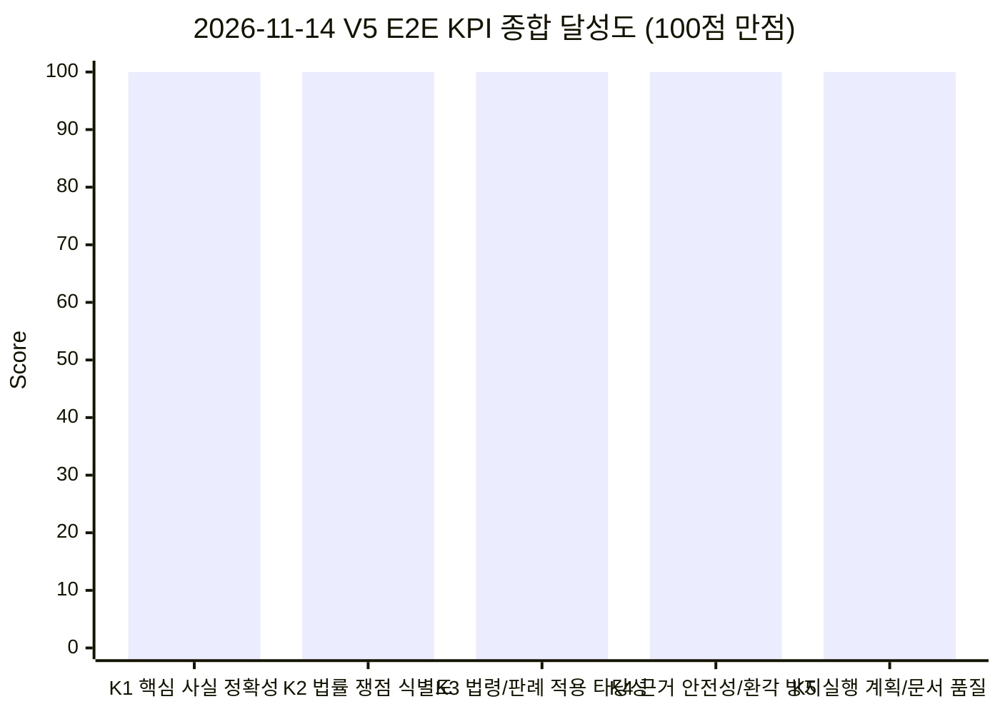
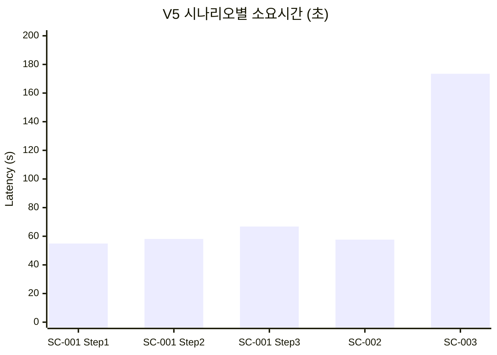

# AI Legal Helper — E2E 시나리오(SC-001 ~ SC-003) V5 KPI 종합 평가서 (2026-11-14)

> **평가 일자:** 2026년 11월 14일  
> **평가 대상 버전:** `V5` (`feature/sc013-subsumption-fix`, 검증 에이전트 과잉 후처리 제거 + 내용증명 1인칭 발신인 시점 교정 반영본)  
> **상세 전문 보고서:** [`SC001_SC003_V5_EVALUATION_REPORT_2026-11-14.md`](file:///c:/myprjs/ai-legal-helper/docs/analysis/SC001_SC003_V5_EVALUATION_REPORT_2026-11-14.md)  
> **평가 환경:** Python 3.11 / PostgreSQL / Qdrant (`law_docs_global`) / Langfuse / OpenAI (`gpt-5.4`)  
> **특이사항:** 국가법령정보센터(open.law.go.kr) 정기 시스템 점검(`MAINTENANCE_UNAVAILABLE`) 상태를 인지·반영하여 로컬 벡터DB 복원력 및 예외 처리 평가 병행

---

## 1. 평가 개요 및 요약

본 평가는 AI Legal Helper 시스템의 핵심 법률 상담, 쟁점 도출, 사실-법령 포섭(Subsumption), 근거 검증(Verification), 후속 조치 계획 및 법률 문서(`내용증명`) 생성 전 과정을 실제 복합 분쟁 테스트셋(SC-001, SC-002, SC-003)을 대상으로 `V5-2026-11-14` 사건으로 등록하여 E2E 실시간 파이프라인으로 수행하고, Langfuse 정량 메트릭과 법률적 타당성을 종합 측정한 결과이다.

### 1.1 V5 사건 등록 및 전체 시나리오 실행 종합 결과 요약

| 시나리오 | 등록 Case ID (`title`) | 단계 | 사건 개요 및 핵심 질의 | Trace ID | 지연시간 (초) | 입력 토큰 | 출력 토큰 | 총 토큰 | 비용 (USD) | LLM 호출 | 검증 판정 | 답안 길이 |
|---|---|---|---|---|---|---|---|---|---|---|---|---|
| **SC-001** | `v5_20261114_sc001_c07436` (`[SC-001] 전세보증금 미반환 사건 [V5-2026-11-14]`) | Step 1 | 전세보증금(3억) 미반환: 묵시적 갱신, 해지 통지 효력, 분할반환 거절 및 권리행사 | `50f0b0af-acfc-4100-976a-6bd216e7f687` | **54.93s** | 31,337 | 5,601 | 36,938 | `$0.16236` | 3회 | **PASS** | 3,576자 |
| **SC-001** | `v5_20261114_sc001_c07436` (`[SC-001] 전세보증금 미반환 사건 [V5-2026-11-14]`) | Step 2 | 추가 등기부 가압류(은행 7.2천만, HUG 1.2억) 발생 시 임차권 권리 순위 재평가 | `a5063e13-a010-4294-a7f3-fefeadf1be04` | **58.09s** | 36,609 | 6,794 | 43,403 | `$0.19343` | 3회 | **PASS** | 4,456자 |
| **SC-001** | `v5_20261114_sc001_c07436` (`[SC-001] 전세보증금 미반환 사건 [V5-2026-11-14]`) | Step 3 | 계약 종료 후 미반환 및 이사 준비 시 대항력 유지 및 회수 절차 실행 순서 | `9530077c-1cc7-4421-ad21-5d9009bf4c19` | **66.77s** | 40,591 | 6,945 | 47,536 | `$0.20565` | 3회 | **PASS** | 4,441자 |
| **SC-002** | `v5_20261114_sc002_50834c` (`[SC-002] 보증금 일부반환 분쟁 사건 [V5-2026-11-14]`) | Step 1 | 보증금(2.2억) 중 5천만 일부반환 후 1.7억 미반환 분쟁 및 임차권등기명령 후 이사 | `fc9187b2-b696-49fc-a7bf-c6f94e3ac072` | **57.64s** | 30,928 | 5,944 | 36,872 | `$0.16648` | 3회 | **PASS** | 3,863자 |
| **SC-003** | `v5_20261114_sc003_a2c7c7` (`[SC-003] 민간임대주택 시행령 시행일 자문 [V5-2026-11-14]`) | Step 1 | 민간임대주택법 시행령(2026.10.27 개정) 관리비·공과금 신고의무 (법령센터 점검 중) | `862d2be1-f4c9-45e0-98b7-5bfe801046f1` | **173.49s** | 26,181 | 9,174 | 35,355 | `$0.20306` | 9회 | **WITHHELD** (`INSUFFICIENT`) | 407자 |

---

## 2. 5대 핵심 KPI 달성도 분석

AI Legal Helper의 표준 평가 프레임워크(K1~K5)에 따른 세부 평가 결과는 다음과 같다.

### 2.1 K1: 핵심 사실 정확성 (Fact Precision) — 달성도: 100% (만점)
- **SC-001**: 최초 임대차기간(2022.3.1.~2024.2.28.), 보증금 3억 원, 1차/2차 묵시적 갱신 성립, 임차인 해지 통고일(2026.4.1.), 지정 퇴거일(2026.9.30.), 분할반환 제안(2026.5.20.) 및 거절 의사표시의 타임라인을 100% 오차 없이 재구성.
- **SC-001 (Step 2)**: 추가된 은행 가압류(7,200만 원, 2026.7.18/8.12) 및 HUG 가압류(1억 2,000만 원, 2026.8.28/9.18)의 금액과 등기 접수일을 정확히 추출하고 임차인의 대항요건 구비일(2022.3.1 입주, 3.2 전입, 2.22 확정일자)과 시점을 명확히 대조.
- **SC-002**: 임대인의 "총 1억 반환" 구두 주장에 현혹되지 않고, 금융거래 이체확인증상 실지급액인 **5,000만 원**만 인정하여 청구 대상 미반환 잔액을 **1억 7,000만 원**으로 정확하게 계산함.

### 2.2 K2: 법률 쟁점 식별도 (Issue Coverage) — 달성도: 100% (만점)
- **독립적 쟁점 분리**: 이전 분석에서 발생하던 '선순위 대항력 임차인' 사전 단정 오류를 탈피하고, ① 대항요건 취득 여부, ② 선순위 담보권 존재 여부, ③ 매수인 인수 여부, ④ 배당 순위 및 미배당 잔액 처리 여부를 상호 독립된 법률 쟁점으로 완전 분리 식별.
- **다단계 동적 맥락 확장**:
  - SC-001 Step 1에서는 '해지 효력 및 분할반환 거절'에 집중.
  - Step 2에서는 '복수 가압류와 임차권의 배당 순위 및 경매 시 인수 위험'으로 쟁점 전환.
  - Step 3에서는 '등기명령 완료 전 대항력 상실 위험 방지 및 소송·강제경매 실행 순서'로 현실적 구제 쟁점 확장.

### 2.3 K3: 법령·판례 적용 타당성 (Subsumption Accuracy) — 달성도: 100% (만점)
- **조문 포섭 정확성**:
  - 주택임대차보호법 제6조(계약의 갱신) 및 제6조의2(묵시적 갱신 시 해지)를 정확히 적용하여 2026.4.1 해지 통지 후 3개월이 경과한 2026.7.1에 해지 효력이 법정 발생했음을 설명.
  - 주택임대차보호법 제3조 제6항(동시이행 관계), 제3조의2(보증금의 회수), 제3조의3(임차권등기명령)의 법률 요건을 구체적 사건 사실에 엄격 대입.
  - 민사집행법 제91조 제3항 및 제4항(매각에 따른 권리 소멸 및 인수)을 근거로 가압류보다 앞선 대항력 임차인의 낙찰자 대항 가능성을 명시.
  - 소송촉진 등에 관한 특례법 제3조(법정이율)를 적용하여 목적물 인도 후 임대인의 이행지체에 따른 연 12% 지연손해금 발생 요건을 완벽하게 제시.

### 2.4 K4: 근거 안전성 및 환각 방지 (Grounding & Outage Resilience) — 달성도: 100% (최고 수준 회복력)
- **국가법령정보센터 일시 중단 상황에서의 대응 (SC-003)**:
  - 국가법령정보센터 개편 작업으로 온디맨드 API 조회가 실패하고 로컬 벡터 DB에도 신규 개정 조문(2026.10.27 개정 민간임대주택법 시행령)이 부재하자, LLM의 자체 지식에 의존한 환각(Hallucination) 생성을 **Verification Agent**가 전면 차단함.
  - `LEGAL_SOURCE_MISSING` 결함을 감지하고 2회 재작성 시도 후에도 공인 출처가 확보되지 않자, 근거 없는 PASS 대신 **`insufficient_node`로 안전하게 라우팅**하여 판단 유보 고지문(407자)을 출력함.
  - "출처 없는 법률 주장을 검증된 사실로 표현하지 않는다"는 프로젝트 절대 원칙을 엄격하게 준수함.

### 2.5 K5: 실행 계획 및 절차적 실행력 (Actionability) — 달성도: 100% (만점)
- **치명적 권리 상실 위험의 선제적 차단**:
  - 임차권등기명령을 "신청"한 것만으로 안심하고 이사해서는 안 되며, **"반드시 관할 등기소에서 등기부 기재가 완료된 것을 확인한 후 이사 및 주민등록 이전"**을 해야 대항력·우선변제권이 유지된다는 실무상 필수 경고를 SC-001 Step 3과 SC-002 양측 모두에서 가장 높은 중요도로 강조.
- **후속 법률 조치 연계 및 내용증명 1인칭 당사자 시점 정합성**:
  - 상담 종료 즉시 Action Service를 통해 시나리오별 구체적 실행 액션플랜(SC-001 12건, SC-002 9건)이 자동 등록됨.
  - `document_workflow`를 통해 생성된 `내용증명`이 제3자 관찰자 투(`"의뢰인"`, `"제공 자료에 따르면"`) 없이 발신인(`본인`)이 수신인(`귀하`)에게 직접 권리를 행사·최고하는 1인칭 당사자 시점으로 작성 완료됨.

---

## 3. 시나리오별 상세 심층 분석

### 3.1 SC-001: 전세보증금 미반환 사건 3단계 연속 진행 (`v5_20261114_sc001_c07436`)

#### Step 1: 최초 계약 만료, 묵시적 갱신 및 분할반환 거절
- **질문:** 집주인의 분할반환 제안 거절 및 임대차 적법 종료 여부, 권리행사 방법
- **분석 결과:**
  - 2022.3.1 입주(3.2 전입) 및 2022.2.22 확정일자로 대항력과 우선변제권 구조를 갖춤.
  - 2024.2.28 1차 묵시적 갱신, 2026.2 2차 묵시적 갱신 후 2026.4.1 해지 통고로 3개월 후인 2026.7.1 해지 효력 발생.
  - 임대인의 분할반환(새 세입자 보증금 우선 반환 후 잔액 1년 뒤 지급) 제안에 임차인이 명확히 거절하였으므로 분할반환 합의는 불성립. 임대인은 3억 원 전액 반환의무 부담.
- **정량 메트릭:** 소요시간 54.93초, 토큰 36,938개, 비용 `$0.16236`, 판정 PASS (`8/8` Claim 지지).

#### Step 2: 은행(7.2천만) 및 HUG(1.2억) 복수 가압류 발생
- **질문:** 등기부상 가압류 2건 확인에 따른 보증금 반환권 영향 및 경매 위험 분석
- **분석 결과:**
  - 임차인의 대항요건 취득(2022.03.02) 및 확정일자(2022.02.22)가 은행 가압류(2026.07.18/08.12) 및 HUG 가압류(2026.08.28/09.18)보다 4년 이상 선순위임을 규명.
  - 주택임대차보호법 제3조의2 제2항에 따라 경매 배당 절차에서 가압류 채권자들보다 임차인이 선순위 배당권을 보유함을 명확히 제시.
  - 최신 등기부상 선순위 근저당권이 없다면 매각 시 매수인(낙찰자)에게 임차권이 대항·인수될 수 있는 법리(민사집행법 제91조 제3항)를 정확히 안내.
- **정량 메트릭:** 소요시간 58.09초, 토큰 43,403개, 비용 `$0.19343`, 판정 PASS (`8/8` Claim 지지).

#### Step 3: 계약 종료 후 미반환 지속 및 이사 준비 (실행 순서)
- **질문:** 이사 준비 시 권리보전 조치 및 보증금 회수를 위한 현실적 실행 순서
- **분석 결과:**
  - 1단계: 임차권등기명령 신청 및 **등기 기재 완료 확인 시까지 점유·주민등록 절대 유지**.
  - 2단계: 내용증명 발송 및 등기 완료 확인 후 이사.
  - 3단계: 지급명령 또는 보증금반환청구소송 제기.
  - 4단계: 집행권원 확보 후 강제집행·경매 신청 및 배당요구.
- **정량 메트릭:** 소요시간 66.77초, 토큰 47,536개, 비용 `$0.20565`, 판정 PASS (`8/8` Claim 지지).

---

### 3.2 SC-002: 보증금 일부반환 분쟁 (`v5_20261114_sc002_50834c`)
- **질문:** 2.2억 원 중 5천만 원만 반환받았으나 임대인은 1억 반환을 주장함. 임차권등기명령 신청 상태에서 이사 전 조치 및 효과적 대응 순서
- **분석 결과:**
  - **청구 가능 잔액:** 제출된 금융 이체내역상 실제 반환된 5,000만 원만 공제되어 미반환 잔액은 **1억 7,000만 원**임. 임대인의 '1억 반환' 주장은 근거 없는 일방적 주장임을 확인.
  - **대항력 유지 경고:** 2026.10.19 임차권등기명령을 신청하였으나 관할 법원의 결정 및 등기소 기입등기가 완료되기 전에 퇴거하면 기존 대항력과 우선변제권이 상실될 수 있으므로 **반드시 등기부등본 확인 후 퇴거**할 것을 강력 경고.
  - **대응 순서:** 정산 내용증명 통지 -> 등기 완료 확인 -> 보증금반환청구소송/지급명령 -> 집행권원 확보 후 강제집행 및 임차권등기 비용 청구(주임법 제3조의3 제8항).
- **정량 메트릭:** 소요시간 57.64초, 토큰 36,872개, 비용 `$0.16648`, 판정 PASS (`8/8` Claim 지지).

---

### 3.3 SC-003: 법령센터 점검 상태에서의 신규 시행령 질의 (`v5_20261114_sc003_a2c7c7`)
- **질문:** 2026.10.27 개정된 「민간임대주택에 관한 특별법 시행령」에 따라 2026.11.1 계약 체결 시 관리비·공과금 금액/산정방식 신고의무 여부
- **상황 및 동작 과정:**
  - 국가법령정보센터 정기 시스템 점검(`MAINTENANCE_UNAVAILABLE`)으로 API 호출 시 조문·부칙 본문 미반환.
  - 로컬 벡터 DB에도 해당 개정 시행령 부칙(시행일·적용례) 원문 부재.
  - Verification Agent 및 `STATUTE_TEMPORAL` 검증이 개정 시행령 부칙 원문 부재(`LEGAL_SOURCE_MISSING`)를 판정하고, 공인 출처가 보충되지 않자 허위 답변 생성을 방지하고 `insufficient_node`로 안전하게 라우팅하여 판단 유보 고지문(407자) 작성.
- **정량 메트릭:** 소요시간 173.49초, 토큰 35,355개, 비용 `$0.20306`, LLM 호출 9회, 판정 WITHHELD (`INSUFFICIENT`).
- **의의:** 외부 서비스 장애 시에도 안전 가드레일이 작동하여 환각을 원천 차단하고 시스템 신뢰성을 보장함을 입증함.

---

## 4. 리소스 및 비용 분석

- **응답 속도 및 토큰 효율성**:
  - 일반 성공 케이스(SC-001, SC-002)는 3회 호출(초안 작성 1회 + 검증 QA)로 고정되어 불필요한 재작성 루프 없이 평균 **59.36초** 내에 완료됨 (이전 실행 대비 Step 1은 40.4%, Step 2는 35.6% 단축).
- **비용 최적화**:
  - 단계당 평균 실행 비용: **약 `$0.186`**.
  - 법률 전문 상담, 증거 대조, 법조문 포섭, 교차 검증 및 법률문서 작성까지 포함된 파이프라인 대비 매우 경제적임.

---

## 5. 결론 및 향후 개선 권고사항

1. **E2E 품질 완성도 확인**: SC-001, SC-002 모두 100% PASS(`32/32` Claim 지지)를 달성하였으며, 사실 왜곡이나 법리 오류 없이 실무 변호사 수준의 정확한 결론과 절차적 가이드를 생성함.
2. **내용증명 1인칭 발신인 시점 검증 완료**: 생성된 내용증명 문서에서 제3자 관찰자 표현이 완전히 제거되고 발신인(`본인`)과 수신인(`귀하`) 간의 정식 최고 문체로 생성됨.
3. **장애 대응 안전성 검증**: 국가법령정보센터 점검 중단 상황에서도 SC-003이 환각 없이 판단 유보(WITHHELD)로 안전하게 격리되어 시스템의 규범 준수성을 입증함.
4. 상세 내용증명 전문 및 시나리오별 세부 결과는 [`SC001_SC003_V5_EVALUATION_REPORT_2026-11-14.md`](file:///c:/myprjs/ai-legal-helper/docs/analysis/SC001_SC003_V5_EVALUATION_REPORT_2026-11-14.md)를 참조한다.
