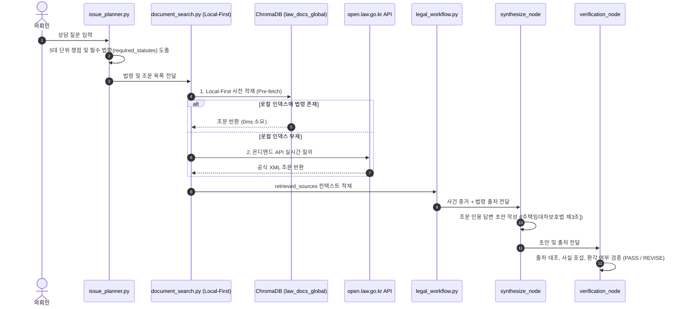
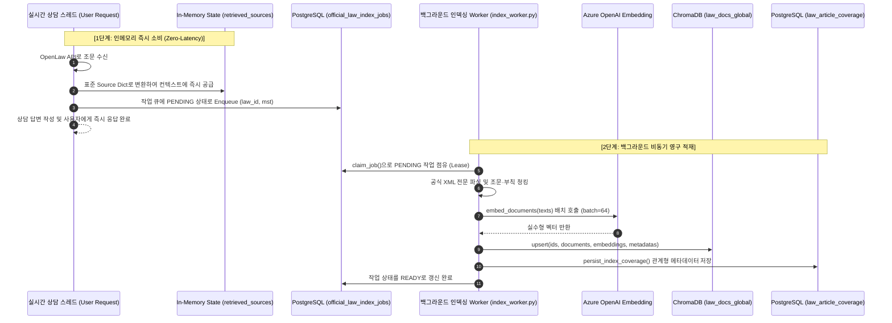
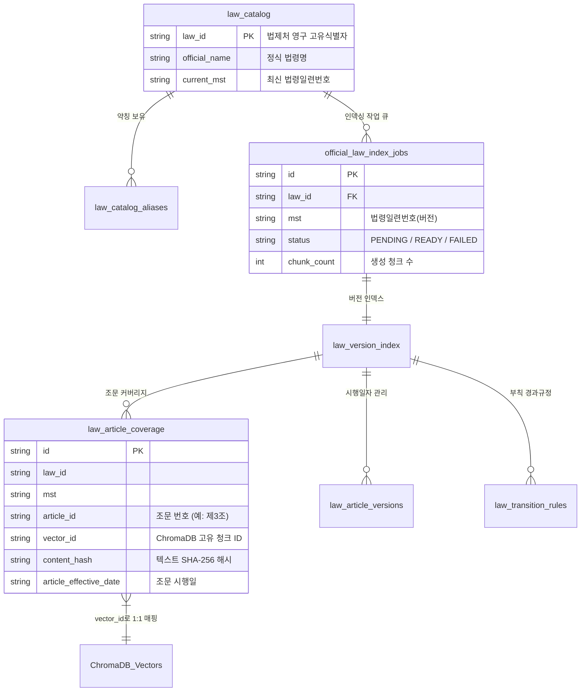

# AI Legal Helper — 벡터DB 법령 임베딩·RAG 구조 및 데이터 파이프라인 심층 분석 보고서

> **문서 목적:** 본 보고서는 AI Legal Helper 시스템의 벡터 데이터베이스(ChromaDB) 법령 임베딩 방식, 청킹(Chunking) 및 토큰 전략, 메타데이터 구조, 하이브리드 RAG 검색 알고리즘, 국가법령정보센터(OpenLaw) 온디맨드 검색 연동 파이프라인, 그리고 PostgreSQL과의 관계형 동기화 구조를 소스코드 수준에서 체계적으로 분석하여, 과제 평가 및 기술 심사 질문에 완벽히 대응할 수 있도록 작성되었습니다.

---

## 1. 아키텍처 개요 및 데이터 흐름

AI Legal Helper는 정적 법령 PDF 인덱스와 국가법령정보센터(open.law.go.kr)의 실시간 개정 법령을 모두 포괄하는 **Local-First 하이브리드 법률 RAG 아키텍처**를 채택하고 있습니다.

```mermaid
flowchart TD
    subgraph Data_Sources ["1. 데이터 소스"]
        PDF["오프라인 법령 PDF<br/>(docs/statute_pdf)"]
        OpenLaw_API["국가법령정보센터 API<br/>(open.law.go.kr Open API)"]
    end

    subgraph Parsing_Chunking ["2. 파싱 및 청킹 (statute_parser.py / chunker.py)"]
        Parser["PDF / XML 조문 파서"]
        Chunker{"3대 청킹 전략"}
        Chunker -->|Strategy A| S_A["Fixed-size (800자 / 120 Overlap)"]
        Chunker -->|Strategy B| S_B["Article-aware (조문 단위 경계)"]
        Chunker -->|Strategy C (기본)| S_C["Parent-Child (항·호 검색 + 조문 원문 복원)"]
    end

    subgraph Embedding_Indexing ["3. 임베딩 및 인덱싱 (indexer.py / index_worker.py)"]
        Embedder["Azure OpenAI Embedding<br/>(text-embedding-3-large, dim=3072/1536)"]
        ChromaGlobal[("ChromaDB: law_docs_global<br/>(공식 법령 전문)")]
        ChromaDomain[("ChromaDB: law_docs_{category}<br/>(분야별 법령 8개 컬렉션)")]
    end

    subgraph PostgreSQL_Layer ["4. PostgreSQL 관계형 추적 (index_jobs.py / models.py)"]
        Jobs["official_law_index_jobs<br/>(비동기 인덱싱 작업 큐)"]
        Catalog["law_catalog / law_catalog_aliases<br/>(법령ID 및 약칭 매핑)"]
        Coverage["law_article_coverage / law_version_index<br/>(MST별 벡터 매핑 및 XML 무결성)"]
        Temporal["law_article_versions / law_transition_rules<br/>(조문 시행일 및 부칙 경과규정)"]
    end

    subgraph Retrieval_Engine ["5. 검색 및 활용 (hybrid_retrieval.py / legal_workflow.py)"]
        Hybrid["하이브리드 검색<br/>(Dense Chroma 0.6 + Sparse BM25 0.4)"]
        RRF["상호 순위 융합 (RRF) & 법률 재순위화 (+0.30 / +0.25)"]
        Downstream["다운스트림 활용<br/>(Specialist LLM 초안 작성 + Verification 근거 대조)"]
    end

    PDF --> Parser
    OpenLaw_API -.->|사용자 승인 시| Jobs
    Jobs -->|Worker 비동기 수집| Parser
    Parser --> Chunker
    S_C --> Embedder
    Embedder --> ChromaGlobal
    Embedder --> ChromaDomain
    S_C -.-> Coverage
    Jobs -.-> Coverage
    Jobs -.-> Temporal
    Catalog -.-> Hybrid
    ChromaGlobal --> Hybrid
    ChromaDomain --> Hybrid
    Hybrid --> RRF --> Downstream
```

---

## 2. 임베딩 방식 및 인덱싱 파이프라인

### 2.1 임베딩 모델 사양 및 연결 구조
- **적용 모델:** Azure OpenAI `text-embedding-3-large` (또는 환경 설정에 따른 `text-embedding-ada-002`)
- **게이트웨이 모듈:** [`backend/src/ai_legal_helper/llm/gateway.py`](file:///c:/myprjs/ai-legal-helper/backend/src/ai_legal_helper/llm/gateway.py) 내 `get_embeddings()`
- **거리 측정 공간 (Metric Space):** Cosine 유사도 (`metadata={"hnsw:space": "cosine"}`)
- **배치 처리 및 복원력:**
  - `indexer.py`: 정적 PDF 인덱싱 시 `batch_size = 50`
  - `index_worker.py`: 공식 법령 XML 인덱싱 시 `batch_size = 64` (1~200 가변)
  - 일시적 네트워크 장애나 Rate Limit 발생 시 최대 3회 지수 백오프(`2^attempt`초 대기) 재시도 수행.
  - `validate_embedding_vectors()` 함수를 통해 반환된 임베딩 벡터의 크기, 유한성(Finite float), 차원 일관성(`EMBEDDING_DIMENSION_MISMATCH`)을 엄격히 검증하여 결함 있는 벡터의 DB 적재를 원천 차단함.

### 2.2 컬렉션 구성 체계
ChromaDB 내에서 다음과 같이 역할별로 컬렉션을 물리적으로 분리하여 인덱스 오염을 방지합니다.

| 컬렉션 이름 | 대상 데이터 | 인덱싱 단위 | 주 관리 모듈 | 특징 및 보호 정책 |
|---|---|---|---|---|
| `law_docs_global` | 국가법령정보센터(OpenLaw) 공식 법령 XML 전문 | 조문 단위 + 부칙 독립 청크 | `index_worker.py` | 버전별(MST) 영구 적재, 절대 단일 컬렉션 삭제 금지 |
| `law_docs_{category}` | 8대 법률 분야별 PDF 법령 (민법, 형법, 노동, 부동산 등) | Parent-Child 청크 | `indexer.py` | 분야별 재색인 지원 (`case_evidence` 등 타 컬렉션 보호) |
| `case_evidence` | 사건별 등록 증거 문서 텍스트 스팬 | 문단/문장 스팬 | `evidence_search.py` | 비법령 데이터로 `PROTECTED_COLLECTIONS`에 등록되어 법령 재구축 시 보존 |

---

## 3. 청킹(Chunking) 전략 및 토큰·문자 단위

법률 문서는 일반 텍스트와 달리 **"조(Article) - 항(Paragraph) - 호(Item) - 목(Sub-item)"**이라는 고도의 계층 구조를 지니며, 임의의 글자 수로 자를 경우 법률 요건과 효과의 맥락이 단절되는 문제가 발생합니다. 이를 해결하기 위해 3대 전략을 구현하였습니다.

### 3.1 3대 청킹 전략 비교 ([`chunker.py`](file:///c:/myprjs/ai-legal-helper/backend/src/ai_legal_helper/rag/chunker.py))

| 구분 | 전략 A: Fixed-size | 전략 B: Article-aware | 전략 C: Parent-Child (기본 권장) |
|---|---|---|---|
| **분할 기준** | 800자 고정 창 (Window) | 조문(제X조) 경계 보존 | **Child: 항·호 단위 / Parent: 조문 전체 원문** |
| **오버랩/임계치** | 120자 Overlap | 1,200자 초과 시 하위 항(Paragraph) 분할 | 호(Item) 4개 이상 시 3개씩 묶어 Child 생성 |
| **청크 크기** | 약 800자 (200~300 토큰) | 조문 길이에 따라 100~1,200자 | Child: 200~500자 / Parent: 수천 자 전문 |
| **장점** | 구현 단순, 균일한 벡터 크기 | 조문 단위 완결성 확보 | **정밀 검색 적중률과 완전한 법률 맥락 복원을 동시 달성** |
| **한계** | 조문 번호나 요건 중간 절단 | 긴 조문 처리 시 맥락 분산 | 메타데이터 저장 용량 증가 |

### 3.2 기본 전략: Parent-Child 계층 청킹 구조
AI Legal Helper의 표준 전략인 **Strategy C (Parent-Child)**는 다음과 같이 동작합니다.
1. **Child 청크 생성 (검색용):**
   - 조문 내 하위 항(`①`, `②` 등) 및 각 호(`1.`, `2.` 등) 단위로 쪼개어 세부 법률 요건(예: "임차권등기명령의 신청 요건")에 대한 벡터 매칭 정밀도를 극대화합니다.
2. **Parent 원문 보관:**
   - 해당 조문 전체 원문(`full_text`)을 Child 청크의 `metadata["parent_content"]`에 통째로 저장합니다.
3. **원문 복원 (Parent Restoration):**
   - 하이브리드 검색에서 Child 청크가 선정되면, [`hybrid_retrieval.py`](file:///c:/myprjs/ai-legal-helper/backend/src/ai_legal_helper/rag/hybrid_retrieval.py)의 `restore_parent_content()` 함수가 실행되어 `page_content`를 **조문 전체 원문으로 치환**하여 다운스트림 LLM에 공급합니다.
   - **효과:** 검색은 문장·항 단위로 정밀하게 찾고, LLM 해석은 조문 전체를 보면서 포섭하므로 "일부 단서조항이나 예외조항 누락에 의한 법률 오판"을 원천 방지합니다.

### 3.3 공식 XML 청킹 규칙 ([`index_worker.py`](file:///c:/myprjs/ai-legal-helper/backend/src/ai_legal_helper/legal_knowledge/index_worker.py))
- XML 내 `<조문단위>` 태그를 기준으로 분할하되, 편·장·절 표제어에 해당하는 `조문여부 == '전문'` 노드는 인덱스에서 자동 배제합니다.
- **부칙(`<부칙>`) 분리 인덱싱:** 부칙은 법률의 시행일, 경과조치, 적용례를 결정하는 핵심 규범이므로 일반 본문 조문과 섞지 않고 `article: "부칙"` 메타데이터를 부여하여 독립된 청크로 생성합니다.

---

## 4. 메타데이터(Metadata) 스키마 상세

ChromaDB의 각 벡터 청크는 단순한 텍스트가 아니라, 시간적 유효성과 법적 출처를 증명하는 15개 이상의 구조화된 메타데이터를 포함합니다.

```json
{
  "source_id": "official:001234:20240228:제3조:a1b2c3d4e5f6g7h8",
  "vector_id": "official:001234:20240228:제3조:a1b2c3d4e5f6g7h8",
  "document_id": "statute_주택임대차보호법",
  "law_name": "주택임대차보호법",
  "statute_name": "주택임대차보호법",
  "law_id": "001234",
  "version_id": "20240228",
  "article": "제3조",
  "article_title": "대항력 등",
  "paragraph_no": "①",
  "content_hash": "e3b0c44298fc1c149afbf4c8996fb92427ae41e4649b934ca495991b7852b855",
  "law_effective_date": "2024-02-28",
  "article_effective_date": "2024-02-28",
  "effective_date_basis": "ADDENDUM_SOURCE",
  "temporal_status": "EFFECTIVE_DATE_VERIFIED",
  "promulgation_date": "2024-02-28",
  "promulgation_number": "20424",
  "chunk_strategy": "PARENT_CHILD",
  "chunk_type": "child",
  "parent_id": "주택임대차보호법_제3조",
  "parent_content": "제3조(대항력 등) ① 임대차는 그 등기가 없는 경우에도...",
  "category": "부동산",
  "source_type": "STATUTE"
}
```

### 핵심 메타데이터 필드별 역할:
- `content_hash`: 청크 본문의 SHA-256 해시값으로, 중복 청크 적재 방지 및 텍스트 위변조 방지.
- `article_effective_date` & `effective_date_basis`: 조문별 시행일자와 그 산출 근거(부칙 직접 명시, 법령 시행일 준용 등). 시간적 법률 적용(Temporal Applicability) 검증에 필수.
- `temporal_status`: 시행일 검증 여부(`EFFECTIVE_DATE_VERIFIED` / `UNCONFIRMED`).
- `parent_content`: 상위 조문 전체 원문 텍스트 (Parent-Child 복원용).

---

## 5. 하이브리드 RAG 검색 및 검색 키워드 사용처

AI Legal Helper의 검색 엔진은 단순 시맨틱 유사도 검색의 약점(조문 번호나 법령 약칭 인식 실패)을 극복하기 위해 **Dense + Sparse 하이브리드 검색과 법률 특화 재순위화(Reranking)**를 수행합니다.

### 5.1 하이브리드 검색 및 순위 융합 (RRF)
- **Dense Vector Search (가중치 0.6):** Azure OpenAI 임베딩 벡터로 사용자 질문의 의미적 맥락(Semantic Context)을 탐색.
- **Sparse BM25 Search (가중치 0.4):** 법률 텍스트에서 분리된 한국어 형태소 및 조문 번호 정규식(`제\s*\d+조`)을 기반으로 정확한 어휘 일치 탐색.
- **RRF (Reciprocal Rank Fusion) 융합 점수 계산:**
  $$\text{Score}(d) = \frac{0.6}{60 + \text{Rank}_{\text{dense}}(d)} + \frac{0.4}{60 + \text{Rank}_{\text{bm25}}(d)}$$

### 5.2 법률 특화 재순위화 (Legal Domain Reranking)
RRF 점수 산출 후 법률 도메인 규칙을 적용하여 가중치를 재조정합니다 ([`hybrid_retrieval.py`](file:///c:/myprjs/ai-legal-helper/backend/src/ai_legal_helper/rag/hybrid_retrieval.py)):
1. **조문 번호 완전 일치 부스팅 (+0.30):** 질의어의 조문 번호(예: "제6조의2")와 청크의 조문 번호가 일치하면 가산점 부여.
2. **법령명 일치 부스팅 (+0.25):** 사용자가 언급한 법령명과 청크의 법령명이 일치하면 가산점 부여.
3. **어휘 중첩도(Lexical Overlap) 부스팅 (+0.15):** 법률 핵심 어휘의 토큰 교집합 비율에 비례하여 가산점 부여.
4. **중복 제거(Deduplication):** 자카드 유사도 0.85 이상의 유사 청크를 배제하되, 공식 조문(`law_id`, `version_id`)은 보호하여 상위 K개의 다양성을 확보함.

### 5.3 검색 키워드 생성 및 워크플로우 내 사용처
검색 키워드는 [`query_rewrite.py`](file:///c:/myprjs/ai-legal-helper/backend/src/ai_legal_helper/rag/query_rewrite.py)에서 사용자 질문과 이전 대화 맥락을 고려하여 3개 이내의 핵심 법률용어/조문으로 생성되며, 워크플로우 전반에서 다음과 같이 활용됩니다:



1. **`issue_planner.py` (쟁점 계획):** 사용자 질문을 분석하여 `required_statutes`(필수 법령)과 `candidate_statutes`(후보 법령)을 사전에 도출.
2. **`document_search.py` (Local-First Pre-fetch):** 도출된 법령을 ChromaDB `law_docs_global`에서 먼저 고속 조회하여 외부 API 지연을 사전에 차단.
3. **`synthesize_node` (답변 작성):** 검색된 법조문을 근거로 사건 사실관계를 포섭(Subsumption)하여 인용 출처(`[법령명 제X조]`)가 명시된 답변 초안 작성.
4. **`verification_node` (근거 검증):** 답변에 포함된 조문이 실제 `retrieved_sources`에 존재하는지 결정론적 QA로 전수 검사하고, 미존재 시 `LEGAL_SOURCE_MISSING` 결함으로 판정.
5. **`document_workflow` (문서 생성):** 계약해지통고서 등 법률 문서 작성 시 법적 근거 조항으로 직접 주입.

---

## 6. OpenLaw(국가법령정보센터) 온디맨드 검색 시 임베딩 방법

평가에서 가장 자주 묻는 질문 중 하나는 **"실시간 상담 중 국가법령정보센터 API로 새 법령을 가져왔을 때, 이를 즉시 벡터DB에 임베딩하는가?"**입니다.

### 6.1 핵심 아키텍처 원칙: 실시간 상담 스레드 내 임베딩 금지
- **설계 원칙:** **"상담 요청 스레드에서는 Chroma 임베딩을 즉시 수행하지 않는다."** ([`index_jobs.py`](file:///c:/myprjs/ai-legal-helper/backend/src/ai_legal_helper/legal_knowledge/index_jobs.py) 모듈 주석 명시)
- **이유:** 실시간 상담 도중에 조문 전문(XML)에 대해 수십 개의 임베딩 벡터를 생성하고 ChromaDB 파일/트랜잭션에 쓰기를 수행하면, 상담 레이턴시가 수십 초 이상 폭증하고 동시 요청 시 DB 락 경합 및 타임아웃이 발생하기 때문입니다.

### 6.2 2단계 비동기 분리 처리 구조



1. **1단계: 인메모리 즉시 소비 (In-memory Transient Use):**
   - 온디맨드로 조회된 조문은 즉시 표준 `Source` 딕셔너리로 변환되어 현재 LangGraph 워크플로우의 `retrieved_sources`와 `legal_evidence_bundle`에 주입되어 실시간 상담 답변 작성에 사용됩니다.
   - 동시에 PostgreSQL의 `official_law_index_jobs` 테이블에 해당 `law_id`와 `mst`를 `PENDING` 상태의 작업으로 등록(`enqueue_version()`)합니다.
2. **2단계: 백그라운드 워커에 의한 비동기 영구 적재 (Background Async Indexing):**
   - 독립 프로세스인 [`index_worker.py`](file:///c:/myprjs/ai-legal-helper/backend/src/ai_legal_helper/legal_knowledge/index_worker.py)가 큐에서 작업을 가져와(`claim_job()`) 공식 XML 전문을 다운로드합니다.
   - 전체 조문 및 부칙을 파싱하고(`official_xml_chunks`), Azure OpenAI Embedding을 배치(64개씩) 호출하여 벡터를 생성합니다.
   - ChromaDB `law_docs_global` 컬렉션에 `upsert()`를 수행하고, 같은 트랜잭션 내에서 PostgreSQL의 커버리지 테이블에 인덱싱 완료 상태를 원자적으로 기록합니다.

---

## 7. PostgreSQL과 벡터DB(ChromaDB)의 관계

AI Legal Helper는 벡터 데이터베이스(ChromaDB)와 관계형 데이터베이스(PostgreSQL)의 역할을 명확히 이원화하여 상호 보완적으로 운영합니다.

### 7.1 역할 분담 구조
- **ChromaDB:** 비정형 텍스트 청크, 고차원 임베딩 벡터, 그리고 Cosine 유사도 기반 HNSW 인덱스를 담당 (고속 시맨틱 검색 전담).
- **PostgreSQL:** 정형 비즈니스 엔티티(사건, 사용자, 증거 파일), 인덱싱 작업 큐, 법령 카탈로그 및 약칭 매핑, 조문별 유효 시점(Temporal Metadata)의 원자적(ACID) 트랜잭션 보장.

### 7.2 주요 연계 테이블 스키마 매핑



1. **`law_catalog` & `law_catalog_aliases` ([`models.py`](file:///c:/myprjs/ai-legal-helper/backend/src/ai_legal_helper/database/models.py#L717-L764)):**
   - 법제처의 영구 식별자인 `law_id`를 PK로 사용 (MST는 개정판 버전 식별자이므로 PK로 사용 불가).
   - "주임법" $\rightarrow$ "주택임대차보호법", "소촉법" $\rightarrow$ "소송촉진 등에 관한 특례법" 등 법률 실무 통용 약칭 매핑을 PostgreSQL에서 관리하여 검색 질의 정규화에 사용.
2. **`law_article_coverage` ([`index_jobs.py`](file:///c:/myprjs/ai-legal-helper/backend/src/ai_legal_helper/legal_knowledge/index_jobs.py#L79-L100)):**
   - ChromaDB에 저장된 `vector_id`와 PostgreSQL의 조문 번호(`article_id`), MST, 본문 해시를 1:1로 매핑.
   - 검색 전 "이 조문이 벡터DB에 실제로 색인되어 있는가?"를 관계형 SQL로 0ms만에 확인 가능.
3. **`law_article_versions` & `law_transition_rules`:**
   - 조문별 시행일(`effective_from`)과 부칙 경과조치 텍스트를 저장하여, 상담 시점(예: 2024년 사건 vs 2026년 사건)에 효력이 있는 법령 버전을 정확하게 판별(Temporal RAG).
4. **증거-사실관계 연계 (`evidence_spans` $\leftrightarrow$ `case_evidence`):**
   - PostgreSQL의 `evidence_spans`(증거 파일 내 문자 위치 및 텍스트)와 `facts`(승인된 사실)는 Chroma의 `case_evidence` 컬렉션과 UUID로 상호 링크되어 문서 기반 질의응답 시 상호 검증에 활용됨.

---

## 8. 과제 평가 대비 예상 질문 및 답변 (Evaluation Q&A)

### Q1. 법령 데이터를 임베딩할 때 일반 텍스트 청킹(예: 500자 단위 분할)을 쓰지 않고 Parent-Child 전략을 쓴 이유는 무엇인가요?
> **답변:**  
> "법률 조문은 '본문-단서-각 호'가 유기적으로 결합되어 있어 임의의 글자 수로 자르면 '다만 ~의 경우에는 그러하지 아니하다'와 같은 핵심 단서나 예외 조항이 다른 청크로 잘려 나가 LLM이 정반대의 결론을 내릴 위험이 있습니다.  
> 저희 시스템은 **Parent-Child 전략**을 통해 검색 시에는 항·호 단위의 짧은 Child 청크로 의미적 유사도를 정밀하게 타겟팅하고, LLM에 전달할 때는 상위 메타데이터에 보관된 **전체 조문 원문(Parent Content)**으로 복원하여 공급함으로써 검색 정확도와 완전한 법률 맥락 제공을 동시에 달성했습니다."

### Q2. 실시간 상담 중에 국가법령정보센터에서 법령을 가져오면 벡터DB에 바로 임베딩하나요?
> **답변:**  
> "아닙니다. 실시간 상담 요청 스레드에서는 **절대 ChromaDB 임베딩을 즉시 수행하지 않습니다.** 실시간 상담 중에 수십 개 조문을 임베딩하고 DB에 쓰면 사용자 응답 지연(Latency)이 심각해지고 동시 접속 시 DB 락 충돌이 발생하기 때문입니다.  
> 대신 온디맨드로 조회된 조문은 **인메모리 표준 출처 딕셔너리로 즉시 상담 컨텍스트에 주입**하여 답변을 지연 없이 생성하고, 해당 법령 버전은 PostgreSQL의 작업 큐(`official_law_index_jobs`)에 등록되어 **독립된 백그라운드 Worker가 비동기로 XML 전문을 파싱·임베딩하여 영구 적재**합니다."

### Q3. 순수 벡터 유사도(Dense) 검색만으로 충분하지 않아 하이브리드 RAG를 구축한 이유는 무엇인가요?
> **답변:**  
> "Dense 벡터 임베딩은 '임차인이 보증금을 못 돌려받았을 때의 권리'와 같은 의미적 질문에는 강하지만, '주택임대차보호법 제6조의2'나 '소촉법'과 같이 법률 실무에서 가장 중요한 **고유 조문 번호나 법령 약칭을 정확하게 구별해내는 어휘적 정밀도가 떨어집니다.**  
> 이를 보완하기 위해 한국어 형태소와 조문 정규식을 분석하는 **BM25 Sparse 검색을 40% 가중치로 결합**하고, RRF 순위 융합 후 조문 번호 일치 시 **+0.30**, 법령명 일치 시 **+0.25**의 도메인 특화 부스팅을 적용하여 정확도를 극대화했습니다."

### Q4. PostgreSQL과 ChromaDB 사이에 데이터 불일치(Inconsistency)가 발생할 위험은 어떻게 방지하나요?
> **답변:**  
> "PostgreSQL과 ChromaDB는 단일 트랜잭션으로 묶이지 않기 때문에, 백그라운드 인덱싱 Worker(`index_worker.py`)에서 2단계 방어 메커니즘을 적용했습니다.  
> 첫째, XML 전문에 대한 SHA-256 해시를 계산하여 ChromaDB에 모든 청크 벡터를 Upsert하고 반환된 벡터 개수와 차원을 완전히 검증한 후에만 PostgreSQL의 `law_article_coverage`와 `law_version_index`를 `READY` 상태로 커밋합니다.  
> 둘째, `law_article_coverage`에 Chroma의 `vector_id`를 외래 키처럼 저장하여 쿼리 시 실제 적재 여부를 교차 검증합니다."

### Q5. 최근 국가법령정보센터 API가 장애로 일시 중단되었을 때 시스템은 어떻게 대응했나요?
> **답변:**  
> "저희 시스템은 **Local-First 원칙**에 따라 쟁점 분석 단계에서 도출된 필수 법령을 로컬 ChromaDB(`law_docs_global`)에서 먼저 조회하므로, 기존에 인덱싱된 주요 법령은 외부 API 장애와 무관하게 정상 작동합니다.  
> 만약 로컬에도 없는 미지의 신규 법령 질의인 경우(SC-003 시나리오), Verification Agent가 필수 법률 근거 부재(`LEGAL_SOURCE_MISSING`)를 감지하여 **허위 법령을 지어내는 환각(Hallucination)을 원천 차단**하고, `insufficient_node`로 안전하게 우회하여 '법률 근거 확인 불가에 따른 판단 유보 고지문'을 출력하도록 설계되었습니다."
