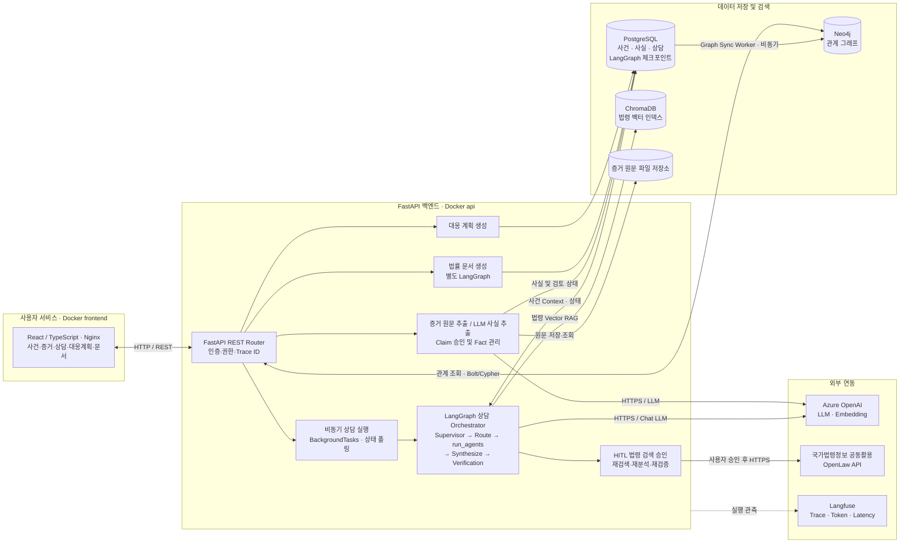

# AI Legal Helper — 기술 시스템 아키텍처 (발표자료용)

> 소스 기준: `main`의 `docker-compose.yml`, `api/main.py`, `api/routes/consultation.py`, `workflows/legal_workflow.py`, `workflows/document_workflow.py`, `llm/gateway.py`, `database/graph_sync_worker.py`.

**핵심 구조:** React/TypeScript 프런트엔드와 FastAPI API 서버를 분리하고, 법률 상담 LangGraph는 FastAPI 프로세스 내부에서 실행합니다. 법령 Vector RAG, 사건 데이터, 그래프 관계, 공식 법령 API와 LLM 호출을 결합합니다.

## 기술 구현 기준

- **별도 API Gateway 컨테이너는 없습니다.** FastAPI Router가 API 진입점 역할을 수행합니다.
- **LangGraph는 독립 서버가 아닙니다.** FastAPI 백엔드 내부의 상태 그래프 실행 코드입니다.
- **증거 추출 및 대응 계획**은 별도 비즈니스 처리이며, 법률 상담 LangGraph의 노드라고 표현하지 않습니다.
- **법률 문서 생성**은 `document_workflow.py`의 독립 LangGraph입니다.
- **PostgreSQL → Neo4j 동기화는 단방향 비동기 처리**입니다. `graph_sync_worker_loop`가 작업 테이블을 폴링하여 실행합니다.
- **LLM 모델명은 배포환경 변수에 따릅니다.** 코드의 기본값을 실제 운영 모델로 단정하지 않습니다.
- **공식 법령 API는 필요 시 HITL 승인 절차 후 호출**합니다.
- **Langfuse는 관측 연동**이며 별도의 Docker Compose 서비스 목록에 포함되어 있지 않습니다.

PDF 발표자료 삽입용 기술 도식은 16:9(1920×1080 논리 좌표)의 PNG·SVG·PDF 파일로 별도 생성했습니다.
