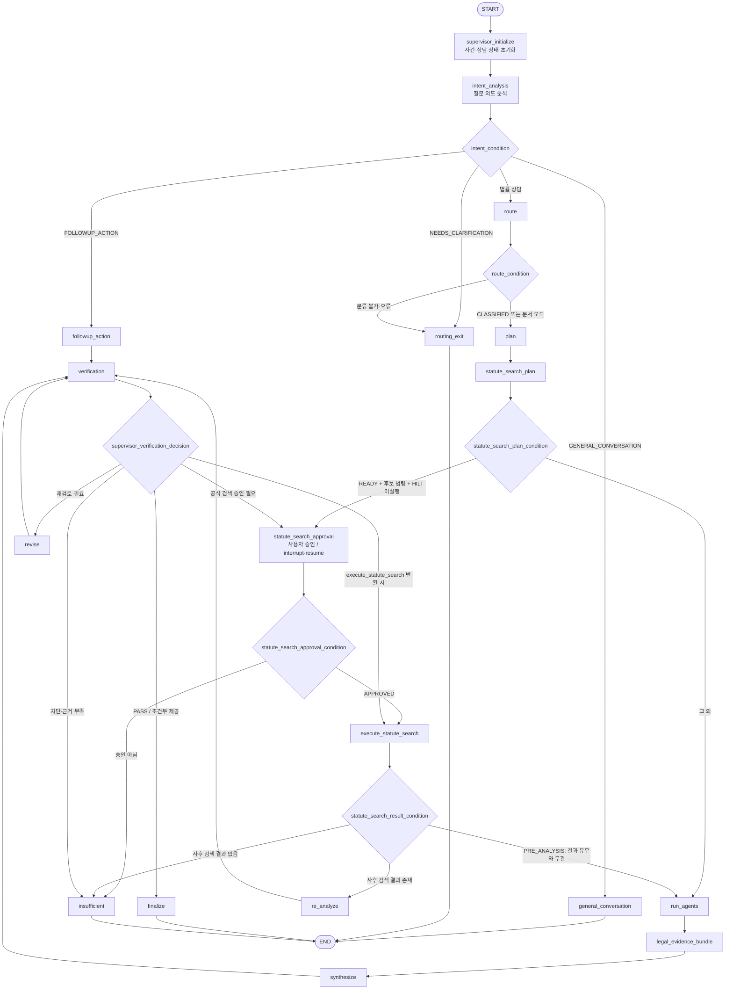

# AI Legal Helper — 상담 전체 LangGraph 플로우차트 (As-Is)

> 기준: `main`의 `backend/src/ai_legal_helper/workflows/legal_workflow.py`, `build_legal_graph()` 및 조건부 분기 함수.  
> 이 문서는 **소스코드에 실제 등록된 노드와 Edge의 정적 구조**를 기록한다. 운영 DB, 회사 LLM, OpenLaw API를 연결한 E2E 실행 통과를 뜻하지 않는다.

## 1. 전체 그래프

**주의:** `verification → execute_statute_search`는 그래프에 등록된 가능한 Edge다. 해당 반환값이 현재 정책의 어떤 입력 상태에서 실제 선택되는지는 별도 경로 테스트로 확인해야 한다. 모든 Edge가 일반 상담에서 반드시 실행되는 것은 아니다.

## 2. 소스 기준 노드 18개

| 노드 | 역할 |
|---|---|
| `supervisor_initialize` | 사건 맥락, 원문 유무, 상담 모드, 추적 상태 초기화 |
| `intent_analysis` | 일반 대화/명확화/후속 행동/법률 상담 의도 분석 |
| `general_conversation` | 인사·감사 등 일반 대화 응답 |
| `followup_action` | 이전 상담 맥락에 기초한 실무 행동 안내 초안 |
| `route` | 법률 분야 분류 |
| `routing_exit` | 정보 부족 또는 Router 오류 시 안전 종료 |
| `plan` | 전문 Agent·Tool 실행 계획 |
| `statute_search_plan` | 선행 법령 검색 계획 및 기준일 검토 |
| `statute_search_approval` | HILT 공식 법령 검색 사용자 승인 |
| `execute_statute_search` | 승인된 공식 법령 검색 |
| `run_agents` | 일반 상담 전문 Agent 실행 / 문서 모드 법률 자료 검색 |
| `legal_evidence_bundle` | 법령·출처 근거 통합 |
| `synthesize` | 답변 초안 생성 |
| `verification` | 법령·증거·인용 및 적용시점 검증 |
| `re_analyze` | 공식 법령 검색 이후 재분석·재작성 |
| `revise` | 검증 지적에 따른 보강·수정 |
| `insufficient` | 근거 부족·차단 시 판단 유보 |
| `finalize` | 최종 답변 확정 및 출처 감사 |

## 3. 조건부 분기 함수

| 출발 노드 | 조건 함수 | 가능한 목적지 |
|---|---|---|
| `intent_analysis` | `intent_condition` | `general_conversation`, `routing_exit`, `followup_action`, `route` |
| `route` | `route_condition` | `plan`, `routing_exit` |
| `statute_search_plan` | `statute_search_plan_condition` | `statute_search_approval`, `run_agents` |
| `verification` | `supervisor_verification_decision` | `finalize`, `statute_search_approval`, `execute_statute_search`, `revise`, `insufficient` |
| `statute_search_approval` | `statute_search_approval_condition` | `execute_statute_search`, `insufficient` |
| `execute_statute_search` | `statute_search_result_condition` | `run_agents`, `re_analyze`, `insufficient` |

## 4. 상담 모드와 특수 경로

- **일반 법률 상담:** 초기화 → 의도 분석 → Router → Planner → 선행 법령 검색 계획 → Agent → Evidence Bundle → Synthesize → Verification → Supervisor 분기.
- **증거 문서 사건:** 별도 그래프가 아니라 동일한 StateGraph를 사용한다. `answer_mode == DOCUMENT_MODE`일 때 `run_agents`, `verification`, `re_analyze`, `finalize` 등 노드 내부가 문서 전용 경로로 바뀐다.
- **후속 행동 질문:** `followup_action → verification`; 일반적인 Router/Planner/Agent 경로를 생략한다.
- **선행 공식 검색:** `statute_search_phase == PRE_ANALYSIS`이면 공식 검색 결과가 없어도 `run_agents`로 진행한다.
- **사후 공식 검색:** 결과가 있으면 `re_analyze → verification`, 결과가 없으면 `insufficient`로 진행한다.
- **검증 실패:** `revise → verification` 또는 HILT 공식 검색 후 재검증. 재검토 횟수 및 HILT 실행 여부를 확인하는 제한 정책이 있다.
- **적용시점 안전 차단:** `temporal_gate.status == BLOCK`이고 후보 법령이 있으며 HILT 미실행이면 `statute_search_approval`로, 그 외에는 `insufficient`로 분기한다.

## 5. Supervisor와 Verification의 실제 책임

- `supervisor_initialize`는 **초기화 노드**다.
- `verification_node`는 검증 결과를 State에 반환한다. 다음 노드를 직접 실행하지 않는다.
- `supervisor_verification_decision`은 `verification`의 **conditional-edge 라우팅 함수**다. 별도 LangGraph Supervisor 실행 노드는 아니다.
- `verification_condition`은 이전 호출자 호환을 위해 유지된 별칭이다.
- 따라서 현재 구현은 **중앙 집중식 Supervisor 노드 하나가 전체 그래프를 통제하는 구조가 아니라**, StateGraph의 조건부 Edge와 여러 분기 함수가 제어를 나누는 구조다.

## 6. 실행 검증이 필요한 지점

1. `MULTIPLE_EVENT_DATES` 등으로 선행 법령 검색 계획이 SKIP될 때 기존 검색 경로가 정확한 개정법·부칙을 확보하는가.
2. HILT 승인·거절·Resume, OpenLaw 공식 원문 조회, 시행일·적용례 판정이 운영 환경에서 정상 연결되는가.
3. P9 백그라운드 인덱싱의 Feature Flag, Worker, PostgreSQL Job, ChromaDB 컬렉션이 실제로 활성화돼 있는가.
4. `revise`와 `re_analyze` 이후 Verification 결과가 개선되는가; 불필요한 재실행과 판단 유보는 없는가.
5. `finalize`의 최종 인용 감사에서 실제 확보한 출처가 유실되지 않는가.
6. SC-001·SC-002·SC-003 및 최신 개정법 질문을 실제 E2E로 실행해 Trace, 지연, 토큰, 답변 품질을 기록했는가.

## 7. 근거 소스

- [LangGraph 구성 및 분기: `legal_workflow.py`](../../backend/src/ai_legal_helper/workflows/legal_workflow.py)
- [상태 정의: `state.py`](../../backend/src/ai_legal_helper/workflows/state.py)
- [P6 HILT 설계 및 검증 한계](../development/temporal-legal-rag/06_P6_HILT_WORKFLOW.md)
- [P8 적용시점 검증](../development/temporal-legal-rag/08_P8_TEMPORAL_VERIFICATION.md)
- [P9 인덱싱 및 운영 활성화](../development/temporal-legal-rag/09_P9_BACKGROUND_INDEX.md)
- [P11 E2E 평가 범위 및 미완료 항목](../development/temporal-legal-rag/11_P11_EVALUATION.md)
