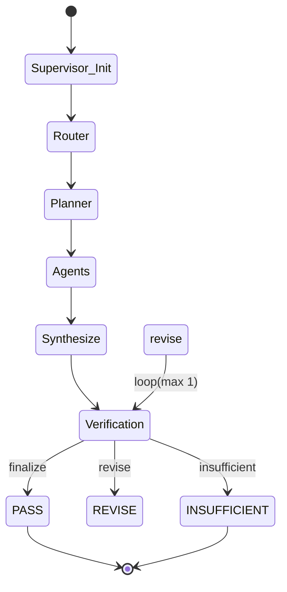

# Supervisor Architecture

## 1. 아키텍처 개요
기존 P1.2에서 단일 흐름(START -> Router -> Plan -> Agents -> Synthesize -> END)으로 구성되었던 LangGraph 파이프라인에, 답변의 신뢰성 검증 및 재검토를 위한 **Supervisor & Verification 루프**를 도입했습니다.

## 2. 상태 관리 (State)
기존 `LegalState`를 확장하여 다음 필드를 추가했습니다.
- `request_id`, `trace_id`: P0/P1 관측성 및 외부 연동을 위한 식별자
- `selected_agents`, `analysis_plan`, `agent_results`: 기존 파이프라인의 실행 이력 유지
- `retrieved_sources`: RAG 과정에서 검색된 실제 원문 및 출처 식별자 보관
- `draft_answer`: Synthesize 단계에서 생성된 1차 답변 (검증 대상)
- `verification_result`: Verification Agent가 판단한 검증 상태(PASS, REVISE, INSUFFICIENT) 및 주석
- `revision_count`: 무한 루프 방지를 위한 재검토 횟수 관리 (최대 1회)
- `final_answer`, `warnings`: 최종 확정된 답변 및 사용자용 경고 메시지

## 3. 노드(Node) 및 엣지(Edge) 구성
- `supervisor_initialize`: 메타데이터 설정 및 초기화
- `verification_node`: LLM(`with_structured_output`)을 활용하여 Grounding 검증
- `verification_condition`: 검증 상태를 평가하여 라우팅
- `revise_node`: 재검토 지침(`revision_instructions`)을 반영하여 답변 수정 및 `revision_count` 증가
- `insufficient_node`: 검증 실패에 따른 경고 문구 삽입
- `finalize_node`: 최종 답변 확정

## 4. 시퀀스 다이어그램

