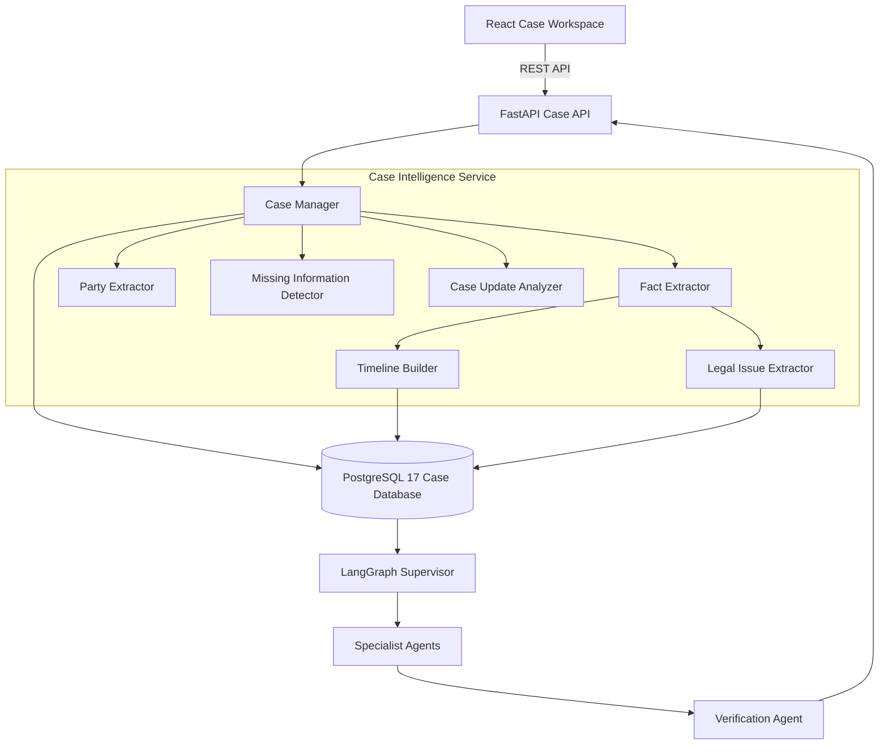

# P2.2 Case Intelligence Architecture

## 1. 개요
P2.2 Case Intelligence Service는 단발성 질의응답을 벗어나, 장기적인 맥락(Context)을 이해하고 이를 활용해 AI 자문을 제공하는 것을 목표로 한다.
React Frontend의 입력을 받은 FastAPI가 Case Intelligence 모듈을 처리하며, 파싱된 사실관계(Fact), 타임라인(Event), 법률 쟁점(Legal Issue)은 PostgreSQL 17 데이터베이스에 영속화된다.
이 데이터는 P2.1의 Supervisor로 주입되어 더욱 정확하고 맥락 있는 답변을 생성하는 기반이 된다.

## 2. 시스템 다이어그램

## 3. 주요 컴포넌트

### 3.1 Case Manager
사용자의 새로운 진술이나 상태 변경 요청을 받아, 내부 Extractor들을 조율하는 오케스트레이터 역할을 한다.
모든 변경사항에 대하여 버전을 관리하고, PostgreSQL 데이터베이스 트랜잭션 단위로 일관성 있는 데이터를 보장한다.

### 3.2 Extractor (LangChain 기반)
- **Party Extractor**: 관련된 임대인, 임차인 등 핵심 당사자를 식별한다.
- **Fact Extractor**: 문장에서 단일 사실들을 분리하고, 날짜/금액/행위 등으로 분류한다.
- **Legal Issue Extractor**: 확정된 사실을 기반으로 추가 검토가 필요한 쟁점을 도출한다.

### 3.3 Timeline Builder
추출된 Fact 중 날짜 정보가 있는 것들을 모아, 시간 순서대로 정렬된 `Event` 엔터티를 생성한다.
불명확한 날짜(예: "4월 초")를 처리하며, 상충하는 날짜가 발견될 경우 갈등을 탐지한다.

### 3.4 Missing Information Detector
현재까지 도출된 사실로 특정 법률 쟁점을 판단하기 어려울 경우, 사용자에게 추가로 물어볼 질문(Missing Information)을 생성한다.

## 4. 데이터 플로우 (신규 진술 업데이트)
1. 사용자가 기존 사건에 새로운 진술을 추가한다.
2. `Case Manager`가 `Fact Extractor`를 호출해 새로운 사실들을 추출한다.
3. 기존 사실과 대조해 변경된 `Fact`를 업데이트하고, `Event`와 `LegalIssue`를 재구성한다.
4. `CaseRevision` 레코드를 생성하여 변경 내역을 저장한다.
5. `Supervisor`가 갱신된 사건 컨텍스트를 주입받아 새로운 분석을 수행하고 답변을 반환한다.
