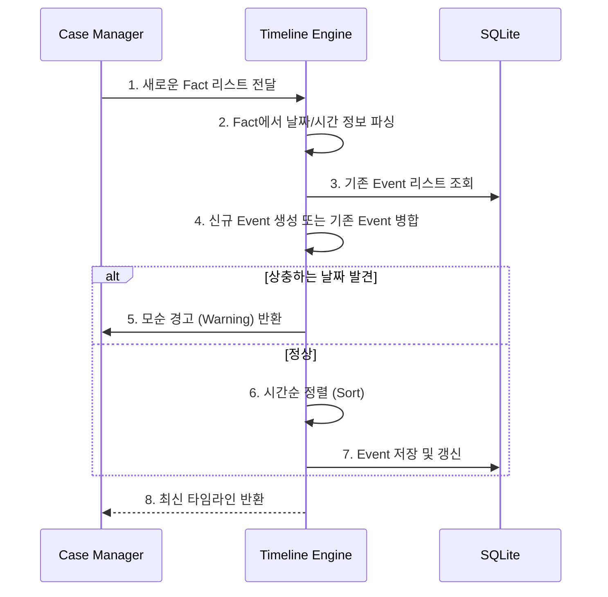

# P2.2 Timeline Engine 설계서

## 1. 개요
Timeline Engine은 Case Intelligence의 핵심 모듈로, 무질서한 사실관계 속에서 시간 정보를 추출하여 사건의 흐름을 시계열로 정리한다.
법률 분쟁(특히 임대차)에서는 통지 시점, 계약 만료일, 거주 시작일 등 시간의 선후 관계가 법률적 효력을 결정하는 중요한 요소이므로, 정확한 타임라인 구성이 필수적이다.

## 2. 주요 기능
1. **날짜 추출 및 정규화**: 텍스트에서 명시적 날짜(예: "2024년 5월 1일")와 암시적 기간(예: "작년 봄")을 추출한다.
2. **이벤트 생성**: 추출된 날짜를 바탕으로 개별 사실(Fact)들을 묶어 하나의 사건(Event)으로 구성한다.
3. **불확실성 처리**: 정확한 날짜를 모를 경우, 임의의 날짜를 추측하지 않고 `date_precision` 속성을 사용하여 모호성을 표현한다. (예: `APPROXIMATE`, `UNKNOWN`)
4. **모순 탐지**: 같은 사건에 대해 상충하는 날짜 주장이 들어오면 이를 식별하여 `DISPUTED` 상태로 전환하거나 추가 확인 질문을 유도한다.
5. **정렬**: 확인된 날짜를 기준으로 과거부터 현재까지 시계열 정렬된 목록을 반환한다.

## 3. 알고리즘 흐름

## 4. 제약 사항
- 타임라인 엔진은 단순한 시간순 정렬과 사실의 묶음을 담당하며, **민법상 기간 계산(예: 초일불산입 원칙 적용 등)**이나 **법적 효력 발생일 판단**은 직접 수행하지 않는다. 
- 복잡한 법률적 기간 계산은 추출된 타임라인을 바탕으로 Specialist Agent(전문 에이전트)가 수행한다.

