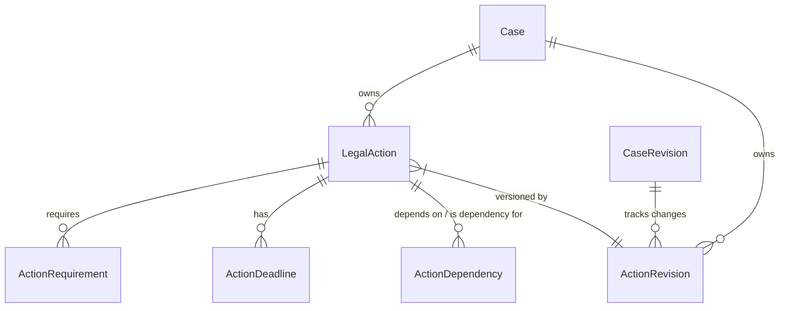

# P3.1 Action Domain Model Architecture

## 1. 개요
P3.1에서는 사건 분석 결과를 바탕으로 사용자에게 구체적이고 실행 가능한 법률 대응 행동을 제안합니다. 이를 위해 PostgreSQL을 데이터의 Source of Truth로 사용하는 Action Domain Model을 설계합니다. 이 모델들은 LangGraph 기반 `LegalActionPlanner`가 생성한 행동 계획을 영구 저장하고 추적하는 데 사용됩니다.

## 2. 모델 구조도 (ERD 요약)

## 3. 엔터티 상세 정의

### 3.1 LegalAction (법률 행동)
사용자가 취할 수 있는 단일 법률 대응 행동입니다.

- **`id`** (String, PK)
- **`case_id`** (String, FK -> cases.id)
- **`action_type`** (String): 행동의 종류 (예: `NOTICE`, `DEMAND`, `LAWSUIT`, `REVIEW`)
- **`title`** (String): 짧은 제목 (예: "내용증명 발송")
- **`description`** (Text): 행동에 대한 상세 설명 및 목적
- **`priority`** (String): 우선순위 (`HIGH`, `MEDIUM`, `LOW`)
- **`status`** (String): 진행 상태 (`RECOMMENDED`, `IN_PROGRESS`, `COMPLETED`, `DISCARDED`, `BLOCKED`)
- **`rationale`** (Text): 이 행동을 추천하는 법률적, 사실적 이유
- **`risk_level`** (String): 이 행동을 취했을 때(또는 취하지 않았을 때)의 위험도 (`HIGH`, `LOW`, `NONE`)
- **`confidence`** (Float): 추천에 대한 AI의 확신도
- **`created_at`, `updated_at`** (DateTime)

### 3.2 ActionRequirement (행동 요건)
특정 행동을 취하기 위해 만족해야 하는 선행 조건이나 사실, 증거입니다.

- **`id`** (String, PK)
- **`action_id`** (String, FK -> legal_actions.id)
- **`requirement_type`** (String): 요건 유형 (`FACT_CONFIRMATION`, `EVIDENCE_REQUIRED`, `LEGAL_CONDITION`)
- **`description`** (Text): 요구사항 설명 (예: "계약 종료 의사가 도달했다는 증명")
- **`satisfaction_status`** (String): 만족 여부 (`SATISFIED`, `UNSATISFIED`, `UNKNOWN`)
- **`supporting_evidence_ids`** (JSON): 이 요건을 충족시키는 증거(`evidence_documents.id`) 목록
- **`legal_source_ids`** (JSON): 이 요건의 근거가 되는 법령/판례 ID 목록

### 3.3 ActionDependency (행동 간 의존성)
행동 간의 선후 관계를 정의합니다.

- **`id`** (String, PK)
- **`action_id`** (String, FK -> legal_actions.id): 종속되는 행동
- **`depends_on_action_id`** (String, FK -> legal_actions.id): 선행되어야 하는 행동
- **`dependency_type`** (String): 의존 유형 (`PREREQUISITE`, `OPTIONAL_PRECURSOR`)

### 3.4 ActionDeadline (행동 기한)
행동과 관련된 법률상 또는 실무상 기한을 관리합니다.

- **`id`** (String, PK)
- **`action_id`** (String, FK -> legal_actions.id)
- **`deadline_type`** (String): 기한의 법적 성격 (`LEGAL_DEADLINE`, `RECOMMENDED_DATE`, `UNKNOWN`)
- **`deadline_date`** (DateTime): 계산된 기한 날짜
- **`calculation_basis`** (Text): 기한을 계산한 기준 (예: "계약 만료 2개월 전")
- **`legal_source_ids`** (JSON): 기한 계산의 근거 법령
- **`verification_status`** (String): 검증 여부 (`VERIFIED`, `UNVERIFIED`)

### 3.5 ActionRevision (행동 계획 변경 이력)
사건의 사실관계나 증거가 변경되었을 때, 행동 계획이 어떻게 갱신되었는지 버전을 추적합니다.

- **`id`** (String, PK)
- **`case_id`** (String, FK -> cases.id)
- **`case_revision_id`** (String, FK -> case_revisions.id, nullable): 이 변경을 촉발한 원본 사건 변경 이력
- **`action_plan_version`** (Integer): 행동 계획의 버전
- **`change_summary`** (Text): 이전 버전 대비 변경된 사항 요약 (예: "새로운 녹취록 증거로 인해 내용증명 발송 요건 충족 처리됨")
- **`created_at`** (DateTime)

## 4. Neo4j 확장 방안
PostgreSQL은 위 모델을 Source of Truth로 저장하며, Neo4j에는 다음과 같은 그래프 관계가 동기화됩니다.
- `(Action)-[:ACTION_ADDRESSES_ISSUE]->(LegalIssue)`
- `(Action)-[:ACTION_REQUIRES_FACT]->(Fact)`
- `(Action)-[:ACTION_REQUIRES_EVIDENCE]->(EvidenceDocument)`
- `(Action)-[:ACTION_DEPENDS_ON]->(Action)`

## 5. 모델 설계 원칙 결론
- 행동(Action) 자체는 불변이 아니며 사용자에 의해 상태(`status`)가 변경될 수 있습니다.
- 재평가 과정에서 사용자가 이미 수동으로 변경한 상태(`COMPLETED` 등)는 함부로 덮어쓰지 않고 보호합니다.
- 기한(Deadline)과 요건(Requirement)을 별도 엔터티로 분리하여 복잡한 조건부 계산과 검증을 독립적으로 수행하도록 합니다.

