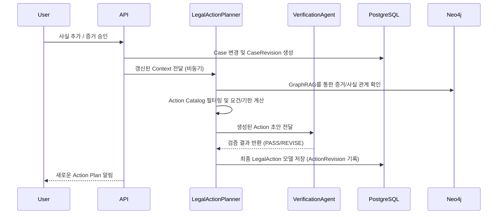

# P3.1 Legal Action Intelligence Architecture

## 1. 시스템 개요
Legal Action Intelligence는 분석된 사건의 사실, 증거, 쟁점을 바탕으로 사용자가 취해야 할 실질적인 법률 대응 행동(Legal Action)을 계획하고 제안하는 시스템입니다. 단순한 정보 제공을 넘어 구체적인 행동, 선행조건, 기한을 구조화하여 제시합니다.

## 2. 주요 구성요소

### 2.1 LegalActionPlanner (LangGraph 기반)
기존 사건 정보를 바탕으로 추천 행동을 추론하는 메인 Agent입니다.
- **Input**:
  - `Case Context`: 승인된 사실, 타임라인, 이벤트
  - `Evidence Context`: 승인된 증거 및 추출 명제, Evidence GraphRAG 결과
  - `Legal Context`: 연관 법률 쟁점 및 법령 검색 결과
  - `Current State`: 기존 Action Plan 및 최신 CaseRevision
- **Process**:
  1. **Action Identification**: 주택 임대차 Action Catalog를 바탕으로 현재 상황에서 고려할 수 있는 행동들을 필터링.
  2. **Requirement Checking**: 각 행동의 법률 요건과 현재 승인된 Fact/Evidence를 대조하여 충족 여부(`satisfaction_status`) 평가.
  3. **Dependency Mapping**: 행동 간의 선후 관계 설정.
  4. **Deadline Calculation**: `Deadline Engine`을 호출하여 법률적 기한 산출.
  5. **Prioritization**: 시급성, 요건 충족도 등에 따른 우선순위 배정.
- **Output**: Pydantic 모델 형태의 구조화된 Action Plan 제안.

### 2.2 Deadline Engine
법률상 또는 실무상 기한을 결정론적(Deterministic)으로 산출하는 모듈입니다.
- 단독 LLM 의존을 지양하고, 법령 기준일(예: 임대차계약 만료일)을 기점으로 한 날짜 계산 규칙 기반 엔진입니다.
- 정보가 부족한 경우 `UNKNOWN` 또는 확인 필요 상태로 반환하며 임의의 기한을 지어내지 않도록 방어합니다.

### 2.3 Action Verification Agent
생성된 Action Plan이 논리적으로 타당하며 환각(Hallucination)이 없는지 검증합니다.
- 선행조건 충족 판정이 실제로 증거에 기반하는지 체크.
- 법적 기한의 근거가 관련 법령에 존재하는지 체크.
- 실패 시 재작성(`REVISE`) 지시.

### 2.4 Action Plan Revision Manager
사건 정보(증거 추가 승인, 새로운 진술 등)가 변경되어 `CaseRevision`이 발생했을 때 기존 Action Plan을 재평가합니다.
- 변경된 사실이 기존 Action의 `Requirement`를 새롭게 충족시키거나 무효화하는지 추적합니다.
- 사용자 상태(`COMPLETED`)를 보존합니다.

## 3. 데이터 흐름도

## 4. 장애 및 Fallback 정책
- **GraphDB 장애**: GraphRAG 연동 실패 시, PostgreSQL 데이터와 Vector DB 검색결과만으로 Action Planner를 작동시키도록 Fallback.
- **LLM 추론 실패**: 구조화된 출력(Pydantic) 파싱 실패 시 재시도. 최종 실패 시 빈 Action Plan 또는 기존 Plan 유지하며 알림.

