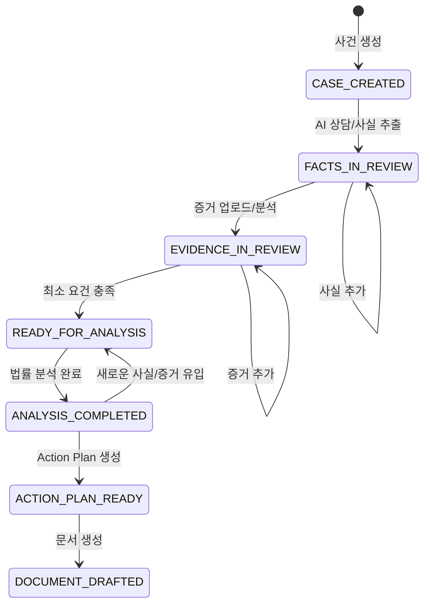

# AI Legal Helper — P3.3 Workspace Architecture

## 1. 개요
이 문서는 P3.3 단계에서 구현되는 **Case Workspace**와 **Workflow Orchestrator**의 아키텍처를 정의한다. 사건 중심의 단일 작업 공간(Workspace)을 제공하고, AI 상담부터 증거 분석, 대응 계획, 문서 작성에 이르는 전체 작업 흐름을 통합한다.

## 2. 통합 Case Workspace 아키텍처 (Frontend)

기존 `App.tsx`에서 분리된 기능들을 탭(Tab) 또는 사이드바(Sidebar) 기반의 네비게이션 구조를 갖춘 `CaseWorkspace`로 통합한다.

### 2.1 구성 요소
- **`WorkspaceLayout`**: 전체 레이아웃 (사이드바, 헤더, 메인 콘텐츠 영역).
- **`Sidebar`**: 사건 개요, 최근 활동, 탭 네비게이션, 현재 진행 상태 표시.
- **Tabs (모듈별 뷰)**:
  - **Overview (개요)**: 사건 요약, 진행 상태(`WorkflowStatus`), Action 제안.
  - **Chat (상담)**: 사건 컨텍스트 기반 AI 채팅 (`useConsultation`).
  - **Facts & Timeline**: 추출된 사실 승인/수정 및 사건 타임라인.
  - **Evidence**: 파일 업로드 및 증거 목록 확인.
  - **Graph (Evidence Graph)**: Neo4j 기반 증거/사실 관계 시각화 (`EvidenceGraph`).
  - **Action Plan**: 추천되는 법적 대응 방안 (`ActionPlanSection`).
  - **Documents**: 문서 생성 및 내보내기 (`DocumentSection`).

### 2.2 상태 관리 (State Management)
- **전역 상태 (Context API / Zustand)**:
  - `ActiveCase`: 현재 선택된 사건 정보 보존 (화면 이동 시에도 유지).
  - `WorkflowState`: 서버에서 조회한 사건의 현재 진행 상태 캐싱.
- **비동기 상태 (React Query / SWR)**:
  - 로딩, 에러, 재시도, 캐시 무효화를 일관되게 처리하여 불필요한 API 중복 호출을 방지.

## 3. Workflow Orchestrator (Backend)

각 파편화된 엔드포인트를 하나로 묶고, 사건의 전체 작업 흐름을 관장하는 Orchestrator API를 추가한다.

### 3.1 상태 전이 다이어그램 (Workflow State)

### 3.2 도메인 모델 매핑
- 이 상태(Workflow State)는 UI에서 사용자의 진행을 돕기 위한 **파생 상태(Derived State)**이다.
- DB에 하드코딩된 별도 컬럼을 두기보다는, 각 도메인(Fact, Evidence, ActionPlan, Document)의 상태를 종합하여 동적으로 계산(Calculate)하는 방식을 기본으로 하되, 성능 향상을 위해 `Case` 테이블에 `workflow_status` 필드를 캐싱할 수 있다.

### 3.3 통합 API 설계 (`/api/v1/cases/{case_id}/workflow`)
- `GET /workflow/status`: 위 상태 전이 다이어그램에 따른 현재 사건의 상태 반환.
- `GET /workflow/summary`: Workspace Overview 탭에서 보여줄 사건의 요약 정보 (최근 활동, 다음 추천 행동 등) 반환.
- `POST /workflow/trigger/{action}`: 특정 분석 작업(예: 법률 분석 재실행) 비동기 시작.

## 4. 백그라운드 작업 및 비동기 처리
- LLM 호출(LangGraph 실행)이나 긴 시간이 소요되는 작업은 기존의 LangGraph 비동기 실행 구조를 활용한다.
- 클라이언트는 Polling 또는 SSE(Server-Sent Events)를 통해 상태 업데이트를 수신하거나, `GET /workflow/status`를 주기적으로 호출하여 UI에 진행률(Progress)을 표시한다.

## 5. 기존 모듈 재사용 방안
- **PostgreSQL**: 사건 정보 및 하위 도메인들의 Source of Truth (유지)
- **Neo4j**: Evidence Graph 시각화 컴포넌트 그대로 사용. 단, Fallback UI 추가.
- **ChromaDB**: 기존 RAG 파이프라인 재사용.
- **LangGraph**: 채팅, 사실 추출, 분석, 문서 생성에 사용된 기존 Graph 파이프라인을 그대로 호출 (Endpoint만 조합).

