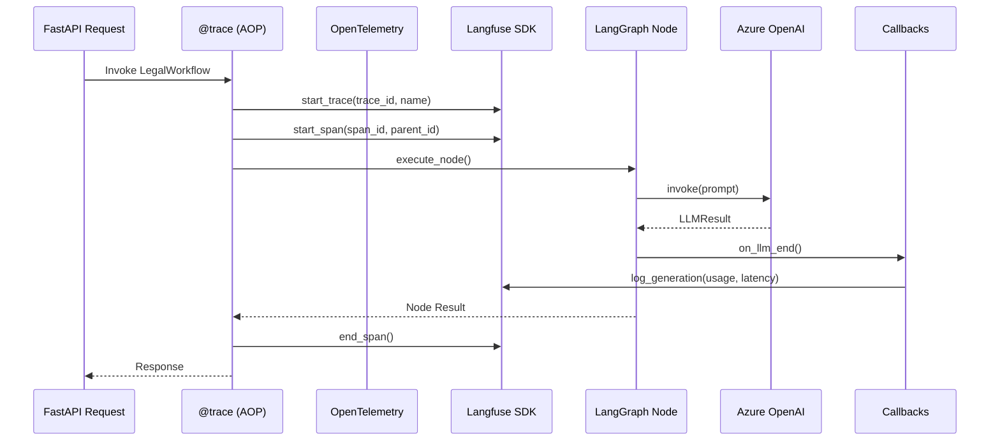

# P3.6 Observability Architecture

## 1. Overview
AI Legal Helper is instrumented with a hybrid observability stack that tracks Multi-Agent execution, GraphRAG retrieval, Action Planning, and Azure OpenAI LLM calls. The architecture relies on an AOP-based tracing approach (`@trace`) which concurrently manages OpenTelemetry (OTel) spans and Langfuse traces.

## 2. Core Components

1. **Context Management (`context.py`)**: 
   Maintains `trace_id`, `run_id`, `agent_name`, `node_name`, and `current_span_id` using Python's `contextvars`. This allows deeply nested async operations to access their parent trace/span without passing them through function arguments.
   
2. **AOP Tracing (`decorators.py`)**: 
   The `@trace` decorator automatically wraps key functions (e.g., LangGraph nodes, RAG retrievals, Agent executions).
   - Generates a unique `span_id`.
   - Starts a Langfuse Span and an OTel Span.
   - Measures latency, captures exceptions, and securely scrubs sensitive data (API keys, PII) before sending error messages to telemetry.
   - Ends the Span upon function return.

3. **LLM Gateway & Token Tracker (`callbacks.py`)**: 
   All Azure OpenAI calls are instantiated via `get_llm()` which injects a `TokenTrackingCallbackHandler`. 
   - Upon LLM end, it records tokens to a global tracker and manually logs a `generation` to Langfuse using the active `span_id`.
   - Prevents duplicate counting since we do not use the raw, noisy `LangfuseCallbackHandler`.
   - Explicitly masks prompts and responses (`[MASKED FOR PRIVACY]`) before they leave the application memory.

4. **Langfuse Client (`langfuse_client.py`)**: 
   A lightweight Singleton wrapper around the official `langfuse` Python SDK. It asynchronously batches and transmits spans/generations to the Langfuse backend.

## 3. Data Flow

## 4. Privacy & Security
- The system enforces a strict "No Body" policy for Observability.
- `LANGFUSE_CAPTURE_CONTENT=false` ensures that variables, RAG search texts, and raw claims are never sent to external servers.
- `update_span` is selectively used in `retrieval.py` and `graph_rag.py` to upload *metadata* (e.g., `hits`, `path_count`, `vector_matches_count`) rather than actual string content.

## 5. Langfuse Self-Hosted Infrastructure
The Langfuse backend is deployed via an isolated `docker-compose.langfuse.yml` which shares the same network and `postgres:17` database instance as the main application, but utilizes a logically distinct `langfuse` database. This ensures minimal overhead while enabling full metric visualization.

