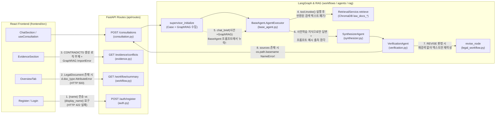

# 00. AI Legal Helper — 전체 서비스 이벤트 및 End-to-End 실행 플로우 감사 요약 (Audit Summary)

- **감사 일자**: 2026-10-16
- **감사 대상 루트**: `C:\myprjs\ai-legal-helper` (`backend/src/ai_legal_helper`, `frontend/src`)
- **감사 성격**: **As-Is Architecture & Event Flow Audit** (실제 구현 코드 및 비파괴 런타임 검증 기반, 소스코드 수정 없음)

---

## 1. 전체 감사 결과 한눈에 보기 (Executive Summary)

AI Legal Helper는 **React 19 + TypeScript (Vite)** 프런트엔드와 **FastAPI + SQLAlchemy (PostgreSQL) + LangGraph + ChromaDB + Neo4j + Langfuse** 백엔드로 구성된 사건 중심(Case-Centric) 법률 AI 워크스페이스이다.

전체 소스코드를 전수 조사하고 로컬 실행 환경(PostgreSQL, Neo4j, ChromaDB SQLite, FastAPI `TestClient`)을 교차 검증한 결과, **총 35개의 주요 이벤트(필수 기준 30개 + 코드에서 추가 발견된 5개)**가 식별되었다.

| 구분 | 이벤트 수 | 비율 | 해당 이벤트 ID |
|---|---:|---:|---|
| **구현 완료 (`IMPLEMENTED`)** | **11개** | 31.4% | `EVT-001`, `EVT-003`, `EVT-004`, `EVT-005`, `EVT-007`, `EVT-008`, `EVT-009`, `EVT-027`, `EVT-032`, `EVT-033`, `EVT-034` |
| **부분 구현 / 결함 내포 (`PARTIAL`)** | **22개** | 62.9% | `EVT-002`, `EVT-010`, `EVT-011`, `EVT-012`, `EVT-013`, `EVT-014`, `EVT-015`, `EVT-016`, `EVT-017`, `EVT-019`, `EVT-020`, `EVT-021`, `EVT-022`, `EVT-023`, `EVT-024`, `EVT-025`, `EVT-026`, `EVT-028`, `EVT-029`, `EVT-030`, `EVT-031`, `EVT-035` |
| **미구현 (`MISSING`)** | **2개** | 5.7% | `EVT-006` (사건 정보 수정), `EVT-018` (검색 전략 변경 및 재검색 루프) |
| **합계** | **35개** | **100.0%** | 필수 `EVT-001`~`EVT-030` (30개) + 추가 발견 `EVT-031`~`EVT-035` (5개) |

> [!IMPORTANT]
> **핵심 감사 결론**:
> 사건 생성·조회·진술 추출(`EVT-003`~`EVT-005`, `EVT-032`), 증거 업로드·추출·검토·삭제(`EVT-008`, `EVT-009`, `EVT-033`, `EVT-034`), 법률 문서 DOCX/PDF 다운로드(`EVT-027`) 등 **Case Intelligence 및 Evidence Pipeline의 CRUD·추출 골격은 실제로 동작**한다.
> 반면, 핵심 AI 차별화 영역인 **법률 상담 LangGraph 파이프라인(`EVT-012`~`EVT-022`)**과 **증거 모순 탐지(`EVT-024`)**, **인증 계약(`EVT-031`)**, **워크플로우 요약(`EVT-035`)**에는 **치명적인 데이터 단절 및 런타임 예외(NameError, AttributeError, ImportError, Schema Mismatch)**가 존재하여 E2E 정상 동작을 가로막고 있다.

---

## 2. 핵심 아키텍처 및 데이터 흐름 단절 요약

### 발견된 5대 구조적 결함
1. **법률 RAG 및 사건 컨텍스트의 하위 에이전트 전달 단절 (`backend/src/ai_legal_helper/agents/legal/base_agent.py:47-92`)**
   - 프로덕션 코드의 `AgentExecutor`는 LangChain 표준 ReAct 루프가 아니라 커스텀 간이 클래스이다.
   - `self.tools[0].invoke({"query": ...})`를 호출하여 ChromaDB 검색 결과를 가져오고 ContextVar(`_retrieved_sources_var`)에 출처 메타데이터를 기록하지만, **정작 반환된 법률 조문/판례 텍스트를 변수에 저장하지 않고 버린다.**
   - 이어서 `self.prompt.format(agent_scratchpad="", ...)`로 프롬프트를 렌더링하며, `inputs`로 전달된 `chat_brief`(사건 사실관계 + 타임라인 + Neo4j GraphRAG 결과)조차 `REACT_TEMPLATE` 변수에 포함하지 않는다.
   - 결과적으로 7개 분야 하위 에이전트는 **검색된 법령/판례도 보지 못하고 사건 사실관계도 보지 못한 채** 오직 LLM의 사전학습 지식으로만 답변을 작성한다.
2. **상담 완료 직전 `NameError: name 'os' is not defined` 크래시 (`backend/src/ai_legal_helper/api/routes/consultation.py:147, 217, 221`)**
   - `RetrievalService.retrieve()`가 `_retrieved_sources_var`에 1건 이상의 출처를 기록하면, `consultation.py:147`에서 `os.path.basename(raw_source)`를 호출한다.
   - 그러나 `consultation.py` 상단에 `import os`가 누락되어 있어 **법률 RAG 검색이 성공할수록 `NameError`가 발생**하며, 예외 핸들러(`consultation.py:162`)가 상태를 `ERROR`로 전환하고 `"상담 처리 중 오류가 발생했습니다"`를 반환한다.
3. **Adaptive Retrieval(`EVT-017`, `EVT-018`) 및 Citation Validator(`EVT-020`) 미구현**
   - `VerificationAgent`(`verification.py:21-40`) 프롬프트에는 `{case_context}`와 출력 JSON 스키마 정의가 누락되어 있으며, JSON 파싱 실패 시 예외 블록(`verification.py:80`, `162`)에서 무조건 `status="PASS"`로 폴백한다.
   - 설령 `REVISE`가 반환되더라도 `revise_node`(`legal_workflow.py:349-370`)는 기존 초안(`draft_answer`)만 LLM으로 다듬을 뿐, 쿼리를 수정하거나 ChromaDB/Neo4j를 재검색(`route`/`plan`/`run_agents`)하는 그래프 엣지가 존재하지 않는다.
   - 본문 내 인용문(`(파일명.pdf, p.XX)`)과 실제 검색된 `_retrieved_sources_var`를 대조하는 Citation Validator 코드가 존재하지 않는다.
4. **증거 모순 탐지(`EVT-024`)의 명목상 구현 (`backend/src/ai_legal_helper/api/routes/evidence.py:96-202`)**
   - `GET /api/v1/cases/{case_id}/evidence/conflicts`는 RDB에서 `link_type == "CONTRADICTS"` 또는 `assertion_status == "CONTRADICTION_CANDIDATE"`를 조회하지만, 추출기(`evidence_extractor.py`)와 매니저(`evidence_manager.py:105`)는 오직 `SUPPORTS` 링크와 4개 고정 상태(`DOCUMENT_STATES`, `PARTY_ALLEGES`, `AI_INFERENCE`, `UNCERTAIN`)만 생성한다.
   - 3단계 GraphRAG 보강 조회(`evidence.py:182`)는 `from ai_legal_helper.rag.graph_rag import GraphRAG`를 호출하나 실제 클래스명은 `GraphRAGRetriever`이므로 매 호출마다 `ImportError`가 발생하고 `except Exception: pass`로 무시된다.
5. **프런트엔드-백엔드 스키마/속성 불일치 (`auth.py`, `workflow.py`)**
   - 회원가입(`Register.tsx:17`)은 `{ email, password, name }`을 전송하나 백엔드 `UserCreate`(`auth.py:18`)는 `display_name`을 필수로 요구하여 **HTTP 422**로 실패한다.
   - 로그인(`Login.tsx:16` / `AuthContext.tsx:41`)은 백엔드가 반환한 `{"message": "로그인 성공"}` 객체를 `user` 상태에 그대로 저장한다.
   - 워크플로우 요약(`workflow.py:305`)은 `LegalDocument` 모델의 `document_type` 컬럼을 `d.doc_type`으로 잘못 참조하여 문서 초안이 1건이라도 생성된 사건에서 `GET /api/v1/cases/{case_id}/workflow/summary`가 **HTTP 500 (`AttributeError`)**으로 실패한다. 또한 `workflow.py:218`은 `last_c.answer`가 `None`일 때 `len(last_c.answer)`에서 **HTTP 500 (`TypeError`)**을 유발한다.

---

## 3. 기술 차별화 5대 요소 실제 구현 평가

| 기술 차별화 요소 | 설계 목표 | 실제 코드 구현 상태 | 판정 | 근거 파일 및 라인 |
|---|---|---|---|---|
| **1. Adaptive Retrieval** | 검색 결과 불충분 시 쿼리 재작성 및 재검색 루프 수행 | `rewrite_query` 1회 실행 후 검색. `VerificationAgent`가 `REVISE`를 반환해도 `revise_node`는 텍스트만 재작성하며 재검색 루프가 없음 | **미구현 (`MISSING` / 텍스트 교정만 존재)** | `workflows/legal_workflow.py:349-413` |
| **2. GraphRAG** | Neo4j 사건/증거 서브그래프 + ChromaDB 하이브리드 검색을 상담·문서 작성에 결합 | `GraphSyncWorker`가 RDB→Neo4j 동기화 수행, `GraphRAGRetriever.search_hybrid`가 Cypher 서브그래프 조회 후 `Synthesizer`와 `DocumentWorkflow`에 전달. 단, `BaseAgent`에는 미전달되며 드라이버 미연결 시 벡터 폴백이 호출부에서 차단됨 | **부분 구현 (`PARTIAL`)** | `rag/graph_rag.py:72-279`, `workflows/legal_workflow.py:157-194` |
| **3. Evidence Reasoning** | 증거 문서 파싱 → Span/Claim 추출 → 사용자 승인 시 Fact 승격 + 모순 탐지 | PDF/DOCX/TXT 파싱, LLM Span/Claim 추출, 사용자 `APPROVE`/`EDIT`/`REJECT` 검토 및 `Fact` 승격·`SUPPORTS` 링크 생성 완비. 단, **모순 탐지(`CONTRADICTS`) 생성 로직 전무** | **부분 구현 (`PARTIAL`)** | `case_intelligence/evidence_extractor.py:92-215`, `api/routes/evidence.py:96-318` |
| **4. Stateful Agent** | 사건 메모리(당사자·사실·타임라인·쟁점)와 상담/액션플랜/문서 작성을 상태 기반으로 연동 | PostgreSQL 기반 사건 메모리(`Case`, `Party`, `Fact`, `Event`, `LegalIssue`) 누적 및 `workflow/summary` 파생 상태 계산 구현. 단, `LegalState` 자체는 요청 단위 휘발성이며 `cases.version`은 갱신되지 않음 | **부분 구현 (`PARTIAL`)** | `case_intelligence/manager.py:19-160`, `api/routes/workflow.py:115-315` |
| **5. Citation Validation** | 생성된 답변의 인용 출처가 실제 검색된 법령/판례/증거와 일치하는지 검증 | `_retrieved_sources_var`로 검색 청크 메타데이터를 수집하나, LLM이 본문에 적은 `(파일명.pdf, p.XX)`와 대조·필터링하는 검증기 부재. 프롬프트 예시(`민법...pdf, p.40`) 환각 노출 위험 높음 | **미구현 (`MISSING` / 단순 포맷·자기검증만 존재)** | `agents/legal/base_agent.py:22-92`, `agents/verification.py:21-82` |

---

## 4. 감사 문서 체계 (Deliverables Index)

본 감사 결과는 `docs/architecture/flow-audit/` 하위에 다음 13개 본문 문서와 35개 개별 이벤트 시퀀스 문서로 구성되어 있다.

1. [`00_AUDIT_SUMMARY.md`](00_AUDIT_SUMMARY.md) — 전체 감사 요약 (본 문서)
2. [`01_SYSTEM_ARCHITECTURE.md`](01_SYSTEM_ARCHITECTURE.md) — 전체 시스템 아키텍처 및 계층별 호출·데이터 흐름
3. [`02_EVENT_CATALOG.md`](02_EVENT_CATALOG.md) — 전체 35개 이벤트 카탈로그 (`EVT-001` ~ `EVT-035`)
4. [`03_EVENT_FLOW_INDEX.md`](03_EVENT_FLOW_INDEX.md) — 화면·도메인별 이벤트 맵 및 시퀀스 다이어그램 목차
5. [`04_LANGGRAPH_FLOW.md`](04_LANGGRAPH_FLOW.md) — 법률 상담(`legal_workflow.py`) 및 문서 작성(`document_workflow.py`) LangGraph 상세 플로우
6. [`05_RAG_CITATION_FLOW.md`](05_RAG_CITATION_FLOW.md) — 법률 RAG, 증거 RAG, GraphRAG 및 출처(Citation) 생성·검증 상세 분석
7. [`06_DATA_FLOW.md`](06_DATA_FLOW.md) — PostgreSQL, ChromaDB, Neo4j, 로컬 파일 스토리지 간 데이터 생명주기 및 Outbox 동기화 플로우
8. [`07_CASE_STATE_FLOW.md`](07_CASE_STATE_FLOW.md) — 사건(`Case`), 증거(`EvidenceDocument`), 주장(`EvidenceClaim`), 상담(`ConsultationRecord`), 문서(`LegalDocument`) 상태 전이 다이어그램
9. [`08_ERROR_RECOVERY_FLOW.md`](08_ERROR_RECOVERY_FLOW.md) — 장애·타임아웃·재시도·폴백 및 예외 삼킴(`except: pass`) 경로 분석
10. [`09_LANGFUSE_TRACE_FLOW.md`](09_LANGFUSE_TRACE_FLOW.md) — Langfuse Trace / Span / Generation, OpenTelemetry, TokenTracker 관측성 플로우
11. [`10_CODE_MAPPING.md`](10_CODE_MAPPING.md) — 전 이벤트(`EVT-001` ~ `EVT-035`) × UI·API·Service·DB·LangGraph·Trace 코드 위치 매핑 테이블
12. [`11_EXECUTION_VERIFICATION.md`](11_EXECUTION_VERIFICATION.md) — 정적 코드 분석 vs 실제 로컬 런타임/TestClient 실행 검증 결과 비교
13. [`12_GAP_ANALYSIS.md`](12_GAP_ANALYSIS.md) — 설계 대비 구현 격차(Gap) 분석 및 최우선 수정 과제 TOP 10
14. [`events/EVT-001.md`](events/EVT-001.md) ~ [`events/EVT-035.md`](events/EVT-035.md) — 35개 전체 이벤트별 End-to-End Sequence Diagram

