# 03. 전체 이벤트 맵 및 다이어그램 목차 (Event Flow Index)

이 문서는 사용자 화면(Screen/Tab)과 백엔드 실행 계층별로 발생하는 모든 이벤트(`EVT-001` ~ `EVT-035`)를 그룹화하여 시각화하고, 개별 상세 Sequence Diagram 문서(`events/EVT-XXX.md`)로의 목차를 제공한다.

---

## 1. 화면 및 계층별 전체 이벤트 맵 (Event Map Diagram)

```mermaid
flowchart TB
    subgraph Lifecycle["시스템 라이프사이클 & 공통 인프라"]
        E001["EVT-001: 서비스 시작 및 초기화\n(main.py lifespan)"]
        E030["EVT-030: 서비스 종료 및 리소스 정리\n(main.py lifespan shutdown)"]
        E028["EVT-028: Langfuse Trace 기록\n(Middleware / @trace / Callback)"]
        E029["EVT-029: 오류·타임아웃·재시도 처리\n(Gateway / Worker / ExceptionHandler)"]
    end

    subgraph AuthScreen["인증 및 세션 화면 (App.tsx / Login.tsx / Register.tsx)"]
        E002["EVT-002: 사용자 세션 시작\n(AuthProvider -> GET /auth/me)"]
        E031["EVT-031: 회원가입·로그인·로그아웃\n(POST /auth/register, /login, /logout)"]
    end

    subgraph CaseListScreen["사건 목록 화면 (CaseList.tsx : '/')"]
        E004["EVT-004: 사건 목록 조회\n(GET /cases)"]
        E003["EVT-003: 사건 등록\n(POST /cases)"]
        E007["EVT-007: 사건 삭제\n(DELETE /cases/{id})"]
        E006["EVT-006: 사건 정보 수정\n[미구현 - MISSING]"]
    end

    subgraph WorkspaceCommon["사건 워크스페이스 공통 & 개요/사실관계 탭 (CaseWorkspace.tsx)"]
        E005["EVT-005: 사건 상세 조회\n(GET /cases/{id})"]
        E032["EVT-032: 사건 진술(Statement) 추가\n(POST /cases/{id}/statements)"]
        E011["EVT-011: 사건 Timeline 생성\n(TimelineEngine.reconstruct_timeline)"]
        E035A["EVT-035 (Part A): 워크플로우 요약 조회\n(OverviewTab -> GET /workflow/summary)"]
    end

    subgraph EvidenceTab["증거 관리 탭 (EvidenceSection.tsx : 'evidence')"]
        E008["EVT-008: 증거 파일 업로드\n(POST /cases/{id}/evidence)"]
        E009["EVT-009: 파일 파싱 및 사실 추출\n(BackgroundTask / POST .../extract)"]
        E033["EVT-033: 증거 Claim 검토 (승인/수정/반려)\n(POST .../claims/{claim_id}/review)"]
        E034["EVT-034: 증거 파일 삭제\n(DELETE /cases/{id}/evidence/{doc_id})"]
        E024["EVT-024: 증거 불일치 탐지\n(GET /cases/{id}/evidence/conflicts)"]
        E010["EVT-010: 증거 임베딩 및 인덱싱\n(GraphSyncWorker -> Chroma + Neo4j)"]
        E023["EVT-023: 새로운 증거 추가 후 재분석\n(승인 -> Fact 승격 -> 재상담/재계획)"]
    end

    subgraph ChatTab["AI 법률 상담 탭 (ChatSection.tsx : 'chat')"]
        E012["EVT-012: 법률 질문 입력 및 폴링\n(POST /consultations + GET /consultations/{id})"]
        E013["EVT-013: Supervisor Agent 실행\n(legal_workflow.py)"]
        E016["EVT-016: GraphRAG 검색\n(GraphRAGRetriever.search_hybrid)"]
        E014["EVT-014: 법률 RAG 검색\n(RetrievalService.retrieve)"]
        E015["EVT-015: 증거 RAG 검색\n(EvidenceVectorStore.search_similar_evidence)"]
        E019["EVT-019: LLM 답변 생성\n(BaseAgent -> SynthesizerAgent)"]
        E017["EVT-017: 검색 결과 충분성 평가\n(VerificationAgent.verify_answer)"]
        E018["EVT-018: 검색 전략 변경 및 재검색\n[미구현 - revise_node 텍스트만 수정]"]
        E020["EVT-020: 법률 근거 및 인용 검증\n(_retrieved_sources_var + Verification)"]
        E021["EVT-021: 분석 결과 저장\n(PostgreSQL consultations + _consultations)"]
        E022["EVT-022: 분석 결과 화면 표시\n(ChatSection.tsx 답변/출처 렌더링)"]
    end

    subgraph GraphActionDocTabs["그래프 / 대응 계획 / 문서 작성 탭 ('graph', 'action', 'docs')"]
        E035B["EVT-035 (Part B): 증거 그래프 및 구조 분석 조회\n(EvidenceGraph -> GET /graph, /graph/analysis)"]
        E025["EVT-025: Next Action 생성·갱신\n(ActionPlanSection -> POST /actions/plan)"]
        E026["EVT-026: 법률 문서 초안 생성\n(DocumentSection -> POST /documents)"]
        E027["EVT-027: DOCX/PDF 다운로드\n(DocumentSection -> POST /documents/{id}/export)"]
    end

    E001 --> E002 --> E004
    E003 --> E005
    E032 --> E011
    E008 --> E009 --> E033 --> E010 --> E023
    E012 --> E013 --> E016 --> E014 --> E019 --> E017 --> E020 --> E021 --> E022
```

---

## 2. 이벤트별 상세 Sequence Diagram 문서 목차 (`events/EVT-XXX.md`)

각 링크를 클릭하면 참여자(`User`, `React`, `FastAPI`, `Service`, `PostgreSQL`, `ChromaDB`, `Neo4j`, `LangGraph`, `LLM`, `Langfuse`) 간의 요청·응답, 조건부 분기, 예외 경로가 포함된 상세 시퀀스 다이어그램 문서를 확인할 수 있다.

### 2.1 시스템 및 세션/인증 이벤트
- [`events/EVT-001.md`](events/EVT-001.md) — **EVT-001**: 서비스 시작 및 초기화 (`IMPLEMENTED`)
- [`events/EVT-002.md`](events/EVT-002.md) — **EVT-002**: 사용자 세션 시작 (`PARTIAL`)
- [`events/EVT-030.md`](events/EVT-030.md) — **EVT-030**: 서비스 종료 및 리소스 정리 (`PARTIAL`)
- [`events/EVT-031.md`](events/EVT-031.md) — **EVT-031**: 사용자 회원가입·로그인·로그아웃 (`PARTIAL`)

### 2.2 사건(Case) 및 사실관계/타임라인 관리 이벤트
- [`events/EVT-003.md`](events/EVT-003.md) — **EVT-003**: 사건 등록 (`IMPLEMENTED`)
- [`events/EVT-004.md`](events/EVT-004.md) — **EVT-004**: 사건 목록 조회 (`IMPLEMENTED`)
- [`events/EVT-005.md`](events/EVT-005.md) — **EVT-005**: 사건 상세 조회 (`IMPLEMENTED`)
- [`events/EVT-006.md`](events/EVT-006.md) — **EVT-006**: 사건 정보 수정 (`MISSING`)
- [`events/EVT-007.md`](events/EVT-007.md) — **EVT-007**: 사건 삭제 (`IMPLEMENTED`)
- [`events/EVT-011.md`](events/EVT-011.md) — **EVT-011**: 사건 Timeline 생성 (`PARTIAL`)
- [`events/EVT-032.md`](events/EVT-032.md) — **EVT-032**: 사건 진술(Statement) 추가 및 사실·쟁점 추출 (`IMPLEMENTED`)

### 2.3 증거(Evidence) 업로드·추출·검토·인덱싱·모순 탐지 이벤트
- [`events/EVT-008.md`](events/EVT-008.md) — **EVT-008**: 증거 파일 업로드 (`IMPLEMENTED`)
- [`events/EVT-009.md`](events/EVT-009.md) — **EVT-009**: 파일 파싱 및 사실 추출 (`IMPLEMENTED`)
- [`events/EVT-010.md`](events/EVT-010.md) — **EVT-010**: 증거 임베딩 및 인덱싱 (`PARTIAL`)
- [`events/EVT-023.md`](events/EVT-023.md) — **EVT-023**: 새로운 증거 추가 후 재분석 (`PARTIAL`)
- [`events/EVT-024.md`](events/EVT-024.md) — **EVT-024**: 증거 불일치 탐지 (`PARTIAL`)
- [`events/EVT-033.md`](events/EVT-033.md) — **EVT-033**: 증거 추출 주장(Claim) 검토 — 승인·수정승인·반려 (`IMPLEMENTED`)
- [`events/EVT-034.md`](events/EVT-034.md) — **EVT-034**: 증거 파일 삭제 (`IMPLEMENTED`)

### 2.4 법률 상담 LangGraph·RAG·인용 검증 이벤트
- [`events/EVT-012.md`](events/EVT-012.md) — **EVT-012**: 법률 질문 입력 및 비동기 폴링 (`PARTIAL`)
- [`events/EVT-013.md`](events/EVT-013.md) — **EVT-013**: Supervisor Agent 실행 (`PARTIAL`)
- [`events/EVT-014.md`](events/EVT-014.md) — **EVT-014**: 법률 RAG 검색 (`PARTIAL`)
- [`events/EVT-015.md`](events/EVT-015.md) — **EVT-015**: 증거 RAG 검색 (`PARTIAL`)
- [`events/EVT-016.md`](events/EVT-016.md) — **EVT-016**: GraphRAG 검색 (`PARTIAL`)
- [`events/EVT-017.md`](events/EVT-017.md) — **EVT-017**: 검색 결과 충분성 평가 (`PARTIAL`)
- [`events/EVT-018.md`](events/EVT-018.md) — **EVT-018**: 검색 전략 변경 및 재검색 (`MISSING`)
- [`events/EVT-019.md`](events/EVT-019.md) — **EVT-019**: LLM 답변 생성 (`PARTIAL`)
- [`events/EVT-020.md`](events/EVT-020.md) — **EVT-020**: 법률 근거 및 인용 검증 (`PARTIAL`)
- [`events/EVT-021.md`](events/EVT-021.md) — **EVT-021**: 분석 결과 저장 (`PARTIAL`)
- [`events/EVT-022.md`](events/EVT-022.md) — **EVT-022**: 분석 결과 화면 표시 (`PARTIAL`)

### 2.5 대응 계획·문서 생성·워크플로우·관측성·오류 복구 이벤트
- [`events/EVT-025.md`](events/EVT-025.md) — **EVT-025**: Next Action 생성·갱신 (`PARTIAL`)
- [`events/EVT-026.md`](events/EVT-026.md) — **EVT-026**: 법률 문서 초안 생성 (`PARTIAL`)
- [`events/EVT-027.md`](events/EVT-027.md) — **EVT-027**: DOCX/PDF 다운로드 (`IMPLEMENTED`)
- [`events/EVT-028.md`](events/EVT-028.md) — **EVT-028**: Langfuse Trace 기록 (`PARTIAL`)
- [`events/EVT-029.md`](events/EVT-029.md) — **EVT-029**: 오류·타임아웃·재시도 처리 (`PARTIAL`)
- [`events/EVT-035.md`](events/EVT-035.md) — **EVT-035**: 통합 워크플로우 요약 및 증거 그래프 시각화·분석 조회 (`PARTIAL`)

