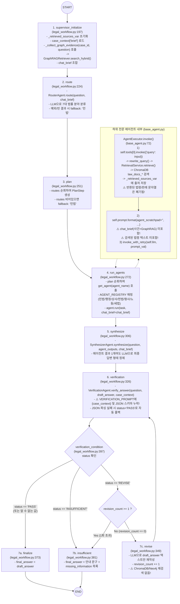
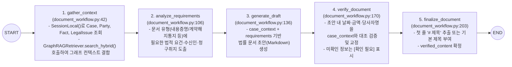

# 04. 전체 LangGraph 실행 플로우 (LangGraph Execution Flow)

이 문서는 AI Legal Helper 백엔드에 구현된 **2개의 LangGraph 워크플로우**의 실제 노드(Node), 엣지(Edge), 상태(State) 스키마, 조건부 분기, 내부 도구 호출, 그리고 코드 수준 결함을 상세히 분석한다.

1. **법률 상담 멀티에이전트 워크플로우**: [`backend/src/ai_legal_helper/workflows/legal_workflow.py`](file:///c:/myprjs/ai-legal-helper/backend/src/ai_legal_helper/workflows/legal_workflow.py) (`create_legal_workflow`)
2. **법률 문서 초안 작성 워크플로우**: [`backend/src/ai_legal_helper/workflows/document_workflow.py`](file:///c:/myprjs/ai-legal-helper/workflows/document_workflow.py) (`build_document_graph`)

---

## 1. 법률 상담 LangGraph 워크플로우 (`legal_workflow.py`)

### 1.1 상태 스키마 (`LegalState` — [`workflows/state.py:21-60`](file:///c:/myprjs/ai-legal-helper/backend/src/ai_legal_helper/workflows/state.py#L21-L60))

| 필드명 | 타입 | 설정 / 갱신 노드 | 설명 |
|---|---|---|---|
| `question` | `str` | 초기 입력 (`consultation.py:114`) | 사용자의 법률 상담 질문 원문 |
| `case_id` | `Optional[str]` | 초기 입력 (`consultation.py:115`) | 연동된 사건 ID (`None` 가능) |
| `case_context` | `Optional[dict]` | 초기 입력 (`consultation.py:92-104`) | 사건 제목·유형·당사자·사실관계·타임라인·쟁점 텍스트가 담긴 딕셔너리 |
| `chat_brief` | `Optional[str]` | `supervisor_initialize` | `case_context["brief"]` + `_collect_graph_evidence()`(Neo4j GraphRAG 결과) 결합 문자열 |
| `routes` | `List[RouteItem]` | `route` (`RouterAgent`) | 분류된 법률 분야(`category`), 신뢰도(`confidence`), 이유(`reason`) 목록 |
| `plan` | `List[PlanStep]` | `plan` | 실행할 에이전트 이름(`agent`), 우선순위(`priority`), 태스크(`task`) 목록 |
| `agent_outputs` | `Dict[str, str]` | `run_agents` | 각 전문 분야 에이전트(`민법`, `행정` 등)의 응답 텍스트 딕셔너리 |
| `retrieved_sources` | `List[dict]` | `run_agents` (`_retrieved_sources_var`) | 하위 에이전트 실행 중 `RetrievalService.retrieve`가 ContextVar에 적재한 출처 목록 |
| `draft_answer` | `Optional[str]` | `synthesize`, `revise` | `SynthesizerAgent`가 통합한 초안 또는 `revise_node`가 수정한 초안 |
| `verification_result` | `Optional[dict]` | `verification` | `VerificationAgent` 판정 결과 (`status`: `PASS`\|`REVISE`\|`INSUFFICIENT`, `revision_instructions` 등) |
| `revision_count` | `int` | `revise` (`+1`) | 답변 재작성 횟수 (최대 1회 제한) |
| `final_answer` | `Optional[str]` | `finalize`, `insufficient` | 사용자에게 반환할 최종 답변 |
| `errors` | `Annotated[List[str], operator.add]` | 각 노드 예외 발생 시 | 누적 오류 메시지 리스트 |
| `trace_log` | `Annotated[List[str], operator.add]` | 전 노드 | 노드 실행 순서 기록 (`["supervisor_initialize", "route", ...]`) |

---

### 1.2 전체 노드 및 엣지 실행 플로우 다이어그램 (As-Is Code)



---

### 1.3 노드별 상세 동작 및 코드 수준 결함 분석

#### (1) `supervisor_initialize_node` ([`legal_workflow.py:197-221`](file:///c:/myprjs/ai-legal-helper/backend/src/ai_legal_helper/workflows/legal_workflow.py#L197-L221))
- `_retrieved_sources_var.set([])`로 요청 단위 출처 버퍼를 초기화한다.
- `state["case_context"]["brief"]`에서 사건 요약 텍스트를 꺼내고, `case_id`가 존재하면 `_collect_graph_evidence(case_id, question)`([`legal_workflow.py:157-194`](file:///c:/myprjs/ai-legal-helper/backend/src/ai_legal_helper/workflows/legal_workflow.py#L157-L194))를 호출한다.
- **결함 1 (GraphRAG 벡터 폴백 사전 차단)**: `_collect_graph_evidence` 166행에서 `if driver is None: return ""`로 조기 반환하기 때문에, `GraphRAGRetriever.search_hybrid()` 내부에 구현된 ChromaDB `case_evidence` 벡터 폴백(`graph_rag.py:263`)이 절대 실행되지 않는다.

#### (2) `route_node` ([`legal_workflow.py:224-248`](file:///c:/myprjs/ai-legal-helper/backend/src/ai_legal_helper/workflows/legal_workflow.py#L224-L248)) & `plan_node` ([`legal_workflow.py:251-269`](file:///c:/myprjs/ai-legal-helper/backend/src/ai_legal_helper/workflows/legal_workflow.py#L251-L269))
- `RouterAgent.route(question, chat_brief)`([`agents/router.py:86-152`](file:///c:/myprjs/ai-legal-helper/backend/src/ai_legal_helper/agents/router.py#L86-L152))가 LLM을 호출해 `민법`, `행정`, `상사`, `헌법`, `형사`, `노동`, `세법` 중 최대 3개 분야를 JSON으로 분류한다.
- 분류 결과가 없거나 JSON 파싱 실패 시 `[{"category": "민법", "confidence": 0.5, "reason": ...}]`로 폴백한다.
- `plan_node`는 각 `route` 항목을 `PlanStep(agent=category, priority=idx, task=question)`으로 변환한다.

#### (3) `run_agents_node` ([`legal_workflow.py:272-303`](file:///c:/myprjs/ai-legal-helper/backend/src/ai_legal_helper/workflows/legal_workflow.py#L272-L303)) 및 `BaseAgent` ([`agents/legal/base_agent.py:47-189`](file:///c:/myprjs/ai-legal-helper/backend/src/ai_legal_helper/agents/legal/base_agent.py#L47-L189))
- `AGENT_REGISTRY`에 등록된 7개 에이전트(`CivilAgent`, `AdminAgent`, `CommercialAgent`, `ConstitutionAgent`, `CriminalAgent`, `LaborAgent`, `TaxAgent`)를 순차 호출한다.
- **결함 2 (치명적: 검색 결과 폐기 및 `chat_brief` 누락)**:
  - [`base_agent.py:47-92`](file:///c:/myprjs/ai-legal-helper/backend/src/ai_legal_helper/agents/legal/base_agent.py#L47-L92)의 `AgentExecutor.invoke()` 코드를 보면:
    ```python
    if self.tools:
        try:
            self.tools[0].invoke({"query": inputs.get("input", "")})
        except Exception:
            pass
    ...
    prompt_val = self.prompt.format(
        tools=tools_str,
        tool_names=tool_names,
        agent_scratchpad="",
        **inputs
    )
    ```
  - `self.tools[0].invoke(...)`가 반환하는 검색 결과 문자열(`"[검색된 법률 자료]\n..."`)을 변수에 받지 않고 버린다!
  - 또한 `REACT_TEMPLATE`([`base_agent.py:22-40`](file:///c:/myprjs/ai-legal-helper/backend/src/ai_legal_helper/agents/legal/base_agent.py#L22-L40))의 입력 변수는 `['agent_scratchpad', 'input', 'system', 'tool_names', 'tools']`뿐이어서 `inputs["chat_brief"]`는 프롬프트 포맷팅에서 완전히 무시된다.

#### (4) `synthesize_node` ([`legal_workflow.py:306-323`](file:///c:/myprjs/ai-legal-helper/backend/src/ai_legal_helper/workflows/legal_workflow.py#L306-L323))
- [`SynthesizerAgent.synthesize()`](file:///c:/myprjs/ai-legal-helper/backend/src/ai_legal_helper/agents/synthesizer.py#L38-L95)를 호출한다.
- 여기서는 `SYNTHESIS_PROMPT`에 `{chat_brief}`가 포함되어 있어, **비로소 이 단계에서 사건 브리핑과 GraphRAG 컨텍스트가 LLM에 처음 전달**된다(단, 여전히 ChromaDB 법률 RAG 검색 원문은 전달되지 않는다).

#### (5) `verification_node` ([`legal_workflow.py:326-346`](file:///c:/myprjs/ai-legal-helper/backend/src/ai_legal_helper/workflows/legal_workflow.py#L326-L346)) 및 `revise_node` ([`legal_workflow.py:349-370`](file:///c:/myprjs/ai-legal-helper/backend/src/ai_legal_helper/workflows/legal_workflow.py#L349-L370))
- **결함 3 (`VERIFICATION_PROMPT` 스키마 및 컨텍스트 누락)**: [`verification.py:21-40`](file:///c:/myprjs/ai-legal-helper/backend/src/ai_legal_helper/agents/verification.py#L21-L40)의 프롬프트에는 `{question}`과 `{answer}`만 있고 `{case_context}` 자리표시자나 JSON 필드명(`status`, `unsupported_claims` 등) 안내가 없다. LLM이 일반 텍스트나 다른 키의 JSON을 반환하면 `VerificationOutput(**data)` 검증이 실패하며, `except` 블록(`verification.py:80`, `162`)이 무조건 `status="PASS"`를 반환한다.
- **결함 4 (`revise_node`의 재검색 부재)**: `verification_condition`이 `"REVISE"`를 반환해도 `revise_node`는 `draft_answer` 텍스트만 LLM으로 고쳐 쓸 뿐, `route`나 `run_agents`로 돌아가 재검색하지 않는다.

---

## 2. 법률 문서 초안 작성 LangGraph 워크플로우 (`document_workflow.py`)

### 2.1 상태 스키마 (`DocumentGraphState` — [`workflows/document_workflow.py:25-37`](file:///c:/myprjs/ai-legal-helper/backend/src/ai_legal_helper/workflows/document_workflow.py#L25-L37))

| 필드명 | 타입 | 설정 / 갱신 노드 | 설명 |
|---|---|---|---|
| `case_id` | `str` | 초기 입력 (`documents.py:30`) | 대상 사건 ID |
| `document_type` | `str` | 초기 입력 (`documents.py:31`) | 문서 유형 (`"CONTENT_CERT"` 내용증명, `"TERMINATION_NOTICE"` 계약종료통지서 등) |
| `custom_instructions` | `Optional[str]` | 초기 입력 | 사용자 추가 작성 지침 |
| `case_context` | `str` | `gather_context` | PostgreSQL(`Case`, `Party`, `Fact`, `LegalIssue`) + `GraphRAGRetriever.search_hybrid` 결합 컨텍스트 |
| `requirements` | `str` | `analyze_requirements` | LLM이 도출한 문서 필수 구성요소 및 법적 요건 |
| `draft_content` | `str` | `generate_draft` | LLM이 작성한 법률 문서 마크다운 초안 |
| `verified_content` | `str` | `verify_document` | 사실관계 대조 및 `[확인 필요: ...]` 플레이스홀더 보정 후 본문 |
| `title` | `str` | `finalize_document` | 문서 제목 (예: `"[내용증명] 임대차보증금 반환 청구 (초안)"`) |
| `error` | `Optional[str]` | 예외 발생 시 | 오류 메시지 |

### 2.2 전체 노드 및 엣지 실행 플로우 다이어그램 (`build_document_graph`)



> [!NOTE]
> `document_workflow.py`는 조건부 분기 없는 5단계 직렬(Linear) 파이프라인으로 구성되어 있으며, `gather_context`에서 PostgreSQL 사건 데이터와 Neo4j `GraphRAGRetriever.search_hybrid()`를 모두 정상적으로 프롬프트(`case_context`)에 주입한다. 단, 문서 생성 완료 후 사용자가 워크스페이스 `OverviewTab`으로 이동하면 `workflow.py:305`의 `d.doc_type` 속성 참조 오류(`LegalDocument.document_type`이 맞음)로 인해 워크플로우 요약 API가 HTTP 500을 반환하는 후속 결함이 존재한다.

