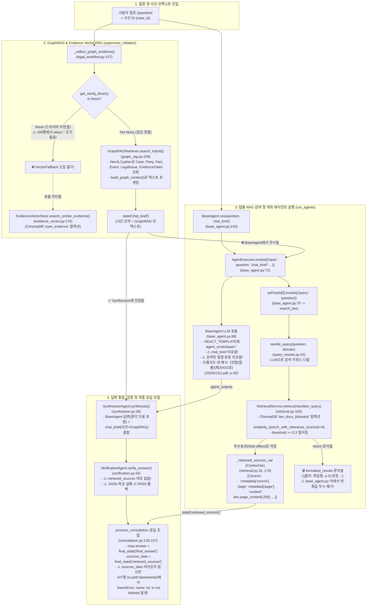

# 05. RAG 및 출처 검증 상세 플로우 (RAG & Citation Validation Flow)

이 문서는 AI Legal Helper의 **법률 RAG(Law RAG)**, **증거 RAG(Evidence Vector RAG)**, **그래프 RAG(GraphRAG)**의 실제 검색 메커니즘부터 LLM 프롬프트 전달 경로, 최종 답변의 출처(Citation) 생성 및 검증 여부까지 코드 라인 단위로 추적한다.

---

## 1. 3대 RAG 및 출처 생성 End-to-End 데이터 흐름도 (As-Is)



---

## 2. 핵심 확인 항목별 코드 추적 결과 (Audit Checklist)

### 2.1 실제 검색된 문서의 ID와 파일명은 어떻게 구성되는가?
- **코드 위치**: [`retrieval_factory.py:17-29`](file:///c:/myprjs/ai-legal-helper/backend/src/ai_legal_helper/rag/retrieval_factory.py#L17-L29), [`retrieval.py:140-182`](file:///c:/myprjs/ai-legal-helper/backend/src/ai_legal_helper/rag/retrieval.py#L140-L182)
- ChromaDB(`backend/data/chroma`)에는 7개 법률 도메인 컬렉션이 적재되어 있다:
  - `law_docs_civil` (1,210건), `law_docs_commercial` (1,219건), `law_docs_tax` (1,130건), `law_docs_administrative` (767건), `law_docs_labor` (449건), `law_docs_criminal` (403건), `law_docs_constitution` (136건).
- 각 Document의 `metadata`에는 `source` (원본 PDF 경로 또는 파일명, 예: `"data/raw/civil/민법(법률)(제20432호)(20250131).pdf"`)와 `page` (페이지 번호 정수)가 저장되어 있다.
- [`RetrievalService.retrieve()`](file:///c:/myprjs/ai-legal-helper/backend/src/ai_legal_helper/rag/retrieval.py#L165-L180)는 유사도 점수(`score >= 0.3`)를 통과한 상위 `k=4`개 청크에 대해:
  1. `source_name = os.path.basename(doc.metadata.get("source", "알 수 없는 출처"))`를 추출한다.
  2. ContextVar인 `_retrieved_sources_var`에 `{"source": doc.metadata.get("source", source_name), "page": page_str, "content": doc.page_content[:200], "score": score}` 딕셔너리를 추가한다.

### 2.2 검색 결과가 LLM Prompt에 전달되는 경로는 정상인가?
- **판정: 단절됨 (`BROKEN`)**.
- [`RetrievalService.retrieve()`](file:///c:/myprjs/ai-legal-helper/backend/src/ai_legal_helper/rag/retrieval.py#L182)는 검색된 청크들을 `"[검색된 법률 자료]\n[출처: {source_name}, p.{page_str}]\n{doc.page_content}"` 형식의 문자열로 반환하고, `search_law` 도구 함수([`base_agent.py:124-127`](file:///c:/myprjs/ai-legal-helper/backend/src/ai_legal_helper/agents/legal/base_agent.py#L124-L127))도 이를 그대로 return한다.
- **그러나** [`base_agent.py:73-77`](file:///c:/myprjs/ai-legal-helper/backend/src/ai_legal_helper/agents/legal/base_agent.py#L73-L77)에서:
  ```python
  if self.tools:
      try:
          self.tools[0].invoke({"query": inputs.get("input", "")})
      except Exception:
          pass
  ```
  반환값을 아무 변수에도 대입하지 않고 버린 뒤, 83행에서 `agent_scratchpad=""`를 넣어 프롬프트를 생성한다.
- 따라서 **ChromaDB에서 검색된 법률 조문과 판례 본문 텍스트는 하위 에이전트(`BaseAgent`), 통합 에이전트(`SynthesizerAgent`), 검증 에이전트(`VerificationAgent`) 중 어느 프롬프트에도 전달되지 않는다.**

### 2.3 LLM이 자체 지식으로 추가한 법률은 어떻게 처리되는가?
- 하위 에이전트가 검색 결과를 전달받지 못하므로, LLM은 100% 자체 사전학습 지식(Parametric Knowledge)으로 법조문(예: 민법 제618조, 주택임대차보호법 제3조 등)을 인용하여 답변을 생성한다.
- 시스템 프롬프트인 `REACT_TEMPLATE`([`base_agent.py:22-40`](file:///c:/myprjs/ai-legal-helper/backend/src/ai_legal_helper/agents/legal/base_agent.py#L22-L40))과 `SYNTHESIS_PROMPT`([`synthesizer.py:17-34`](file:///c:/myprjs/ai-legal-helper/backend/src/ai_legal_helper/agents/synthesizer.py#L17-L34))가 `"모든 법률적 주장에는 반드시 (파일명.pdf, p.페이지번호) 형식의 출처를 명시하세요. 예: (민법(법률)(제20432호)(20250131).pdf, p.40)"`이라고 강제하기 때문에, LLM은 검색 결과를 보지 못한 상태에서 **프롬프트에 적힌 예시 파일명(`민법(법률)(제20432호)(20250131).pdf, p.40`)이나 임의의 파일명/페이지를 지어내어(Hallucination) 본문과 `[참고 자료]` 섹션에 기재**한다.

### 2.4 답변 마지막의 출처 목록 생성 위치는 어디인가?
최종 사용자 화면(`ChatSection.tsx`)에 노출되는 출처는 **두 군데에서 서로 독립적으로** 만들어진다.
1. **답변 본문(`answer`) 내부의 `[참고 자료]` 텍스트**:
   - `BaseAgent`(`base_agent.py:31`) 및 `SynthesizerAgent`(`synthesizer.py:29`) 프롬프트 지시에 따라 **LLM이 생성한 마크다운 문자열 일부**이다. 실제 검색된 청크와 무관하게 생성된다.
2. **API 응답 JSON의 `sources: List[SourceItem]` 배열 (UI 하단 `📚 참고 법령 및 판례 출처` 배지)**:
   - `run_agents_node`(`legal_workflow.py:296`)가 `get_retrieved_sources()`로 `_retrieved_sources_var` 값을 읽어 `state["retrieved_sources"]`에 저장한다.
   - `process_consultation`([`consultation.py:139-151`](file:///c:/myprjs/ai-legal-helper/backend/src/ai_legal_helper/api/routes/consultation.py#L139-L151))이 이를 `SourceItem(title=..., source=..., page=..., content_snippet=...)` 리스트로 변환하여 `ConsultationResponse.sources`에 담는다.
   - **치명적 런타임 버그**: `sources_data`가 1개 이상 존재하면 [`consultation.py:147`](file:///c:/myprjs/ai-legal-helper/backend/src/ai_legal_helper/api/routes/consultation.py#L147)(및 `get_consultation`의 217, 221행)에서 `os.path.basename(raw_source)`를 실행하는데, `consultation.py`에 `import os`가 없어 **`NameError: name 'os' is not defined`가 발생**하고 상담 전체가 `ERROR` 상태로 실패한다!

### 2.5 검색하지 않은 파일명이 출처에 포함될 수 있는 경로 (Hallucination Vectors)
1. **경로 1 (프롬프트 예시 오염)**: `base_agent.py:26`의 프롬프트에 하드코딩된 예시 `(민법(법률)(제20432호)(20250131).pdf, p.40)`을 LLM이 그대로 복사하여 답변 본문에 출력한다.
2. **경로 2 (도메인 에이전트 시스템 프롬프트 유도)**: 각 분야 에이전트(`civil_agent.py`, `labor_agent.py` 등)가 특정 법령명을 언급하도록 유도하나 검색 결과(`agent_scratchpad`)가 비어 있으므로 LLM이 가상 PDF 파일명(예: `(근로기준법.pdf, p.12)`)을 생성한다.
3. **경로 3 (본문 인용 vs `sources` 배열 불일치)**: 설령 `import os`를 추가하더라도, LLM은 검색 청크를 보지 못했으므로 **본문(`answer`)에 적힌 인용 파일명/페이지**와 **하단 배지(`sources`)에 표시되는 ChromaDB 검색 청크**가 서로 일치하지 않는다.

### 2.6 Citation Validator 존재 여부
- **판정: 존재하지 않음 (`MISSING`)**.
- 코드베이스 전체(`backend/src/ai_legal_helper/`)에 정규표현식 등으로 답변 본문의 `(*.pdf, p.XX)` 인용을 추출하여 `_retrieved_sources_var`의 실제 `source`·`page`와 대조하거나 미검증 인용을 제거/경고하는 Citation Validator 모듈이 없다.
- [`VerificationAgent`](file:///c:/myprjs/ai-legal-helper/backend/src/ai_legal_helper/agents/verification.py)조차 `retrieved_sources`를 입력 인자로 받지 않으며(`verify_answer(question, draft, case_context)`), 따라서 출처의 실재 여부를 검증할 수 없다.

