# 06. 데이터 저장·조회 및 동기화 플로우 (Data Persistence & Sync Flow)

이 문서는 AI Legal Helper의 4대 저장소(**PostgreSQL**, **ChromaDB**, **Neo4j**, **Local File System**)와 인메모리 캐시에 사건·증거·분석 결과·임베딩·그래프 노드가 언제 생성·갱신·조회·삭제되는지 추적한다.

---

## 1. 저장소 간 전체 데이터 흐름 및 Outbox 동기화 아키텍처

```mermaid
flowchart TB
    subgraph APIAndServices["API Routes & Domain Services"]
        AuthRoute["auth.py\n(/auth/register, /login, /logout)"]
        CaseRoute["cases.py + manager.py\n(사건 생성, 진술 추가, 대응 계획, 사건 삭제)"]
        EvidRoute["evidence.py + evidence_ingestion.py\n+ evidence_extractor.py + evidence_manager.py\n(업로드, 파싱/추출, Claim 검토, 삭제)"]
        ConsRoute["consultation.py\n(법률 상담 요청 및 백그라운드 실행)"]
        DocRoute["documents.py + document_exporter.py\n(문서 초안 생성 및 DOCX/PDF 내보내기)"]
    end

    subgraph PG["PostgreSQL (SSOT - 15 Tables in models.py)"]
        TUser["users / user_sessions"]
        TCase["cases / parties / facts /\nevents / legal_issues"]
        TAction["legal_actions /\naction_requirements"]
        TEvid["evidence_documents /\nevidence_spans / evidence_claims /\nevidence_links"]
        TCons["consultations"]
        TDoc["legal_documents"]
        TOutbox["graph_sync_tasks\n(Outbox Table: PENDING / COMPLETED / FAILED)"]
    end

    subgraph InMemory["Process Memory"]
        MemCons["_consultations Dict\n(consultation.py:38)"]
    end

    subgraph FS["Local File System"]
        EvidFS["./storage/evidence/{uuid}.{ext}\n(업로드 증거 원본 파일)"]
        ExportFS["./data/exports/doc_{id}_{ts}.docx|pdf\n(내보내기 문서 파일)"]
    end

    subgraph SyncWorker["Background Outbox Worker (graph_sync_worker.py)"]
        WorkerLoop["graph_sync_worker_loop()\n(5초 주기 폴링, MAX_RETRIES=3)"]
        SyncFn["sync_case_to_graph(db, case_id)\n(graph_sync.py:130)"]
    end

    subgraph SecondaryStores["Secondary Vector & Graph Stores"]
        Neo4j[("Neo4j GraphDB (:7687)\n_write_snapshot_tx()\nCase 서브그래프 전체 재작성")]
        ChromaEvid[("ChromaDB Evidence Store\n(./vectorstore/chroma : 'case_evidence')\nsync_evidence_to_vector_store()")]
        ChromaLaw[("ChromaDB Law Store (Read-Only)\n(data/chroma : 'law_docs_*')")]
    end

    AuthRoute -->|"INSERT / SELECT / DELETE"| TUser
    CaseRoute -->|"INSERT / UPDATE / DELETE"| TCase
    CaseRoute -->|"INSERT / DELETE"| TAction
    CaseRoute -->|"queue_sync_task()"| TOutbox

    EvidRoute -->|"파일 쓰기 / 삭제"| EvidFS
    EvidRoute -->|"INSERT / UPDATE / DELETE"| TEvid
    EvidRoute -->|"Claim 승인 시 Fact 생성"| TCase
    EvidRoute -->|"queue_sync_task()"| TOutbox

    ConsRoute -->|"INSERT / UPDATE"| TCons
    ConsRoute -->|"읽기 / 쓰기"| MemCons
    ConsRoute -.->|"SELECT (컨텍스트 수집)"| TCase
    ConsRoute -.->|"SELECT (법령 검색)"| ChromaLaw
    ConsRoute -.->|"MATCH (GraphRAG 검색)"| Neo4j

    DocRoute -->|"INSERT"| TDoc
    DocRoute -->|"파일 생성"| ExportFS
    DocRoute -.->|"SELECT"| TCase
    DocRoute -.->|"MATCH"| Neo4j

    TOutbox ==>|"SELECT status in (PENDING, FAILED)"| WorkerLoop
    WorkerLoop --> SyncFn
    SyncFn -.->|"사건 전체 스냅샷 SELECT"| TCase
    SyncFn -.->|"증거/주장/링크 SELECT"| TEvid
    SyncFn -.->|"대응계획 SELECT"| TAction
    SyncFn ==>|"DETACH DELETE 후 MERGE"| Neo4j
    SyncFn ==>|"Upsert Facts & Claims"| ChromaEvid
    SyncFn ==>|"status = COMPLETED"| TOutbox
```

---

## 2. PostgreSQL 15개 테이블(ORM 모델) 생명주기 매핑

[`backend/src/ai_legal_helper/database/models.py`](file:///c:/myprjs/ai-legal-helper/backend/src/ai_legal_helper/database/models.py)에 정의된 15개 테이블의 생성(Create), 조회(Read), 수정(Update), 삭제(Delete) 시점은 다음과 같다. (현재 로컬 DB 실측 행 수 포함)

| 테이블명 (`__tablename__`) | ORM 클래스 | 현재 행 수 | INSERT 발생 이벤트 | SELECT 발생 이벤트 | UPDATE 발생 이벤트 | DELETE 발생 이벤트 |
|---|---|---:|---|---|---|---|
| `users` | `User` | 32 | `EVT-002` (로컬 테스터 자동생성), `EVT-031` (`POST /auth/register`) | `EVT-002` (`get_current_user`), `EVT-031` (`POST /auth/login`) | 없음 | 없음 |
| `user_sessions` | `UserSession` | 12 | `EVT-031` (`POST /auth/login`) | `EVT-002` (`get_current_user`) | 없음 | `EVT-031` (`POST /auth/logout`, 만료 세션 조회 시) |
| `cases` | `Case` | 3 | `EVT-003` (`POST /cases`) | `EVT-004`, `EVT-005`, `EVT-012`, `EVT-025`, `EVT-026`, `EVT-035` 등 전 사건 API | `EVT-002` (orphan `user_id` 귀속), `EVT-032` (`updated_at`) | `EVT-007` (`DELETE /cases/{id}`) |
| `parties` | `Party` | 7 | `EVT-032` (`process_new_statement`) | `EVT-005`, `EVT-010`, `EVT-012`, `EVT-026`, `EVT-035` | `EVT-032` (기존 당사자 `claims` 병합) | `EVT-007` (Cascade) |
| `facts` | `Fact` | 49 | `EVT-032` (진술 추출), `EVT-033` (Claim 승인 시 `source="evidence_promoted"`) | `EVT-005`, `EVT-010`, `EVT-012`, `EVT-025`, `EVT-026`, `EVT-035` | 없음 | `EVT-034` (증거 삭제 시 승격된 Fact 삭제), `EVT-007` (Cascade) |
| `events` | `Event` | 6 | `EVT-011` / `EVT-032` (`reconstruct_timeline`) | `EVT-005`, `EVT-010`, `EVT-012`, `EVT-035` | 없음 (재구성 시 기존 전체 삭제 후 재생성) | `EVT-032` (`Event` 재구성 전 삭제), `EVT-007` (Cascade) |
| `legal_issues` | `LegalIssue` | 12 | `EVT-032` (`process_new_statement`) | `EVT-005`, `EVT-010`, `EVT-012`, `EVT-025`, `EVT-026`, `EVT-035` | 없음 | `EVT-007` (Cascade) |
| `legal_actions` | `LegalAction` | 10 | `EVT-025` (`generate_action_plan`) | `EVT-010`, `EVT-025` (`GET /actions`), `EVT-035` | 없음 (재생성 시 기존 전체 삭제 후 INSERT) | `EVT-025` (재생성 전 기존 삭제), `EVT-007` (Cascade) |
| `action_requirements` | `ActionRequirement` | 27 | `EVT-025` (`generate_action_plan`) | `EVT-010`, `EVT-025` (`GET /actions`) | 없음 | `EVT-025` (`LegalAction` 삭제 시 Cascade), `EVT-007` (Cascade) |
| `evidence_documents` | `EvidenceDocument` | 2 | `EVT-008` (`ingest_evidence`) | `EVT-008`, `EVT-009`, `EVT-010`, `EVT-024`, `EVT-034`, `EVT-035` | `EVT-009` (`status`: `UPLOADED` → `EXTRACTING` → `EXTRACTED` / `FAILED`) | `EVT-034` (`DELETE /evidence/{doc_id}`), `EVT-007` (Cascade) |
| `evidence_spans` | `EvidenceSpan` | 32 | `EVT-009` (`extract_from_document`) | `EVT-010`, `EVT-033` | 없음 | `EVT-009` (재추출 전 기존 삭제), `EVT-034` / `EVT-007` (Cascade) |
| `evidence_claims` | `EvidenceClaim` | 68 | `EVT-009` (`extract_from_document`) | `EVT-009`, `EVT-010`, `EVT-024`, `EVT-033`, `EVT-035` | `EVT-033` (`review_status`: `PENDING` → `APPROVED` / `EDITED` / `REJECTED`) | `EVT-009` (재추출 전 기존 삭제), `EVT-034` / `EVT-007` (Cascade) |
| `evidence_links` | `EvidenceLink` | 36 | `EVT-033` (`promote_claim_to_fact`: `link_type="SUPPORTS"`) | `EVT-010`, `EVT-024`, `EVT-034` | 없음 | `EVT-034` / `EVT-007` (Cascade) |
| `graph_sync_tasks` | `GraphSyncTask` | 28 | `EVT-007`, `EVT-009`, `EVT-025`(미커밋 버그), `EVT-032`, `EVT-033`, `EVT-034` | `EVT-010` (`graph_sync_worker_loop`) | `EVT-010` (`status`: `PENDING` → `IN_PROGRESS` → `COMPLETED` / `FAILED`, `retry_count`) | `EVT-007` (`Case` 삭제 시 FK Cascade 삭제 후 별도 재생성) |
| `consultations` | `ConsultationRecord` | 11 | `EVT-012` (`POST /consultations`) | `EVT-012` (`GET /consultations/{id}`), `EVT-022` (`GET /cases/{id}/consultations`), `EVT-035` | `EVT-021` (`process_consultation` 완료/실패 시 `status`, `answer`, `sources` 등 갱신) | `EVT-007` (Cascade) |
| `legal_documents` | `LegalDocument` | 0 | `EVT-026` (`POST /cases/{id}/documents`) | `EVT-026` (`GET /documents`), `EVT-027` (`POST /export`), `EVT-035` | 없음 (동일 유형 재생성 시 `version + 1`로 신규 행 INSERT) | `EVT-007` (Cascade) |

---

## 3. Outbox 패턴 기반 Neo4j & ChromaDB 비동기 동기화 (`graph_sync.py`)

사건이나 증거 데이터가 변경될 때 RDB 트랜잭션 지연을 막기 위해 **Transactional Outbox 패턴**([`database/graph_sync.py`](file:///c:/myprjs/ai-legal-helper/backend/src/ai_legal_helper/database/graph_sync.py), [`database/graph_sync_worker.py`](file:///c:/myprjs/ai-legal-helper/backend/src/ai_legal_helper/database/graph_sync_worker.py))을 사용한다.

1. **태스크 큐잉 (`queue_sync_task(db, case_id)`)**:
   - 해당 `case_id`에 대해 이미 `PENDING` 또는 `IN_PROGRESS` 상태인 `GraphSyncTask`가 있으면 중복 생성하지 않고 기존 태스크를 반환한다.
   - 단, `queue_sync_task`는 내부에서 `db.add(new_task)`만 호출하고 `db.commit()`은 호출자에게 위임한다.
   - **코드 결함 발견 ([`api/routes/cases.py:121-128`](file:///c:/myprjs/ai-legal-helper/backend/src/ai_legal_helper/api/routes/cases.py#L121-L128))**: `create_action_plan`(`POST /api/v1/cases/{case_id}/actions/plan`)은 `generate_action_plan()` 내부에서 이미 `db.commit()`을 마친 뒤 128행에서 `queue_sync_task(db, case_id)`만 호출하고 `db.commit()`을 호출하지 않아, **Action Plan 생성 후의 그래프 동기화 태스크가 커밋되지 않고 유실**된다.
2. **워커 폴링 (`process_pending_sync_tasks(db)`)**:
   - 5초마다 `status IN ('PENDING', 'FAILED') AND retry_count < 3`인 태스크를 최대 10건 조회하여 `sync_case_to_graph(db, case_id)`를 호출한다.
3. **Neo4j 전체 스냅샷 재구축 (`_write_snapshot_tx`)**:
   - 만약 PostgreSQL에서 `Case`가 삭제된 상태라면(`case_obj is None`), Neo4j에서 해당 사건의 서브그래프 전체를 `DETACH DELETE`하고 종료한다.
   - `Case`가 존재하면 기존 서브그래프를 정리한 뒤 `Case`, `Party`, `Fact`, `Event`, `LegalIssue`, `LegalAction`, `ActionRequirement`, `EvidenceDocument`, `EvidenceSpan`, `EvidenceClaim` 노드와 `INVOLVES_PARTY`, `HAS_FACT`, `HAS_EVENT`, `OCCURRED_BEFORE`, `HAS_ISSUE`, `RECOMMENDS_ACTION`, `HAS_REQUIREMENT`, `DEPENDS_ON_ACTION`, `HAS_EVIDENCE`, `CONTAINS_SPAN`, `HAS_CLAIM`, `SUPPORTS`/`CONTRADICTS`/`RELATED_TO` 엣지를 일괄 생성(`MERGE`)한다.
4. **ChromaDB 증거 벡터 동기화 (`sync_evidence_to_vector_store`)**:
   - [`rag/evidence_vector.py:130-174`](file:///c:/myprjs/ai-legal-helper/backend/src/ai_legal_helper/rag/evidence_vector.py#L130-L174)를 호출하여 해당 사건의 기존 벡터를 삭제(`delete_case_vectors`)한 뒤 모든 `Fact`와 `EvidenceClaim`을 `./vectorstore/chroma`의 `case_evidence` 컬렉션에 임베딩·적재한다.
   - 단, `sync_evidence_to_vector_store` 실패 시 로그(`warning`)만 남기고 예외를 상위로 던지지 않으므로 Neo4j 동기화가 성공하면 `GraphSyncTask`는 `COMPLETED` 처리된다.

