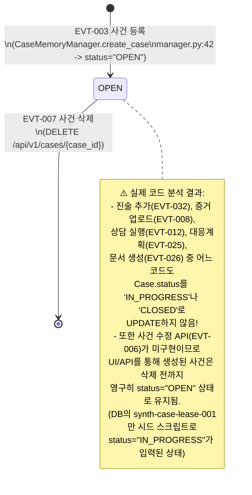
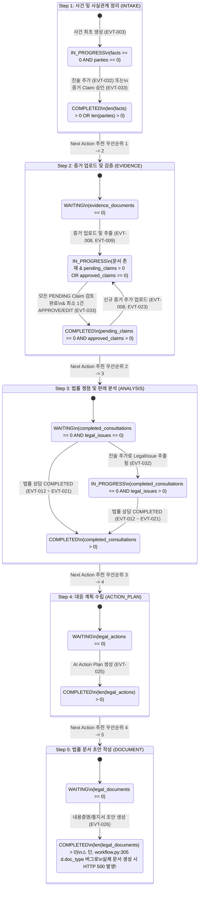
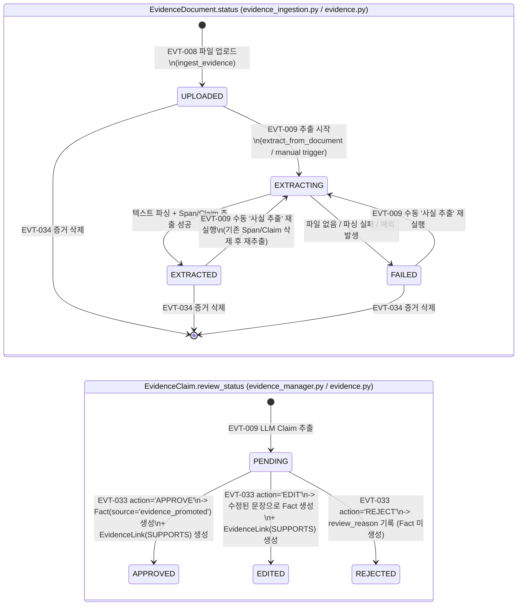
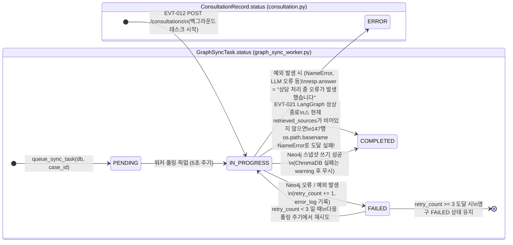

# 07. 사건 및 엔티티 상태 전이 다이어그램 (Case & Entity State Flow)

이 문서는 [`models.py`](file:///c:/myprjs/ai-legal-helper/backend/src/ai_legal_helper/database/models.py)와 [`workflow.py`](file:///c:/myprjs/ai-legal-helper/backend/src/ai_legal_helper/api/routes/workflow.py)에 구현된 **실제 상태 모델(State Model)**을 기반으로, 사건(`Case`), 파생 워크플로우 5단계(`WorkflowStep`), 증거 문서(`EvidenceDocument`), 추출 주장(`EvidenceClaim`), 법률 상담(`ConsultationRecord`), 동기화 태스크(`GraphSyncTask`)의 상태 전이를 시각화한다.

---

## 1. 사건(`Case.status`) DB 저장 상태 vs 파생 워크플로우 상태

### 1.1 `cases.status` 컬럼의 실제 전이 (As-Is DB State)
[`models.py:61`](file:///c:/myprjs/ai-legal-helper/backend/src/ai_legal_helper/database/models.py#L61)의 주석에는 `"OPEN, IN_PROGRESS, CLOSED"`가 명시되어 있으나, 실제 애플리케이션 코드에서 `Case.status`를 변경하는 로직을 추적하면 다음과 같다.

---

### 1.2 통합 워크플로우 5단계 파생 상태 전이 (`workflow.py:115-315`)
`Case.status`가 갱신되지 않는 대신, 프런트엔드 `OverviewTab`은 [`GET /api/v1/cases/{case_id}/workflow/summary`](file:///c:/myprjs/ai-legal-helper/backend/src/ai_legal_helper/api/routes/workflow.py#L115-L315)가 하위 테이블들의 레코드 존재 여부를 실시간 집계하여 계산하는 **5단계 파생 워크플로우 상태(`WAITING` | `IN_PROGRESS` | `COMPLETED`)**를 사건 진행 상태로 사용한다.

---

## 2. 하위 도메인 엔티티별 상태 전이 다이어그램

### 2.1 증거 문서 (`EvidenceDocument.status`) 및 추출 주장 (`EvidenceClaim.review_status`)

### 2.2 법률 상담 (`ConsultationRecord.status`) 및 그래프 동기화 (`GraphSyncTask.status`)

