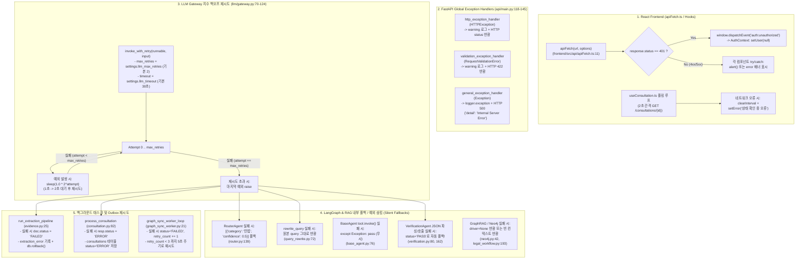

# 08. 장애·예외 처리 및 복구 플로우 (Error & Recovery Flow)

이 문서는 LLM 호출 오류, RAG 검색 실패, DB 장애, 파일 업로드 실패, 비동기 작업 타임아웃/재시도 초과 시 실제 코드가 어떻게 동작하는지 추적한다.

---

## 1. 계층별 예외·재시도·폴백 처리 전체 플로우 다이어그램

---

## 2. 영역별 장애 대응 메커니즘 상세 분석

### 2.1 LLM 호출 오류·타임아웃·재시도 (`llm/gateway.py`)
- **설정값** ([`core/config.py:27-28`](file:///c:/myprjs/ai-legal-helper/backend/src/ai_legal_helper/core/config.py#L27-L28)):
  - `llm_timeout`: 기본 `30`초 (`AzureChatOpenAI` 및 `ChatOpenAI` 생성 시 `timeout=settings.llm_timeout` 전달)
  - `llm_max_retries`: 기본 `2`회 (최초 1회 + 재시도 2회 = 최대 3회 호출)
- **동작 방식** ([`llm/gateway.py:70-124`](file:///c:/myprjs/ai-legal-helper/backend/src/ai_legal_helper/llm/gateway.py#L70-L124)):
  - `invoke_with_retry()` 및 `ainvoke_with_retry()`는 예외 발생 시 `wait_time = retry_delay * (2 ** attempt)` (1초, 2초)만큼 대기한 후 재시도한다.
  - 단, [`case_intelligence/extractor.py:92`](file:///c:/myprjs/ai-legal-helper/backend/src/ai_legal_helper/case_intelligence/extractor.py#L92)와 [`case_intelligence/evidence_extractor.py:165`](file:///c:/myprjs/ai-legal-helper/backend/src/ai_legal_helper/case_intelligence/evidence_extractor.py#L165)는 `invoke_with_retry()`를 거치지 않고 `chain.invoke()`를 직접 호출하므로 게이트웨이 레벨의 지수 백오프 재시도가 적용되지 않는다.

### 2.2 RAG 검색 실패 및 Neo4j / ChromaDB 장애
- **법률 RAG (`RetrievalService.retrieve`)**:
  - `rewrite_query()`가 실패하면 경고 로그를 남기고 원본 사용자 질문을 그대로 사용한다([`query_rewrite.py:72-74`](file:///c:/myprjs/ai-legal-helper/backend/src/ai_legal_helper/rag/query_rewrite.py#L72-L74)).
  - ChromaDB 검색 중 예외가 발생하면 `RetrievalService.retrieve()`가 `"법률 자료 검색 중 오류가 발생했습니다: ..."` 문자열을 반환하며([`retrieval.py:187`](file:///c:/myprjs/ai-legal-helper/backend/src/ai_legal_helper/rag/retrieval.py#L187)), 만약 `BaseAgent.AgentExecutor`에서 예외가 발생하더라도 `except Exception: pass`로 무시하고 LLM 단독 생성을 진행한다.
- **Neo4j 장애 (`database/neo4j.py`)**:
  - `get_neo4j_driver()`는 `driver.verify_connectivity()` 실패 시 예외를 던지지 않고 `None`을 반환한다([`neo4j.py:42-45`](file:///c:/myprjs/ai-legal-helper/backend/src/ai_legal_helper/database/neo4j.py#L42-L45)).
  - 그래프 시각화 API(`GET /cases/{id}/graph`, `/graph/analysis`)는 드라이버가 `None`이거나 오류가 발생해도 HTTP 500 대신 빈 그래프(`nodes=[], edges=[], message="Graph database is currently unavailable"`)를 HTTP 200으로 반환하여 프런트엔드 크래시를 방지한다.

### 2.3 파일 업로드 실패 및 트랜잭션 롤백 (`evidence_ingestion.py`)
- **검증 단계** ([`evidence_ingestion.py:67-118`](file:///c:/myprjs/ai-legal-helper/backend/src/ai_legal_helper/case_intelligence/evidence_ingestion.py#L67-L118)):
  - 허용되지 않는 확장자(`.pdf`, `.docx`, `.txt` 외) 또는 MIME 타입 불일치 시 **HTTP 400** 반환.
  - 동일 사건 내 동일한 `file_hash`(SHA-256) 파일 업로드 시 **HTTP 409 Conflict** 반환.
- **트랜잭션 및 물리 파일 정리** ([`evidence_ingestion.py:139-144`](file:///c:/myprjs/ai-legal-helper/backend/src/ai_legal_helper/case_intelligence/evidence_ingestion.py#L139-L144)):
  - 디스크에 파일을 먼저 저장한 뒤 DB `commit()`이 실패하면 `os.remove(storage_path)`로 고아(Orphan) 파일을 즉시 삭제하고 **HTTP 500**을 반환한다.

---

## 3. 위험한 침묵 예외 삼킴(`except Exception: pass`) 및 잘못된 폴백 목록

코드 감사 결과, 오류를 복구하는 대신 **문제를 은폐하거나 부적절한 상태로 통과시키는 코드 위치**가 6곳 확인되었다.

| 번호 | 파일 및 라인 | 예외 처리 코드 | 발생 위험 |
|---:|---|---|---|
| 1 | [`agents/verification.py:76-82, 159-168`](file:///c:/myprjs/ai-legal-helper/backend/src/ai_legal_helper/agents/verification.py#L76-L82) | `except Exception` → `return {"status": "PASS", ...}` | 검증 에이전트 프롬프트에 JSON 스키마가 없어 파싱 오류가 자주 발생하는데, 실패 시 **`INSUFFICIENT`나 `REVISE`가 아닌 `PASS`(검증 통과)로 둔갑**함. |
| 2 | [`agents/legal/base_agent.py:76-77`](file:///c:/myprjs/ai-legal-helper/backend/src/ai_legal_helper/agents/legal/base_agent.py#L76-L77) | `self.tools[0].invoke(...)` 후 `except Exception: pass` | ChromaDB가 패닉하거나 컬렉션 로드에 실패해도 아무런 로그 없이 무시하고 LLM 단독 답변을 생성함. |
| 3 | [`api/routes/evidence.py:181-190`](file:///c:/myprjs/ai-legal-helper/backend/src/ai_legal_helper/api/routes/evidence.py#L181-L190) | `from ai_legal_helper.rag.graph_rag import GraphRAG` 후 `except Exception: pass` | 잘못된 클래스명(`GraphRAG` vs `GraphRAGRetriever`)으로 인해 매 요청마다 `ImportError`가 발생하지만 로그조차 남기지 않고 무시됨. |
| 4 | [`rag/graph_rag.py:249-252, 265-268`](file:///c:/myprjs/ai-legal-helper/backend/src/ai_legal_helper/rag/graph_rag.py#L249-L252) | `update_span(get_current_span_id(), ...)` 후 `except Exception: pass` | `update_span`과 `get_current_span_id`가 임포트되지 않아 매번 `NameError`가 발생하나 조용히 무시되어 Langfuse Span 메타데이터가 전혀 기록되지 않음. |
| 5 | [`api/routes/consultation.py:127, 179`](file:///c:/myprjs/ai-legal-helper/backend/src/ai_legal_helper/api/routes/consultation.py#L127) | DB 저장 실패 시 `except Exception as db_e: logger.error(...)` | 백그라운드 상담 완료/실패 상태를 DB에 기록하다 실패해도 인메모리 `_consultations`에만 반영하고 넘어가 재시작 시 상태가 유실됨. |
| 6 | [`hooks/useConsultation.ts:49-71`](file:///c:/myprjs/ai-legal-helper/frontend/src/hooks/useConsultation.ts#L49-L71) | `setInterval` 폴링 중 컴포넌트 언마운트 시 클린업(`useEffect` return) 부재 + 최대 폴링 타임아웃 부재 | 백엔드 태스크가 비정상 종료되어 `IN_PROGRESS`로 남거나 탭을 이동해도 2초 주기 폴링이 영구 지속될 수 있음. |

