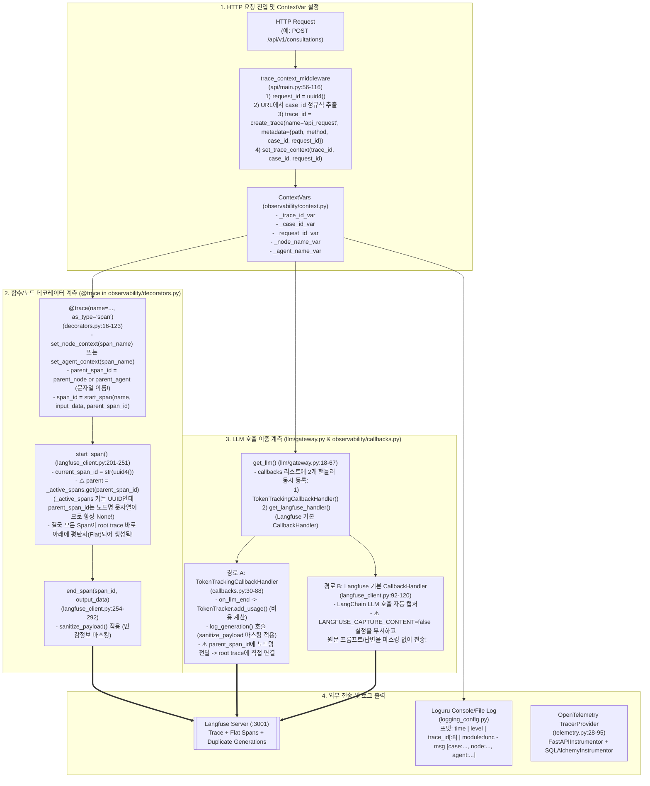

# 09. Langfuse Observability 및 Trace 플로우 (Observability Flow)

이 문서는 사용자 이벤트와 API 요청이 백엔드에서 어떤 **Trace**, **Span**, **Generation**, **OpenTelemetry Span**, **Structured Log**로 기록되는지 추적하고, 실제 구현 코드의 관측성(Observability) 결함을 분석한다.

---

## 1. 관측성(Observability) 전체 계측 플로우 다이어그램 (As-Is)

---

## 2. `@trace` 데코레이터가 적용된 실제 코드 위치 전수 목록

코드베이스 전체에서 `@trace`([`observability/decorators.py:16`](file:///c:/myprjs/ai-legal-helper/backend/src/ai_legal_helper/observability/decorators.py#L16))가 부착된 함수/메서드는 총 **24개**이다.

| 영역 | 파일 경로 | 함수 / 메서드 | Span 이름 (`name`) | 컨텍스트 설정 |
|---|---|---|---|---|
| **상담 API** | `api/routes/consultation.py:82` | `process_consultation` | `"process_consultation"` | `node_name` |
| **상담 LangGraph** | `workflows/legal_workflow.py:197` | `supervisor_initialize_node` | `"supervisor_initialize"` | `node_name` |
| **상담 LangGraph** | `workflows/legal_workflow.py:224` | `route_node` | `"route"` | `node_name` |
| **상담 LangGraph** | `workflows/legal_workflow.py:251` | `plan_node` | `"plan"` | `node_name` |
| **상담 LangGraph** | `workflows/legal_workflow.py:272` | `run_agents_node` | `"run_agents"` | `node_name` |
| **상담 LangGraph** | `workflows/legal_workflow.py:306` | `synthesize_node` | `"synthesize"` | `node_name` |
| **상담 LangGraph** | `workflows/legal_workflow.py:326` | `verification_node` | `"verification"` | `node_name` |
| **상담 LangGraph** | `workflows/legal_workflow.py:349` | `revise_node` | `"revise"` | `node_name` |
| **상담 LangGraph** | `workflows/legal_workflow.py:373` | `finalize_node` | `"finalize"` | `node_name` |
| **상담 LangGraph** | `workflows/legal_workflow.py:381` | `insufficient_node` | `"insufficient"` | `node_name` |
| **문서 LangGraph** | `workflows/document_workflow.py:42` | `gather_context` | `"doc_gather_context"` | `node_name` |
| **문서 LangGraph** | `workflows/document_workflow.py:106` | `analyze_requirements` | `"doc_analyze_requirements"` | `node_name` |
| **문서 LangGraph** | `workflows/document_workflow.py:136` | `generate_draft` | `"doc_generate_draft"` | `node_name` |
| **문서 LangGraph** | `workflows/document_workflow.py:170` | `verify_document` | `"doc_verify_document"` | `node_name` |
| **문서 LangGraph** | `workflows/document_workflow.py:203` | `finalize_document` | `"doc_finalize_document"` | `node_name` |
| **AI 에이전트** | `agents/router.py:86` | `RouterAgent.route` | `"router_agent"` | `agent_name` |
| **AI 에이전트** | `agents/legal/base_agent.py:143` | `BaseAgent.run` | `"legal_specialist_agent"` | `agent_name` |
| **AI 에이전트** | `agents/synthesizer.py:38` | `SynthesizerAgent.synthesize` | `"synthesizer_agent"` | `agent_name` |
| **AI 에이전트** | `agents/verification.py:43` | `VerificationAgent.verify_answer` | `"verification_agent"` | `agent_name` |
| **AI 에이전트** | `agents/verification.py:84` | `VerificationAgent.verify_answer_async` | `"verification_agent_async"` | `agent_name` |
| **RAG 검색** | `rag/query_rewrite.py:42` | `rewrite_query` | `"query_rewrite"` | `node_name` |
| **RAG 검색** | `rag/retrieval.py:102` | `RetrievalService.retrieve` | `"rag_retrieve"` | `node_name` |
| **RAG 검색** | `rag/graph_rag.py:239` | `GraphRAGRetriever.search_hybrid` | `"graph_rag_hybrid_search"` | `node_name` |
| **사건 인텔리전스** | `case_intelligence/manager.py:55` | `CaseMemoryManager.process_new_statement` | `"case_memory_process_statement"` | `node_name` |
| **사건 인텔리전스** | `case_intelligence/extractor.py:72` | `CaseExtractor.extract_from_statement` | `"case_extractor_extract"` | `node_name` |
| **사건 인텔리전스** | `case_intelligence/timeline.py:47` | `TimelineEngine.reconstruct_timeline` | `"timeline_reconstruct"` | `node_name` |

---

## 3. 관측성 구현의 4대 코드 결함

1. **부모-자식 Span 계층 구조 붕괴 (`langfuse_client.py:228` vs `decorators.py:45`)**
   - `start_span()`은 생성된 Span 객체를 `_active_spans[current_span_id] = span`에 저장하는데, 이때 키(`current_span_id`)는 `str(uuid.uuid4())`이다.
   - 반면 `@trace` 데코레이터(`decorators.py:45`, `86`)와 `TokenTrackingCallbackHandler`(`callbacks.py:80`)는 `parent_span_id` 인자로 UUID가 아닌 `get_node_id() or get_agent_name()`(**문자열 이름**, 예: `"run_agents"`, `"legal_specialist_agent"`)을 넘긴다.
   - 따라서 `start_span()` 및 `log_generation()` 내부의 `_active_spans.get(parent_span_id)`는 **항상 `None`을 반환**하며, 모든 하위 Span과 Generation이 부모 Span 아래에 중첩되지 못하고 Root Trace 바로 아래에 일렬(Flat)로 매달린다.
2. **LLM Generation 이중 기록 및 민감정보 마스킹 우회 (`llm/gateway.py:44-52`)**
   - `get_llm()`은 `TokenTrackingCallbackHandler`(자체 `log_generation()` 호출, `LANGFUSE_CAPTURE_CONTENT=false` 준수)와 Langfuse 기본 `CallbackHandler`(`get_langfuse_handler()`)를 동시에 등록한다.
   - 그 결과 단일 LLM 호출마다 Langfuse에 Generation이 중복 생성되며, Langfuse 기본 `CallbackHandler`는 `sanitize_payload()`를 거치지 않아 `LANGFUSE_CAPTURE_CONTENT=false`일 때에도 상담 질문·프롬프트 원문을 Langfuse 서버로 전송한다.
3. **`GraphRAGRetriever.search_hybrid`의 Span 업데이트 `NameError` (`rag/graph_rag.py:249, 265`)**
   - `graph_rag.py`는 `@trace(name="graph_rag_hybrid_search")`만 임포트했을 뿐 `update_span`과 `get_current_span_id`를 임포트하지 않은 채 호출하고 `except Exception: pass`로 덮어두어, 하이브리드 검색 모드(`graph_cypher` vs `vector_fallback`) 메타데이터가 전혀 기록되지 않는다.
4. **Score 기록 미구현 및 종료 시 Flush 미호출**
   - `VerificationAgent`의 검증 결과(`PASS`/`REVISE`/`INSUFFICIENT`)나 사용자 피드백을 Langfuse `score()` API로 기록하는 코드가 존재하지 않는다.
   - `observability/langfuse_client.py:345`에 `flush_langfuse()` 함수가 정의되어 있으나 `api/main.py`의 `lifespan` 종료 시점에 호출되지 않는다.

