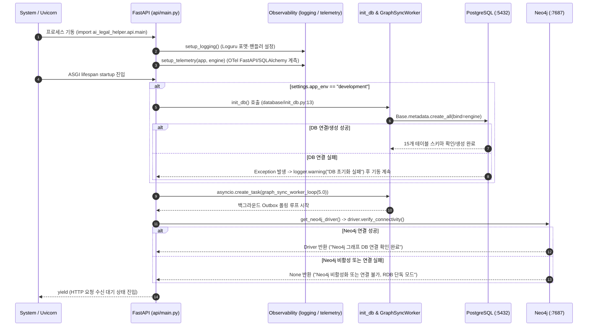

# EVT-001: 서비스 시작 및 초기화 (Service Startup & Initialization)

## 1. 이벤트 메타데이터

| 항목 | 내용 |
|---|---|
| **이벤트 ID** | `EVT-001` |
| **이벤트 명칭** | 서비스 시작 및 초기화 |
| **구현 상태** | **IMPLEMENTED** |
| **발생 시점** | FastAPI(Uvicorn) 서버 기동 시점 및 React 앱(`main.tsx`) 초기 부트스트랩 |
| **진입점 코드** | [`backend/src/ai_legal_helper/api/main.py:29-51`](file:///c:/myprjs/ai-legal-helper/backend/src/ai_legal_helper/api/main.py#L29-L51) (`lifespan`), [`frontend/src/main.tsx`](file:///c:/myprjs/ai-legal-helper/frontend/src/main.tsx) |
| **연관 서비스/모듈** | `observability/logging_config.py`, `observability/telemetry.py`, `database/init_db.py`, `database/graph_sync_worker.py`, `database/neo4j.py` |
| **연관 저장소** | PostgreSQL (`Base.metadata.create_all`), Neo4j (`verify_connectivity`) |

---

## 2. End-to-End Sequence Diagram

---

## 3. 13단계 실행 경로 상세 추적

1. **이벤트 발생 화면 및 컴포넌트**: 서버 프로세스 기동 이벤트 (프런트엔드는 [`frontend/src/main.tsx`](file:///c:/myprjs/ai-legal-helper/frontend/src/main.tsx)에서 `ReactDOM.createRoot`로 `<App />` 마운트).
2. **이벤트 핸들러**: [`api/main.py:29`](file:///c:/myprjs/ai-legal-helper/backend/src/ai_legal_helper/api/main.py#L29) `@asynccontextmanager async def lifespan(app: FastAPI)`.
3. **호출되는 API와 HTTP Method**: 서버 내부 라이프사이클 이벤트 (이후 상태 확인용 `GET /api/v1/graph/health` 제공, 단 `/health` 루트 엔드포인트는 미구현으로 HTTP 404).
4. **FastAPI Router**: `app = FastAPI(lifespan=lifespan)`에 7개 라우터(`auth`, `consultation`, `cases`, `evidence`, `documents`, `graph`, `workflow`)를 `/api/v1` 프리픽스로 등록.
5. **Service / Repository 함수**: `setup_logging()`, `setup_telemetry()`, `init_db()`, `graph_sync_worker_loop()`, `get_neo4j_driver()`.
6. **DB 읽기·쓰기**: 개발 환경에서 PostgreSQL `Base.metadata.create_all(bind=engine)` DDL 실행, Neo4j `driver.verify_connectivity()` 실행, 5초마다 `graph_sync_tasks` 테이블 폴링 시작.
7. **AI Agent 또는 RAG 호출**: 기동 시점에는 호출하지 않음 (`get_retriever` 등은 Lazy 초기화).
8. **외부 LLM·도구 호출**: 없음.
9. **응답 JSON 구조**: 해당 없음.
10. **프런트엔드 상태 변경**: `App.tsx`의 `AuthProvider`가 마운트되면서 즉시 `EVT-002`(`GET /api/v1/auth/me`)를 트리거함.
11. **화면 출력**: 상단 `Navbar` 및 현재 URL 라우트 페이지 렌더링.
12. **Langfuse 기록**: 기동 시점에는 Trace를 생성하지 않으며, 첫 HTTP 요청 진입 시 `trace_context_middleware`가 `get_langfuse_client()`를 Lazy 초기화함.
13. **실패·예외 처리 경로**:
    - PostgreSQL `init_db()` 실패 시 `except Exception as e: logger.warning(...)`으로 기동 중단 없이 통과.
    - Neo4j 연결 실패 시 `get_neo4j_driver()`가 `None`을 반환하고 RDB 단독 모드로 기동 지속.
    - **환경 주의사항**: 과거 `src/` 디렉터리가 `backend/src/`로 이동된 상태이므로 실행 시 `PYTHONPATH=backend/src` 설정(또는 `pip install -e backend`)이 필요하다.

