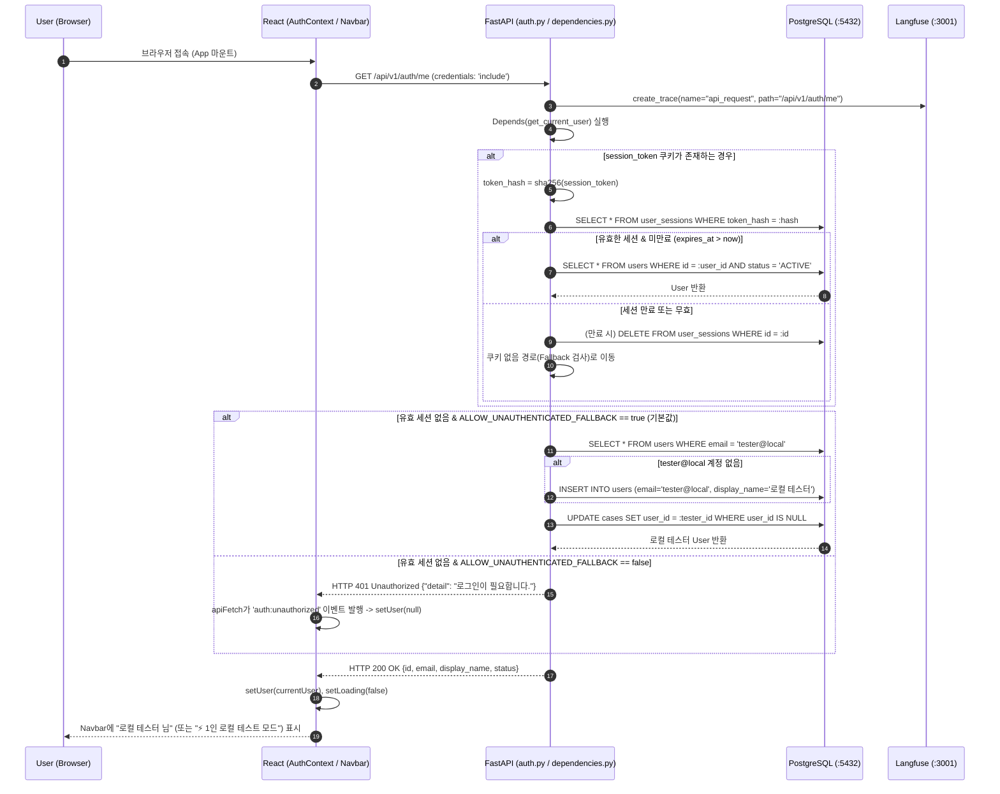

# EVT-002: 사용자 세션 시작 (User Session Initialization)

## 1. 이벤트 메타데이터

| 항목 | 내용 |
|---|---|
| **이벤트 ID** | `EVT-002` |
| **이벤트 명칭** | 사용자 세션 시작 및 현재 사용자 식별 |
| **구현 상태** | **PARTIAL** (1인 로컬 테스트 폴백 동작 완료, 단 `ProtectedRoute` 미적용) |
| **발생 화면 / 컴포넌트** | [`frontend/src/context/AuthContext.tsx:22-37`](file:///c:/myprjs/ai-legal-helper/frontend/src/context/AuthContext.tsx#L22-L37) (`AuthProvider`), [`frontend/src/App.tsx:18-65`](file:///c:/myprjs/ai-legal-helper/frontend/src/App.tsx#L18-L65) (`Navbar`) |
| **호출 API** | `GET /api/v1/auth/me` |
| **백엔드 진입점** | [`api/routes/auth.py:130-133`](file:///c:/myprjs/ai-legal-helper/backend/src/ai_legal_helper/api/routes/auth.py#L130-L133) (`get_me`), [`api/dependencies.py:55-103`](file:///c:/myprjs/ai-legal-helper/backend/src/ai_legal_helper/api/dependencies.py#L55-L103) (`get_current_user`) |
| **연관 저장소** | PostgreSQL (`user_sessions`, `users`, `cases`) |

---

## 2. End-to-End Sequence Diagram



---

## 3. 13단계 실행 경로 상세 추적

1. **이벤트 발생 화면 및 컴포넌트**: 앱 최초 진입 시 [`AuthContext.tsx`](file:///c:/myprjs/ai-legal-helper/frontend/src/context/AuthContext.tsx)의 `AuthProvider` `useEffect`.
2. **이벤트 핸들러**: `initAuth()` 내부 `getCurrentUser()`([`api/authClient.ts:38-45`](file:///c:/myprjs/ai-legal-helper/frontend/src/api/authClient.ts#L38-L45)).
3. **호출되는 API와 HTTP Method**: `GET /api/v1/auth/me`.
4. **FastAPI Router**: [`api/routes/auth.py:130`](file:///c:/myprjs/ai-legal-helper/backend/src/ai_legal_helper/api/routes/auth.py#L130) `get_me(current_user: User = Depends(get_current_user))`.
5. **Service / Repository 함수**: [`api/dependencies.py:55`](file:///c:/myprjs/ai-legal-helper/backend/src/ai_legal_helper/api/dependencies.py#L55) `get_current_user()`, `_get_or_create_local_user()`.
6. **DB 읽기·쓰기**:
   - `user_sessions` 조회 및 만료 시 `DELETE`.
   - 폴백 활성화 시 `users` 테이블에서 `tester@local` 조회/생성(`INSERT`) 후, `cases` 테이블에서 `user_id IS NULL`인 고아 사건들을 `tester@local` 소유로 일괄 `UPDATE`.
7. **AI Agent 또는 RAG 호출**: 없음.
8. **외부 LLM·도구 호출**: 없음.
9. **응답 JSON 구조**:
   ```json
   {
     "id": "f83a07d3-7c9b-45fe-bf30-57efc0e9299d",
     "email": "tester@local",
     "display_name": "로컬 테스터",
     "status": "ACTIVE"
   }
   ```
10. **프런트엔드 상태 변경**: `AuthContext`의 `user` 상태 설정 및 `loading = false` 전환.
11. **화면 출력**: `Navbar`([`App.tsx:37-58`](file:///c:/myprjs/ai-legal-helper/frontend/src/App.tsx#L37-L58))에 `user.name || user.display_name`("로컬 테스터 님")과 `로그아웃` 버튼 렌더링. 만약 `user === null`이면 `"⚡ 1인 로컬 테스트 모드 (인증 생략)"` 배지 표시.
12. **Langfuse 기록**: `trace_context_middleware`가 `api_request` Root Trace 기록.
13. **실패·예외 처리 및 구조적 결함**:
    - `getCurrentUser()`가 실패하거나 401을 반환하면 `authClient.ts:43`의 `catch`가 `null`을 반환하여 `user = null`이 된다.
    - [`frontend/src/components/ProtectedRoute.tsx`](file:///c:/myprjs/ai-legal-helper/frontend/src/components/ProtectedRoute.tsx)가 구현되어 있으나 `App.tsx`에서 라우트를 감싸는 데 사용되지 않아, `ALLOW_UNAUTHENTICATED_FALLBACK=false`인 환경에서도 미인증 사용자가 `/login`으로 자동 리다이렉트되지 않고 빈 사건 목록 화면을 보게 된다.

