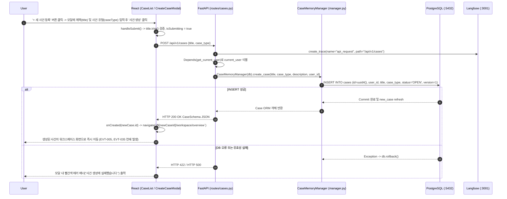

# EVT-003: 사건 등록 (Case Creation)

## 1. 이벤트 메타데이터

| 항목 | 내용 |
|---|---|
| **이벤트 ID** | `EVT-003` |
| **이벤트 명칭** | 신규 사건 등록 |
| **구현 상태** | **IMPLEMENTED** |
| **발생 화면 / 컴포넌트** | [`frontend/src/pages/CaseList.tsx:27-139`](file:///c:/myprjs/ai-legal-helper/frontend/src/pages/CaseList.tsx#L27-L139) (`CreateCaseModal`) |
| **호출 API** | `POST /api/v1/cases` |
| **백엔드 진입점** | [`api/routes/cases.py:26-44`](file:///c:/myprjs/ai-legal-helper/backend/src/ai_legal_helper/api/routes/cases.py#L26-L44) (`create_case`) |
| **서비스 함수** | [`case_intelligence/manager.py:28-53`](file:///c:/myprjs/ai-legal-helper/backend/src/ai_legal_helper/case_intelligence/manager.py#L28-L53) (`CaseMemoryManager.create_case`) |
| **연관 저장소** | PostgreSQL (`cases`) |

---

## 2. End-to-End Sequence Diagram



---

## 3. 13단계 실행 경로 상세 추적

1. **이벤트 발생 화면 및 컴포넌트**: `/` 경로의 [`CaseList.tsx`](file:///c:/myprjs/ai-legal-helper/frontend/src/pages/CaseList.tsx) 내 `CreateCaseModal` 컴포넌트(`+ 새 사건 등록` 또는 빈 상태의 `+ 첫 번째 사건 생성하기` 버튼 클릭 시 오픈).
2. **이벤트 핸들러**: `CreateCaseModal`의 `handleSubmit`(`CaseList.tsx:34-54`) → `createCase(title, caseType)`([`api/caseClient.ts:21-30`](file:///c:/myprjs/ai-legal-helper/frontend/src/api/caseClient.ts#L21-L30)).
3. **호출되는 API와 HTTP Method**: `POST /api/v1/cases` (Body: `{"title": "...", "case_type": "부동산/임대차"}`).
4. **FastAPI Router**: [`api/routes/cases.py:26`](file:///c:/myprjs/ai-legal-helper/backend/src/ai_legal_helper/api/routes/cases.py#L26) `create_case(req: CaseCreateRequest, ...)`.
5. **Service / Repository 함수**: [`case_intelligence/manager.py:28`](file:///c:/myprjs/ai-legal-helper/backend/src/ai_legal_helper/case_intelligence/manager.py#L28) `CaseMemoryManager.create_case()`.
6. **DB 읽기·쓰기**: PostgreSQL `cases` 테이블에 신규 레코드 1건 `INSERT` (`status="OPEN"`, `version=1`).
7. **AI Agent 또는 RAG 호출**: 없음 (단순 메타데이터 등록).
8. **외부 LLM·도구 호출**: 없음.
9. **응답 JSON 구조** (`CaseSchema` — [`api/schemas/case.py:48-55`](file:///c:/myprjs/ai-legal-helper/backend/src/ai_legal_helper/api/schemas/case.py#L48-L55)):
   ```json
   {
     "id": "uuid-string",
     "title": "전세보증금 반환 분쟁",
     "case_type": "부동산/임대차",
     "description": null,
     "status": "OPEN",
     "version": 1,
     "created_at": "2026-10-16T09:00:00Z",
     "updated_at": "2026-10-16T09:00:00Z"
   }
   ```
10. **프런트엔드 상태 변경**: `isModalOpen = false` 처리 후 `navigate(\`/\${newCaseId}/workspace/overview\`)`로 라우트 전환.
11. **화면 출력**: 신규 사건 워크스페이스(`CaseWorkspace.tsx`)로 전환.
12. **Langfuse 기록**: `trace_context_middleware`가 `api_request` Root Trace 생성.
13. **실패·예외 처리 경로**:
    - 제목 미입력 시 프런트엔드에서 `"사건 제목을 입력해주세요."` 즉시 차단.
    - 백엔드 DB 예외 발생 시 `manager.py:51`에서 `self.db.rollback()` 수행 후 전역 예외 핸들러가 HTTP 500 반환, 모달 내 에러 메시지 표시.

