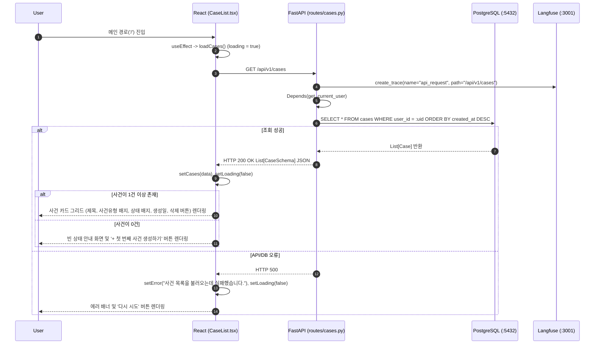

# EVT-004: 사건 목록 조회 (Case List Retrieval)

## 1. 이벤트 메타데이터

| 항목 | 내용 |
|---|---|
| **이벤트 ID** | `EVT-004` |
| **이벤트 명칭** | 사건 목록 조회 |
| **구현 상태** | **IMPLEMENTED** |
| **발생 화면 / 컴포넌트** | [`frontend/src/pages/CaseList.tsx:214-237`](file:///c:/myprjs/ai-legal-helper/frontend/src/pages/CaseList.tsx#L214-L237) (`CaseList`) |
| **호출 API** | `GET /api/v1/cases` |
| **백엔드 진입점** | [`api/routes/cases.py:54-61`](file:///c:/myprjs/ai-legal-helper/backend/src/ai_legal_helper/api/routes/cases.py#L54-L61) (`list_cases`) |
| **연관 저장소** | PostgreSQL (`cases`) |

---

## 2. End-to-End Sequence Diagram

---

## 3. 13단계 실행 경로 상세 추적

1. **이벤트 발생 화면 및 컴포넌트**: [`frontend/src/pages/CaseList.tsx`](file:///c:/myprjs/ai-legal-helper/frontend/src/pages/CaseList.tsx) 마운트 또는 에러 배너의 `다시 시도` 버튼 클릭.
2. **이벤트 핸들러**: `loadCases()`(`CaseList.tsx:222-233`) → `getCases()`([`api/caseClient.ts:13-19`](file:///c:/myprjs/ai-legal-helper/frontend/src/api/caseClient.ts#L13-L19)).
3. **호출되는 API와 HTTP Method**: `GET /api/v1/cases`.
4. **FastAPI Router**: [`api/routes/cases.py:54`](file:///c:/myprjs/ai-legal-helper/backend/src/ai_legal_helper/api/routes/cases.py#L54) `list_cases()`.
5. **Service / Repository 함수**: 라우터 내부에서 직접 SQLAlchemy 쿼리 실행 (`db.query(Case).filter(Case.user_id == current_user.id).order_by(Case.created_at.desc()).all()`).
6. **DB 읽기·쓰기**: PostgreSQL `cases` 테이블 `SELECT` (Read-Only).
7. **AI Agent 또는 RAG 호출**: 없음.
8. **외부 LLM·도구 호출**: 없음.
9. **응답 JSON 구조**: `List[CaseSchema]` 배열.
10. **프런트엔드 상태 변경**: `cases` 배열 상태 업데이트 및 `loading = false`.
11. **화면 출력**: 사건 카드 그리드 출력. 각 카드 클릭 시 `navigate(\`/\${c.id}/workspace/overview\`)`로 `EVT-005` 트리거.
12. **Langfuse 기록**: `trace_context_middleware`가 `api_request` Root Trace 기록.
13. **실패·예외 처리 경로**: 실패 시 `error` 상태가 설정되며 상단에 에러 알림창과 `다시 시도`(`onClick={loadCases}`) 버튼이 표시된다.

