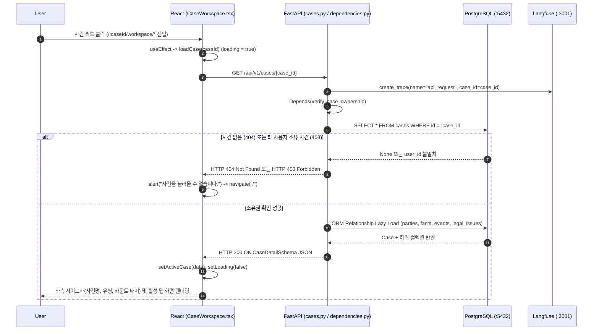

# EVT-005: 사건 상세 조회 (Case Detail Retrieval)

## 1. 이벤트 메타데이터

| 항목 | 내용 |
|---|---|
| **이벤트 ID** | `EVT-005` |
| **이벤트 명칭** | 사건 상세 및 메모리(당사자·사실·이벤트·쟁점) 조회 |
| **구현 상태** | **IMPLEMENTED** |
| **발생 화면 / 컴포넌트** | [`frontend/src/pages/CaseWorkspace.tsx:128-152`](file:///c:/myprjs/ai-legal-helper/frontend/src/pages/CaseWorkspace.tsx#L128-L152) (`CaseWorkspace`), [`FactsTab`](file:///c:/myprjs/ai-legal-helper/frontend/src/pages/CaseWorkspace.tsx#L548-L670) |
| **호출 API** | `GET /api/v1/cases/{case_id}` |
| **백엔드 진입점** | [`api/routes/cases.py:64-68`](file:///c:/myprjs/ai-legal-helper/backend/src/ai_legal_helper/api/routes/cases.py#L64-L68) (`get_case_detail`), [`api/dependencies.py:106-135`](file:///c:/myprjs/ai-legal-helper/backend/src/ai_legal_helper/api/dependencies.py#L106-L135) (`verify_case_ownership`) |
| **연관 저장소** | PostgreSQL (`cases`, `parties`, `facts`, `events`, `legal_issues`) |

---

## 2. End-to-End Sequence Diagram



---

## 3. 13단계 실행 경로 상세 추적

1. **이벤트 발생 화면 및 컴포넌트**: [`CaseWorkspace.tsx`](file:///c:/myprjs/ai-legal-helper/frontend/src/pages/CaseWorkspace.tsx) 마운트 시 `useEffect([caseId])`.
2. **이벤트 핸들러**: `loadCase(id)`(`CaseWorkspace.tsx:136-151`) → `getCaseDetail(caseId)`([`api/caseClient.ts:32-38`](file:///c:/myprjs/ai-legal-helper/frontend/src/api/caseClient.ts#L32-L38)).
3. **호출되는 API와 HTTP Method**: `GET /api/v1/cases/{case_id}`.
4. **FastAPI Router**: [`api/routes/cases.py:64`](file:///c:/myprjs/ai-legal-helper/backend/src/ai_legal_helper/api/routes/cases.py#L64) `get_case_detail(case_obj: Case = Depends(verify_case_ownership))`.
5. **Service / Repository 함수**: [`api/dependencies.py:106`](file:///c:/myprjs/ai-legal-helper/backend/src/ai_legal_helper/api/dependencies.py#L106) `verify_case_ownership()` (만약 `case_obj.user_id is None`이면 현재 사용자에게 자동 귀속 `UPDATE` 수행).
6. **DB 읽기·쓰기**: PostgreSQL `cases` 조회 및 SQLAlchemy relationship을 통해 `parties`, `facts`, `events`, `legal_issues` 테이블 `SELECT`.
7. **AI Agent 또는 RAG 호출**: 없음.
8. **외부 LLM·도구 호출**: 없음.
9. **응답 JSON 구조** (`CaseDetailSchema` — [`api/schemas/case.py:57-61`](file:///c:/myprjs/ai-legal-helper/backend/src/ai_legal_helper/api/schemas/case.py#L57-L61)):
   ```json
   {
     "id": "synth-case-lease-001",
     "title": "주택 임대차 전세보증금 미반환",
     "case_type": "부동산/임대차",
     "status": "IN_PROGRESS",
     "version": 1,
     "parties": [{"id": "...", "name": "임차인 김철수", "party_type": "원고(신청인)", "claims": "..."}],
     "facts": [{"id": "...", "description": "...", "category": "계약체결", "confidence": 1.0, "status": "verified", "source": "user_input"}],
     "events": [{"id": "...", "date": "2024-03-01", "description": "..."}],
     "legal_issues": [{"id": "...", "issue_type": "보증금반환청구권", "description": "..."}]
   }
   ```
10. **프런트엔드 상태 변경**: `activeCase` 상태 저장.
11. **화면 출력**: 좌측 사이드바 요약 정보, 상단 7개 탭 네비게이션, 그리고 `facts` 탭 선택 시 `FactsTab`(`CaseWorkspace.tsx:548`)에서 당사자·추출된 사실·타임라인·핵심 법적 쟁점 카드를 직접 렌더링.
12. **Langfuse 기록**: `trace_context_middleware`가 URL에서 `case_id`를 추출하여 `api_request` Root Trace 메타데이터에 태깅.
13. **실패·예외 처리 및 주의사항**:
    - 403/404/500 발생 시 `CaseWorkspace.tsx:144`에서 `alert('사건을 불러올 수 없습니다.')` 후 `/`로 리다이렉트.
    - **스키마 주의사항**: `PartySchema`, `FactSchema`, `EventSchema`, `LegalIssueSchema`([`api/schemas/case.py:12-42`](file:///c:/myprjs/ai-legal-helper/backend/src/ai_legal_helper/api/schemas/case.py#L12-L42)) 자체에는 `from_attributes = True`가 누락되어 있다. FastAPI 라우터 응답 직렬화 시에는 부모 `CaseDetailSchema`의 `from_attributes = True`가 전파되어 HTTP 200으로 동작하지만, Python 코드에서 `CaseDetailSchema.model_validate(case_obj)`를 직접 호출하면 `ValidationError`가 발생한다.

