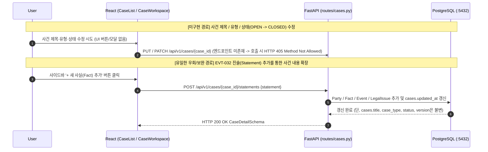

# EVT-006: 사건 정보 수정 (Case Metadata Update — 미구현)

## 1. 이벤트 메타데이터

| 항목 | 내용 |
|---|---|
| **이벤트 ID** | `EVT-006` |
| **이벤트 명칭** | 사건 기본 정보(제목·사건 유형·설명·상태) 수정 |
| **구현 상태** | **MISSING (미구현)** |
| **발생 화면 / 컴포넌트** | 없음 (`CaseList.tsx`, `CaseWorkspace.tsx` 모두 수정 버튼/모달 미존재) |
| **호출 API** | 없음 (`PUT /api/v1/cases/{case_id}` 또는 `PATCH /api/v1/cases/{case_id}` 미구현) |
| **백엔드 진입점** | 없음 ([`api/routes/cases.py`](file:///c:/myprjs/ai-legal-helper/backend/src/ai_legal_helper/api/routes/cases.py)에 수정 라우트 부재) |
| **대체 동작** | 새로운 진술을 추가하여 하위 사실·쟁점을 병합하는 `POST /api/v1/cases/{case_id}/statements`([`EVT-032`](EVT-032.md))만 존재함 |

---

## 2. As-Is 미구현 상태 및 대체 경로 다이어그램

---

## 3. 감사 확인 내역

1. **프런트엔드 확인**:
   - [`frontend/src/api/caseClient.ts`](file:///c:/myprjs/ai-legal-helper/frontend/src/api/caseClient.ts)에는 `getCases`, `createCase`, `getCaseDetail`, `addStatement`, `deleteCase` 5개 함수만 정의되어 있으며 `updateCase` 함수는 존재하지 않는다.
   - [`CaseList.tsx`](file:///c:/myprjs/ai-legal-helper/frontend/src/pages/CaseList.tsx)와 [`CaseWorkspace.tsx`](file:///c:/myprjs/ai-legal-helper/frontend/src/pages/CaseWorkspace.tsx) 어디에도 사건 제목, 사건 유형, 사건 상태(`OPEN` / `IN_PROGRESS` / `CLOSED`)를 편집하는 UI 컨트롤이 없다.
2. **백엔드 확인**:
   - [`backend/src/ai_legal_helper/api/routes/cases.py`](file:///c:/myprjs/ai-legal-helper/backend/src/ai_legal_helper/api/routes/cases.py)에는 `POST ""`, `GET ""`, `GET "/{case_id}"`, `POST "/{case_id}/statements"`, `POST "/{case_id}/actions/plan"`, `GET "/{case_id}/actions"`, `DELETE "/{case_id}"`만 존재한다.
   - [`case_intelligence/manager.py`](file:///c:/myprjs/ai-legal-helper/backend/src/ai_legal_helper/case_intelligence/manager.py)에도 `create_case`와 `process_new_statement`만 있을 뿐 사건 메타데이터 수정 메서드가 없다.
3. **영향도**:
   - 사용자가 사건 등록 시 제목이나 사건 유형을 잘못 입력해도 삭제 후 재생성하는 것 외에는 수정할 방법이 없으며, 완료된 사건을 `CLOSED` 상태로 전환할 수 없다.

