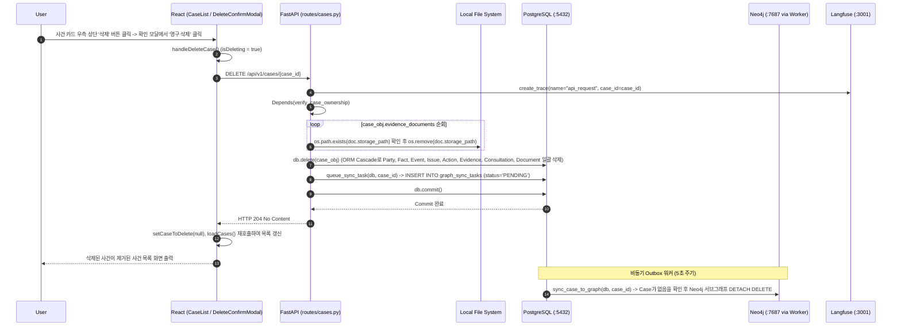

# EVT-007: 사건 삭제 (Case Deletion)

## 1. 이벤트 메타데이터

| 항목 | 내용 |
|---|---|
| **이벤트 ID** | `EVT-007` |
| **이벤트 명칭** | 사건 삭제 및 연관 리소스(물리 파일·DB·그래프) 정리 |
| **구현 상태** | **IMPLEMENTED** |
| **발생 화면 / 컴포넌트** | [`frontend/src/pages/CaseList.tsx:142-211, 239-250, 355`](file:///c:/myprjs/ai-legal-helper/frontend/src/pages/CaseList.tsx#L142-L211) (`DeleteConfirmModal`) |
| **호출 API** | `DELETE /api/v1/cases/{case_id}` |
| **백엔드 진입점** | [`api/routes/cases.py:142-177`](file:///c:/myprjs/ai-legal-helper/backend/src/ai_legal_helper/api/routes/cases.py#L142-L177) (`delete_case`) |
| **연관 저장소** | Local File System (`./storage/evidence/`), PostgreSQL (`cases` 및 Cascade 하위 테이블, `graph_sync_tasks`), Neo4j (백그라운드 워커 삭제) |

---

## 2. End-to-End Sequence Diagram

---

## 3. 13단계 실행 경로 상세 추적

1. **이벤트 발생 화면 및 컴포넌트**: [`CaseList.tsx`](file:///c:/myprjs/ai-legal-helper/frontend/src/pages/CaseList.tsx)의 사건 카드 내 `삭제` 버튼(`e.stopPropagation()` 적용) 및 `DeleteConfirmModal`.
2. **이벤트 핸들러**: `handleDeleteCase`(`CaseList.tsx:239-250`) → `deleteCase(caseId)`([`api/caseClient.ts:50-56`](file:///c:/myprjs/ai-legal-helper/frontend/src/api/caseClient.ts#L50-L56)).
3. **호출되는 API와 HTTP Method**: `DELETE /api/v1/cases/{case_id}`.
4. **FastAPI Router**: [`api/routes/cases.py:142`](file:///c:/myprjs/ai-legal-helper/backend/src/ai_legal_helper/api/routes/cases.py#L142) `delete_case()`.
5. **Service / Repository 함수**: 라우터 내부 물리 파일 정리 루프 + `db.delete(case_obj)` + `queue_sync_task(db, case_id)`.
6. **DB 읽기·쓰기**:
   - Local FS에서 업로드된 증거 원본 파일 삭제.
   - PostgreSQL `cases` 삭제 및 `cascade="all, delete-orphan"` 설정에 의해 연관된 모든 자식 테이블 레코드 삭제.
   - `graph_sync_tasks`에 `PENDING` 태스크 추가(`graph_sync_tasks.case_id`는 외래키가 아닌 일반 문자열 컬럼이므로 `Case` 삭제 후에도 유지됨).
   - 이후 `GraphSyncWorker`가 [`graph_sync.py:140-154`](file:///c:/myprjs/ai-legal-helper/backend/src/ai_legal_helper/database/graph_sync.py#L140-L154)에서 `case_obj is None` 분기를 타서 Neo4j의 사건 서브그래프를 `DETACH DELETE`한다. (단, `case_obj is None` 조기 반환 분기에서는 ChromaDB `delete_case_vectors(case_id)`를 호출하지 않아 ChromaDB `case_evidence`에 해당 사건 벡터가 잔류하는 미세 결함이 있다.)
7. **AI Agent 또는 RAG 호출**: 없음.
8. **외부 LLM·도구 호출**: 없음.
9. **응답 JSON 구조**: HTTP 204 No Content (빈 본문).
10. **프런트엔드 상태 변경**: `caseToDelete = null`, `isDeleting = false` 후 `loadCases()` 호출.
11. **화면 출력**: 사건 카드 목록에서 해당 사건 제거.
12. **Langfuse 기록**: `trace_context_middleware`가 `api_request` Root Trace 기록.
13. **실패·예외 처리 경로**:
    - 물리 파일 삭제 실패 시 `cases.py:157`에서 경고 로그만 남기고 DB 삭제는 정상 진행.
    - DB 삭제 실패 시 `db.rollback()` 후 HTTP 500 반환, 프런트엔드에서 `alert('사건 삭제에 실패했습니다.')` 출력.

