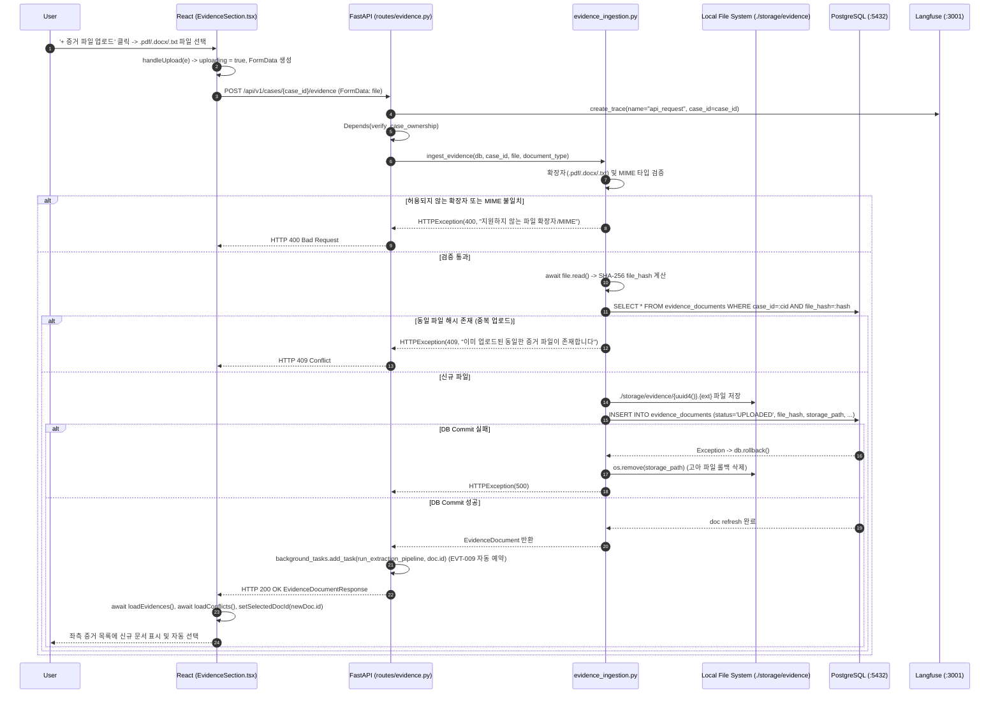

# EVT-008: 증거 파일 업로드 (Evidence File Upload)

## 1. 이벤트 메타데이터

| 항목 | 내용 |
|---|---|
| **이벤트 ID** | `EVT-008` |
| **이벤트 명칭** | 증거 파일 업로드 및 백그라운드 추출 예약 |
| **구현 상태** | **IMPLEMENTED** |
| **발생 화면 / 컴포넌트** | [`frontend/src/components/EvidenceSection.tsx:311-334, 456-475`](file:///c:/myprjs/ai-legal-helper/frontend/src/components/EvidenceSection.tsx#L311-L334) |
| **호출 API** | `POST /api/v1/cases/{case_id}/evidence` (`multipart/form-data`) |
| **백엔드 진입점** | [`api/routes/evidence.py:50-65`](file:///c:/myprjs/ai-legal-helper/backend/src/ai_legal_helper/api/routes/evidence.py#L50-L65) (`upload_evidence`) |
| **서비스 함수** | [`case_intelligence/evidence_ingestion.py:67-146`](file:///c:/myprjs/ai-legal-helper/backend/src/ai_legal_helper/case_intelligence/evidence_ingestion.py#L67-L146) (`ingest_evidence`) |
| **연관 저장소** | Local File System (`./storage/evidence/`), PostgreSQL (`evidence_documents`) |

---

## 2. End-to-End Sequence Diagram



---

## 3. 13단계 실행 경로 상세 추적

1. **이벤트 발생 화면 및 컴포넌트**: 워크스페이스 `evidence` 탭의 [`EvidenceSection.tsx`](file:///c:/myprjs/ai-legal-helper/frontend/src/components/EvidenceSection.tsx) 상단 `+ 증거 파일 업로드` 버튼 및 숨겨진 `<input type="file" accept=".pdf,.docx,.txt">`.
2. **이벤트 핸들러**: `handleUpload`(`EvidenceSection.tsx:311-334`) → `uploadEvidence(caseId, file)`([`api/evidenceClient.ts:52-63`](file:///c:/myprjs/ai-legal-helper/frontend/src/api/evidenceClient.ts#L52-L63)).
3. **호출되는 API와 HTTP Method**: `POST /api/v1/cases/{case_id}/evidence` (`multipart/form-data`).
4. **FastAPI Router**: [`api/routes/evidence.py:50`](file:///c:/myprjs/ai-legal-helper/backend/src/ai_legal_helper/api/routes/evidence.py#L50) `upload_evidence()`.
5. **Service / Repository 함수**: [`case_intelligence/evidence_ingestion.py:67`](file:///c:/myprjs/ai-legal-helper/backend/src/ai_legal_helper/case_intelligence/evidence_ingestion.py#L67) `ingest_evidence()`.
6. **DB 읽기·쓰기**:
   - PostgreSQL `evidence_documents`에서 `(case_id, file_hash)` 중복 여부 `SELECT`.
   - Local FS `./storage/evidence/{uuid}{ext}`에 바이너리 기록.
   - PostgreSQL `evidence_documents`에 `status="UPLOADED"`로 `INSERT`.
7. **AI Agent 또는 RAG 호출**: 업로드 요청 자체에서는 동기 호출하지 않으나, 반환 직전 `background_tasks.add_task(run_extraction_pipeline, doc.id)`를 통해 [`EVT-009`](EVT-009.md)를 백그라운드에서 즉시 실행한다.
8. **외부 LLM·도구 호출**: 없음 (`EVT-009`에서 수행).
9. **응답 JSON 구조** (`EvidenceDocumentResponse` — [`api/schemas/evidence.py:13-29`](file:///c:/myprjs/ai-legal-helper/backend/src/ai_legal_helper/api/schemas/evidence.py#L13-L29)):
   ```json
   {
     "id": "doc-uuid",
     "case_id": "case-uuid",
     "filename": "임대차계약서.pdf",
     "file_type": ".pdf",
     "file_size": 145200,
     "document_type": "GENERAL",
     "status": "UPLOADED",
     "extraction_error": null,
     "created_at": "2026-10-16T09:05:00Z"
   }
   ```
10. **프런트엔드 상태 변경**: `evidences` 목록 갱신, `selectedDocId = newDoc.id` 자동 선택, `fileInputRef.current.value = ''` 초기화.
11. **화면 출력**: 좌측 증거 목록에 업로드된 문서 추가.
12. **Langfuse 기록**: `trace_context_middleware`가 `api_request` Root Trace 기록.
13. **실패·예외 처리 경로**: 확장자/MIME 오류(400), 중복 파일(409), 파일 쓰기/DB 실패(500 + 물리 파일 롤백 삭제) 처리 완비. 프런트엔드에서는 `setError(err.message)`로 상단 에러 배너 출력.

