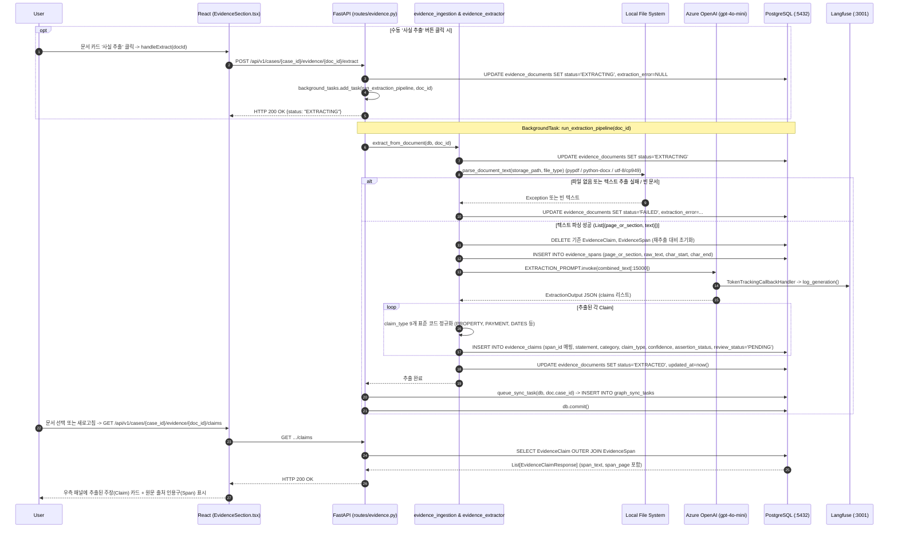

# EVT-009: 파일 파싱 및 사실 추출 (Evidence Parsing & Claim Extraction)

## 1. 이벤트 메타데이터

| 항목 | 내용 |
|---|---|
| **이벤트 ID** | `EVT-009` |
| **이벤트 명칭** | 증거 파일 텍스트 파싱(Span) 및 LLM 주장(Claim) 추출 |
| **구현 상태** | **IMPLEMENTED** |
| **발생 화면 / 트리거** | 1) `EVT-008` 업로드 직후 자동 `BackgroundTasks`<br>2) [`EvidenceSection.tsx:336-352, 512`](file:///c:/myprjs/ai-legal-helper/frontend/src/components/EvidenceSection.tsx#L336-L352) 문서 카드 `사실 추출` 버튼 클릭 |
| **호출 API** | `POST /api/v1/cases/{case_id}/evidence/{doc_id}/extract` |
| **백엔드 진입점** | [`api/routes/evidence.py:25-47`](file:///c:/myprjs/ai-legal-helper/backend/src/ai_legal_helper/api/routes/evidence.py#L25-L47) (`run_extraction_pipeline`), [`evidence.py:204-239`](file:///c:/myprjs/ai-legal-helper/backend/src/ai_legal_helper/api/routes/evidence.py#L204-L239) (`trigger_extraction`) |
| **서비스 함수** | [`evidence_ingestion.py:149-203`](file:///c:/myprjs/ai-legal-helper/backend/src/ai_legal_helper/case_intelligence/evidence_ingestion.py#L149-L203) (`parse_document_text`), [`evidence_extractor.py:92-215`](file:///c:/myprjs/ai-legal-helper/backend/src/ai_legal_helper/case_intelligence/evidence_extractor.py#L92-L215) (`extract_from_document`) |
| **연관 저장소** | Local FS (`./storage/evidence/`), PostgreSQL (`evidence_documents`, `evidence_spans`, `evidence_claims`, `graph_sync_tasks`) |

---

## 2. End-to-End Sequence Diagram



---

## 3. 13단계 실행 경로 상세 추적

1. **이벤트 발생 화면 및 컴포넌트**: `EVT-008` 완료 직후 자동 실행 또는 [`EvidenceSection.tsx:512`](file:///c:/myprjs/ai-legal-helper/frontend/src/components/EvidenceSection.tsx#L512)의 `사실 추출` 버튼 클릭.
2. **이벤트 핸들러**: `handleExtract`(`EvidenceSection.tsx:336-352`) → `extractEvidence(caseId, docId)`([`api/evidenceClient.ts:65-71`](file:///c:/myprjs/ai-legal-helper/frontend/src/api/evidenceClient.ts#L65-L71)).
3. **호출되는 API와 HTTP Method**: `POST /api/v1/cases/{case_id}/evidence/{doc_id}/extract` 및 조회용 `GET /api/v1/cases/{case_id}/evidence/{doc_id}/claims`.
4. **FastAPI Router**: [`api/routes/evidence.py:204`](file:///c:/myprjs/ai-legal-helper/backend/src/ai_legal_helper/api/routes/evidence.py#L204) `trigger_extraction()`, `list_document_claims()`(`242행`).
5. **Service / Repository 함수**: `run_extraction_pipeline()`(`evidence.py:25`), `parse_document_text()`(`evidence_ingestion.py:149`), `extract_from_document()`(`evidence_extractor.py:92`).
6. **DB 읽기·쓰기**:
   - `evidence_documents.status`를 `"EXTRACTING"`으로 변경.
   - 기존 `evidence_claims`, `evidence_spans` 삭제 후 새로 파싱된 `EvidenceSpan` `INSERT`.
   - LLM 추출 결과를 `EvidenceClaim`(`review_status="PENDING"`)으로 `INSERT` 후 `evidence_documents.status = "EXTRACTED"` 갱신 및 `GraphSyncTask` 큐잉.
7. **AI Agent 또는 RAG 호출**: `evidence_extractor.py`가 `EXTRACTION_PROMPT | llm | JsonOutputParser(pydantic_object=ExtractionOutput)` 체인을 실행하여 각 문장(`statement`), 카테고리(`Fact`/`Timeline`/`Party`/`Issue`), 표준 비교 유형(`claim_type` 9종), 확신도(`confidence`), 주장 성격(`assertion_status`: `DOCUMENT_STATES` | `PARTY_ALLEGES` | `AI_INFERENCE` | `UNCERTAIN`), 원문 구절(`source_quote`)을 추출한다.
8. **외부 LLM·도구 호출**: `get_llm(temperature=0.0)`을 통한 Azure OpenAI 호출 (입력 텍스트는 최대 `15,000`자로 슬라이싱).
9. **응답 JSON 구조** (`EvidenceClaimResponse` — [`api/schemas/evidence.py:32-50`](file:///c:/myprjs/ai-legal-helper/backend/src/ai_legal_helper/api/schemas/evidence.py#L32-L50)):
   ```json
   {
     "id": "claim-uuid",
     "document_id": "doc-uuid",
     "span_id": "span-uuid",
     "statement": "임대차보증금은 금 2억원으로 한다.",
     "category": "Fact",
     "claim_type": "PAYMENT",
     "confidence": 0.95,
     "assertion_status": "DOCUMENT_STATES",
     "review_status": "PENDING",
     "span_text": "제1조(보증금) 임대차보증금은 금 2억원으로 한다...",
     "span_page": "Page 1"
   }
   ```
10. **프런트엔드 상태 변경**: `evidences` 상태 및 선택된 문서의 `claims` 배열 상태 업데이트.
11. **화면 출력**: 우측 패널에 각 Claim의 상태 배지(`검토 대기`), 주장 성격 배지(`문서 명시` 등), 확신도 퍼센트, 원문 출처 박스(`📄 원문 출처 (Page 1)`), 그리고 `✓ 승인 (Fact 등록)` / `✎ 수정 승인` / `✕ 반려` 버튼 출력.
12. **Langfuse 기록**: API 요청 Trace 생성 및 `TokenTrackingCallbackHandler`를 통한 LLM Generation 기록.
13. **실패·예외 처리 경로**:
    - 파일이 디스크에 없거나 파싱/LLM 추출 중 예외 발생 시 `evidence_extractor.py:203-214`에서 `db.rollback()` 후 `doc.status = "FAILED"`, `doc.extraction_error = str(e)`를 DB에 기록하여 UI에서 빨간색 `추출 실패` 배지와 사유를 확인할 수 있게 한다.

