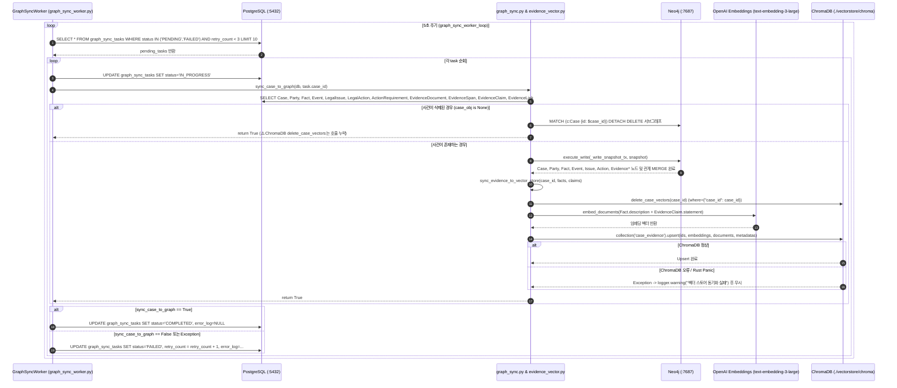

# EVT-010: 증거 임베딩 및 그래프 인덱싱 (Evidence Embedding & Graph Indexing)

## 1. 이벤트 메타데이터

| 항목 | 내용 |
|---|---|
| **이벤트 ID** | `EVT-010` |
| **이벤트 명칭** | 사건·증거 데이터의 Neo4j 그래프 및 ChromaDB 벡터 비동기 인덱싱 |
| **구현 상태** | **PARTIAL** (Outbox 워커 및 동기화 로직 구현 완료, 단 ChromaDB 경로 이원화 및 로컬 Rust SQLite 패닉 존재) |
| **발생 트리거** | `graph_sync_worker_loop` 5초 주기 백그라운드 폴링 (`EVT-007`, `EVT-009`, `EVT-032`, `EVT-033`, `EVT-034`에서 큐잉된 `GraphSyncTask` 소비) |
| **백엔드 진입점** | [`database/graph_sync_worker.py:21-69`](file:///c:/myprjs/ai-legal-helper/backend/src/ai_legal_helper/database/graph_sync_worker.py#L21-L69) (`process_pending_sync_tasks`) |
| **서비스 함수** | [`database/graph_sync.py:130-427`](file:///c:/myprjs/ai-legal-helper/backend/src/ai_legal_helper/database/graph_sync.py#L130-L427) (`sync_case_to_graph`, `_write_snapshot_tx`), [`rag/evidence_vector.py:130-174`](file:///c:/myprjs/ai-legal-helper/backend/src/ai_legal_helper/rag/evidence_vector.py#L130-L174) (`sync_evidence_to_vector_store`) |
| **연관 저장소** | PostgreSQL (`graph_sync_tasks` 및 사건/증거 테이블), Neo4j (`:7687`), ChromaDB (`./vectorstore/chroma` `case_evidence`) |

---

## 2. End-to-End Sequence Diagram

---

## 3. 13단계 실행 경로 상세 추적

1. **이벤트 발생 화면 및 컴포넌트**: 백그라운드 데몬 루프(UI 없음). 단, 수동 실행용 `POST /api/v1/cases/{case_id}/graph/sync`([`api/routes/graph.py:42`](file:///c:/myprjs/ai-legal-helper/backend/src/ai_legal_helper/api/routes/graph.py#L42))도 존재한다.
2. **이벤트 핸들러**: [`graph_sync_worker.py:72`](file:///c:/myprjs/ai-legal-helper/backend/src/ai_legal_helper/database/graph_sync_worker.py#L72) `graph_sync_worker_loop()`.
3. **호출되는 API와 HTTP Method**: 백그라운드 내부 호출 (수동 API는 `POST /api/v1/cases/{case_id}/graph/sync`).
4. **FastAPI Router**: `api/main.py:41`에서 `asyncio.create_task`로 기동.
5. **Service / Repository 함수**: `process_pending_sync_tasks()`, `sync_case_to_graph()`, `_write_snapshot_tx()`, `sync_evidence_to_vector_store()`.
6. **DB 읽기·쓰기**:
   - PostgreSQL: `graph_sync_tasks` 상태 전이(`PENDING` → `IN_PROGRESS` → `COMPLETED`/`FAILED`) 및 사건 스냅샷 전체 `SELECT`.
   - Neo4j: 사건의 기존 서브그래프 `DETACH DELETE` 후 10종 노드(`Case`, `Party`, `Fact`, `Event`, `LegalIssue`, `LegalAction`, `ActionRequirement`, `EvidenceDocument`, `EvidenceSpan`, `EvidenceClaim`) 및 13종 엣지 `MERGE`.
   - ChromaDB: `./vectorstore/chroma` 경로의 `case_evidence` 컬렉션에 `fact_{id}` 및 `claim_{id}` 문서 Upsert.
7. **AI Agent 또는 RAG 호출**: `EvidenceVectorStore`가 `OpenAIEmbeddings` / `AzureOpenAIEmbeddings`(`text-embedding-3-large`)를 사용해 사실관계와 주장을 벡터화한다.
8. **외부 LLM·도구 호출**: OpenAI / Azure OpenAI Embeddings API 호출.
9. **응답 JSON 구조**: 백그라운드 태스크이므로 응답 없음 (수동 API는 `{"status": "success", "message": "Graph synchronized successfully."}`).
10. **프런트엔드 상태 변경**: 없음 (이후 사용자가 `graph` 탭을 열거나 상담을 요청할 때 반영된 그래프가 조회됨).
11. **화면 출력**: 없음.
12. **Langfuse 기록**: 백그라운드 워커에는 `@trace` 데코레이터가 부착되어 있지 않아 Langfuse Trace가 생성되지 않는다.
13. **실패·예외 처리 및 구조적 결함**:
    - Neo4j 동기화 실패 시 `retry_count`를 1 증가시키고 최대 3회(`MAX_RETRIES = 3`)까지 5초 간격으로 재시도한다.
    - **결함 1 (ChromaDB 경로 이원화)**: `evidence_vector.py:36`은 `CHROMA_PERSIST_DIR`(기본 `./vectorstore/chroma`)에 저장하는 반면, 법률 RAG(`retrieval_factory.py:32`)는 `CHROMA_DIR`(기본 `data/chroma`)을 사용한다.
    - **결함 2 (사건 삭제 시 벡터 미삭제)**: `graph_sync.py:140-154`에서 사건이 삭제된 경우(`case_obj is None`) Neo4j 노드만 삭제하고 `return True`로 종료하여 ChromaDB `case_evidence`에 삭제된 사건의 벡터가 남는다.

