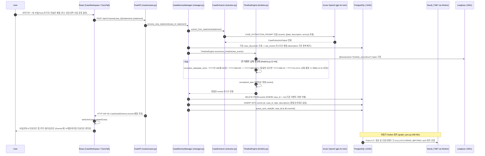

# EVT-011: 사건 Timeline 생성 (Case Timeline Reconstruction)

## 1. 이벤트 메타데이터

| 항목 | 내용 |
|---|---|
| **이벤트 ID** | `EVT-011` |
| **이벤트 명칭** | 사건 타임라인(시계열 이벤트) 추출·정규화·재구성 |
| **구현 상태** | **PARTIAL** (`POST /cases/{id}/statements` 내부에서 정상 동작 및 `FactsTab` 표시 완료, 단 독립 타임라인 재생성 API나 증거 승인 시 자동 타임라인 편입은 미구현) |
| **발생 화면 / 컴포넌트** | [`frontend/src/pages/CaseWorkspace.tsx:37-118`](file:///c:/myprjs/ai-legal-helper/frontend/src/pages/CaseWorkspace.tsx#L37-L118) (`AddStatementModal`) → [`FactsTab`](file:///c:/myprjs/ai-legal-helper/frontend/src/pages/CaseWorkspace.tsx#L612-L641) (`⏱️ 타임라인 (Events)`) |
| **호출 API** | `POST /api/v1/cases/{case_id}/statements` |
| **백엔드 진입점** | [`api/routes/cases.py:70-102`](file:///c:/myprjs/ai-legal-helper/backend/src/ai_legal_helper/api/routes/cases.py#L70-L102) (`add_statement`) |
| **서비스 함수** | [`case_intelligence/manager.py:114-127`](file:///c:/myprjs/ai-legal-helper/backend/src/ai_legal_helper/case_intelligence/manager.py#L114-L127), [`case_intelligence/timeline.py:47-84`](file:///c:/myprjs/ai-legal-helper/backend/src/ai_legal_helper/case_intelligence/timeline.py#L47-L84) (`TimelineEngine.reconstruct_timeline`) |
| **연관 저장소** | PostgreSQL (`events`, `graph_sync_tasks`), Neo4j (`Event` 노드 및 `OCCURRED_BEFORE` 엣지) |

---

## 2. End-to-End Sequence Diagram

---

## 3. 13단계 실행 경로 상세 추적

1. **이벤트 발생 화면 및 컴포넌트**: [`CaseWorkspace.tsx`](file:///c:/myprjs/ai-legal-helper/frontend/src/pages/CaseWorkspace.tsx)의 `AddStatementModal` 제출 시 발생하며, 결과는 `facts` 탭(`FactsTab`, `CaseWorkspace.tsx:612-641`)에서 확인한다.
2. **이벤트 핸들러**: `handleAddStatement`(`CaseWorkspace.tsx:154-157`) → `addStatement(caseId, statement)`([`api/caseClient.ts:40-48`](file:///c:/myprjs/ai-legal-helper/frontend/src/api/caseClient.ts#L40-L48)).
3. **호출되는 API와 HTTP Method**: `POST /api/v1/cases/{case_id}/statements`.
4. **FastAPI Router**: [`api/routes/cases.py:70`](file:///c:/myprjs/ai-legal-helper/backend/src/ai_legal_helper/api/routes/cases.py#L70) `add_statement()`.
5. **Service / Repository 함수**: `CaseMemoryManager.process_new_statement()` → `TimelineEngine.reconstruct_timeline()`.
6. **DB 읽기·쓰기**:
   - PostgreSQL `events` 테이블에서 해당 사건의 기존 행을 모두 `DELETE`한 후 정규화·정렬된 `Event` 행들을 새로 `INSERT`한다.
   - 이후 `GraphSyncWorker`가 [`graph_sync.py:272-281`](file:///c:/myprjs/ai-legal-helper/backend/src/ai_legal_helper/database/graph_sync.py#L272-L281)에서 `date <> '9999-12-31 (미상)'`인 `Event`들을 시간순 정렬하여 Neo4j에 `(:Event)-[:OCCURRED_BEFORE]->(:Event)` 체인 관계를 생성한다.
7. **AI Agent 또는 RAG 호출**: `CaseExtractor`가 LLM으로 진술문에서 시계열 이벤트를 추출한다.
8. **외부 LLM·도구 호출**: Azure OpenAI(`gpt-4o-mini`) 호출 + 정규식 기반 날짜 파서(`TimelineEngine.normalize_date`).
9. **응답 JSON 구조**: `CaseDetailSchema` 내 `"events": [{"id": "...", "date": "2024-03-01", "description": "임대차계약 체결", "source": "user_input"}]`.
10. **프런트엔드 상태 변경**: `activeCase.events` 갱신.
11. **화면 출력**: `FactsTab` 우측 `⏱️ 타임라인 (Events)` 섹션에 세로 타임라인 바, 파란색 원형 마커, 날짜 배지(`ev.date`), 설명(`ev.description`) 렌더링.
12. **Langfuse 기록**: `@trace(name="timeline_reconstruct")` Span 생성.
13. **실패·예외 처리 및 한계점**:
    - 날짜 정규식이 인식하지 못하는 상대 날짜 표현(예: `"지난달 중순"`, `"계약 만료 2개월 전"`)은 모두 `"9999-12-31 (미상)"`으로 분류되어 타임라인 맨 끝으로 밀린다.
    - 증거 문서에서 추출된 `category == "Timeline"` 또는 `claim_type == "DATES"`인 `EvidenceClaim`을 승인(`EVT-033`)할 때는 `events` 테이블이 아닌 `facts` 테이블로만 승격되므로([`evidence_manager.py:75`](file:///c:/myprjs/ai-legal-helper/backend/src/ai_legal_helper/case_intelligence/evidence_manager.py#L75)), 증거 기반 날짜가 `events` 타임라인에 자동 합류하지 않는 한계가 있다.

