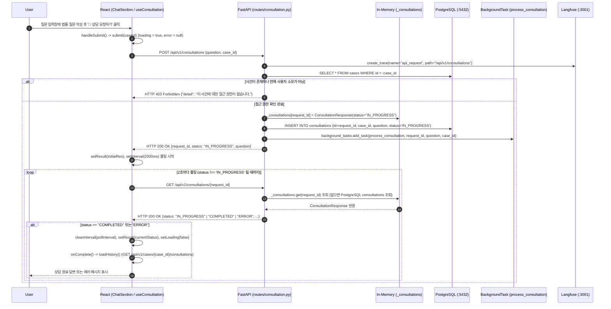

# EVT-012: 법률 질문 입력 및 비동기 상담 폴링 (Legal Question Submission & Polling)

## 1. 이벤트 메타데이터

| 항목 | 내용 |
|---|---|
| **이벤트 ID** | `EVT-012` |
| **이벤트 명칭** | 법률 질문 입력, 백그라운드 상담 시작 및 2초 주기 상태 폴링 |
| **구현 상태** | **PARTIAL** (비동기 접수 및 폴링 동작, 단 인메모리 `_consultations` 의존, 폴링 클린업 누락, 백엔드 완료 단계 `NameError` 내포) |
| **발생 화면 / 컴포넌트** | [`frontend/src/components/ChatSection.tsx:26-41, 74-109`](file:///c:/myprjs/ai-legal-helper/frontend/src/components/ChatSection.tsx#L26-L41), [`frontend/src/hooks/useConsultation.ts:38-77`](file:///c:/myprjs/ai-legal-helper/frontend/src/hooks/useConsultation.ts#L38-L77) |
| **호출 API** | `POST /api/v1/consultations`, `GET /api/v1/consultations/{request_id}` |
| **백엔드 진입점** | [`api/routes/consultation.py:44-80`](file:///c:/myprjs/ai-legal-helper/backend/src/ai_legal_helper/api/routes/consultation.py#L44-L80) (`create_consultation`), [`consultation.py:199-234`](file:///c:/myprjs/ai-legal-helper/backend/src/ai_legal_helper/api/routes/consultation.py#L199-L234) (`get_consultation`) |
| **연관 저장소** | Process Memory (`_consultations`), PostgreSQL (`consultations`, `cases`) |

---

## 2. End-to-End Sequence Diagram



---

## 3. 13단계 실행 경로 상세 추적

1. **이벤트 발생 화면 및 컴포넌트**: 워크스페이스 `chat` 탭의 [`ChatSection.tsx`](file:///c:/myprjs/ai-legal-helper/frontend/src/components/ChatSection.tsx) 질문 입력 `<textarea>` 및 `🚀 상담 요청하기` 버튼.
2. **이벤트 핸들러**: `handleSubmit`(`ChatSection.tsx:36-41`) → `useConsultation.submit`(`useConsultation.ts:38-77`) → `submitConsultation` / `getConsultationStatus`([`api/consultationClient.ts:5-27`](file:///c:/myprjs/ai-legal-helper/frontend/src/api/consultationClient.ts#L5-L27)).
3. **호출되는 API와 HTTP Method**:
   - 질문 등록: `POST /api/v1/consultations`
   - 상태/결과 폴링: `GET /api/v1/consultations/{request_id}` (참고: 백엔드 `consultation.py:237`에 경량 `GET /api/v1/consultations/{request_id}/status`가 있으나 프런트엔드는 사용하지 않음).
4. **FastAPI Router**: [`api/routes/consultation.py:44`](file:///c:/myprjs/ai-legal-helper/backend/src/ai_legal_helper/api/routes/consultation.py#L44) `create_consultation()`, `get_consultation()`(`199행`).
5. **Service / Repository 함수**: `process_consultation()`(`consultation.py:82`, FastAPI `BackgroundTasks`로 실행).
6. **DB 읽기·쓰기**:
   - 인메모리 딕셔너리 `_consultations[request_id]`에 초기 응답 객체 저장.
   - PostgreSQL `consultations` 테이블에 `status="IN_PROGRESS"`로 `INSERT`.
7. **AI Agent 또는 RAG 호출**: 백그라운드 태스크 `process_consultation` 내부에서 `create_legal_workflow().invoke(initial_state)`를 호출하여 [`EVT-013`](EVT-013.md) ~ [`EVT-021`](EVT-021.md)을 순차 실행한다.
8. **외부 LLM·도구 호출**: 백그라운드 워크플로우에서 수행.
9. **응답 JSON 구조** (`ConsultationResponse` — [`api/schemas/consultation.py:21-31`](file:///c:/myprjs/ai-legal-helper/backend/src/ai_legal_helper/api/schemas/consultation.py#L21-L31)):
   ```json
   {
     "request_id": "req-uuid",
     "status": "IN_PROGRESS",
     "question": "임대인이 보증금을 돌려주지 않을 때 어떻게 해야 하나요?",
     "answer": null,
     "sources": [],
     "verification_result": null,
     "warnings": [],
     "created_at": "2026-10-16T09:10:00Z"
   }
   ```
10. **프런트엔드 상태 변경**: `loading = true`, `result`에 진행 상태 저장, 완료 시 `loadHistory()`로 `history` 배열 갱신.
11. **화면 출력**: 진행 중에는 `"법률 에이전트가 판례 및 법령을 검색하고 답변을 작성 중입니다... (진행 상태: IN_PROGRESS)"` 스피너 카드를 표시한다.
12. **Langfuse 기록**: `POST /api/v1/consultations` 요청의 `api_request` Trace 및 `process_consultation`의 `@trace` Span 생성.
13. **실패·예외 처리 및 구조적 결함**:
    - **결함 1 (언마운트 클린업 누락)**: `useConsultation.ts:49`의 `setInterval`은 `useRef`나 `useEffect` 클린업 함수와 연결되어 있지 않아, 상담 진행 중 사용자가 다른 탭이나 페이지로 이동해도 백그라운드 폴링이 멈추지 않는다.
    - **결함 2 (`get_consultation`의 `os` 미임포트)**: 서버 재시작 후 인메모리 `_consultations`에 데이터가 없어 DB에서 완료된 상담(`record.sources`가 비어있지 않은 건)을 조회할 때도 `consultation.py:217, 221`의 `os.path.basename` 호출에서 `NameError: name 'os' is not defined`가 발생한다.

