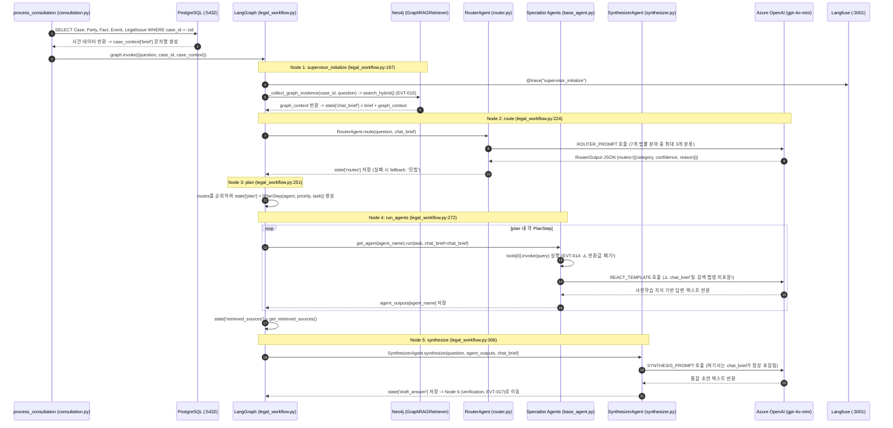

# EVT-013: Supervisor Agent 실행 (Supervisor & Multi-Agent Orchestration)

## 1. 이벤트 메타데이터

| 항목 | 내용 |
|---|---|
| **이벤트 ID** | `EVT-013` |
| **이벤트 명칭** | Supervisor Agent 초기화, 라우팅, 실행 계획 수립 및 하위 에이전트 오케스트레이션 |
| **구현 상태** | **PARTIAL** (LangGraph 상태 그래프 오케스트레이션 동작, 단 하위 `BaseAgent`가 RAG 결과와 `chat_brief`를 프롬프트에서 누락) |
| **발생 트리거** | `EVT-012` 백그라운드 `process_consultation` 내 `graph.invoke(initial_state)` |
| **백엔드 진입점** | [`api/routes/consultation.py:82-135`](file:///c:/myprjs/ai-legal-helper/backend/src/ai_legal_helper/api/routes/consultation.py#L82-L135), [`workflows/legal_workflow.py:197-323, 419-466`](file:///c:/myprjs/ai-legal-helper/backend/src/ai_legal_helper/workflows/legal_workflow.py#L197-L323) |
| **연관 에이전트** | `RouterAgent` (`agents/router.py`), 7개 분야 에이전트 (`agents/legal/*`), `SynthesizerAgent` (`agents/synthesizer.py`) |
| **연관 저장소** | PostgreSQL (`cases`, `parties`, `facts`, `events`, `legal_issues`), Neo4j (`GraphRAGRetriever`), ChromaDB (`law_docs_*`) |

---

## 2. End-to-End Sequence Diagram

---

## 3. 13단계 실행 경로 상세 추적

1. **이벤트 발생 화면 및 컴포넌트**: `EVT-012`에서 시작된 백그라운드 워크플로우 내부 실행.
2. **이벤트 핸들러**: `process_consultation`(`consultation.py:82`) 내부 `graph.invoke(initial_state)`(`135행`).
3. **호출되는 API와 HTTP Method**: 백그라운드 내부 실행.
4. **FastAPI Router**: `api/routes/consultation.py`.
5. **Service / Repository 함수**: `create_legal_workflow()`, `_collect_graph_evidence()`, `RouterAgent.route()`, `get_agent().run()`, `SynthesizerAgent.synthesize()`.
6. **DB 읽기·쓰기**:
   - `process_consultation` 시작 시 PostgreSQL에서 `Case`와 관계 엔티티(`parties`, `facts`, `events`, `legal_issues`)를 읽어 `case_context["brief"]`를 조립한다([`consultation.py:90-108`](file:///c:/myprjs/ai-legal-helper/backend/src/ai_legal_helper/api/routes/consultation.py#L90-L108)).
   - `supervisor_initialize_node`에서 Neo4j 그래프를 조회한다.
7. **AI Agent 또는 RAG 호출**:
   - `AGENT_REGISTRY`([`legal_workflow.py:42-50`](file:///c:/myprjs/ai-legal-helper/backend/src/ai_legal_helper/workflows/legal_workflow.py#L42-L50)): `"민법": CivilAgent`, `"행정": AdminAgent`, `"상사": CommercialAgent`, `"헌법": ConstitutionAgent`, `"형사": CriminalAgent`, `"노동": LaborAgent`, `"세법": TaxAgent`.
8. **외부 LLM·도구 호출**: `RouterAgent`(1회) + 선택된 전문 에이전트 수만큼(`rewriter` 1회 + `BaseAgent` 1회) + `SynthesizerAgent`(1회) Azure OpenAI 호출.
9. **응답 JSON 구조**: LangGraph 내부 상태 `LegalState` 전이 (`routes`, `plan`, `agent_outputs`, `retrieved_sources`, `draft_answer`).
10. **프런트엔드 상태 변경**: 완료 전까지 `status: "IN_PROGRESS"` 유지.
11. **화면 출력**: 폴링 스피너 표시 유지.
12. **Langfuse 기록**: `supervisor_initialize`, `route`, `router_agent`, `plan`, `run_agents`, `legal_specialist_agent`, `synthesize`, `synthesizer_agent` Span 기록.
13. **실패·예외 처리 및 구조적 결함**:
    - `RouterAgent` 예외 발생 시 `"민법"` 에이전트 1개로 자동 폴백(`router.py:139`, `legal_workflow.py:242`).
    - 특정 하위 에이전트 실행 중 예외 발생 시 `agent_outputs[agent_name] = "오류 발생: ..."`을 기록하고 다른 에이전트 실행을 계속한다(`legal_workflow.py:292`).
    - **핵심 결함**: `BaseAgent.run()`에 `chat_brief`가 인자로 전달되지만 `REACT_TEMPLATE`에 `{chat_brief}` 플레이스홀더가 없어 하위 에이전트는 사건 정보를 전혀 읽지 못한다.

