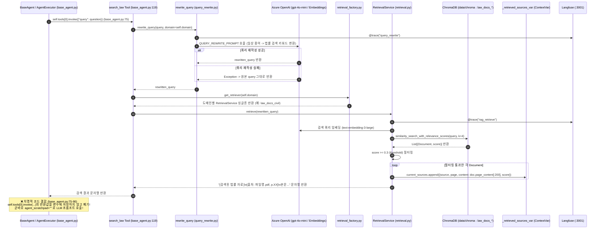

# EVT-014: 법률 RAG 검색 (Law RAG Retrieval)

## 1. 이벤트 메타데이터

| 항목 | 내용 |
|---|---|
| **이벤트 ID** | `EVT-014` |
| **이벤트 명칭** | 법률·판례 쿼리 재작성 및 도메인별 ChromaDB 유사도 검색 |
| **구현 상태** | **PARTIAL (심각한 단절 내포)** — 쿼리 재작성, ChromaDB 검색, `_retrieved_sources_var` 저장은 구현되어 있으나, **반환된 법령 본문 문자열이 `base_agent.py:75`에서 버려져 LLM에 전달되지 않음** |
| **발생 트리거** | `EVT-013` `run_agents_node` 내부에서 각 전문 에이전트의 `AgentExecutor.invoke()` 실행 시 |
| **백엔드 진입점** | [`agents/legal/base_agent.py:73-77, 117-128`](file:///c:/myprjs/ai-legal-helper/backend/src/ai_legal_helper/agents/legal/base_agent.py#L73-L77) (`search_law`) |
| **서비스 함수** | [`rag/query_rewrite.py:42-74`](file:///c:/myprjs/ai-legal-helper/backend/src/ai_legal_helper/rag/query_rewrite.py#L42-L74) (`rewrite_query`), [`rag/retrieval_factory.py:45-95`](file:///c:/myprjs/ai-legal-helper/backend/src/ai_legal_helper/rag/retrieval_factory.py#L45-L95) (`get_retriever`), [`rag/retrieval.py:102-187`](file:///c:/myprjs/ai-legal-helper/backend/src/ai_legal_helper/rag/retrieval.py#L102-L187) (`RetrievalService.retrieve`) |
| **연관 저장소** | ChromaDB (`backend/data/chroma` 내 7개 `law_docs_*` 컬렉션), ContextVar (`_retrieved_sources_var`) |

---

## 2. End-to-End Sequence Diagram



---

## 3. 13단계 실행 경로 상세 추적

1. **이벤트 발생 화면 및 컴포넌트**: 백그라운드 법률 상담 실행 중 내부 이벤트.
2. **이벤트 핸들러**: [`base_agent.py:72`](file:///c:/myprjs/ai-legal-helper/backend/src/ai_legal_helper/agents/legal/base_agent.py#L72) `AgentExecutor.invoke()`.
3. **호출되는 API와 HTTP Method**: 내부 함수 호출.
4. **FastAPI Router**: `api/routes/consultation.py` 백그라운드 태스크 경유.
5. **Service / Repository 함수**: `search_law()` → `rewrite_query()` → `get_retriever(domain)` → `RetrievalService.retrieve()`.
6. **DB 읽기·쓰기**:
   - ChromaDB(`data/chroma`)의 도메인별 컬렉션 조회:
     - `민법` → `law_docs_civil` (1,210건)
     - `행정` → `law_docs_administrative` (767건)
     - `상사` → `law_docs_commercial` (1,219건)
     - `헌법` → `law_docs_constitution` (136건)
     - `형사` → `law_docs_criminal` (403건)
     - `노동` → `law_docs_labor` (449건)
     - `세법` → `law_docs_tax` (1,130건)
   - 검색된 상위 문서를 ContextVar `_retrieved_sources_var`에 저장.
7. **AI Agent 또는 RAG 호출**: `rewrite_query`에서 LLM 1회 호출, `RetrievalService`에서 임베딩 후 벡터 유사도 검색(`k=4`, `threshold=0.3`).
8. **외부 LLM·도구 호출**: Azure OpenAI Chat(`gpt-4o-mini`) + Embeddings(`text-embedding-3-large`).
9. **응답 JSON 구조**: `_retrieved_sources_var`에 적재되는 각 항목 구조:
   ```json
   {
     "source": "data/raw/civil/민법(법률)(제20432호)(20250131).pdf",
     "page": "40",
     "content": "제618조(임대차의 의의) 임대차는 당사자 일방이...",
     "score": 0.7821
   }
   ```
10. **프런트엔드 상태 변경**: 없음.
11. **화면 출력**: 추후 `EVT-022`에서 `sources` 배열이 상담 카드 하단 출처 배지로 렌더링됨(단, `EVT-020`의 `import os` 누락 버그가 수정되어야 도달 가능).
12. **Langfuse 기록**: `@trace(name="query_rewrite")` 및 `@trace(name="rag_retrieve")` Span 기록.
13. **실패·예외 처리 및 치명적 결함**:
    - **결함 1 (검색 결과 폐기)**: `base_agent.py:75`에서 `self.tools[0].invoke(...)`가 반환한 법령 본문 텍스트를 받지 않고 버린다.
    - **결함 2 (예외 침묵 삼킴)**: `base_agent.py:76-77`에서 `except Exception: pass`로 처리하여 ChromaDB 패닉(`pyo3_runtime.PanicException` 등)이나 임베딩 오류가 발생해도 아무런 로그 없이 넘어간다.

