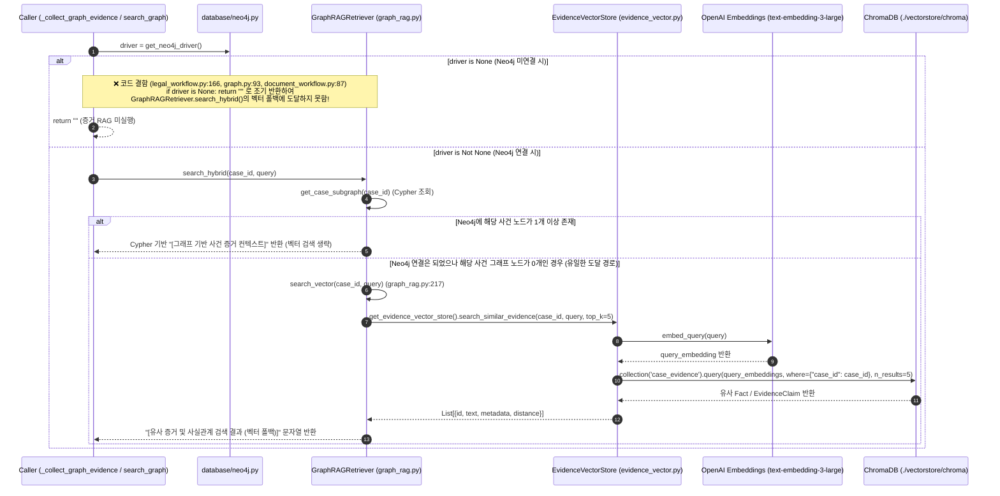

# EVT-015: 증거 RAG 검색 (Evidence Vector RAG Search)

## 1. 이벤트 메타데이터

| 항목 | 내용 |
|---|---|
| **이벤트 ID** | `EVT-015` |
| **이벤트 명칭** | 사건 증거 및 사실관계 ChromaDB 벡터 유사도 검색 |
| **구현 상태** | **PARTIAL (호출부 사전 차단 결함)** — `EvidenceVectorStore.search_similar_evidence` 및 `GraphRAGRetriever.search_vector`는 구현되어 있으나, 호출부가 `if driver is None: return`으로 먼저 반환하여 실제 상담/검색 플로우에서 도달하지 못함 |
| **발생 트리거** | `GraphRAGRetriever.search_hybrid(case_id, query)` 내부에서 Neo4j 그래프가 없거나 비어 있을 때의 폴백 경로 |
| **백엔드 진입점** | [`rag/graph_rag.py:217-279`](file:///c:/myprjs/ai-legal-helper/backend/src/ai_legal_helper/rag/graph_rag.py#L217-L279) (`search_vector`, `search_hybrid`), [`rag/evidence_vector.py:176-225`](file:///c:/myprjs/ai-legal-helper/backend/src/ai_legal_helper/rag/evidence_vector.py#L176-L225) (`search_similar_evidence`) |
| **호출부 코드** | [`workflows/legal_workflow.py:165-169`](file:///c:/myprjs/ai-legal-helper/backend/src/ai_legal_helper/workflows/legal_workflow.py#L165-L169), [`api/routes/graph.py:92-96`](file:///c:/myprjs/ai-legal-helper/backend/src/ai_legal_helper/api/routes/graph.py#L92-L96), [`workflows/document_workflow.py:85-95`](file:///c:/myprjs/ai-legal-helper/backend/src/ai_legal_helper/workflows/document_workflow.py#L85-L95) |
| **연관 저장소** | ChromaDB (`./vectorstore/chroma` `case_evidence` 컬렉션) |

---

## 2. End-to-End Sequence Diagram (As-Is vs 도달 조건)



---

## 3. 13단계 실행 경로 상세 추적

1. **이벤트 발생 화면 및 컴포넌트**: 백그라운드 상담(`EVT-012`), 문서 초안 작성(`EVT-026`), 또는 그래프 검색 API(`GET /api/v1/cases/{case_id}/graph/search`) 내부.
2. **이벤트 핸들러**: `GraphRAGRetriever.search_hybrid()`(`graph_rag.py:239`).
3. **호출되는 API와 HTTP Method**: 내부 호출 (독립 API는 `GET /api/v1/cases/{case_id}/graph/search?query=...`).
4. **FastAPI Router**: `api/routes/consultation.py`, `api/routes/documents.py`, `api/routes/graph.py`.
5. **Service / Repository 함수**: `GraphRAGRetriever.search_vector()` → `EvidenceVectorStore.search_similar_evidence()`.
6. **DB 읽기·쓰기**: ChromaDB `./vectorstore/chroma`의 `case_evidence` 컬렉션에서 `where={"case_id": case_id}` 필터로 상위 `top_k=5`개 문서 조회.
7. **AI Agent 또는 RAG 호출**: `EvidenceVectorStore`가 질문을 임베딩하여 사건 내 `Fact` 및 `EvidenceClaim` 벡터와 코사인/L2 거리 비교.
8. **외부 LLM·도구 호출**: OpenAI / Azure OpenAI Embeddings(`text-embedding-3-large`).
9. **응답 JSON 구조**: 포맷팅된 컨텍스트 문자열:
   ```text
   [유사 증거 및 사실관계 검색 결과 (벡터 폴백)]
   - [FACT] 임대차보증금 2억원을 지급함 (출처: user_input)
   - [CLAIM] 계약 만료일은 2026년 3월 1일임 (출처: DOCUMENT_STATES)
   ```
10. **프런트엔드 상태 변경**: 없음.
11. **화면 출력**: 없음.
12. **Langfuse 기록**: `@trace(name="graph_rag_hybrid_search")` Span 내부에서 실행되나, `graph_rag.py:265`의 `update_span(get_current_span_id(), metadata={"retrieval_mode": "vector_fallback"})`은 `update_span` 미임포트로 인해 `NameError`가 발생하고 `except: pass`로 무시된다.
13. **실패·예외 처리 및 구조적 결함**:
    - **결함 (폴백 가드 모순)**: `GraphRAGRetriever.search_hybrid()`(`graph_rag.py:248`)는 `if self.driver is not None:` 블록이 실패하거나 빈 노드를 반환할 때 `self.search_vector(case_id, query)`를 호출하도록 설계되어 있다. 그러나 모든 호출부(`legal_workflow.py:166`, `graph.py:93`, `document_workflow.py:87`)가 `driver = get_neo4j_driver()` 직후 `if driver is None: return`으로 막아버려, 정작 Neo4j가 꺼져 있을 때 벡터 폴백이 작동하지 않는다.

