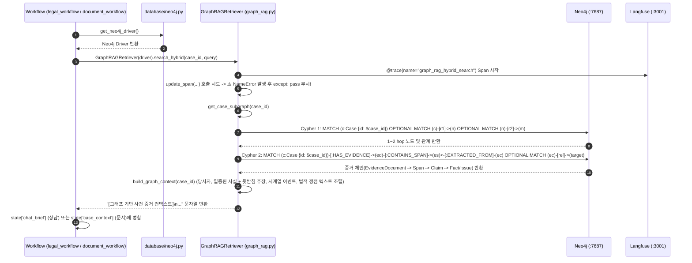

# EVT-016: GraphRAG 검색 (Neo4j GraphRAG Subgraph Retrieval)

## 1. 이벤트 메타데이터

| 항목 | 내용 |
|---|---|
| **이벤트 ID** | `EVT-016` |
| **이벤트 명칭** | Neo4j 사건 지식 그래프 서브그래프 탐색 및 컨텍스트 조립 (GraphRAG) |
| **구현 상태** | **PARTIAL** (Neo4j Cypher 조회 및 `Synthesizer`/`DocumentWorkflow` 주입 완료, 단 `BaseAgent` 프롬프트에는 미전달 및 `update_span` 미임포트 결함 존재) |
| **발생 트리거** | 1) 상담 초기화 (`legal_workflow.py:supervisor_initialize_node` -> `_collect_graph_evidence`)<br>2) 법률 문서 작성 초기화 (`document_workflow.py:gather_context`)<br>3) 그래프 검색 API (`GET /api/v1/cases/{case_id}/graph/search`) |
| **백엔드 진입점** | [`rag/graph_rag.py:72-279`](file:///c:/myprjs/ai-legal-helper/backend/src/ai_legal_helper/rag/graph_rag.py#L72-L279) (`GraphRAGRetriever.get_case_subgraph`, `build_graph_context`, `search_hybrid`) |
| **연관 저장소** | Neo4j (`:7687`) |

---

## 2. End-to-End Sequence Diagram



---

## 3. 13단계 실행 경로 상세 추적

1. **이벤트 발생 화면 및 컴포넌트**: 법률 상담(`ChatSection.tsx`) 또는 법률 문서 생성(`DocumentSection.tsx`) 실행 시 백엔드 내부에서 자동 수행.
2. **이벤트 핸들러**: `_collect_graph_evidence`(`legal_workflow.py:157`) 및 `gather_context`(`document_workflow.py:42`).
3. **호출되는 API와 HTTP Method**: 상담(`POST /api/v1/consultations`), 문서 생성(`POST /api/v1/cases/{id}/documents`), 또는 직접 검색(`GET /api/v1/cases/{id}/graph/search`).
4. **FastAPI Router**: `consultation.py`, `documents.py`, `graph.py`.
5. **Service / Repository 함수**: `GraphRAGRetriever.search_hybrid()`, `get_case_subgraph()`, `_fetch_subgraph_tx()`, `build_graph_context()`.
6. **DB 읽기·쓰기**: Neo4j Read-Only 트랜잭션(`session.execute_read(_fetch_subgraph_tx, case_id)`)으로 2개의 Cypher 쿼리를 실행하여 사건의 2-hop 이웃과 3-hop 증거 체인을 모두 가져온다.
7. **AI Agent 또는 RAG 호출**:
   - `build_graph_context()`(`graph_rag.py:155-215`)가 그래프 토폴로지를 따라 **어떤 `Fact`가 어떤 `EvidenceClaim`(`SUPPORTS`)에 의해 뒷받침되는지** 계층적으로 묶어 텍스트 프롬프트로 변환한다:
     ```text
     [그래프 기반 사건 증거 컨텍스트]
     ■ 관련 당사자:
       - 임차인 김철수 (원고(신청인)): 보증금 반환 요구
     ■ 입증된 사실관계 및 근거:
       - [계약체결] 임대차보증금 2억원 지급 (상태: verified)
         └─ 뒷받침 주장: 보증금 2억원 영수함 (성격: DOCUMENT_STATES)
     ■ 시계열 이벤트:
       - [2024-03-01] 임대차계약 체결
     ■ 주요 법적 쟁점:
       - [보증금반환청구권] 계약 만료 후 보증금 반환 지체
     ```
8. **외부 LLM·도구 호출**: Cypher 탐색 자체에는 LLM 호출 없음.
9. **응답 JSON 구조**: 워크플로우 내부 문자열(`chat_brief` / `case_context`).
10. **프런트엔드 상태 변경**: 없음.
11. **화면 출력**: 최종 합성된 상담 답변 또는 법률 문서 초안에 반영됨.
12. **Langfuse 기록**: `@trace(name="graph_rag_hybrid_search")` Span 생성.
13. **실패·예외 처리 및 구조적 결함**:
    - **결함 1 (하위 전문 에이전트 미전달)**: `legal_workflow.py`에서 `supervisor_initialize_node`가 생성한 `chat_brief`(GraphRAG 컨텍스트 포함)는 `RouterAgent`와 `SynthesizerAgent`에만 전달되고, 정작 법리를 분석하는 7개 분야 `BaseAgent` 프롬프트(`REACT_TEMPLATE`)에서는 누락된다.
    - **결함 2 (`update_span` 미임포트)**: `graph_rag.py:249, 265`에서 `update_span`과 `get_current_span_id`를 임포트하지 않고 호출하여 매번 `NameError`가 발생한 뒤 `except: pass`로 무시된다.

