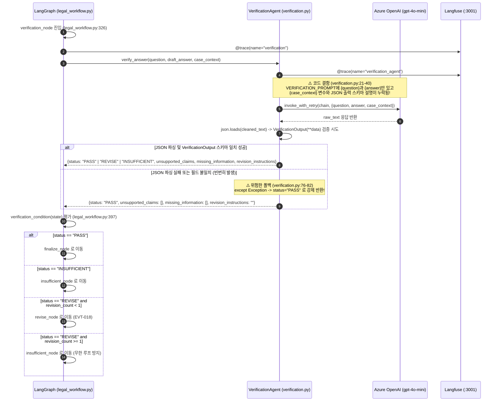

# EVT-017: 검색 결과 충분성 평가 (Verification & Sufficiency Evaluation)

## 1. 이벤트 메타데이터

| 항목 | 내용 |
|---|---|
| **이벤트 ID** | `EVT-017` |
| **이벤트 명칭** | 생성된 초안의 법률 근거·사실 정합성·정보 충분성 검증 (`VerificationAgent`) |
| **구현 상태** | **PARTIAL (결함 내포)** — `verification_node` 및 조건부 분기(`PASS`/`REVISE`/`INSUFFICIENT`)는 존재하나, 프롬프트에 `{case_context}`와 JSON 스키마가 누락되어 파싱 실패 시 무조건 `PASS`로 통과됨 |
| **발생 트리거** | `legal_workflow.py`의 `synthesize` 노드(또는 `revise` 노드) 실행 직후 `verification_node` 진입 |
| **백엔드 진입점** | [`workflows/legal_workflow.py:326-346, 397-413`](file:///c:/myprjs/ai-legal-helper/backend/src/ai_legal_helper/workflows/legal_workflow.py#L326-L346), [`agents/verification.py:13-82`](file:///c:/myprjs/ai-legal-helper/backend/src/ai_legal_helper/agents/verification.py#L13-L82) |
| **연관 저장소** | 없음 (In-Memory `LegalState.verification_result`, 추후 PostgreSQL `consultations.verification_result`에 JSON 저장) |

---

## 2. End-to-End Sequence Diagram



---

## 3. 13단계 실행 경로 상세 추적

1. **이벤트 발생 화면 및 컴포넌트**: 백그라운드 법률 상담 실행 중 내부 검증 단계.
2. **이벤트 핸들러**: [`legal_workflow.py:326`](file:///c:/myprjs/ai-legal-helper/backend/src/ai_legal_helper/workflows/legal_workflow.py#L326) `verification_node()`.
3. **호출되는 API와 HTTP Method**: 백그라운드 내부 실행.
4. **FastAPI Router**: `api/routes/consultation.py`.
5. **Service / Repository 함수**: [`agents/verification.py:43`](file:///c:/myprjs/ai-legal-helper/backend/src/ai_legal_helper/agents/verification.py#L43) `VerificationAgent.verify_answer()`.
6. **DB 읽기·쓰기**: 실행 시점에는 메모리 상태(`state["verification_result"]`)만 갱신하며, 워크플로우 종료 시 PostgreSQL `consultations.verification_result`(JSON 컬럼)에 저장된다.
7. **AI Agent 또는 RAG 호출**: `VerificationAgent` 단독 호출 (RAG 검색 결과 목록인 `retrieved_sources`는 전달받지 못함).
8. **외부 LLM·도구 호출**: `get_llm(temperature=0.0)`을 통한 Azure OpenAI 호출.
9. **응답 JSON 구조** (`VerificationOutput` — [`agents/verification.py:13-19`](file:///c:/myprjs/ai-legal-helper/backend/src/ai_legal_helper/agents/verification.py#L13-L19)):
   ```json
   {
     "status": "PASS",
     "unsupported_claims": [],
     "missing_information": [],
     "revision_instructions": ""
   }
   ```
10. **프런트엔드 상태 변경**: 폴링 완료 시 `ConsultationResponse.verification_result`로 전달됨.
11. **화면 출력**: **미표시** — [`ChatSection.tsx`](file:///c:/myprjs/ai-legal-helper/frontend/src/components/ChatSection.tsx)는 `verification_result`와 `warnings`를 화면에 렌더링하지 않는다.
12. **Langfuse 기록**: `@trace(name="verification")` 및 `@trace(name="verification_agent")` Span 기록.
13. **실패·예외 처리 및 구조적 결함**:
    - **결함 1 (프롬프트 내 JSON 스키마 및 `{case_context}` 누락)**: `VERIFICATION_PROMPT`(`verification.py:21-40`)는 `"JSON 형식으로 검증 결과를 출력하세요."`라고만 할 뿐 어떤 키(`status`, `unsupported_claims`, `missing_information`, `revision_instructions`)를 써야 하는지 알려주지 않고 `{case_context}`도 프롬프트 템플릿에 넣지 않았다.
    - **결함 2 (실패 시 `PASS` 폴백)**: LLM이 다른 키 이름으로 JSON을 반환하면 `VerificationOutput(**data)`에서 `ValidationError`가 발생하고, `except` 블록(`verification.py:80`)이 무조건 `status: "PASS"`를 반환하여 검증기가 사실상 무력화된다.

